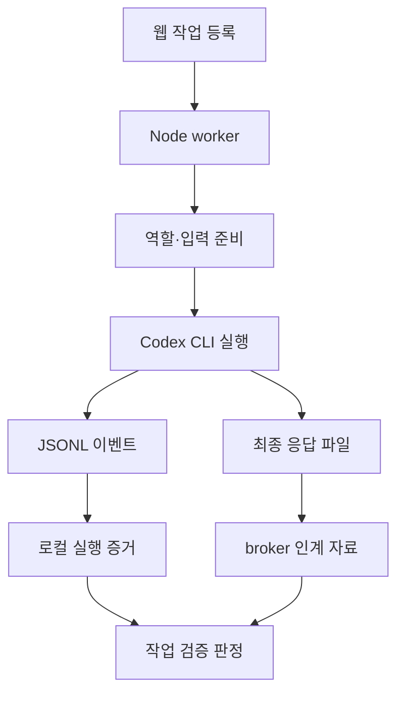

## API 키를 사용하는 경로 대신 CLI를 연결하기

imjaess는 웹 화면에서 작업을 등록하고 여러 AI 역할을 순서대로 실행하는 로컬 하네스다. 여기서 하네스는 작업 큐, 실행 공간, 역할별 입력과 결과, 검증 상태를 관리하는 프로그램을 뜻한다. TypeScript·Next.js·Node worker·SQLite로 구성했다.

처음에는 OpenAI API를 직접 호출하는 방식으로 만들었다. 당시 API 키를 사용하는 경로로 진행할 수 없어, ChatGPT 계정으로 로그인한 Codex CLI를 실행하는 경로를 추가했다. Git 이력에는 2026년 5월 21일 API 방식에서 CLI 방식으로 전환한 변경이 남아 있다.

현재 소스의 호출 경로(provider)는 `openai`, `codex-cli`, `mock` 세 가지다. 역할마다 경로를 선택할 수 있다. 이 글은 그중 CLI 연결 방식과 실행 결과를 하네스에 돌려주는 과정을 다룬다.

Codex CLI의 ChatGPT 로그인은 API 키 인증과 구분되는 공식 인증 경로다. 하네스는 CLI에 저장된 로그인 상태를 사용하도록 구성했으며, 실행에는 해당 계정의 이용 권한과 한도가 적용된다. [OpenAI 공식 인증 문서](https://learn.chatgpt.com/docs/auth), [비대화형 실행 문서](https://learn.chatgpt.com/docs/non-interactive-mode)

## 작업 흐름과 모델 호출을 분리하기

웹 화면은 작업을 등록하고 상태를 조회한다. 실제 모델 호출과 명령 실행은 서버 측 Node worker가 담당한다. 요청을 받은 웹 라우트에서 전체 AI 작업이 끝날 때까지 기다리는 구조는 피했다.

worker는 작업을 큐에서 꺼내 실행 흐름을 관리하는 오케스트레이터에 넘긴다. 오케스트레이터는 역할별 작업 공간과 프롬프트를 준비한 다음 provider를 선택한다. API provider는 SDK로 요청을 보내고, CLI provider는 `codex` 프로세스를 실행한다. 이후 단계는 각 provider가 반환한 텍스트를 같은 역할 결과로 취급한다. 역할 간 인계 자료는 broker라는 중개 계층에서 정리한다.

이렇게 호출 부분을 나누면서 CLI로 바꾸어도 작업 상태·역할 구분·검증 흐름을 유지할 수 있었다. 다만 두 provider의 내부 실행 방식과 수집할 수 있는 증거는 다르다.

실제 CLI 실행에는 mock 모드를 끄고 각 역할의 provider를 바꿔야 한다. 아래는 인증 정보가 들어 있지 않은 설정 예시다. CLI 로그인은 별도로 `codex login`에서 진행한다.

```text
MOCK_AGENTS=0
RESEARCHER_PROVIDER=codex-cli
IMPLEMENTER_PROVIDER=codex-cli
TESTER_PROVIDER=codex-cli
VERIFIER_PROVIDER=codex-cli
```

mock 모드를 켜 두면 CLI provider를 골라도 더미 결과가 반환된다. 또 웹 설정에서 저장한 역할별 값이 환경 변수보다 우선하므로 실제 적용된 provider를 확인해야 한다. API 키 필수 검사는 `openai` 경로에 있고, `codex-cli`는 CLI 실행 경로로 분기한다.

## CLI를 자식 프로세스로 실행하기

CLI 연결부(adapter)는 Node의 `spawn`으로 실행 파일과 인수 배열을 전달한다. 실행 디렉터리와 CLI의 `--cd`를 역할에 배정한 작업 공간으로 맞추고, Windows에서는 별도 콘솔 창을 표시하지 않도록 했다.

입출력에 해당하는 인수만 줄여 쓰면 다음 형태다. 실제 호출에는 모델·이미지·권한 등 별도 옵션도 들어간다.

```text
codex exec --cd <작업 공간> --json --output-last-message <결과 파일> -
```

프롬프트는 마지막 `-`에 대응하는 표준입력으로 보낸다. 긴 프롬프트를 셸 명령 문자열에 합쳐 넣지 않고, 프로세스를 시작한 뒤 `stdin`에 쓰고 닫는다. 외부 실행 기록에 표시할 명령에서도 프롬프트 본문은 생략한다.

프롬프트 본문은 명령 인수에서 빠지지만, 별도의 로컬 실행 기록에는 저장된다. 명령 표시와 프롬프트 저장 범위는 따로 관리한다.

모델을 `default`로 지정한 경우에는 `--model`을 추가하지 않아 로컬 CLI 설정을 따르게 했다. 다른 모델을 고르면 해당 인수를 전달한다. 역할별 추론 설정과 첨부 이미지도 호출 옵션으로 연결했다.

## 실행 이벤트와 최종 응답을 나누기

CLI는 터미널에서 읽을 출력뿐 아니라 자동화에서 소비할 출력도 제공한다. `--json`의 표준출력은 여러 JSON 객체가 줄마다 나오는 JSONL 스트림이며, `--output-last-message`는 최종 응답을 별도 파일로 저장한다. 하네스는 두 출력을 다른 목적으로 사용한다. [OpenAI 비대화형 실행 문서](https://learn.chatgpt.com/docs/non-interactive-mode)

| 수집 대상 | 하네스의 처리 | 사용하는 곳 |
| --- | --- | --- |
| 표준출력의 JSONL | 줄별로 파싱하고 완료된 `command_execution` 이벤트 추출 | 명령과 출력·종료 코드 기록 |
| 표준오류 | 별도로 수집 | 실행 실패 원인 확인 |
| 최종 응답 파일 | 프로세스 종료 후 읽기 | 해당 역할의 결과와 broker 인계 자료 |
| 프로세스 종료 코드 | 0이 아니면 실행 실패로 처리 | 작업 상태와 오류 표시 |

진행 이벤트가 섞인 표준출력 전체를 그대로 다음 역할의 답변으로 넘기지 않기 위해 최종 응답 파일을 우선했다. 파일을 읽은 뒤에는 임시 파일을 정리한다.

현재 구현에는 최종 파일이 없거나 비어 있으면 표준출력으로 대체하는 경로도 남아 있다. 이 경우 이벤트 스트림이 결과 텍스트에 섞일 수 있다. 최종 응답 부재를 별도 오류로 구분하는 것은 보완할 부분이다.



CLI 호출과 결과 수집 관계를 정리한 구조도다. 실제 하네스 화면 캡처는 아직 첨부하지 않았다.

## 역할 사이에는 필요한 자료만 전달하기

기본 역할은 조사하는 `researcher`, 수정하는 `implementer`, 검사하는 `tester`, 판정하는 `verifier`다. 현재 기본값인 `fast` 모드에서는 tester를 생략하고, `balanced` 모드에서는 별도 tester 실행을 포함한다.

각 CLI 실행은 배정된 역할의 입력으로 시작한다. 역할 사이에는 broker가 만든 `evidence_pack`, `implementation_brief`, `test_result`, `final_brief` 등의 자료를 전달한다. 이전 역할의 대화 전체를 다음 역할의 프롬프트에 붙이는 방식은 사용하지 않았다.

예를 들어 tester에는 구현자의 설명 전체 대신 변경 diff와 구현 커밋, 검증 명령의 결과를 담은 자료를 전달한다. verifier에는 broker 자료와 필요한 명령 증거를 모은다. 이는 프롬프트에 들어가는 정보의 범위를 나눈 설계다. 판단의 독립성이나 정확성까지 자동으로 보장하는 것은 아니다.

## 종료 코드 0과 작업 통과를 구분하기

CLI가 정상 종료했다는 것은 역할 실행이 끝났다는 뜻이다. 수정한 기능이 요구사항을 충족했는지는 별도 단계에서 판단한다.

verifier에는 `pass`, `needs_fix`, `blocked` 중 하나와 요약을 반환하도록 요청했다. 또 명시적으로 설정한 검증 명령이 실패했는데 verifier가 `pass`를 반환하면, evidence contract 검사에서 `needs_fix`로 낮추는 경로를 추가했다. 모델의 설명과 실제 명령 결과가 충돌할 때 이를 그대로 통과시키지 않기 위한 처리다.

검증 명령이 없으면 evidence contract의 명령 검증 항목을 `unknown`으로 기록한다. `fast` 모드에서 tester가 생략된 사실도 판정 입력에 표시한다. 통과 범위는 선택한 모드와 실제로 확보한 검증 증거에 한정된다.

`pass` 이후에는 검토용 브랜치를 만들고 `ready_for_review`로 둔다. 최종 확인과 기준 브랜치 반영은 이후 작업이다. Unity의 프리팹·씬·자산 변경은 이 단계에서 에디터 임포트와 실제 동작을 확인할 필요가 있다.

현재 CLI 호출에는 `--output-schema`가 없으며, 판정은 응답 텍스트에서 JSON을 찾고 실패하면 키워드로 해석한다. 공식 CLI에는 최종 출력 스키마를 지정하는 기능이 있으므로, 판정 형식을 더 엄격하게 만드는 보완 방향으로 볼 수 있다. 현재 구현한 기능과는 구분한다. [OpenAI 비대화형 실행 문서](https://learn.chatgpt.com/docs/non-interactive-mode)

## API 호출을 프로세스로 바꾸면서 생긴 제약

CLI 연결부에는 실행 파일을 찾지 못한 경우의 오류 처리, 비정상 종료 코드 확인, 표준출력·표준오류의 크기 제한이 필요했다. 로그인 상태나 CLI 옵션 호환성에 문제가 생겨도 역할 실행을 완료할 수 없다.

역할 실행에는 입력·인계 텍스트 길이와 최대 실행 시간을 정했다. 취소나 시간 초과는 `AbortSignal`로 실행 중인 CLI 프로세스에 전달한다. 코드상 이 신호가 연결된 것과, CLI가 만든 모든 자식 명령까지 즉시 정리되는 것은 다른 문제다. Windows에서의 프로세스 트리 종료는 실제 실행으로 더 확인해야 한다.

명령 증거에도 수집 범위가 있다. 현재 이벤트 해석 코드는 완료된 `command_execution` 이벤트를 추출한다. 다른 종류의 도구 이벤트를 같은 방식으로 처리하는 경로는 없다. 내부 명령 기록에 넣는 시간은 외부 CLI 실행 전체 시간이므로, 명령별 성능 측정에는 별도 계측이 필요하다.

작업 공간을 지정하는 것과 운영체제 권한을 제한하는 것도 구분해야 한다. 현재 소스의 CLI sandbox 기본값은 `danger-full-access`이며, 역할별 수정 제한 일부는 프롬프트로 전달한다. 작업 디렉터리를 지정했다는 이유만으로 폴더 밖 접근을 강제 차단한 구조라고 설명할 수는 없다.

## 확인한 범위

이번 글은 API→CLI 전환 커밋과 현재 CLI 연결부·worker·오케스트레이터·판정 코드를 읽어 정리했다. provider 설정, 실행 시간 제한, fast·balanced 흐름과 실패한 검증 명령 처리에 관한 테스트 코드도 확인했다.

해당 하네스의 테스트나 실계정 CLI 호출을 이번에 다시 실행하지는 않았다. 기존 테스트 중 mock provider로 역할 흐름을 확인하는 항목은 실제 모델의 호출 성공과 구분한다. 최신 CLI와의 종단 간 실행, 로그인 만료·한도 도달, 취소 후 자식 프로세스 잔존 여부는 추가 확인할 항목이다.

하네스는 로컬 작업 도구이며 모델 추론까지 로컬에서 수행하는 시스템은 아니다. API 키 기반 직접 호출을 사용할 수 없는 조건에서, 로그인된 CLI를 기존 작업 흐름에 연결한 구현 경험이다.

이 하네스 제작에도 AI를 사용했다. 호출 경로를 바꾸는 작업과 함께 역할별 인계, 실행 증거, 재시도와 검토 상태를 구성했다. AI 사용과 검증을 나누어 기록하는 기준은 [AI를 사용한 구현과 검증 과정](/writing/working-with-ai/)에서도 다뤘다.

게임 개발에서 여러 작업을 별도 체크아웃으로 병행한 사례는 [Git 워크트리 운영 과정](/writing/parallel-ai-worktrees/)에서 다뤘다.
