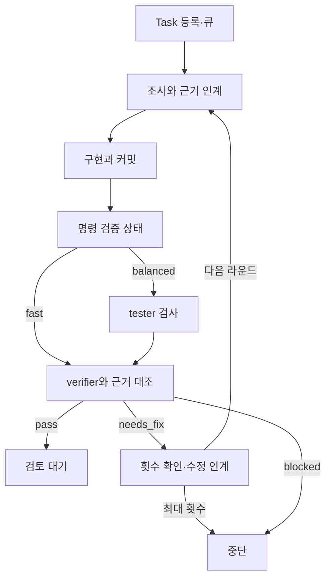

## 여러 AI 역할을 하나의 작업으로 운영하기

imjaess는 웹 화면에서 작업을 등록하고, AI의 조사·구현·검사·판정을 연결하는 로컬 하네스다. 여기서 하네스는 작업 큐, 실행 공간, 역할별 입력과 결과, 검증 상태를 관리하는 프로그램을 뜻한다. TypeScript·Next.js·Node worker·SQLite로 구성했다.

처음 정한 요구는 여러 AI 역할의 검증 과정을 하나의 Task로 묶고, 여러 Task를 병행하는 것이었다. 웹에서 진행 상태를 확인하면서 로컬 파일과 CLI 명령을 사용하고, Unity 프로젝트의 작업 규칙도 기록할 수 있어야 했다. AI를 사용해 이 요구를 구현으로 연결했다.

설계에서 나눈 경계는 **작업 등록과 실행**, **역할별 입력과 원본 로그**, **모델의 완료 응답과 실제 검증 결과**다. 이 글은 API 호출을 CLI로 바꾼 이유부터 각 경계를 코드에서 어떻게 처리했는지 설명한다.

## API 직접 호출이 막혔을 때 CLI를 선택한 이유

초기 구현은 OpenAI API를 직접 호출했다. 2026년 5월 21일 작업 기록에는 researcher 단계에서 할당량 관련 `429` 오류가 발생했다는 보고가 있다. 당시 API 키 기반 호출로 진행할 수 없는 조건에서, ChatGPT 계정으로 로그인한 Codex CLI를 실행하는 경로를 추가했다. 같은 날 전환 커밋이 남아 있다.

CLI를 선택할 때 필요한 조건은 다음과 같았다.

- 로컬에서 사용할 수 있는 인증 경로로 역할을 실행할 수 있어야 한다.
- 작업 디렉터리와 프롬프트를 프로그램에서 지정할 수 있어야 한다.
- 진행 이벤트, 최종 응답과 실패 상태를 하네스가 구분해 받을 수 있어야 한다.
- 기존의 작업 큐·역할·검증 구조에 연결할 수 있어야 한다.

Codex CLI는 ChatGPT 로그인과 API 키 인증을 지원한다. 이 프로젝트에서는 CLI가 보관한 로그인 상태를 사용하는 방식을 연결했다. 이용 가능 범위와 한도는 해당 계정의 Codex 권한을 따른다. [OpenAI 공식 인증 문서](https://learn.chatgpt.com/docs/auth)

현재 소스에는 `openai`, `codex-cli`, `mock` 세 provider가 있다. provider는 역할을 실제로 호출하는 연결부다. API 경로를 없애지 않고 CLI 경로를 추가해, 역할과 작업 상태를 유지한 채 실행 수단을 선택하도록 했다. 모델 추론은 서비스에서 수행하며, 여기서 로컬이라는 말은 하네스와 파일·명령 실행 환경을 가리킨다.

### 바꾼 부분과 유지한 부분

| 구분 | API 경로 | CLI 경로 |
| --- | --- | --- |
| 호출 | SDK의 API 요청 | Node에서 `codex exec` 프로세스 실행 |
| 인증 | API 키 필수 검사 | CLI에 저장된 인증 상태 사용 |
| 명령 수행 | 모델의 `run_shell` 도구 요청을 worker가 처리 | CLI가 실행한 명령 이벤트를 수집 |
| 역할 결과 | API 응답 텍스트 | 최종 응답 파일을 우선해서 읽음 |
| 공통 처리 | 작업 상태·역할·broker·판정 | 같은 작업 흐름에 연결 |

두 경로가 같은 문자열 결과를 반환해도 내부에서 수행한 작업과 확보한 증거는 다르다. CLI를 호출한 사실과 CLI 내부 명령을 얼마나 수집했는지는 별도로 확인해야 한다.

## 웹 요청과 장시간 AI 실행을 분리하기

웹 API는 목표·범위·대상 프로젝트·검증 모드 등을 받아 Task를 저장한다. 실행 승인이 있는 작업은 큐에 넣고 응답한다. 역할 실행 전체가 끝날 때까지 웹 요청을 유지하지 않는다.

| 구성 요소 | 실제 담당 범위 |
| --- | --- |
| 웹 UI·API | Task 생성, 설정, 상태 조회, 계획 질문 답변과 취소 요청 |
| Node worker | 실행 대기 큐, 동시 Task 수, 취소 신호 관리 |
| 오케스트레이터 | 역할 순서, 작업 공간, broker 인계, 검증 명령과 재시도 관리 |
| provider | 역할 입력을 API·CLI·mock 실행으로 연결 |
| SQLite | Task·역할 실행·broker 자료·명령 결과·판정 기록 |

worker의 큐는 Node 프로세스 안에 있고, 실행 중 Task를 `AbortController`와 함께 관리한다. 기본 동시 Task 수는 3이며 설정으로 바꿀 수 있다. **여러 Task의 병행과 한 Task 안의 역할 순서는 다르다.** 한 Task의 구현은 조사 결과를 받은 뒤 시작하고, 판정은 구현과 검증 근거를 받은 뒤 진행한다.

SQLite에 상태가 저장되는 것과 프로세스가 재시작된 뒤 실행이 자동 복구되는 것은 별개다. 현재 큐를 외부 영속 작업 시스템으로 구성한 것은 아니다.

## 역할마다 입력과 책임을 제한하기

역할을 나눈 목적은 각 실행에서 해야 할 일과 결과 판단에 사용할 정보를 정하는 데 있었다. 다음 역할에 이전 대화와 전체 실행 로그를 모두 붙이지 않고, broker가 만든 인계 자료를 전달한다.

| 역할 | 받는 자료 | 맡는 일과 전달 결과 |
| --- | --- | --- |
| `researcher` | Task 목표·범위, 참조 파일과 적용 규칙 | 실제 코드·제약 조사 → `evidence_pack` |
| `implementer` | Task, 조사 근거, 승인된 계획이 있으면 `plan_brief` | 범위 안에서 수정 → 변경 커밋과 `implementation_brief`의 입력 |
| `tester` | Task, 구현 ref, 변경 요약과 명령 검증 상태 | 별도 실행에서 검사 → `test_result` |
| `verifier` | 조사·구현·검사 인계 자료와 명령 근거 | `pass`·`needs_fix`·`blocked` → `final_brief` |

테스터에게는 구현자의 최종 설명이나 숨겨진 의도를 전달하지 않는다. 구현 커밋과 변경 요약을 기준으로 확인하도록 한다. 현재 `getDiffSummary()`가 만드는 자료는 `git diff --stat`와 `--name-status`이며, 전체 코드 패치 자체는 아니다. 테스터는 배정된 작업 공간에서 실제 파일과 커밋을 추가로 확인할 수 있다.

역할별 provider·모델·추론 설정도 분리했다. 같은 모델을 여러 역할에 배정할 수도 있다. 역할을 나눴다는 사실만으로 서로 다른 모델의 교차 검증이나 판단의 독립성이 보장되지는 않는다.

### 계획 질문과 검사 모드를 별도로 선택하기

`direct` 모드는 조사 후 구현으로 진행한다. `plan` 모드는 먼저 필요한 질문을 만들고 `waiting_for_user` 상태에서 답변을 기다린다. 현재 구현은 첫 조사와 계획 질문을 한 번의 researcher 실행에서 함께 만들도록 되어 있다. 답변을 broker 자료로 저장한 뒤 구현을 재개하며, 사용자 응답을 기다리는 시간은 역할의 실행 시간에 넣지 않는다.

검사 모드는 별도 설정이다.

- `fast`: researcher → implementer → verifier. 별도 tester 실행을 생략한다.
- `balanced`: researcher → implementer → tester → verifier. 검사 역할을 추가한다.

기본값은 `fast`다. 검증 명령을 명시하면 두 모드 모두 해당 명령의 결과를 판정에 사용한다. 명령을 설정하지 않으면 하네스가 기본 검증 명령을 임의로 실행하지 않는다.

## 역할별 작업 공간과 변경 기준을 연결하기

Git 프로젝트에서는 implementer의 작업 공간을 Task·역할·라운드별 워크트리로 만든다. 수정 결과를 커밋한 뒤 `balanced`의 tester 공간을 **그 구현 커밋에서 생성**한다. 검사 대상이 다른 브랜치의 오래된 파일이 되지 않도록 입력 ref를 연결한 것이다.

읽기 전용 조사에 별도 ref가 필요 없으면 대상 체크아웃을 사용한다. verifier는 구현 워크트리를 재사용하고, 별도 verifier 워크트리를 더 만들지 않는다. 역할 입력 분리와 물리적인 파일 공간 분리는 서로 다른 기준이다.

Git 저장소가 아닌 대상은 지정한 폴더를 직접 사용하는 대체 경로가 있다. 모든 대상이 자동으로 워크트리에 격리된다고 설명할 수는 없다. 이 하네스의 Task·역할·라운드별 작업 공간 구성은 [공용 슬롯을 사용하는 병렬 세션 운영](/writing/parallel-ai-worktrees/)과 구분되는 구현이다.

## 세션 입력과 인계 길이·실행 시간을 관리하기

`runRole()`은 실제 호출 전에 역할별 실행 정책을 적용한다. 다른 역할의 일을 다시 수행하지 않게 하고, 결과·근거·남은 위험·다음 행동을 인계하도록 지시한다. 프로젝트 규칙도 역할과 Task 태그에 맞춰 입력에 넣는다.

역할 프롬프트를 조립할 때 30,000자, broker의 본문 텍스트에는 8,000자를 기본 예산으로 적용한다. 시간은 implementer에 15분, 다른 역할에 5분을 배정한다. 값은 설정으로 조정할 수 있다. 문자 수 기준이며, CLI adapter가 덧붙이는 지침과 구조화 자료까지 포함한 모델 전체 컨텍스트의 상한은 아니다.

긴 텍스트는 앞뒤를 남기고 중간을 잘라 생략 표시를 넣는다. 의미를 보존하는 자동 요약은 아니므로, 중요한 근거가 중간에 있으면 누락될 수 있다. 입력 크기·잘림 여부·시간 제한을 실행 기록에 남겨 인계 자료가 어떤 상태였는지 확인하도록 했다. 실행 시 적용한 provider·모델·작업 공간도 함께 기록해 설정이 바뀐 뒤에도 해당 결과의 실행 조건을 확인할 수 있게 했다.

CLI 역할은 매번 새 `codex exec`로 시작한다. 현재 adapter는 이전 CLI 세션을 `resume`해서 이어 쓰지 않는다. 하네스의 Task·라운드·broker 자료가 다음 역할과 수정 라운드에 필요한 상태를 전달한다.

### 실제 CLI 경로를 선택하는 설정

실제 호출에는 mock 모드를 끄고 역할별 provider를 선택해야 한다. 다음은 인증 정보가 없는 설정 예시이며 CLI 로그인은 별도다.

```text
MOCK_AGENTS=0
RESEARCHER_PROVIDER=codex-cli
IMPLEMENTER_PROVIDER=codex-cli
TESTER_PROVIDER=codex-cli
VERIFIER_PROVIDER=codex-cli
```

웹에서 SQLite에 저장한 역할별 설정이 환경 변수보다 우선한다. `MOCK_AGENTS`가 꺼져 있지 않으면 provider를 바꿔도 mock 결과를 반환한다. 따라서 입력한 설정과 실제 적용한 provider를 구분해 확인해야 한다.

## CLI의 입력·이벤트·최종 응답을 연결하기

CLI adapter는 Node의 `spawn`에 실행 파일과 인수 배열을 전달한다. 프로세스의 `cwd`와 CLI의 `--cd`를 역할 작업 공간으로 맞추고, Windows에서는 별도 콘솔 창을 표시하지 않도록 했다.

입출력 옵션만 줄인 호출 형태는 다음과 같다. 실제 구현에는 모델·추론·이미지·권한 관련 인수도 들어간다.

```text
codex exec --cd <작업 공간> --json --output-last-message <결과 파일> -
```

프롬프트는 마지막 `-`에 대응하는 표준입력으로 전달한다. 긴 입력을 셸 명령 문자열에 이어 붙이지 않고 `stdin`에 쓰고 닫는다. 모델이 `default`이면 `--model`을 생략해 CLI 설정을 따르고, 별도 모델이면 해당 인수를 추가한다.

`--json`은 JSONL 이벤트를, `--output-last-message`는 최종 응답 파일을 제공한다. `codex exec`는 저장된 CLI 인증을 재사용할 수 있다. [OpenAI 비대화형 실행 문서](https://learn.chatgpt.com/docs/non-interactive-mode)

| 수집 대상 | 구현에서 하는 일 | 판단에 사용하는 범위 |
| --- | --- | --- |
| 표준출력 JSONL | 종료 후 줄별 파싱, 완료된 `command_execution` 이벤트 추출 | CLI 내부 명령·출력·종료 코드 |
| 표준오류 | 표준출력과 별도로 수집 | 호출 실패 원인 확인 |
| 최종 응답 파일 | 프로세스 종료 후 우선해서 읽고 임시 파일 정리 | 역할 결과와 broker 자료 생성 |
| 프로세스 종료 코드 | 0이 아니면 예외 처리 | 역할 호출 성공 여부 |

외부 CLI 호출과 추출한 내부 명령은 Task·역할·작업 디렉터리와 연결해 기록한다. 표시용 명령에는 프롬프트 본문을 생략하지만, 역할 입력은 별도의 로컬 실행 기록에 저장된다. 명령 인수에서 제외한 것과 저장하지 않는 것은 다르다.

최종 응답과 실행 이벤트를 나눈 이유는 진행 로그를 다음 역할의 답변으로 오인하지 않기 위해서다. 다만 현재 코드에는 최종 파일이 없거나 비어 있으면 표준출력으로 대체하는 경로가 남아 있다. 이 경우 JSONL이 역할 결과에 섞일 수 있어, 최종 응답 부재를 명시적인 실패로 분리하는 보완이 필요하다.

## broker에 주장과 근거·미확인 항목을 함께 담기

broker 자료에는 `EvidenceContract`를 붙인다. 5월 28일 추가된 구조로, 텍스트 설명과 판정 근거를 필드로 나눠 저장한다. contract가 있는 자료는 그 구조를 다음 역할에 전달한다.

| 필드 | 기록하는 내용 |
| --- | --- |
| `claims`·`evidence` | 주장과 근거 ID, 참조 대상과 발췌 |
| `filesTouched`·`commandsRun` | 변경 파일과 실행 명령·작업 위치·종료 코드 |
| `unverifiedAssumptions`·`residualRisks` | 확인하지 못한 가정과 남은 위험 |
| `acceptanceCriteriaStatus` | 기준별 `pass`·`fail`·`unknown`과 근거 ID |

구현 인계의 근거는 변경 요약과 구현 ref, 설정한 검증 명령 결과로 조립한다. 없는 근거 ID를 가리키는 주장은 연결을 제거하고 신뢰도를 낮추는 정규화도 있다. 다만 이 필드는 오케스트레이터가 정한 틀로 생성한다. 주장 내용이 사실인지 전부 다시 조사하는 검증기는 아니다.

예를 들어 “검증 명령을 실행했다”와 “명령이 성공했다”는 다른 사실이다. 명령과 종료 코드, 미실행 항목을 구분해 다음 역할이 판단할 수 있게 했다.

## CLI 정상 종료와 작업 통과를 분리하기

판정에는 세 단계가 있다. 먼저 CLI 프로세스가 정상 종료했는지 확인한다. 다음으로 설정한 검증 명령의 결과를 확인한다. 마지막으로 verifier의 응답을 해석하고 명령 근거와 대조한다.

| 조건 | 실제 처리 |
| --- | --- |
| CLI 호출 오류 발생 | 취소는 `canceled`, 그 밖의 호출 실패는 `blocked`로 처리 |
| verifier `pass`, 설정한 검증 명령 성공 | 검토용 브랜치 생성·갱신, `ready_for_review` |
| verifier `pass`, 설정한 검증 명령 실패 | evidence contract 검사로 `needs_fix`로 낮춤 |
| 검증 명령 미설정 | 명령 기준을 `unknown`으로 기록. 그 사실만으로 `pass`를 낮추지는 않음 |
| verifier `needs_fix` | 직전 구현 ref와 인계 자료를 사용해 다음 수정 라운드 진행 |
| verifier `blocked` 또는 최대 라운드 도달 | 작업 중단, 실패 이유 기록 |

현재 evidence contract 검사는 기준에 `fail`이 있으면 verifier의 `pass`를 그대로 채택하지 않는다. 검증 명령 실패가 대표적인 경우다. 기본 최대 라운드는 3이며 마지막 라운드에서도 해결되지 않으면 작업 상태는 `blocked`가 된다. 해당 라운드의 `needs_fix` 판정과 최종 Task 상태는 구분해서 저장한다.

다음은 Git 프로젝트에서 직접 실행하는 흐름을 간추린 구조도다. 계획 질문 대기는 생략했다.



`pass`가 나오면 검토 브랜치를 만들고 기준 브랜치에 자동 병합하지 않는다. Unity의 프리팹·씬·자산 변경은 이 결과를 가져와 에디터 임포트와 실제 동작을 확인해야 한다. 검토 대기까지를 하네스의 완료 경계로 둔 것이다.

## 구현에서 남아 있는 확인 범위

현재 verifier는 응답에서 JSON을 찾고, 실패하면 키워드로 판정한다. CLI가 지원하는 `--output-schema`는 연결하지 않았다. 형식이 모호한 응답을 엄격히 거절하고 최종 출력 스키마를 적용하는 것은 보완할 부분이다. [OpenAI CLI 옵션 문서](https://learn.chatgpt.com/docs/cli/reference)

변경 근거에도 한계가 있다. 현재 변경 요약은 커밋 전 `git diff`로 만들기 때문에 미추적 신규 파일이 요약에서 빠질 수 있다. 실제 구현 커밋과 요약의 파일 목록을 대조하고 커밋 기준 diff를 전달하도록 보완할 필요가 있다.

CLI의 표준출력·표준오류는 각각 최대 1,000,000자를 남기며 초과하면 앞부분이 잘린다. 수집하는 내부 도구 이벤트는 완료된 `command_execution`에 한정된다. 각 내부 명령 기록의 시간도 CLI 호출 전체 시간으로 넣으므로 명령별 성능 측정값으로 사용할 수 없다.

취소와 시간 초과는 `AbortSignal`로 CLI에 전달한다. 이 연결이 있다는 것과 Windows의 모든 하위 프로세스가 정리되는 것은 별도 문제다. 프로세스 트리 종료와 재시작 후 복구는 실제 실행으로 더 확인해야 한다.

현재 sandbox 기본값은 `danger-full-access`이고 일부 역할 제한은 프롬프트 지시다. 작업 디렉터리를 지정한 것만으로 운영체제 수준의 접근 차단을 구현한 것은 아니다. 컨텍스트 분리, 작업 파일 분리와 실행 권한 제한은 각각 다른 범위다.

## 직접 정한 요구와 AI를 사용한 구현

나는 다중 역할의 검증, Task 병행, 웹에서의 작업 관리와 로컬 CLI 접근을 요구했다. 역할별 모델을 고르고 결과를 확인할 수 있는 흐름을 원했고, API 호출이 막힌 뒤에는 CLI 실행으로 전환하는 방향을 진행했다. 코드와 테스트 작성에는 AI를 사용했다.

그 결과를 단일 프롬프트 실행으로 끝내지 않고, 역할 입력·작업 공간·실행 근거·판정·검토 상태로 나눠 구성했다. 어떤 실행 수단을 사용할 수 있는지 판단하고, 다음 역할에 넘길 정보를 제한하며, 모델의 응답을 명령 결과와 대조하도록 만든 부분이 이 하네스의 작업 구조다.

### 이번에 대조한 근거와 미실행 항목

API→CLI 전환 커밋, 현재 `agents`·worker·오케스트레이터·Git 작업 공간·실행 정책·evidence contract 코드를 확인했다. 전환 당시 API 오류와 초기 기능 요구도 작업 기록과 대조했다. 현재 소스에는 이후 추가한 계획 질문 통합, 검증 모드와 역할별 규칙 적용도 포함되어 있다.

테스트 코드에서는 provider 설정 우선순위, 입력·시간 제한, fast·balanced 역할 순서, 검증 명령 실패 시 판정 하향과 검토 브랜치 생성을 확인했다. **이번 보완에서 하네스 테스트를 재실행하거나 실계정 CLI를 호출한 것은 아니다.** mock 기반 테스트의 존재는 실제 모델 호출이나 기능 품질의 검증 결과와 구분한다.

최신 CLI와의 종단 간 실행, 로그인 만료·한도 도달, 취소 후 하위 프로세스, Unity 재생·화면 품질은 아직 이번에 확인하지 않았다. 역할 분리로 정확도가 높아졌다는 비교 실험이나 전체 작업 시간 절감률도 측정하지 않았다.

AI 구현 결과의 검증 범위를 나누는 기준은 [AI를 사용한 구현과 검증 과정](/writing/working-with-ai/), 공통 지침으로 여러 세션을 운영한 방식은 [병렬 AI 세션과 Git 워크트리 운영](/writing/parallel-ai-worktrees/)에서 다룬다.
