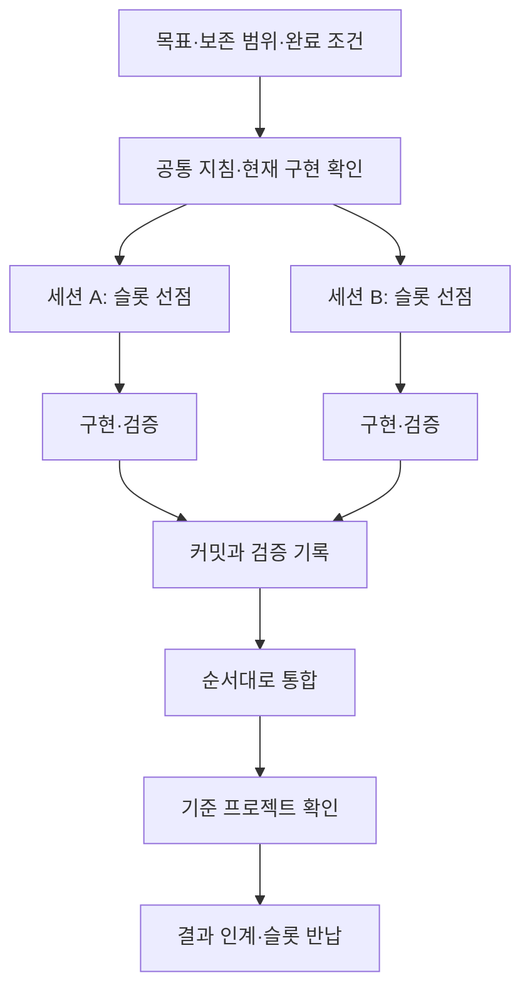

## 해결한 문제와 맡은 역할

Unity의 불·급류 포말·트레버설 작업을 여러 AI 세션에 맡기면서, 각 결과를 같은 프로젝트에 반영할 기준이 필요했다. 세션별 구현이 끝나도 공통 셰이더나 씬의 변경이 섞이면 통합하기 어려웠고, 사용 중인 Unity 에디터와 배치 검증의 작업 공간도 분리해야 했다.

나는 **작업 목표·수정 범위·보존 조건·완료 기준을 정하고, 결과를 보고 채택·수정·제외를 판단하는 역할**을 맡았다. 코드와 검증 도구 작성, 상태 조사, 배치 실행과 Git 통합에는 AI를 사용했다. 반복해서 적용할 규칙은 공통 문서로 관리하고, 작업별 커밋과 검증 기록을 받아 통합하도록 했다.

| 구분 | 담당한 내용 |
| --- | --- |
| 직접 지정한 것 | 작업 목표와 우선순위, 수정할 파일, 보존할 자산·시각 레퍼런스, 의존 입력과 완료 조건 |
| 직접 판단한 것 | 결과에 따른 수정 방향과 채택 범위. 제외한 실험은 이유와 기록을 남겨 정리하도록 요청 |
| 운영 규칙으로 정한 것 | Unity 에디터와 배치 작업의 공간 분리, 공용 슬롯의 점유·반납, 변경 성격별 검증과 산출물, 작업 범위 커밋의 순차 통합 |
| AI를 사용한 것 | 코드·검증 도구 작성, 상태 조사, 배치 실행과 Git 통합. 지침 문서의 정리와 수정 |

아래 실행 사례는 **2026년 10월 1~2일 Deluge의 작업 기록**을 근거로 한다. 공통 문서와 슬롯 절차는 **DCB의 지침 및 10월 15일 지침 정리 이력**과 대조했다. 당시 실행과 이후 정리한 운영 규칙은 구분한다.

## 실제 작업에서 판단한 세 가지

### 불·포말·SideStep: 구현은 병행하고 통합 순서는 조정

10월 1일에는 별도 슬롯에서 급류 포말과 불 작업의 세션 진행 구간이 겹쳤고, 이후 불과 SideStep 작업도 겹쳤다. 작업 공간을 분리해 각 세션이 자신의 변경을 만들도록 하되, 기준 프로젝트에 반영할 때는 커밋 범위와 다른 작업의 반영 상태를 다시 확인하도록 했다.

불·포말 작업에는 기존 변경 파일의 해시를 기록하고 통합 후에도 유지되는지 대조한 내역이 있다. 내가 보존할 범위를 지정하고, AI가 그 범위를 대조하며 작업별 변경을 전달하도록 운영한 사례다. 이 확인은 기존 파일 보존에 관한 근거이며, 효과의 품질이나 실제 게임 동작까지 증명하지는 않는다.

### 급류: 최신 검증 입력과 반영할 변경을 구분

급류를 계산하는 동안 기준 프로젝트의 지형과 공유 셰이더가 달라졌다. 결과를 최신 환경에서 비교할 필요가 있었지만, 다른 작업의 셰이더 변경까지 급류 작업의 커밋에 넣으면 변경 범위가 섞였다.

따라서 **검증에 필요한 최신 입력과 이번 세션이 반영할 파일을 따로 관리**했다. 최신 입력으로 결과를 다시 비교하고, 납품할 커밋에는 해당 작업의 변경만 포함했다. 워크트리에서 한 번 통과한 결과도 씬·공유 셰이더가 바뀐 기준 프로젝트에 통합할 때는 다시 확인해야 했다.

### StepUp: 접촉 오차가 줄어도 손목 외형이 악화한 후보는 제외

트레버설에서는 같은 Avatar·지형·입력 조건에서 정상 속도와 근접 프레임을 함께 비교했다. 10월 2일 기록에는 접촉 오차 일부가 줄었어도 늦은 구간의 손목 변형이 악화해 제외한 후보가 남아 있다. 결과를 채택할 때 위치 오차와 관절 외형을 함께 본 사례다. 상세 구현은 [IK 트레버설의 후보 비교](/writing/ik-traversal/#위치-오차와-관절-외형을-함께-본다)에서 다룬다.

제외한 실험은 채택·제외 이유와 커밋 목록을 남기고 정리하도록 요청했다. 다음 세션이 과거 실험을 적용할 기능이나 미완료 작업으로 오해하지 않도록, 코드와 함께 판단 기록도 인계했다.

## 도구별 진입점과 공통 지침을 분리하기

같은 규칙을 여러 도구의 지침에 복사하면 한쪽만 수정되기 쉽다. 세션에 매번 긴 설명을 붙이는 방식도 새 세션에서 빠뜨릴 수 있다. 그래서 도구가 처음 읽는 파일은 공통 문서로 연결하고, 규칙은 역할별 기준 문서에 모았다.

| 문서 | 담당하는 내용 | 세션에서 사용하는 이유 |
| --- | --- | --- |
| `AGENTS.md`·`CLAUDE.md` | 도구별 진입점과 읽을 문서 안내 | 시작 도구가 달라도 같은 기준에 도달한다 |
| `CONVENTIONS.md` | 코드·에셋 이름, 작성 규칙과 보존 계약 | 세션별로 다른 관례를 만들지 않는다 |
| `AI.md` | 작업 위치, 워크트리 점유·반납, 통합과 검증 | 구현 외에 작업을 마치는 절차까지 지정한다 |
| `ARCHITECTURE.md` | Manager, 데이터 흐름, 아이템·풀 구조 | 기존 구조를 먼저 확인하고 수정하게 한다 |
| `Docs/README.md`와 분야별 제작 지침 | 시스템별 기준 문서, VFX·UI·로직 등의 상세 조건 | 해당 작업에 필요한 세부 맥락을 추가한다 |

공통 지침에는 모든 작업이 지킬 기준을 두고, 상세 제작 계약은 분야별로 분리했다. 예를 들어 VFX는 고정 조건의 화면 비교와 프리팹 산출물이 필요하고, 게임 로직은 호출 경로와 데이터·직렬화 의존성 확인이 필요하다. 각 세션이 작업 분야에 맞는 문서를 직접 읽도록 연결했다.

문서를 읽었다는 보고만으로 현재 구현이 확인되는 것은 아니다. 실제 호출 코드와 씬·프리팹·재질 등의 연결을 따라가게 했다. 문서는 조사할 위치와 규칙을 제공하고, 변경 근거는 현재 소스와 자산에서 확인하는 구조다.

## 작업을 나누는 단위는 목표와 변경 범위

세션을 나눌 때는 기능 이름과 함께 **수정할 파일, 보존할 자산, 의존하는 입력, 완료 조건**을 정한다. 공통 셰이더나 같은 씬을 여러 작업이 수정한다면 통합 순서를 조정해야 한다. 파일을 다른 폴더에서 편집해도 결과 사이의 의존성은 남는다.

병행 여부를 판단할 때는 다음을 확인한다.

1. 각 세션이 독립적으로 구현하고 검증할 수 있는가?
2. 같은 코드·씬·프리팹을 고쳐야 하는가? 그렇다면 먼저 반영할 변경은 무엇인가?
3. 다른 작업의 최신 결과가 필요한가? 어떤 커밋을 입력으로 사용할 것인가?
4. 완료 후 이번 작업의 변경만 분리해 통합할 수 있는가?

다음은 실제 지침에 담긴 항목을 **개별 요청 형식으로 재구성한 예시**다. 자동 작업 등록기의 입력 형식이나 원본 대화의 인용은 아니다.

```text
목표: 지정한 효과의 외곽 표현을 개선한다.
기준: 현재 기준 브랜치와 연결된 프리팹·재질·셰이더를 먼저 확인한다.
변경 범위: 효과 자산과 해당 검증에 필요한 도구.
보존 범위: 승인된 메시·베이크, 다른 효과, 사용자의 기존 변경.
작업 위치: 캡처가 필요하므로 공용 배치 슬롯을 선점한다.
검증: 같은 카메라·노출·배경에서 변경 전후를 비교한다.
산출물: 프리팹과 의존 자산, 작업 범위만 담은 커밋, 검증 결과.
마무리: 통합한 변경과 남은 문제를 구분하고 슬롯을 반납한다.
```

결과의 모양만 요청하면 AI가 주변 자산까지 다시 만들거나, 캡처만 남기고 실제 프리팹을 전달하지 않을 수 있다. 그래서 수정할 수 있는 범위와 최종 산출물을 함께 지정했다. 범위를 넓혀야 하는 의존성이 발견되면 현재 연결과 변경 필요성을 먼저 확인한다.

## Git 워크트리로 편집·실행 공간을 분리하기

Git 워크트리는 한 저장소에서 여러 브랜치를 별도 폴더에 체크아웃하는 기능이다. 각 작업 공간의 파일과 `HEAD`·index는 분리되고, Git 객체와 브랜치 참조 등은 공유한다. 한쪽의 미커밋 변경이 다른 쪽에 자동으로 전달되지는 않는다. [Git worktree 공식 문서](https://git-scm.com/docs/git-worktree)

프로젝트의 기준 체크아웃은 사용자가 직접 작업하는 Unity 에디터용으로 유지했다. Unity 배치모드, 헤드리스 캡처, 장시간 자동 검사나 광범위한 자산 재생성은 별도 워크트리에서 실행하도록 정했다. 가벼운 문서 수정이나 기존 C#의 비배치 컴파일만 필요한 작업은 기준 체크아웃에서 처리할 수 있다.

즉, 에이전트가 요청의 성격을 보고 격리가 필요한지 판단하도록 했다. 사용자가 매번 워크트리 생성을 지시해야 배치 공간을 만드는 구조로 두지 않았다.



배치 작업 두 개의 관계를 간추린 흐름이다. 세션과 파일은 나눌 수 있지만, 같은 기준 브랜치에 반영하는 단계는 순서를 조정한다. 이 흐름은 저장소 지침에 따라 각 AI 세션이 수행하는 절차이며, 중앙 스케줄러가 모든 단계를 자동 조정하는 시스템을 구현했다는 뜻은 아니다.

## 작업별 폴더 대신 공용 실행 슬롯 사용하기

초기에는 작업 주제마다 워크트리를 만들면서 공간이 누적됐다. 운영 지침에는 한때 16개까지 늘어난 기록이 있다. 이미 통합한 작업의 체크아웃도 남아 다음 세션이 상태를 다시 판별해야 했다. 이는 누적 공간 수이며, 16개 AI가 동시에 실행됐다는 수치는 아니다.

이후에는 워크트리를 **동시에 필요한 작업 공간의 슬롯**으로 다뤘다. 도구별 전용 풀을 나누지 않고 같은 풀에서 빈 슬롯을 선점한다. 기존 슬롯이 모두 사용 중이면 다음 번호를 만들고, 작업 후에는 재사용할 수 있게 정리한다. 특정 효과나 기능 이름에 슬롯을 고정하지 않는다.

Git 객체를 공유해도 Unity 임포트 캐시와 생성 파일은 작업 공간마다 생긴다. CPU·GPU·메모리도 공유하므로, 슬롯 수를 늘리는 것과 실제 처리량이 늘어나는 것은 별도로 판단해야 한다.

### 슬롯 선택과 소유권 기록을 한 단계로 묶기

`Temp/UnityLockfile`만 확인하면 Unity를 실행하기 전의 편집 단계는 보호하지 못한다. 두 세션이 동시에 “사용 중인 Unity가 없다”고 판단한 뒤 같은 공간을 선택할 수 있기 때문이다. 확인 시점과 사용 시점 사이에 다른 작업이 끼어드는 경쟁 상태다.

이를 피하기 위해 `.ai-worktree-claim` 디렉터리를 **없을 때만 새로 생성하는 연산**으로 선점한다. 생성에 성공한 세션만 슬롯을 사용하고, 이미 존재해서 실패한 세션은 다른 슬롯을 확인한다. 기존 디렉터리에도 성공을 반환하는 생성 방식으로는 이 선점을 구현할 수 없다.

선점 직후 `owner.txt`에 도구 이름, 세션 ID와 ISO 형식의 시각을 남긴다. 슬롯을 찾는 순서는 다음과 같다.

1. 내 세션 ID로 선점한 공간이 있는지 먼저 확인한다.
2. 없다면 번호순으로 선점을 시도하고, 성공한 첫 슬롯을 사용한다.
3. 슬롯의 상태와 기준 브랜치를 확인한 뒤 구현·검증을 시작한다.
4. 통합과 결과 확인을 마치면 소유 기록을 제거한다.

Unity 잠금 파일은 실행 중 중복 사용을 막는 추가 확인으로 남긴다. 소유 기록은 편집 단계부터 적용하고, Unity 실행 상태도 별도로 확인한다. 이 규칙은 참여하는 도구가 같은 절차를 따른다는 전제의 협력 방식이다.

### 오래된 소유 기록과 세션 복구

현재 지침은 8시간 이상 지난 소유 기록을 회수 후보로 본다. 시각만 보고 지우지는 않는다. Unity 프로세스의 명령줄에서 `-projectPath`를 정규화된 절대 경로로 대조한다. 해당 프로젝트를 사용하는 프로세스가 있거나, 프로세스·경로를 확인할 수 없으면 다음 슬롯을 선택한다.

점유 프로세스가 없음을 확인한 뒤에만 잔여 잠금과 소유 기록을 회수하고 다시 선점하도록 되어 있다. 이 절차가 장시간 편집 중인 AI 세션의 종료까지 자동으로 증명하지는 못한다. 편집 세션의 소유 상태도 확인해야 하며, 불명확한 슬롯은 다른 공간을 사용하는 편이 안전하다.

컨텍스트가 끊긴 세션은 자신의 ID가 남은 슬롯을 다시 찾을 수 있다. 다만 소유 기록에는 전체 작업 맥락이 없다. 이어서 작업할 때는 현재 브랜치·diff·커밋과 남겨 둔 작업 기록을 읽어 완료한 부분과 다음 단계를 복구해야 한다.

## 완료 조건에 검증 수준과 산출물을 넣기

AI의 완료 보고는 무엇을 실행했는지 확인할 수 있어야 한다. 프로젝트 지침에서 검증 명령을 관리하고, 변경 성격에 맞는 확인을 요구했다.

| 변경·확인 대상 | 요구하는 확인 | 그 결과만으로 확정할 수 없는 것 |
| --- | --- | --- |
| 기존 C# 파일 편집 | 기존 솔루션의 `dotnet build` 컴파일 검사 | 실제 Unity 재생과 동작 |
| 신규 `.cs` 추가 | 격리 공간의 Unity 임포트와 실제 컴파일 결과 | 기존 프로젝트 파일만 빌드한 결과로 새 파일까지 확인했다는 판단 |
| 에디터 전용 API 사용 가능성 | Player 스크립트 컴파일 검사 | 에디터 컴파일 성공만으로 Player 호환성 판단 |
| VFX 형상·색·입자 수정 | 고정 카메라·노출 등의 조건에서 변경 전후 캡처 비교 | 다른 카메라·기기에서의 품질과 성능 |
| IK·접촉·이동 수정 | 해당 Avatar의 실제 동작과 관절·접촉 확인 | 일부 접촉 수치나 자동 검사 통과만으로 모션 전체의 품질 판단 |

신규 C# 파일은 Unity가 프로젝트 파일을 갱신하기 전까지 컴파일 대상에서 빠질 수 있다. 그래서 `dotnet build`의 오류가 0이라는 보고만으로 새 파일이 검증됐다고 보지 않는다. 컴파일·자동 검사·실제 재생·화면 비교·성능 측정을 구분한 이유다.

VFX는 캡처 이미지와 함께 실제 프리팹, 의존 자산과 필요한 `.meta`까지 결과에 포함하도록 했다. 결과물 이름도 완료 보고에 적게 했다. 이미지를 확인한 뒤 기준 프로젝트에서 무엇을 열어야 하는지 다시 찾는 일을 줄이기 위한 계약이다.

## 통합은 작업 범위의 커밋으로 수행하기

배치 워크트리에서는 해당 작업에 속한 변경만 커밋한다. 기존의 무관한 작업, Unity가 재생성한 파일과 슬롯 소유 기록은 제외한다. 그 커밋을 기준 브랜치로 체리픽하고 실제 반영된 diff가 의도한 범위인지 확인한다. 체리픽은 선택한 커밋의 변경을 현재 브랜치에 적용하며, 충돌은 별도로 해결해야 한다. [Git cherry-pick 공식 문서](https://git-scm.com/docs/git-cherry-pick)

통합 단계에서는 다음 순서로 확인한다.

1. 반영 직전의 브랜치·미커밋 변경과 다른 세션의 반영 상태를 확인한다.
2. 이번 작업의 커밋과 파일 범위를 대조한다.
3. 의존하는 변경부터 순서대로 적용한다. 충돌이 나면 양쪽의 의도와 현재 호출·자산 연결을 확인한다.
4. 통합 후 diff를 확인하고, 바뀐 조합에 필요한 검증을 수행한다.
5. 기준 프로젝트 반영 여부와 남은 검증을 결과에 적는다.

여러 세션이 기준 브랜치에 동시에 체리픽하는 일을 Git 워크트리가 자동으로 조정하지는 않는다. 독립 구현을 병행한 뒤에도 최종 통합 시점의 상태와 순서를 다시 확인해야 한다.

### 통합 이후의 정리도 다음 세션을 위한 작업

체리픽한 커밋은 원래 커밋과 해시가 달라질 수 있고, 통합 과정에서 패치를 조정할 수도 있다. 현재 지침은 커밋 제목을 대조해 반영 이력을 찾도록 한다. 제목은 확인할 변경을 찾는 단서이며, 최종 반영 여부는 실제 diff와 결과까지 함께 확인해야 한다.

반영을 확인한 작업용 임시 브랜치는 끝점 커밋을 기록한 뒤 정리한다. 재사용하는 슬롯 브랜치는 유지하되 기준 상태로 맞춘다. 그 전에 미추적 원본 파일과 아직 반영하지 않은 변경을 확인한다. 다른 세션이 사용 중인 공간과 보존할 백업·미반영 작업은 건드리지 않는다.

캡처와 로그도 필요한 근거를 보관한 뒤 정리한다. `.gitignore`로 제외한 파일도 별도의 디스크 공간을 사용하므로 정리 대상과 보관할 근거를 구분한다.

### 다음 세션이 이어받을 수 있는 결과 보고

한 세션의 채팅을 전부 다시 읽지 않아도 작업 상태를 확인할 수 있도록, 결과에는 변경 내용·산출물·검증과 주의점을 남기게 했다. 아래는 공통 지침의 완료 보고 항목과 작업 기록을 재구성한 인계 예시다. 모든 과거 세션이 같은 양식을 사용했다는 뜻은 아니다.

```text
목표와 결과: 무엇을 바꿨고, 요구한 범위 중 무엇을 마쳤는가?
기준과 커밋: 어느 상태에서 작업했고, 어떤 커밋으로 전달했는가?
변경 산출물: 기준 프로젝트에서 확인할 프리팹·코드·문서는 무엇인가?
보존 확인: 기존 변경과 승인된 자산을 어떻게 확인했는가?
검증 근거: 실행한 명령·조건·결과는 무엇인가?
남은 문제: 실행하지 않은 검증, 제외한 후보와 남은 결함은 무엇인가?
통합 상태: 기준 브랜치에 반영했는가? 슬롯을 반납했는가?
```

세션을 재시작할 때는 이 기록과 실제 Git 상태를 함께 확인한다. “완료했다”는 문장만 남기는 것보다 어떤 결과를 이어서 수정할지 판단하기 쉽다.

## 확인한 결과와 남은 범위

작업 기록과 Git 이력에서는 불·포말·SideStep의 세션 진행 구간 중첩, 작업별 변경의 통합, 기존 파일의 보존 대조와 StepUp 후보의 제외 기록을 확인했다. 공통 지침에서는 작업 범위·검증 수준·결과 인계를 연결하는 운영 절차를 확인했다.

이번 글 보완에서는 Unity 검증을 새로 실행하지 않았다. 선점 경쟁·비정상 종료 복구의 재현, 전체 작업 시간의 Unity 프로세스 동시 실행 측정, 개발 시간 절감률·처리량 비교도 수행하지 않았다. 이후 정리한 운영 규칙을 모든 과거 세션이 빠짐없이 따랐다고 보지는 않는다.

개별 구현은 [불 이펙트](/writing/fire-vfx/), [물 캐시 재생](/writing/water-playback/), [IK 트레버설](/writing/ik-traversal/)에서 다룬다. 검증 구분과 결과 판단은 [AI를 사용한 구현과 검증 과정](/writing/working-with-ai/)으로 연결한다. 작업 등록·역할별 실행을 별도 도구로 구성한 사례는 [CLI 기반 AI 하네스](/writing/cli-agent-harness/)에서 설명한다.
