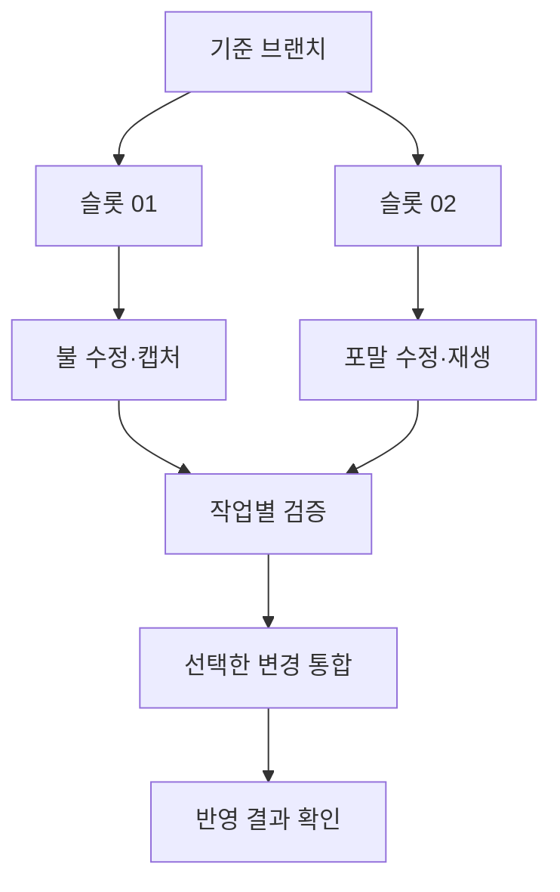

## 여러 AI 작업의 파일을 분리할 필요

Unity 프로젝트에서 불 이펙트, 급류, 캐릭터 트레버설을 여러 AI 작업 세션으로 나눠 진행했다. 한 폴더에서 함께 수정하면 어느 작업이 바꾼 파일인지 구분하기 어렵고, Unity 재저장이나 자산 임포트 결과까지 섞일 수 있다. 사용 중인 에디터와 배치 검증도 분리할 필요가 있었다.

작업용 체크아웃은 Git 워크트리로 만들었다. 기준 작업 폴더를 유지하면서 다른 폴더에서 별도 브랜치를 편집하고 Unity 검증을 실행하는 방식이다. Git 워크트리마다 작업 파일과 `HEAD`·index가 따로 있고, 저장소의 객체와 브랜치 참조 등은 공유한다. [Git worktree 공식 문서](https://git-scm.com/docs/git-worktree)

이 글의 구체적인 병행 사례는 **2026년 10월 1~2일, DCB로 이어지기 전 Deluge 프로젝트에서 수행한 작업**이다. 당시 채팅의 실행 기록, 현재 남아 있는 Git 이력과 실험 문서를 대조했다. 현재 DCB의 워크트리 운영 규칙과 과거 실행 내역은 구분해서 정리했다.

## 실제로 겹쳐 진행한 작업

10월 1일에는 다음 작업을 서로 다른 워크트리에서 진행했다. 시간은 한국 시간이며, 각 요청을 처리한 세션의 시작·종료 시각이다.

| 작업 | 세션 진행 시간 | 사용한 슬롯 | 주요 변경 |
| --- | --- | --- | --- |
| 급류 포말 개선 | 11:15~12:11 | 02 | 승인된 물 메시·베이크를 유지하면서 포말 표현 수정 |
| 불 이펙트 보강 | 12:02~12:43 | 01 | 화염 디테일, 연기와 재 레이어 보강 |
| 불 색 전이 조정 | 13:15~13:37 | 01 | 밝은 중심과 주황 외곽 사이의 전이 조정 |
| SideStep 접촉 개선 | 13:29~16:07 | 02 | 바위 이음새의 발 지지와 진입·종료 연결 개선 |

포말과 불 작업, 이후 불과 SideStep 작업의 진행 구간이 각각 겹친다. 이 기록은 별도 체크아웃에서 작업을 병행했다는 근거다. 전체 시간 동안 Unity 프로세스가 동시에 실행됐거나, 그만큼 작업 시간이 단축됐다는 측정은 아니다.

같은 불 작업도 이후에는 04·03 슬롯을 사용했다. 슬롯 번호를 특정 기능의 전용 공간으로 고정하지 않고, 사용할 수 있는 작업 공간을 재사용했다.

두 작업의 분리와 통합 관계를 간추린 흐름도다.

## 워크트리를 고르는 단계도 작업에 포함하기

워크트리가 여러 개 있어도 두 세션이 같은 폴더를 고르면 파일 분리가 깨진다. 현재 운영 규칙은 슬롯을 고르는 단계에서 소유권을 먼저 기록하도록 되어 있다.

선점용 디렉터리 생성이 성공한 세션만 슬롯을 사용한다. 그 안에 작업 세션 식별자와 시각을 기록하고, 다른 세션이 사용 중인 공간은 건너뛴다. 기존 디렉터리를 무조건 덮어쓰는 방식으로는 누가 먼저 선택했는지 구분할 수 없다.

Unity의 잠금 파일 확인도 함께 사용한다. 다만 Unity가 아직 실행되지 않은 편집 단계에는 잠금 파일만으로 작업 공간의 소유 여부를 알 수 없다. 작업 슬롯의 선점과 에디터 실행 중복 확인을 따로 둔 이유다.

과거 불·포말 작업 기록에서도 슬롯 소유 기록을 만들고 기준 브랜치와 동기화한 뒤 배치 검증을 실행한 과정을 확인했다. 오래된 소유 기록을 회수하는 세부 기준 등은 현재 지침이며, 모든 과거 작업이 지금의 절차를 동일하게 거쳤다고 보지는 않는다.

## 나눈 작업에도 공유 파일은 남는다

작업 목표가 다르다고 변경 파일이 완전히 분리되지는 않았다. 불 작업은 셰이더·재질·프리팹과 검증 도구를 함께 바꿨다. 트레버설은 런타임 코드뿐 아니라 씬에 연결된 존 프리팹과 검사 도구도 다뤘다.

급류 작업에서는 계산이 진행되는 동안 기준 프로젝트의 지형과 공유 셰이더가 달라진 사례가 있었다. 최신 지형을 다시 검증 입력으로 가져와 결과를 대조했고, 다른 작업의 셰이더 변경은 검증에 필요한 입력으로 사용했다. 그 변경을 급류 작업의 커밋에 함께 넣지는 않았다.

여기서 **검증에 사용한 파일**과 **이번 작업으로 반영할 파일**을 구분했다. 최신 환경에서 동작을 확인하려면 다른 변경이 필요할 수 있지만, 그렇다고 그 변경까지 해당 작업의 결과가 되는 것은 아니다.

이런 의존성이 생기면 기준 커밋과 입력을 다시 확인해야 한다. 워크트리가 나눠져 있다는 사실만으로 오래된 씬·프리팹에서 얻은 결과를 최신 프로젝트의 결과로 사용할 수는 없다.

## 검증한 변경만 기준 브랜치에 반영하기

일반적인 반영 흐름은 작업 범위의 파일을 커밋하고, 필요한 커밋을 기준 브랜치에 체리픽하는 방식이었다. 체리픽은 선택한 커밋의 변경을 현재 브랜치에 적용한다. 충돌과 작업 트리 상태는 별도로 확인해야 한다. [Git cherry-pick 공식 문서](https://git-scm.com/docs/git-cherry-pick)

불과 포말 작업에서는 반영 직전 기존 작업 파일을 기록하고 해시를 구한 뒤, 반영 후 그대로 남아 있는지 대조했다. 불 작업에서는 해당 범위에 별도 미커밋 변경이 있는지도 확인했다. AI가 제안한 변경을 넣는 것과, 원래 진행 중이던 작업을 보존하는 것을 함께 검증한 것이다.

반영 후에는 기준 브랜치의 diff와 작업 결과를 비교했다. 2026년 10월 17일 확인한 DCB 이력에도 불 보강과 SideStep 개선, 최종 StepUp 통합 및 실험 기록 커밋이 포함되어 있다. 이후 동작의 회귀 여부는 별도 실행 검증이 필요하다.

워크트리는 최종 반영을 자동으로 직렬화해 주지 않는다. 여러 세션이 같은 기준 브랜치를 갱신할 때는 반영 직전 상태를 다시 확인하고 순서를 조정해야 한다.

## StepUp에서 채택하지 않은 실험을 정리한 과정

StepUp 작업에는 접촉·공중 이동·손목·보행 연결을 바꾸는 여러 후보가 생겼다. 검사에 통과한 후보라도 실제 Avatar 재생에서 관절이나 접촉이 나빠지면 최종 조합에 넣지 않았다. 일부 후보는 실제 재검증을 마치지 못해 제외했다.

최종 반영 범위를 정할 때는 검증한 소스를 기준으로 삼고, 다른 후보에서 필요한 보행 IK 보정 두 파일만 선택했다. 작업 브랜치의 모든 변경을 한꺼번에 합치지 않았다.

당시 최종 조합의 Unity 임포트·EditMode 통합 검사는 2,044개가 통과했다. 높은 턱의 발 튐과 손 접촉 오차는 남아 있어 모션 전체가 완성됐다고 기록하지 않았다. 이번 글을 작성하며 그 Unity 검사를 다시 실행한 것은 아니다.

이후 슬롯 03에는 기준 브랜치에 없는 중간 커밋 해시 218개가 남아 있었다. 최종 변경이 이미 별도 커밋으로 통합되어 있었기 때문에, 이 수를 그대로 미반영 기능의 수로 볼 수 없었다.

중간 이력을 정리하기 전에 채택·제외 이유를 문서와 커밋 목록으로 남기고, 최종 변경의 반영 여부를 확인했다. 당시 기록에는 슬롯 03의 미합류 커밋 수를 218개에서 0개로 맞춘 결과가 남아 있다. 실험 목록에도 해당 출처의 218개 커밋을 보존했다. 실패한 실험의 설명은 유지하면서, 다음 작업에서 불필요한 중간 이력을 미완료 작업으로 오해하지 않도록 정리했다.

## 워크트리를 늘리는 데도 비용이 있었다

초기에는 작업 주제마다 공간을 만들면서 워크트리가 누적됐다. 운영 지침에는 한때 16개까지 늘어난 기록이 있다. 이 수는 같은 시각에 16개 작업을 실행했다는 의미가 아니다.

Git 객체를 공유해도 Unity의 임포트 캐시와 생성 파일은 각 작업 공간에서 저장 공간을 차지한다. 여러 검증을 함께 돌리면 CPU·GPU·메모리도 나눠 써야 한다. 작업 공간 수만큼 실행 성능이 늘어나지는 않는다.

이후 규칙은 필요한 동시 작업 수만큼 슬롯을 확보하고, 작업 후 소유권을 반납하는 방식으로 정리했다. 이미 통합한 결과와 미추적 원본 파일을 확인한 뒤 슬롯을 기준 상태로 맞추거나 불필요한 작업 공간을 정리한다. 진행 중인 다른 세션의 작업은 이 정리 대상에 넣지 않는다.

## AI에 맡긴 부분과 판단한 부분

AI를 작업 코드와 검증 도구 작성, 워크트리 상태 확인, 배치 실행과 변경 통합에 사용했다. 나는 작업 목표와 우선순위, 시각 레퍼런스를 지정하고 결과를 보며 수정 방향을 요청했다. StepUp 실험은 최종 범위를 정해 마무리하고, 채택하지 않은 시도는 기록으로 남기도록 했다.

이 경험에서 설명할 수 있는 부분은 작업을 나누는 기준, 공유 파일과 검증 입력의 관리, 기존 변경 보존, 채택할 결과와 남길 문제를 구분한 과정이다. 전체 개발 시간의 절감률은 측정하지 않았다.

이번 정리는 과거 실행 기록과 Git 이력·현재 운영 지침을 대조한 결과다. 원본 로그와 비공개 소스는 첨부하지 않았다. 개별 기능은 [불 이펙트](/writing/fire-vfx/), [물 캐시 재생](/writing/water-playback/), [IK 트레버설](/writing/ik-traversal/)에서 다루며, 검증 구분은 [AI를 사용한 구현과 검증 과정](/writing/working-with-ai/)으로 연결한다.

작업 등록과 역할별 실행을 도구로 구성한 별도 사례는 [CLI 기반 AI 하네스](/writing/cli-agent-harness/)에서 다뤘다.
