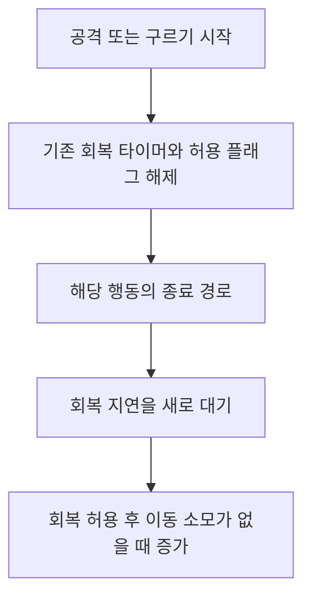

## 행동 비용과 다음 회복의 시작점을 함께 봅니다

<div id="행동-비용과-다음-회복의-시작점을-함께-본다" aria-hidden="true" style="scroll-margin-top: 90px;"></div>

DCB에서는 공격·구르기·패리에 스태미너를 한 번씩 사용합니다. 공격의 기준 비용은 현재 오른손 무기의 데이터에서 가져올 수 있고, 구르기·패리는 공통 밸런스 설정을 사용합니다. 여기에 맨몸·지게 착용 상태의 행동 배율과 적재 배율을 적용합니다.

같은 비용을 차감해도 언제 회복을 허용하는지에 따라 연속 행동의 간격이 달라집니다. 공격은 공격 흐름이 끝난 뒤, 구르기는 종료를 감지한 경로에서 회복 지연을 다시 시작합니다. **패리에는 현재 이와 같은 종료 후 회복 재시작 처리가 없습니다.** 세 행동을 모두 같은 회복 규칙으로 소개하면 실제 코드와 어긋납니다.

행동 배율을 지게 부담에 연결하고, 차감 시점과 회복 타이머를 분리했습니다. 구르기 실패 복구와 패리 안전장치도 함께 설명합니다.

## 기준 비용은 어디서 가져오는가

공통 행동 설정은 `GameBalanceCatalog`의 `wanderer.actions`에 있고, `PlayerAttributeController.Initialize()`와 `ApplyBalance()`를 통해 플레이어에 적용됩니다. 현재 저장된 기본 공격·구르기·패리 비용은 각각 10, 회복 지연은 0.3초입니다. 속성 컨트롤러 프리팹도 같은 값을 저장하고 있습니다.

공격은 `ResolveAttackStaminaCost()`에서 오른손 `WeaponItemStatus.StaminaCost`를 먼저 확인합니다. 무기가 없거나 맨손 종류이거나 비용이 0 이하이면 기본 공격 비용 10으로 돌아갑니다. 따라서 무기 시트에 0을 적는 것만으로 무료 공격이 되지는 않습니다. 장비 데이터의 `StaminaCost`는 무기 테이블의 `staminaCost`에서 들어옵니다.

`Player.Attribute`는 이 기준 비용에 `ActionStaminaCostRate`를 곱합니다. 해당 배율은 착용 모드의 행동 배율과 적재 소모 곡선의 곱입니다.

```text
행동 비용 = 행동 기준 비용 × 착용 모드 행동 배율 × 적재 소모 배율

현재 맨몸 행동 배율 = 1.0
현재 지게 행동 배율 = 1.2
현재 저장된 적재 소모 배율 = 1.0
```

| 행동 | 기준 비용의 출처 | 맨몸 비용 | 지게 비용 |
| --- | --- | --- | --- |
| 일반 공격 | 유효한 무기 비용, 없으면 기본 10 | 기준 비용 × 1.0 | 기준 비용 × 1.2 |
| 구르기 | 카탈로그 10 | 10 | 12 |
| 패리 | 카탈로그 10 | 10 | 12 |

현재 적재 곡선은 배율 1이므로 짐을 추가로 실었다는 이유로 이 표의 비용이 더 늘지는 않습니다. 착용 자체의 배율과 적재량에 따른 추가 배율은 구분합니다. 지게 행동 배율을 적용한 결과가 소수일 수도 있어, 플레이어의 구르기·패리 비용 속성도 정수에서 실수로 바꿨습니다.

예를 들어 **가상의 무기 비용이 17**이라면 지게를 진 공격 비용은 `17 × 1.2 = 20.4`입니다. 17은 기존 비용 선택 검사에도 쓰인 예시이며 현재 게임에서 장착한 무기의 실제 값이나 실측 차감량이라는 뜻은 아닙니다.

### 행동 가능 판정은 전체 비용을 보유했는지와 다릅니다

<div id="행동-가능-판정은-전체-비용을-보유했는지와-다르다" aria-hidden="true" style="scroll-margin-top: 90px;"></div>

일반 공격 입력·콤보 진입·구르기·패리는 각자의 다른 허용 조건과 함께 `CanConsumeStamina()`를 확인합니다. 이 함수의 자원 조건은 **현재 스태미너가 0보다 큰가**입니다. 비용 12를 전부 낼 수 있는지 검사하는 구조는 아닙니다.

`ConsumeStamina()`는 양의 자원에서 비용을 빼고 음수가 되면 0으로 제한합니다. 다른 조건을 충족한 지게 구르기를 스태미너 3에서 시작한다면, 비용 12 때문에 시작을 거절하는 대신 3을 모두 쓰고 0이 되는 계산입니다.

또한 `ConsumeStamina()` 자체는 회복 타이머를 초기화하지 않습니다. **차감 함수 호출과 회복 중단·재개는 서로 다른 경로**입니다. 비용을 바꾸는 일과 행동 가능 조건을 바꾸는 일도 별도 조정으로 봐야 합니다.

## 공격은 입력보다 Animator 상태 진입에 비용을 연결했습니다

<div id="공격은-입력보다-animator-상태-진입에-비용을-연결했다" aria-hidden="true" style="scroll-margin-top: 90px;"></div>

일반 공격 입력의 `StartPrimaryAttack()`은 스태미너와 이동 상태를 확인해 일반 공격 또는 질주 공격 코루틴을 시작합니다. 일반 `Attack()`은 공격 중 상태를 켜고 기존 회복 타이머를 끕니다. 콤보를 진행할 때도 자원을 다시 확인하고 회복 중단을 유지합니다.

실제 차감은 `PlayerAnimatorSMB`의 공격 상태 진입에서 `DispatchPlayerAttackStarted()`를 호출하고, 플레이어가 등록한 리스너가 `ConsumeStamina(attackCost)`를 실행하는 경로입니다. 기본 Wanderer 컨트롤러의 SMB 연결도 확인했습니다.

이 구조에서는 버튼을 눌렀다는 사실만으로 비용을 먼저 차감하지 않습니다. 반대로 공격 상태에 들어갔다면 적중 여부를 기다리지 않습니다. 빗나간 공격도 이 이벤트의 비용 대상입니다. 콤보 역시 각 공격 상태의 진입을 기준으로 봐야 하며, 한 번의 공격 입력 묶음에 비용을 한 번만 낸다고 설명할 수 없습니다.

차징 준비 상태와 일반 공격·질주 공격의 이벤트 분기는 다르고, 처형 상태는 일반 공격 이벤트 분기에서 제외합니다. 이 글의 비용 설명을 모든 특수 공격·활·처형의 공통 비용표로 확대하지 않습니다.

일반 `Attack()`은 공격 흐름과 마지막 `IsAttackToIdle` 복귀를 기다린 뒤 `IsAttacking`을 내리고 `PlayRegenStaminaCoroutine()`을 호출합니다. 일반 입력부터 차감을 거쳐 정상 종료하는 책임은 다음과 같이 나뉩니다.

1. 입력 경로가 행동 시작 가능 여부를 확인합니다.
2. 공격 코루틴이 회복을 중단하고 공격 흐름을 진행합니다.
3. Animator 공격 상태 진입 이벤트가 현재 장비·착용 조건의 비용을 차감합니다.
4. 공격 코루틴의 정상 종료 경로가 회복 지연을 다시 시작합니다.

새 공격이나 다른 행동이 지연 중에 들어오면 그 행동의 중단 경로가 기존 타이머를 지웁니다. 중간 피격·행동 취소·무기 전환까지 모두 정상 종료와 같은 결과를 보장하는지는 별도 재현이 필요합니다.

## 구르기는 시작 실패와 정상 종료를 나눠 복구합니다

<div id="구르기는-시작-실패와-정상-종료를-나눠-복구한다" aria-hidden="true" style="scroll-margin-top: 90px;"></div>

`Roll()`은 구르기 허용 여부와 양의 스태미너를 확인합니다. 회피 방향을 정하고 질주를 취소한 뒤, **차감 직전 자원을 저장하고 구르기 비용을 먼저 차감**합니다. 이후 재구르기를 막고 회복을 끄며 애니메이션 트리거를 보냅니다.

여기서는 트리거를 보낸 것과 실제 구르기 진입을 구분해야 했습니다. 현재 상태에서 Roll 전이가 불가능하면 트리거가 나중까지 남아 엉뚱한 시점에 구르거나, 대기 코루틴이 끝나지 않아 `CanRoll=false`와 무적이 남을 수 있었습니다. 이 시작 실패를 복구하는 경로를 추가했습니다.

시작 대기 중 `ModelController.IsRolling`도 꺼져 있고 0.3초 이상 기다렸다면 트리거를 지웁니다. 저장한 스태미너로 복원하고 무적·회피 방향을 정리한 뒤 다시 구르기를 허용합니다. 이어 회복 지연을 새로 시작하고 코루틴을 끝냅니다. 이미 진입 전이가 시작됐다면 같은 타임아웃을 무조건 적용하지 않습니다.

이때 0.3초는 **구르기 시작 실패를 판단하는 상수**입니다. 카탈로그의 회복 지연도 현재는 0.3초지만 서로 다른 값과 책임입니다. 회복 지연을 조정한다고 시작 실패 제한이 같이 바뀌지는 않습니다.

스태미너 복원은 비용만 더하는 방식이 아니라 차감 직전 값으로 대입하는 방식입니다. 그 대기 중 다른 차감·회복이 겹쳤을 때의 결과는 따로 검증해야 합니다. 구르기 전체를 언제 취소해도 비용을 환불하는 구조는 아닙니다.

정상 구르기는 Roll 상태에서 빠져나가는 전환을 감지한 경로에서 무적을 해제하고 회복 지연과 구르기 간격 처리를 시작합니다. 회피 방향은 모션이 완전히 끝난 뒤 별도로 정리합니다. 따라서 **회복 지연 시작과 탈출 크로스페이드 종료를 같은 시점으로 보면 안 됩니다.** 현재 구조가 방향 정리를 기다린 뒤 회복을 시작하도록 함께 미루는 것은 아닙니다.

## 회복 지연과 회복량은 별도로 계산합니다

<div id="회복-지연과-회복량은-별도로-계산한다" aria-hidden="true" style="scroll-margin-top: 90px;"></div>

회복을 제어하는 공통 함수는 세 부분입니다.

- `RemoveRegenStaminaCoroutine()`은 기존 지연 코루틴을 중단하고 회복 허용 플래그를 끕니다.
- `PlayRegenStaminaCoroutine()`은 위 중단 처리를 먼저 호출한 뒤 새 지연 코루틴을 시작합니다.
- `RegenStaminaTimer()`는 현재 적용된 지연을 기다리고 회복 허용 플래그를 켭니다.

따라서 재시작 요청은 이전 대기 시간에 이어 붙이는 방식이 아닙니다. 새로 읽은 지연을 처음부터 기다립니다. 대기가 시작된 후 설정값을 바꾼 경우 이미 만들어진 대기까지 자동 갱신하는 구조로 설명할 수도 없습니다.



위 도식은 공격·구르기의 정상 종료 책임을 요약한 것입니다. 패리에는 아래의 다른 경로가 있고, 실제 프레임별 재생을 촬영한 자료는 아닙니다.

실제 자원 증가는 플레이어의 `FixedUpdate`에서 처리합니다. 초기화·생존·일시정지 등의 갱신 조건을 통과하고, 최대치 미만이며 회복 허용 플래그가 켜져 있고 이동 소모 중이 아니어야 합니다. 최대치에 도달하면 회복 플래그를 끕니다.

```text
조건 반영 회복 시간 = 시트의 StaminaRegen × 배고픔 회복 시간 배율 × 갈증 회복 시간 배율
최종 초당 회복량 = 최대 스태미너 ÷ 조건 반영 회복 시간 × 착용·이동 중·적재 회복 배율
이번 스텝 회복량 = 최종 초당 회복량 × Time.fixedDeltaTime
```

여기서 `StaminaRegen`은 시트가 공급하는 회복 시간 성격의 값이며, 카탈로그의 `StaminaRegenDelay`와 다릅니다. **지연은 언제 회복을 허용할지, 회복량은 허용된 뒤 얼마나 채울지**를 정합니다. 실제 최대 자원·시트 값·배고픔과 갈증 등의 영향을 고정하지 않고 총 회복 시간을 숫자 하나로 단정하지 않습니다.

이동 소모가 끝나는 `StopLocomotionStaminaDrain()`도 회복을 재개할 수 있습니다. 다만 공격·패리·구르기 중에는 여기서 타이머를 시작하지 않도록 조건을 둡니다.

## 배고픔·갈증이 바꾸는 회복·운반 한도·이동·체력

`HungerSystem`과 `ThirstSystem`은 플레이어 생성 시 시작하고, 공통 `PlayerNeedSystemBase`가 자원을 줄이며 단계에 맞는 보정을 등록합니다. 값은 카탈로그의 `wanderer.needs`에서 읽습니다. **문턱 25와 10은 최대치 대비 비율이 아니라 현재 자원의 절대값**이며, 정확히 25나 10이어도 해당 단계입니다.

| 자원과 조건 | 현재 저장값 | 실제 적용 대상 |
| --- | --- | --- |
| 배고픔 25 이하 | 회복 패널티 `+1.1` | `StaminaRegen` 회복 시간 ×2.1 |
| 갈증 25 이하 | 회복 패널티 `+1.1` | `StaminaRegen` 회복 시간 ×2.1 |
| 배고픔 10 이하 | 운반 패널티 `-0.3` | 플레이어 `WeightCapacity` ×0.7 |
| 갈증 10 이하 | 이동 패널티 `-0.2` | `MoveSpeed`의 갈증 보정 ×0.8 |
| 배고픔 0 | 체력 피해 2/초 | 배고픔 원인의 체력 차감 |
| 갈증 0 | 체력 피해 2/초 | 갈증 원인의 체력 차감 |
| 두 자원의 단계별 기본 능력치 보정 | 1·2단계 모두 0 | 근력·체력 등의 추가 감소는 현재 비활성 |

25 이하에서 걸린 회복 패널티는 10 이하와 0에서도 유지됩니다. 이 보정은 앞에서 본 차감 비용이나 0.3초 회복 지연을 바꾸지 않고, 회복이 허용된 뒤 채워지는 양과 이동·운반 조건을 바꿉니다.

`PlayerStat`은 보정마다 `1 + modifierRate`를 곱하므로 회복 패널티 1.1은 회복 시간 2.1배입니다. 두 자원이 모두 25 이하이면 2.1 × 2.1 = 4.41배가 되어 초당 회복량은 정상의 약 22.7%다. 예를 들어 최대 스태미너 100, 회복 시간 5초를 가정하면 정상 20/초가 약 4.54/초로 줄고, 지게 걷기의 회복 배율 0.48까지 곱하면 약 2.18/초입니다. 이동 소모 중이거나 회복 허용 플래그가 꺼져 있으면 적용되지 않습니다.

배고픔의 `WeightCapacity`는 플레이어의 운반 가능 무게이지 지게 화물의 적재 용량이 아닙니다. 줄어든 한도를 넘으면 과적이 되고, 과적은 자원 감소를 빠르게 하는 조건에도 연결됩니다. 갈증의 `MoveSpeed` 보정은 기존 속도 수정자에 등록돼 다른 수정자와 곱해집니다. 기준 속도 4.19에 갈증 보정만 적용하면 3.352이며, 실제 이동에는 무게·경사·물속 보정이 더 관여합니다. 그 중첩은 [인벤토리 무게·갈증·물속 감속의 중첩](/writing/movement-speed-modifier-stacking/)에서 다룹니다.

자원 감소는 음식·물 보충과 환경 수정자를 제외하면 10초당 다음과 같습니다. 실제 갱신은 고정 스텝에 맞춰 나눠 적용합니다.

| 조건 | 배고픔 감소/10초 | 갈증 감소/10초 |
| --- | --- | --- |
| 평소 | 2.5 | 1.5 |
| 질주 또는 과적 한 가지 | 4 | 3 |
| 질주와 과적 동시 | 5.5 | 4.5 |

질주·과적은 원인마다 `ActiveDecayPer10s - BaseDecayPer10s`를 더하므로 둘이 겹치면 합산됩니다. 질주 통지는 `StartSprint()`와 `CancleSprint()`에 연결돼 있어 지게의 일반 달리기 `MOVE_STATE`는 질주로 치지 않습니다. 두 자원이 모두 0이면 각각 2/초, 합계 4/초의 체력 차감 경로가 되고, 이 차감은 방어·피격 계산을 거치지 않습니다. 로비에서는 자연 감소와 체력 피해를 막지만 이미 낮아진 수치의 보정은 유지합니다.

문턱을 다시 넘으면 다음 갱신에서 수정자를 해제하고, 같은 단계에서 카탈로그 배율이 바뀌면 다시 등록합니다. 기본 능력치 보정과 `CalcGritPenaltyReduction()`은 현재 0이며, 코드의 오래된 50·25 문턱 주석 대신 현재 카탈로그를 기준으로 썼습니다.

## 패리는 비용과 모션 복구가 있지만 회복 경로는 다릅니다

<div id="패리는-비용과-모션-복구가-있지만-회복-경로는-다르다" aria-hidden="true" style="scroll-margin-top: 90px;"></div>

`Parry()`는 무기 넣기 상태·장애물 동작·장비·중복 패리·구르기·처형 모션 등의 조건을 확인한 뒤, 양의 스태미너가 있으면 패리 비용을 차감합니다. 이어 `CancleSprint()`, `GuardOff(0f, false)`, 패리 코루틴 시작을 순서대로 호출합니다.

패리 코루틴은 플레이어의 패리 플래그, 이동·회전 감속과 판정 콜라이더를 정리합니다. 판정 창은 `ParryWindowSMB`가 담당하고, 코루틴에는 최대 1.5초의 상태 정리 제한이 있습니다. 모션 미배선 등으로 패리 상태가 계속 남는 문제를 다룬 별도 장치입니다.

스태미너 회복은 다음처럼 연결돼 있습니다.

| 확인 위치 | 현재 코드에서 하는 일 | 해석할 때 주의할 점 |
| --- | --- | --- |
| `CancleSprint()` | 회복 지연 시작 | 패리 진입 중에도 호출되며 패리 종료 시각 기준이 아님 |
| `GuardOff(0f, false)` | 가드를 내리되 가드 해제에 의한 재생 요청은 생략 | 앞에서 시작된 회복 타이머를 취소하는 함수는 아님 |
| `ParryCoroutine()` | 패리 상태·감속·콜라이더 정리 | 회복 타이머 중단이나 종료 후 재시작 호출 없음 |
| 플레이어 회복 갱신 | 회복 허용·이동 소모 여부 확인 | 이 갱신 조건 자체에는 `IsParrying` 검사 없음 |

따라서 현재 소스만 보면, 다른 경로가 타이머를 끊지 않고 이동 소모도 없다면 패리 종료 이전에 지연이 끝나 회복할 가능성이 있습니다. 반대로 이동 소모 종료 시점에 패리 플래그가 켜져 있으면 그 경로에서는 재개 요청을 생략합니다. 이후 어떤 타이머가 남아 있는지는 호출 순서까지 기록해야 합니다.

또한 이동 소모를 제외하는 `TryGetMovingGait()`의 조건에는 공격·구르기 등이 있지만 패리 플래그는 없습니다. 이동 요청과 비용 있는 걸음이 유지되는 조건에서는 **패리의 이동 감속과 별개로 이동 소모가 이어지는지** 확인할 필요가 있습니다. 실제 이동량 0과 이동 입력 없음도 같은 조건이 아닙니다.

  1.5초 정리 장치도 비용 환불이나 회복 재시작까지 처리하지 않습니다.

## 비용과 회복 경로를 연결한 과정

| 순서 | 변경 | 적용 범위 |
| --- | --- | --- |
| 1 | 회복 지연 코루틴과 공격·구르기의 재개 호출 추가 | 공격·구르기 후 회복 재개 시점 제어 |
| 2 | Roll 시작 실패의 트리거·무적·입력 잠금·자원 복원 | 실패해도 비용·상태가 남던 문제의 복구 방식 |
| 3 | 칼 패리 장비 허용, 중복 진입 제한·판정 창·상태 정리 제한 | 패리 모션·상태 책임. 회복 종료 처리를 추가한 작업은 아님 |
| 4 | 행동 설정 집중과 유효한 무기 공격 비용 선택 | 무기 비용과 기본 비용의 우선순위 |
| 5 | 착용·적재 행동 배율, 실수 비용, 이동 소모와 회복 제어 연결 | 현재 비용 계산을 설명하는 대표 작업 |
| 6 | 배고픔·갈증 규칙을 카탈로그로 이동, 같은 단계의 변경값 재적용·능력치 보정 부호 수정 | 현재 문턱·보정·감소 설정과 도구 연결. 원래 값은 유지한 이력 |
| 7 | 자원 시스템의 플레이어 수명·로비 조건 보강 | 현재 로비의 0 자원 체력 피해 제외와 갱신 종료 조건 |

## 담당 범위와 관련 분석

장비 비용의 적용, 착용·적재 배율, 차감과 회복 제어의 분리, 구르기 실패 복구와 패리 상태 정리를 담당했습니다. 구르기 안전장치·패리 확장·지게 부담 코드는 AI와 함께 작성했습니다.

앞선 [이동 전환·고갈 후 재입력](/writing/locomotion-stamina-reinput/)은 지속 이동 소모와 입력 기록을 다룹니다. [운반의 속도·스태미너 계산](/writing/jige-carry-burden/)과 함께 보면 같은 자원을 쓰는 이동 비용과 행동 비용이 어디서 합쳐지는지 확인할 수 있습니다. 다음 이동 보정·행동 중 입력 제약 분석은 [게임플레이 밸런싱과 제어 목록](/projects/dcb/features/gameplay-balancing/)에서 이어집니다.
