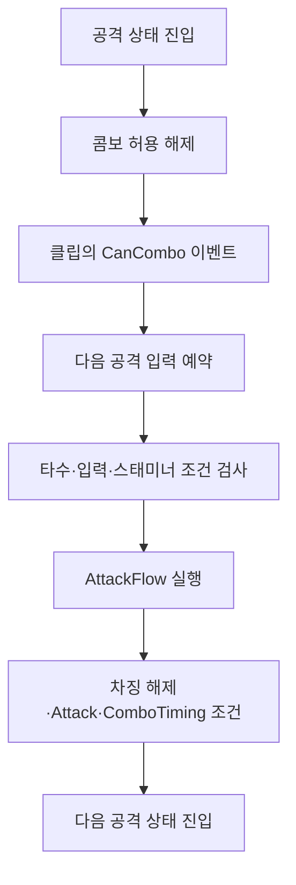

`AnimatorSMB`는 원하는 정확한 애니메이션 상태에서 원하는 동작을 실행하기 위한 구성입니다. 제작 목적은 상태의 시작·종료와 전환 처리를 애니메이션 이벤트 키에 의존해 연결하는 방식을 지양하고, Animator의 실제 상태 변화를 기준으로 동작을 제어하는 데 있습니다.

DCB의 공격은 애니메이션의 진행에 맞춰 입력 조건이 바뀝니다. 공격을 시작하면 콤보 입력을 잠그고, 정해진 구간에서 다음 타를 받아들입니다. 차징 중에는 버튼을 놓는 시점을 확인하며, 공격이 대기나 이동으로 돌아오면 행동 상태를 정리합니다.

`StateMachineBehaviour`를 상속해 Animator의 상태 진입·갱신·이탈을 게임 코드에 전달하고, 상태 사이의 전환 시작·진행·종료를 감지합니다. 파생 클래스는 플레이어 동작과 레이어별 처리를 나누어 공격·차징·구르기·가드·채집을 담당합니다. 상태 단위의 동작은 SMB에 연결하고, 콤보 허용처럼 클립 내부의 특정 시점이 필요한 처리는 Animation Event로 지정합니다.

## 상태 콜백과 상속 구조

Unity의 [`StateMachineBehaviour`](https://docs.unity3d.com/6000.0/Documentation/ScriptReference/StateMachineBehaviour.html)는 Animator 상태에 붙여 동작하는 스크립트입니다. 상태가 평가되기 시작할 때 `OnStateEnter`, 갱신 중에는 `OnStateUpdate`, 마지막으로 평가될 때 `OnStateExit`를 받습니다. DCB의 `AnimatorSMB`는 이 콜백을 받아 처리하는 공통 기반입니다.

```text
StateMachineBehaviour
└─ AnimatorSMB
   ├─ AnimatorSMBBaseLayer
   │  └─ PlayerAnimatorSMB
   └─ AnimatorSMBGuardLayer
      └─ PlayerGuardAnimatorSMB
```

`AnimatorSMB`는 상태와 전환을 감지합니다. 중간 클래스는 `layerIndex`를 검사해 Base 또는 Guard 레이어의 호출을 통과시킵니다. 마지막 파생 클래스가 상태 이름과 태그를 판별하고, `ModelController`의 행동 상태를 바꿉니다.

예를 들어 `Attack` 태그는 일반 공격이라는 공통 분류에 사용합니다. `Attack_01`, `Attack_02` 같은 상태 이름은 현재 몇 번째 공격인지 구분하는 데 사용합니다. 여러 공격 상태가 같은 시작 처리를 공유하면서도, 타수에 따른 공격 데이터는 각각 선택할 수 있습니다.

## 상태 진입과 전환 완료의 구분

두 모션을 블렌딩하는 동안에는 이전 상태와 다음 상태의 평가가 겹칠 수 있습니다. 다음 공격 상태에 들어왔다는 사실만으로 이전 클립의 영향까지 끝났다고 판단하면, 입력 잠금이나 이벤트 초기화 시점이 어긋납니다.

그래서 상태 콜백과 별도로 [`Animator.IsInTransition(layerIndex)`](https://docs.unity3d.com/6000.0/Documentation/ScriptReference/Animator.IsInTransition.html)을 확인합니다. 이전 갱신에서 저장한 값과 현재 값을 비교해 전환을 감지합니다.

| 이전 값 → 현재 값 | 호출하는 확장 함수 | 쓰임 |
| --- | --- | --- |
| `false → true` | `OnTransitionStarted` | 다음 행동으로 넘어가기 시작할 때 상태 설정 |
| 현재 값이 `true` | `OnTransitionProgress` | 전환 중 현재·다음 상태와 전환 정보 전달 |
| `true → false` | `OnTransitionEnded` | 전환 후 현재 상태를 확인하고 복귀·초기화 처리 |

이 세 함수는 `AnimatorSMB`가 제공하는 확장 함수입니다. Unity의 상태 콜백에서 공통 감지 코드를 실행하고, 파생 클래스가 필요한 함수를 재정의합니다. 전환 중에는 `GetCurrentAnimatorStateInfo`, `GetNextAnimatorStateInfo`, `GetAnimatorTransitionInfo`로 현재 상태·목적 상태·전환 정보를 읽습니다.

플레이어는 구르기나 패리로 전환하기 시작할 때 해당 행동 상태를 설정합니다. 대기·이동 계열로 전환이 끝나면 `ReturnIdle()`을 호출합니다. 행동에 따라 진입 처리와 정리 처리를 실행하는 시점이 다릅니다.

현재 감지 기준은 해당 레이어의 전환 중 여부가 바뀌는 순간입니다. 전환 중 다른 전환으로 중단되어 `true`가 유지되면, 이 값만으로는 새로운 전환 시작을 구별할 수 없습니다. 파생 클래스에서도 현재·다음 상태를 확인해 처리할 동작을 한정합니다.

## 콤보 입력 허용과 다음 타의 시작

공격 중에는 **다음 입력을 받아도 되는 시점**과 **다음 모션으로 넘어갈 시점**을 따로 다룹니다.

| 이름 | 종류 | 역할 |
| --- | --- | --- |
| `CanCombo` | 클립의 Animation Event | `CanAttackCombo`를 켜서 다음 공격 입력 허용 |
| `CanAttackCombo` | 게임 코드의 bool | 입력 예약과 콤보 진행 조건 검사 |
| `Attack` | Animator Trigger | 공격 재생 요청 |
| `ComboTiming` | Animator Trigger | 클립에서 지정한 콤보 전환 시점 알림 |
| `IsCharge` | Animator bool | 차징 유지 여부와 공격 전환 조건 |

`PlayerAnimatorSMB`는 공격 상태 진입 시 `StartAttack()`을 호출합니다. 이 함수는 `IsAttacking`을 켜고, `CanAttackCombo`와 `IsAttackToIdle`을 끕니다. 새 공격의 콤보 허용 시점을 다시 기다리도록 만드는 초기화입니다.

클립에서 `CanCombo` 이벤트가 실행되면 `CanAttackCombo`가 켜집니다. 일반 전투 입력 경로는 이 플래그가 켜져 있고, 예약된 입력과 소비 대기가 없을 때 다음 공격을 버퍼에 넣습니다. 따라서 현재 입력 예약은 콤보 허용 구간을 기준으로 동작합니다.



공격 코루틴은 `CanAttackCombo`, 현재 타수와 무기의 최대 타수, 버퍼에 남은 입력, 이전 입력의 소비 대기를 함께 검사합니다. 조건이 맞으면 버퍼를 비우고 스태미너 사용 가능 여부를 확인한 뒤 `AttackFlow()`를 실행합니다. 최대 타수는 장착한 오른손 무기의 공격 데이터로 결정하며, Animator에 준비한 1~5타 범위로 제한합니다.

`AttackFlow()`는 입력 소비 대기를 켜고 `IsCharge`를 설정합니다. 차징이 해제되거나 제한 시간에 도달하면 공격 Trigger를 보냅니다. 일반 콤보의 다음 타 전이는 `IsCharge=false`, `Attack`, `ComboTiming`을 함께 요구합니다. 다음 공격 상태가 실제로 진입하면 SMB가 소비 대기를 해제하고 `AttackStep`을 갱신합니다.

이 과정에서 입력 예약, 공격 요청, Animator 상태 진입이 각각 별도의 단계가 됩니다. 코드에서 다음 타를 요청한 뒤에는 실제 상태 진입 콜백을 통해 요청이 실행된 시점을 받습니다.

## 클립 내부 타이밍과 Animation Event

상태 진입·전환은 SMB가 받고, 클립 안의 특정 시점은 Animation Event로 지정합니다. 클립의 `CallEvent`가 `AnimationEventHelper`를 거쳐 등록된 함수에 전달되는 구조입니다.

`CanCombo`는 `ModelController.CanCombo()`로 연결해 bool을 바꿉니다. `ComboTiming`, `MoveTiming`, `ParryTiming`은 Animator의 `SetTrigger`로 연결합니다. 공격 중 회전 시작·종료 이벤트는 `CanAttackRotate`를 바꾸고, 플레이어 회전 코드가 이 값을 읽습니다.

| 플래그 | 게임 코드에서 사용하는 의미 |
| --- | --- |
| `IsAttacking` | 모델의 공격 진행 여부. 콤보 반복과 이동·회전 제어에 사용 |
| `CanAttackCombo` | 다음 공격의 입력 예약과 진행 허용 |
| `IsCharging` | 차징 상태 진입 여부. 버튼 해제 처리에 사용 |
| `IsAttackToIdle` | 대기·이동 복귀 완료. 공격 코루틴의 종료 대기 해제 |
| `CanAttackGuard` | 공격 중 가드로 전환할 수 있는 구간 |
| `CanAttackRotate` | 공격 중 시선 방향으로 회전할 수 있는 구간 |

게임 코드의 bool과 Animator 파라미터는 역할이 다릅니다. bool은 입력·행동 규칙을 판단하고, Animator 파라미터는 그래프의 전이를 선택합니다. SMB와 클립 이벤트가 두 영역 사이에서 실제 재생 상태와 허용 시점을 전달합니다.

공격이 대기·이동 계열 상태에 진입하면 모델의 공격 진행을 해제합니다. 이어 전환 종료에서 `ReturnIdle()`이 `IsAttackToIdle`을 켜면, 플레이어 공격 코루틴도 종료 대기를 마치고 남은 입력을 정리합니다. 모델의 공격 상태와 플레이어 공격 처리 전체의 수명은 각각 관리됩니다.

## 블렌드 중 남는 타이밍 Trigger

콤보 연결에서는 이전 타의 이벤트가 다음 타에 영향을 주는 문제가 있었습니다. 다음 공격 상태에 진입할 때 타이밍 Trigger를 초기화해도, 빠져나가는 클립은 크로스페이드 중 계속 평가됩니다. 그 사이 이전 클립의 `MoveTiming` 이벤트가 다시 발생할 수 있습니다.

그러면 다음 공격에 진입한 직후 이동 전환 조건이 성립해, 해당 타의 모션이 생략되고 이동 상태로 넘어갑니다. 입력과 콤보 요청이 정상이어도 최종 모션은 이어지지 않는 경우였습니다.

`PlayerAnimatorSMB`는 공격 상태 진입 때 타이밍 Trigger를 초기화합니다. 전환 종료를 감지했을 때 현재 상태가 공격 또는 질주 공격이면 한 번 더 초기화합니다. 대상은 `ComboTiming`, `MoveTiming`, `ParryTiming`입니다.

초기화 기준은 **다음 상태의 진입과 이전 상태의 블렌딩 종료** 두 시점입니다. 진입 시 초기화한 뒤에도 이전 클립의 이벤트가 발생할 수 있으므로 전환 완료 시점의 정리가 필요합니다.

## Base·Guard 레이어와 상태 수명

Base 레이어에는 이동·공격 등 기본 동작이 있고, Guard 레이어에는 가드 상태가 있습니다. Guard 레이어에는 Avatar Mask를 적용해 영향을 줄 부위를 지정하고, `PlayerGuardAnimatorSMB`가 가드 진입과 종료를 처리합니다.

레이어가 다르면 상태 플래그의 수명도 다릅니다. Base가 Idle로 돌아왔을 때 Guard가 계속 유지되고 있다면 `IsGuarding`도 유지되어야 합니다. 가드 플래그의 해제는 Guard 레이어의 `Guard_End` 진입에서 `EndGuard()`가 담당합니다. Base의 `ReturnIdle()`은 가드 플래그를 변경하지 않습니다.

가드에서 공격으로 전환하는 경우도 같은 문제가 생깁니다. 공격이 먼저 시작된 뒤 Guard의 종료 처리가 도착할 수 있기 때문입니다. `EndGuard()`는 가드가 공격 입력으로 취소됐는지 확인하고, 이미 시작된 공격을 지우는 상태 정리 코드를 건너뜁니다.

각 레이어의 SMB가 해당 레이어의 진입·종료 처리를 담당합니다. 모션이 겹치는 동안에도 가드 유지와 공격 전환을 각각의 상태 수명에 맞춰 처리합니다.

## Animator 기능별 적용 범위

`AnimatorSMB`는 상태 이름·태그, 전이 조건, 블렌드 시간, 클립 이벤트와 레이어를 조합해 게임 동작을 제어합니다.

| 제어 대상 | DCB에서 연결한 동작 |
| --- | --- |
| 상태 이름과 태그 | 공격 공통 처리와 개별 콤보 타수 구분 |
| bool·Trigger와 전이 조건 | 차징 유지·해제, 다음 공격, 이동 복귀 선택 |
| 상태와 전환의 수명 | 공격 시작, 구르기·패리 진입, 행동 복귀 처리 |
| 클립 이벤트 | 콤보·가드·회전 허용 구간과 전환 타이밍 지정 |
| 레이어와 Avatar Mask | 기본 동작과 가드 모션의 병행 및 상태 정리 |
| 게임 규칙과의 연동 | 입력 예약·소비 대기, 무기별 타수, 스태미너 조건 검사 |

- 직접 구현: 상태·전환 감지 구조와 플래그 기반 공격 제어.
- AI 보조: 입력 버퍼 분리와 전환 중 타이밍 Trigger 정리 등 후속 보완. 설명·도식 작성에는 Codex 사용.
- 사용 자산: 프로젝트의 기존 애니메이션 모션.

관련 항목: [공격·구르기·패리의 스태미너 비용과 회복](/writing/action-stamina-cost-and-recovery/), [IK 트레버설 구현](/writing/ik-traversal/).
