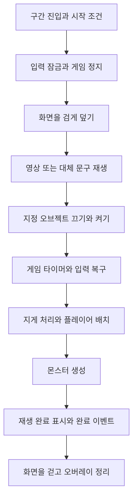

## 특정 구간을 지나면 영상에서 게임으로 이어진다

DCB의 현재 시네마틱은 플레이어가 지정된 구간에 들어오면 게임을 멈추고, 준비한 `VideoClip`을 전체 화면에 재생하는 방식이다. 영상이 끝나면 화면을 가린 상태에서 월드의 오브젝트와 플레이어·몬스터 상태를 바꾸고 다시 게임을 보여 준다.

매복 구간에서는 통과 전 장애물을 끄고 사건 이후의 장애물을 켠다. 플레이어를 지정한 위치·방향으로 옮기고, 지게를 잃는 처리를 거친 뒤 Samurai 두 명을 생성한다. 영상 속 사건이 끝난 뒤 실제 플레이의 시작 상태를 맞추는 연결이다.

영상 안의 카메라와 캐릭터 연출은 준비된 영상에 포함된다. 이 시스템이 게임 쪽에서 담당하는 것은 **재생 조건, 게임·입력의 정지, 전체 화면 표시와 종료 뒤의 상태 전환**이다.

아래는 2026년 10월 19일의 구간 기능·오버레이·게임 타이머·입력 코드와 두 구간 프리팹을 대조한 설명이다. 이번에 Unity 컴파일·Play Mode·실제 영상 재생을 실행한 것은 아니다. 연결된 영상 원본도 이 글에 복사하거나 첨부하지 않았다.

## 현재 연결된 두 구간

| 구간 | 영상 이후의 저장 설정 |
| --- | --- |
| 매복 | 기존 장애물 묶음 비활성, 사건 이후 묶음 활성, 플레이어 위치·방향 변경, 지게 상실, 레벨 1 Samurai 두 명 생성 |
| 산성 입구 | 연결된 입구 영상을 재생. 오브젝트 교체·플레이어 재배치·지게 상실·추가 몬스터 생성은 지정하지 않음 |

두 프리팹 모두 `playOnce`가 켜져 있고 페이드 시간은 0.3초다. 영상이 없을 때 사용할 안내 문구와 대기 시간 3초도 저장돼 있다. 현재 두 구간에는 영상 참조가 연결돼 있으므로, 안내 문구는 미등록 상황의 대체 경로다.

여기서 한 번 재생한다는 의미는 해당 컴포넌트의 메모리 상태를 기준으로 한다. `hasPlayed`를 세이브에 기록하는 연결은 이 기능 안에 없다. 씬을 다시 로드하거나 오브젝트를 새로 만든 뒤에도 영구히 재생하지 않는 진행도 저장 기능으로 설명하지 않는다.

## 들어온 순간 시작할 수 없으면 안에서 다시 시도한다

`PlayerRegion`은 Collider의 범위와 플레이어 위치를 비교해 진입·체류·이탈을 알린다. `CinematicRegionFeature`는 진입 때 재생을 시도하고, 아직 시작할 수 없으면 구간 안에 머무는 동안 다시 시도한다.

시작 조건은 다음과 같다.

- 플레이어가 활성 상태이고 살아 있어야 한다.
- 다른 독점 애니메이션이나 트레버설·턱 오르기가 진행 중이면 기다린다.
- 다른 기능이 이미 게임 타이머를 멈췄다면 그 일시정지가 풀릴 때까지 기다린다.
- 현재 재생 중이거나 같은 방문에서 이미 소비한 경우에는 중복 시작하지 않는다.
- `playOnce`이고 이미 결과를 적용했다면 다시 재생하지 않는다.

따라서 등반 중 구간 경계를 넘었다고 즉시 그 동작을 끊어 영상을 재생하는 구조는 아니다. 시작 가능한 상태가 된 뒤 구간 안에 남아 있어야 재시도가 이어진다. 이탈하면 이번 방문의 소비 표시는 해제한다.

## 게임은 멈추고 영상과 화면 전환의 시간은 흐르게 한다

시작할 때는 플레이어 입력과 게임 입력의 활성 상태를 기록한다. 예약된 공격 입력을 비우고 이동·공격 입력뿐 아니라 Esc·인벤토리·UI 입력도 잠근다. 뒤의 UI가 클릭되지 않도록 오버레이도 레이캐스트를 막는다.

이동 컨트롤러에서는 남은 루트 이동과 환경 접촉 속도·넉백·이동 입력을 정리한다. 재개 직후 진입 당시의 수평 이동이 그대로 이어지지 않도록 하는 처리다.

`GameTimer.Stop()`은 `Time.timeScale`을 0으로 만들고 DOTween을 일시정지한다. 게임 카메라의 추적과 방향 제어도 타이머의 일시정지 상태를 보고 갱신을 멈춘다. 타이머가 멈췄다는 이유만으로 모든 종류의 업데이트가 자동 정지한다고 가정하지 않고, 관련 경로의 정지 조건을 함께 사용한다.

반면 검은 화면의 페이드와 준비·종료 대기는 `Time.unscaledDeltaTime`으로 진행한다. DOTween을 함께 멈췄으므로 이 페이드를 별도의 코루틴으로 계산한다. 영상의 시간 기준은 오디오 트랙이 있으면 `DSPTime`, 없으면 `UnscaledGameTime`을 선택한다. 이 시간 선택의 의미는 [Unity의 VideoTimeUpdateMode 문서](https://docs.unity3d.com/6000.3/Documentation/ScriptReference/Video.VideoTimeUpdateMode.html)와 대조했다. 현재 설정이 실제 기기에서 음성·영상 동기를 보장한다는 측정 결과는 아니다.

## 영상은 전체 화면 UI로 표시한다

`CinematicOverlay`는 재생 때 생성하고 종료 때 정리하는 UI다. Screen Space Overlay Canvas에 검은 배경, 영상용 `RawImage`, 영상이 없을 때의 안내 문구를 둔다. 기준 해상도는 1920×1080이며 영상 비율을 유지해 부모 영역 안에 맞춘다.

`VideoPlayer`의 출력은 클립 크기의 `RenderTexture`에 연결한다. 오디오는 직접 출력 모드를 사용한다. 게임의 3D 카메라를 영상 카메라로 바꾸는 대신, 멈춰 있는 게임 화면 위에서 이 UI를 재생한다.

정상 종료 때는 영상 이벤트 구독을 해제하고 영상 플레이어를 정지한 뒤 오버레이를 파괴한다. `OnDestroy`에서 생성한 RenderTexture를 해제·파괴한다. 여기서 확인한 것은 생성·정리 경로이며, 반복 재생의 메모리 사용량을 측정한 것은 아니다.

## 검은 화면 아래에서 결과를 적용하는 순서

현재 코루틴의 순서는 다음과 같다.

화면에 결과가 노출되기 전에 상태를 맞추지만, **입력 잠금이 화면을 완전히 걷을 때까지 유지되는 것은 아니다.** 코드는 오브젝트를 교체한 뒤 게임·입력을 먼저 복구하고, 나머지 결과와 완료 이벤트를 적용한 다음 0.3초 페이드를 진행한다. 화면을 걷는 동안 이미 게임이 진행될 수 있으므로 재개 첫 입력과 적의 행동 시점은 실제 플레이에서 확인해야 한다.

### 플레이어의 위치·방향과 지게

재배치 지점이 있으면 락온을 지운다. 위치 이동이 켜진 경우에는 플레이어 Transform과 Rigidbody 위치를 함께 맞추고 선형·각속도를 정리한다. 바라보는 방향은 캐릭터의 모델 방향을 담당하는 경로로 전달한다. 지점의 기울기를 그대로 캐릭터 몸에 적용하려는 처리가 아니다.

매복 구간의 `removePlayerJige`는 `LoseJige()`를 호출한다. 지게에 꽂혀 있던 막대나 무기를 손으로 옮기는 상태를 정리하고, 지게 획득·착용 상태와 바닥 지게를 처리한다. 다만 가방 슬롯 장착 상태 때문에 여전히 지게를 보유하게 되는 경우에는 경고를 남긴다. 모든 인벤토리 구성에서 지게가 반드시 제거됐다는 실행 결과로 쓰지는 않는다.

### 영상 이후의 몬스터 생성

생성 항목은 위치·방향, 몬스터 종류와 레벨 또는 시트 식별자를 가진다. 시트 정보를 확인해 생성기를 통해 얻고, 생성 지점의 수평 방향을 적용한 뒤 탄생·장비 처리를 진행한다.

이 경로는 맵 모듈을 넘기지 않고 몬스터를 탄생시킨다. 맵 모듈의 수면·거리별 시뮬레이션 조절 경로와 구분되는 생성 방식이다. 생성한 Samurai의 이후 행동은 [Samurai의 그룹 전투](/writing/monster-combat/)에서 설명한다.

## 영상 실패와 연출 취소는 다르게 처리한다

| 상황 | 현재 경로 |
| --- | --- |
| 영상 미등록 | 안내 문구를 지정 시간 동안 표시한 뒤 결과 적용으로 진행 |
| 영상 준비 지연 | 5초 안에 준비되지 않으면 경고를 남기고 재생 대기 종료 |
| 디코더 오류 | 오류 이벤트로 대기를 끝내고 이후 단계로 진행 |
| 정상 끝 이벤트 누락 | 클립 길이 + 2초의 갱신 시간 상한으로 재생 대기 종료 |
| 생성 위치·시트 정보·생성기 누락 | 해당 생성 또는 생성 전체를 건너뛰는 경로. 결과 전체를 원상 복구하는 트랜잭션은 아님 |
| 연출 도중 비활성화 | `OnDisable`에서 자신이 잠근 타이머·입력과 오버레이를 정리 |

**영상 재생 실패가 월드 상태 전환의 취소를 뜻하지는 않는다.** 준비 실패나 오류로 영상 대기가 끝나도 호출자는 결과 적용으로 진행한다. 일부 몬스터를 만들지 못해도 완료 표시가 남을 수 있다. 현재 정책은 영상을 끝없이 기다리며 게임을 잠그는 일을 피하는 쪽이며, 실패 시 모든 결과를 보류하거나 원상 복구하는 정책과는 다르다.

비활성화는 결과 적용 전인지 후인지도 구분해야 한다. 이미 교체한 오브젝트나 생성한 몬스터를 되돌리는 코드까지 있는 것은 아니다. `playRoutine` 참조를 비우는 일도 코루틴 자체의 명시적 중단과는 다르다. 현재 `OnDisable`에는 `StopCoroutine` 호출이 없다.

Unity는 GameObject 비활성화와 `MonoBehaviour.enabled = false`의 코루틴 동작을 구분한다. 컴포넌트만 끄는 경우에는 코루틴이 자동 중단되지 않는다. 따라서 현재 정리 코드를 모든 비활성화 방식에서 결과 적용을 막는 보장으로 소개하지 않는다. 이 구분은 [Unity 코루틴 문서](https://docs.unity3d.com/6000.3/Documentation/Manual/Coroutines.html)를 기준으로 확인했으며, DCB에서 각 중단 상황을 새로 재현하지는 않았다.

입력 복구도 기록한 Player·Game 입력 활성 여부를 기준으로 한다. Global·UI 입력의 개별 상태를 모두 저장하는 구조는 아니다. 타이머 정지는 중첩 소유권 카운터로 관리하지 않으므로 다른 일시정지·독점 연출과 겹치는 상황도 별도로 확인해야 한다. 사용자 스킵 입력을 처리하는 분기도 현재 이 재생 경로에는 없다.

## 작업 기록과 확인 범위

10월 2일 `b7505ca80`에서 구간 진입 재생과 오버레이를 추가했다. 같은 날 `7fffb1efd`에서 지게 상실을, `da504a8a5`에서 시네마틱 이후 막대·무기를 손에 남기는 연결을 보완했다. 현재 코드와 매복·산성 입구 프리팹의 저장값을 이 기록과 대조했다.

내가 정한 게임 흐름은 연출이 끝난 뒤 부서진 지게 곁에서 막대를 든 상태로 플레이를 이어 가는 연결이며, 이 요구는 작업 기록과 코드 주석에도 남아 있다. 구간 기능·UI·상태 연결 코드 작성에는 AI 보조를 사용했고 관련 커밋에도 공동 작성 기록이 있다. 영상 파일의 연결 사실을 영상 촬영·모델·애니메이션 원본을 직접 제작한 성과로 포함하지 않는다.

기존 `PlayerRegionTests`는 구간 범위와 진입·체류·이탈 알림을 확인하는 검사다. 이것이 영상 디코딩·오디오 동기·매복 종료 상태를 검증한 결과는 아니다. **이번에는 해당 검사도 새로 실행하지 않았으며 Unity 컴파일·EditMode·Play Mode·Player 영상 재생·성능 측정과 실제 캡처를 수행하지 않았다.**

다음 실행에서는 정상 진입과 등반 종료 후 진입, Esc·인벤토리 차단, 영상 누락·준비 지연·오류, 결과 적용 전후의 구역 비활성화와 컴포넌트 비활성화를 나눠 확인해야 한다. 이후 지게·막대·플레이어 배치·Samurai 두 명의 생성, 페이드 중 조작 재개, 재방문과 씬 재로드의 한 번 재생 정책을 같은 조건에서 확인한다.
