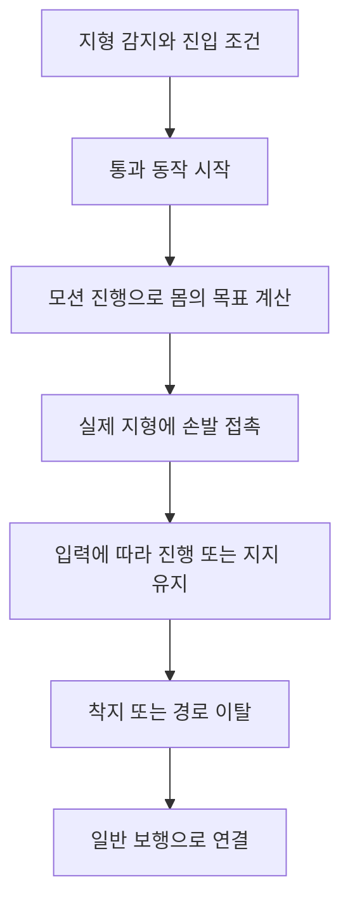

## 지형에 따라 이동 동작을 바꿉니다

DCB의 장애물 이동은 턱에 올라서는 `StepUp`, 벽을 오르내리는 `Climb`, 좁은 선반을 지나는 `SideStep`으로 나뉩니다. 각각 진입 조건과 이동 경로가 다르며, 동작을 마치면 일반 보행으로 돌아옵니다.

플레이어는 통과할 지형에 접근하고 이동 방향을 정합니다. 턱 오르기는 이동 중 자동 검사를 사용합니다. 벽과 선반은 통과 안내가 잡힌 경로에 진입 입력을 보내 시작합니다. 현재 키보드에서는 Space 안내와 연결돼 있습니다. 아무 벽이나 자유롭게 오르거나 임의의 틈을 자동으로 통과하는 방식은 아닙니다.

## 세 동작의 사용 흐름

| 동작 | 시작 | 진행 | 종료 |
| --- | --- | --- | --- |
| 턱 오르기 | 이동 방향의 턱 높이·상단 지지면·착지 가능 여부를 검사 | 높이에 맞는 모션으로 몸을 올리고 발·손을 지형에 맞춤 | 상단 착지 후 남은 보정을 보행에 인계 |
| 벽 타기 | 안내 대상으로 선택된 등반 경로에 Space 입력 | W/S로 위·아래 이동. 조건이 맞으면 A/D로 옆 경로 이동. 입력을 놓으면 지지 유지 | 위·아래 이탈 지점에서 경로를 벗어나 보행 연결 |
| 옆걸음 | 안내된 선반 경로에 Space 입력 | 경로 방향으로 양방향 이동. 멈출 때는 디딤 위상을 맞춰 정지 | 끝 지점의 이탈 동작을 거쳐 보행 연결 |

공격·가드·피격·넉백 등 다른 행동이 진행 중이면 진입을 제한합니다. 이미 한 통과 동작을 소유한 동안에는 다른 통과 동작을 동시에 시작하지 않습니다. 사용자가 진입 입력을 보냈다는 사실만으로 동작이 확정되지는 않으며, 선택된 경로와 현재 캐릭터 상태가 함께 맞아야 합니다.

### 턱 오르기

이동 방향 앞의 지형을 보고 오를 수 있는 높이와 상단 공간을 찾습니다. 낮은 턱의 발 중심 모션과 높은 턱의 손 지지 모션은 다른 조건을 사용합니다. 몸은 모션에서 측정한 전진·높이 진행을 따라 이동하고, 실제 턱의 높이와 착지 위치에 맞춰 보정합니다.

발은 출발 지면과 도착할 상단을 따로 기준으로 삼습니다. 발을 들어 옮기는 동안에는 원본 궤적을 유지하면서 착지 차이를 나눠 적용합니다. 손을 짚는 모션에서는 손바닥의 접촉과 도달 범위도 함께 계산합니다. 턱 위에 올라선 뒤에는 발의 보정을 바로 끄지 않고 일반 보행의 발 배치에 이어 줍니다.

### 벽 타기

벽 타기는 저작된 등반 경로와 모션 프로필을 사용합니다. 프로필은 몸이 한 주기 동안 얼마나 움직이는지와 손발의 지지·이동 구간을 담습니다. 런타임은 이 진행도를 실제 벽의 위치·방향에 맞춥니다.

W/S 입력은 카메라 방향과 별도로 위·아래 의도를 전달합니다. 입력이 멈추면 몸의 진행을 멈추고 현재 손발 지지를 유지합니다. 내려가기 전의 손 재배치나 다음 지지점 도착을 기다리는 구간에서는 입력이 있어도 몸을 먼저 내리지 않습니다. 옆 이동도 연결 가능한 벽 경로와 현재 준비 상태를 확인합니다.

위나 아래 끝에 도착하면 이탈 가능 여부를 확인해 보행으로 연결합니다. 따라서 등반 경로의 끝이 있다는 사실과 안전하게 내리거나 올라설 공간이 있다는 조건을 함께 다룹니다.

### 좁은 선반의 옆걸음

선반에서는 경로만 따라 몸을 옮기지 않습니다. 발이 딛는 실제 면과 손이 닿는 벽을 찾고, 이동하려는 다음 구간에도 두 접촉면이 이어지는지 확인합니다. 지지가 끊긴 구간으로 계속 밀어 넣는 대신 현재 지지 자세에서 멈추는 경로가 있습니다.

이동량은 옆걸음 클립의 진행에서 계산합니다. 입력을 놓거나 반대 방향을 요구하면 현재 한 걸음을 무조건 잘라 버리지 않고 정지할 지지 위상을 정합니다. 다음 발이 디딘 뒤 기존 발의 지지를 넘기며, 끝 지점에서는 별도의 이탈 동작을 사용합니다.

## 몸의 이동과 손발 접촉을 함께 연결합니다

몸의 이동은 해당 동작의 전용 갱신이 맡습니다. 같은 틱에 일반 보행 이동이나 일반 루트 모션을 더하지 않도록 제어권을 나눴습니다. 손발은 IK로 실제 접촉점에 맞추되, 원본 애니메이션에서 움직여야 하는 구간과 지지해야 하는 구간을 구분합니다.

이 구성으로 지형에 맞춰 이동하는 경로와 관절 자세를 따로 조정할 수 있습니다. 모션 프로필·경로·접촉면이 잘 연결돼야 하므로 애니메이션 하나를 재생하는 것만으로 통과 동작이 완성되는 구조는 아닙니다.

## 구현과 자산

모델은 기존 자산이며 기준 애니메이션은 작업자에게 받은 클립을 사용했습니다. 진입·이동·접촉 기준을 정하고 AI와 함께 런타임과 제작 도구를 구성했습니다. 측정 방법과 수정 과정은 [IK 트레버설 구현](/writing/ik-traversal/)에서 다룹니다.
