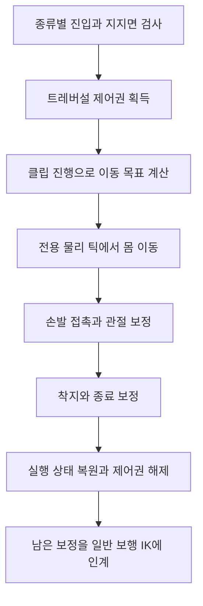

## 전달받은 애니메이션을 지형에 연결하기

턱은 걷다가 그대로 올라서고, 벽과 좁은 선반은 안내가 잡힌 자리에서 Space로 들어간다. 세 동작 모두 작업자에게 받은 클립을 실제 지형에 맞추고, 끝나면 일반 보행에 제어권을 돌려준다. 조작과 진행 흐름은 [DCB의 장애물 이동](/writing/dcb-traversal-overview/)에 있다. 이 글은 클립을 측정해 데이터로 만들고 손발을 지형에 붙인 과정, 그리고 수정 기록을 다룬다.

클립의 발 위치를 지면에 맞추는 것만으로는 부족했다. 몸이 앞으로 가는 동안 지지하던 손발이 끌려가고, 턱 위에서 보행으로 바뀌는 순간 발 보정이 사라진다. 그래서 몸을 옮기는 코드와 손발을 붙이는 코드를 나누고, 보정이 끝나는 과정까지 보행에 이어 붙였다.

역할은 이렇다. 애니메이션 원본은 작업자가 만들었고 3D 모델은 기존 자산이다. 언제 들어가고 멈추는지, 무엇을 어디까지 보정하고 확인하는지는 내가 정했다. 측정 도구와 런타임 제어, IK 코드는 AI의 도움을 받아 작성하고 고쳤다. 높은 턱에서 발이 튀는 문제는 아직 남아 있다. 확인한 범위와 날짜는 끝의 검사 기록에 모았다.

## 클립과 함께 확인할 기준

받은 클립을 적용하려면 어떤 지형을 기준으로 제작했는지 알아야 한다. StepUp에서는 턱 높이와 시작 거리, 어느 발로 먼저 오르는지가 필요하다. Climb과 SideStep에서는 벽과 몸 사이 거리, 손발이 붙는 구간, 반복 중 멈출 수 있는 자세를 확인한다.

전달·보정 기준 문서에는 아래 항목을 둔다. 클립별 제작 조건과 실제 측정값을 이 항목에 맞춰 확인한다.

| 확인 항목 | IK와 이동 코드에서 사용하는 곳 |
| --- | --- |
| 기준 턱 높이·선반 폭·벽 거리·시작과 종료 위치 | 실제 지형과 원본의 차이를 계산하고 진입·착지 목표를 잡는다 |
| 선행 손발과 접촉·이탈 프레임 | 지지할 구간과 다음 접촉점으로 옮길 구간을 구분한다 |
| 총 프레임·FPS·루프 여부·주기당 이동량 | 클립 시간을 정규화하고 반복 이동의 누적 거리를 계산한다 |
| 전진·후진 사용 범위와 정지·재개 구간 | 역방향 이동과 Hold 상태에 사용할 수 있는지 판단한다 |
| 몸의 최고점·회전·장비와의 간섭 | 원본의 체중 이동을 유지하면서 몸통·관절 보정 범위를 정한다 |

접촉 정보는 `LeftFootIK`·`RightFootIK` 같은 곡선이나 프레임 표로 표현할 수 있다. 다만 발이 지지면에서 떨어져 있다는 사실과 IK 계산을 꺼야 한다는 판단은 다르다. 공중의 발에도 착지 위치와 장애물 높이에 맞춘 궤적 보정이 필요하다.

작업자가 만든 몸의 들림·무릎 굽힘·체중 이동을 기준 자세로 두고, 코드는 지형 차이와 접촉 연결을 처리하도록 역할을 나눴다. 원본에서 손발이 움직여야 하는 구간까지 벽이나 바닥에 고정하면 자세가 늘어나고 이동 리듬도 달라진다.

## 실제 Avatar에서 원본 움직임 측정하기

Humanoid 클립의 루트 곡선과 게임 오브젝트의 실제 이동은 구분해서 측정한다. 리타기팅에 사용하는 Avatar, 모델 크기, Root Transform의 Bake 설정에 따라 손발 위치와 추출되는 변위가 달라진다. 애니메이션 파일의 높이 곡선만 읽어서는 게임 안의 발 접촉 위치를 확정할 수 없다.

측정 도구는 실제 캐릭터 모델과 Avatar를 미리보기 씬에 배치한다. 복제한 모델에서 게임 실행용 컴포넌트를 제거해 이동 코드의 개입을 막고, 120Hz를 기준으로 클립 시작과 끝을 포함해 포즈를 읽는다. 이는 애니메이션의 측정 간격이며 게임의 실행 FPS와는 별개다.

`PlayerStepUpSetupTool`은 다음 데이터를 구분해 수집한다.

- **몸의 경로:** `PlayableGraph`를 수동 진행하며 `Animator.deltaPosition`을 누적하고 루트의 이동과 대조한다.
- **손발의 자세:** 골반·발목·발끝과 원본 뼈 위치를 읽어 높이 변화와 이탈·착지 시점을 계산한다.
- **IK 좌표:** 뼈의 FK 위치와 Humanoid IK 목표를 따로 기록해 시작 보정과 종료 자세에 사용한다. 둘을 같은 좌표로 취급하지 않는다.

측정 때는 Unity의 기본 Foot IK를 꺼 원본 포즈를 읽는다. 클립·Avatar 식별 정보, 스케일과 적용 설정도 기록해 다른 버전의 측정값을 섞지 않도록 한다. 클립이나 Avatar가 바뀌면 이전 보정값을 그대로 재사용할 수 있는지 다시 확인해야 한다.

## 측정값을 런타임 클립과 프로필로 구성하기

전달받은 원본은 보존하고, 게임에 필요한 구간 추출과 루프·Bake 설정은 런타임용 클립에서 관리했다. 높은 StepUp에는 기존 오르기 애니메이션의 일부 구간을 활용한 파생 클립도 사용한다. 원본을 남겨 두면 가공 전후의 자세와 이동량을 같은 Avatar에서 다시 비교할 수 있다.

StepUp 설정 도구는 `Sample`·`Apply`·`Verify`로 나뉜다. `Sample`은 복제본에서 측정하고 보고서를 만든다. `Apply`는 지정된 런타임 클립의 설정과 발 접촉 곡선, Animator 연결과 플레이어 설정을 갱신한다. `Verify`는 클립 식별·루프·Bake·곡선·컨트롤러 연결을 검사한다. 이 검사는 연결과 데이터의 조건을 확인하며 실제 모션의 외형까지 승인하지는 않는다.

동작별 런타임 데이터도 구분했다.

| 데이터 | 담는 내용 | 런타임에서 하는 일 |
| --- | --- | --- |
| `PlayerStepUpSettings` | 기준 높이·전진 거리, 높이·전진 진행 곡선, 발의 시작·종료 위치와 이탈·착지 시점, 손 지지 정보 | 선택한 모션을 실제 턱과 착지점에 맞추고 손발 보정의 시점을 계산한다 |
| `ClimbMotionProfile` | 진입·반복·종료 이동, 네 팔다리의 접촉 채널, 몸통 변위·지지·반동 정보와 접촉 축 | 상승·하강과 정지 중에 몸의 이동과 손발 지지를 연결한다 |
| `SideStepMotionProfile` | 양 끝의 진입·이탈, 양방향 반복 클립과 위치 표본 | 선반 방향으로 이동하고 끝 지점에서 보행으로 빠져나간다 |

StepUp 종료를 연결할 일반 보행 클립도 측정한다. `PlayerStepUpLocomotionCalibration`은 보행 중 발의 지지·이동 구간을 읽어 `MoveBlend`로 들어갈 위상을 설정하는 데 사용한다. 턱 오르기를 끝내는 시점과 다음 보행에서 어느 발이 움직일지를 함께 맞추기 위한 데이터다.

Bake 설정은 동작별로 결정한다. 예를 들어 SideStep 파생 클립은 회전과 Y 움직임을 포즈에 두고 XZ 이동을 추출한다. 진입·이탈 경로에는 옆 방향이나 높이 변화가 있으므로 이동량을 거리 하나로 줄이지 않고 방향과 부호가 있는 위치 표본으로 보관한다.

SideStep의 제자리 반복 클립은 한 주기의 루트 변위가 거의 없어도 발을 교대로 옮기는 움직임을 담고 있다. 제작 도구는 지지 발의 뒤쪽 이동을 이용해 전진 경로를 재구성한다. 런타임의 `LoopDistance`는 완료한 반복 횟수의 거리와 현재 주기의 거리를 더한다. 루프 시간이 1을 넘었다고 고정하면 두 번째 주기부터 몸의 이동이 멈추므로 반복 횟수와 현재 위상을 함께 유지한다.

## 동작마다 다른 진입과 지지 조건

| 동작 | 진입과 이동 | 접촉과 종료 |
| --- | --- | --- |
| StepUp | 이동 중 턱 높이·지지면·착지 조건을 검사해 자동 진입한다 | 준비·공중·착지 단계를 거쳐 발 보정을 일반 보행에 인계한다 |
| Climb | Space로 진입하고 W/S로 상승·하강한다. 입력을 놓으면 정지한다 | 정지·반동 중에도 지지를 유지하고, 위나 아래의 이탈 지점에서 보행으로 연결한다 |
| SideStep | Space로 진입해 선반을 따라 양방향으로 이동한다 | 다리 도달 거리와 발바닥 지지를 검사하며, 반대 발이 착지한 뒤 기존 지지를 해제한다 |

진입 검사와 모션 진행은 동작별로 둔다. Climb의 벽 접촉면과 StepUp의 착지면을 같은 지면 판정으로 처리하면 벽이 일반 보행의 바닥으로 잡힐 수 있다. 동작별로 유효한 표면과 종료 조건을 구분한다.

## 코드로 처리한 지형 적응과 접촉

### StepUp: 발의 출발점과 착지점 연결

StepUp은 턱 높이와 착지 조건에 맞는 모션을 고른 뒤, 측정한 전진·높이 진행 곡선으로 몸의 이동 목표를 계산한다. 낮은 턱의 발 중심 모션과 높은 턱의 손 지지 모션은 보정 조건을 구분한다.

발은 시작 지면과 턱 윗면에 각각 투영해 접촉점을 잡는다. 발목 높이만 맞추지 않고 발끝 위치·발바닥 높이·표면 법선을 함께 사용한다. 뒷발이 발끝을 축으로 뒤꿈치를 드는 구간에서는 발목의 수평 위치까지 고정하지 않도록 처리한다.

발을 들 때는 마지막으로 지지하던 위치의 보정량을 저장한다. 공중에서는 원본 FK 궤적에 출발 보정과 착지 오차를 점진적으로 더한다. 착지 직전에 먼 목표로 발을 당기는 대신, 발을 옮기는 구간 전체에 차이를 나눠 적용하는 방식이다. 표면 기울기에 맞추는 발 회전도 공중 구간에서 이어 붙인다.

손 지지 모션에서는 손 접촉 구간과 도달 거리도 계산한다. 손바닥의 접촉 방향과 손목·팔꿈치 자세를 보정하고, 지지를 놓은 뒤 원본 팔 움직임으로 돌아가는 과정까지 연결한다. 높은 턱의 발 튐과 손 도달 오차는 여전히 남아 있으므로 이 기능들의 구현 여부와 외형 품질의 통과를 구분한다.

### Climb: 정지와 반동 중에도 지지 유지

Climb은 프로필의 반복 이동량을 상승·하강 입력에 연결하고, 손발 네 곳의 접촉 채널을 읽어 지지와 이동을 구분한다. 접촉 데이터는 측정한 손발 높이와 상대 속도, 손을 뻗어 잡는 시점과 몸의 반동 구간에서 구성한다. 런타임에서는 그 값을 실제 벽의 접촉점과 팔다리 도달 거리에 맞춰 사용한다.

입력을 놓았을 때는 몸의 진행을 멈추고 현재 지지를 유지한다. 움직이는 중에도 다음 손발이 도착하지 않았다면 기존 지지를 바로 풀지 않는다. 특히 반대 발이 실제로 딛었는지와 남은 도달 여유를 확인해 양발이 함께 풀리는 상황을 막는다. 손을 잡은 뒤 몸이 반동으로 움직이는 구간도 손의 월드 접촉점을 유지하도록 처리한다.

### SideStep: 선반 경로와 실제 지지면 연결

SideStep은 경로 데이터로 선반의 방향과 양 끝을 정한다. 발이 딛는 면과 손이 닿는 벽은 발·손 역할이 지정된 실제 Collider에서 찾는다. 경로가 있다는 이유로 발 아래에 가상의 지지면을 만들지는 않는다.

`ApplySideStepContactIK`는 발 지지를 확인하고 골반과 몸 기울기를 보정한 뒤, 팔의 도달 범위를 고려해 손 접촉을 계산한다. 다음 발이 착지할 때까지 기존 지지를 유지하고, 손도 반대쪽 지지와 도달 조건을 보고 교대한다. 진입 때는 발 보정을 첫 프레임부터 이어 받고 손과 몸 기울기의 가중치는 별도로 올린다. 벽에 접근하는 동안 발 보정까지 천천히 켜면 일반 보행 IK가 풀리는 순간 발이 원본 위치로 떨어질 수 있기 때문이다.

## 캐릭터를 이동시키는 주체는 하나로 둔다

`PlayerController`의 `FixedUpdate`는 Climb·SideStep·StepUp이 실행 중이면 해당 이동 틱을 처리하고 반환한다. 일반 이동을 같은 틱에 이어서 적용하지 않는다. StepUp 착지 블렌드 동안에는 이동 속도와 일반 루트 이동 누적을 정리해 마지막 디딤을 먼저 인계한다.

애니메이션의 변위를 일반 액션 경로에서도 누적하면 전용 이동과 겹친다. `ModelRootMotionHandler`는 트레버설과 StepUp 종료 블렌드를 확인해 일반 루트 이동 전달을 차단한다. 클립의 진행으로 목표를 계산하는 일과 그 목표로 몸을 움직이는 일을 분리한 구조다.

`PlayerController.Traversal`은 활성 동작 종류와 세션 번호를 기록한다. 다른 동작이 활성화돼 있으면 획득을 거부한다. 획득할 때 몸 Collider의 기존 `isTrigger`를 저장하고, 해당 동작을 해제할 때 복원한다. 중력 등 종류별 실행 상태의 저장·복원은 각 동작 코드에 남아 있다. 공통 소유권이 있다는 이유로 모든 복원 처리가 한 함수에 모여 있는 것은 아니다.

다음 그림은 이동과 접촉의 역할을 설명한 구조도다.

## 지지 해제와 보정 해제를 구분한다

몸이 앞으로 이동해도 지지 중인 손발은 접촉면에 남아 있어야 한다. 다음 지지점으로 옮길 때는 반대쪽 지지가 확보됐는지와 새 목표까지 도달할 수 있는지를 검사한다. 공중에서 새 접촉점으로 이동하는 구간을 이미 지지 중인 상태로 기록하지 않는다.

지지를 놓은 뒤에도 포즈 보정이 즉시 0이 되어야 하는 것은 아니다. 손발이 원래 애니메이션 자세로 돌아가는 동안 위치·회전·IK 가중치를 연속적으로 줄여야 한 프레임의 튐을 피할 수 있다. 반대로 포즈를 부드럽게 유지하려고 유효하지 않은 접촉점을 계속 지지면으로 인정해서도 안 된다.

현재 SideStep 접촉 검사에는 몸과 손목이 이동해도 손의 월드 접촉점을 유지하는 경우, 반대쪽 지지를 기다린 뒤 새 점으로 이동하는 경우, 접촉을 해제한 손이 움직이는 원본 포즈로 돌아가는 경우가 있다. 이는 검사 코드에서 확인한 범위이며 이번에 실제 모션을 재실행한 결과는 아니다.

## StepUp 종료에서 지면 레이가 잠시 실패한 문제

턱 위 보행으로 넘어가면 발 아래의 표본이 윗면·아랫면·레이 실패 사이를 오갈 수 있다. 기존 기록에는 발 보정이 남아 있는데 인계 유예 시간이 끝나면서 발이 튄 사례가 있다. 인계는 시간만으로 끝내지 않고, 접지·직전 프레임과의 연속성·목표 보정의 잔여 상태를 함께 본다.

`PlayerFootIK`는 원래 애니메이션 발 위치에 지면 보정량을 더한다. 표본이 바뀌면 보정 위치와 회전을 새 목표로 점진적으로 이동시킨다. 레이가 실패하면 목표 보정은 원래 포즈 쪽으로 돌아간다.

이때 위치 보정이 먼저 작아졌더라도 IK 가중치가 아직 감쇠 중일 수 있다. 실패한 프레임에서 가중치를 바로 끄고 다음 접촉 프레임에서 다시 켜면 발이 다시 튄다. 반영한 보정은 **StepUp에서 이어진 보행이고, 직전 프레임 이력이 연속이며, 유효한 가중치가 남은 경우**에 기존 감쇠를 이어간다.

이 처리는 레이 실패를 새 지지로 바꾸지 않는다. 접지를 잃거나 이력이 끊기면 인계를 유지하지 않으며, 가중치도 기존 속도로 소멸한다. 일반 보행과 Climb에 이 추가 규칙을 적용하지 않았다.

## 위치 오차와 관절 외형을 함께 본다

손바닥이 벽에 도달해도 손목이 과하게 꺾이거나 팔꿈치가 뒤집히면 사용할 수 없다. 손발 목표 위치·회전, 팔꿈치·무릎의 굽힘 평면, 몸의 이동과 원본 반동을 함께 확인한다. Avatar의 뼈 회전축과 Humanoid IK 목표 회전의 축도 구분한다.

접촉면의 법선을 손목 회전에 그대로 대입하지 않고, 원본 뼈와 IK 목표 사이의 회전 차이와 손바닥·발바닥의 접촉 축을 사용한다. 팔꿈치·무릎에는 `AvatarIKHint`로 굽힘 방향을 지정한다. 손발 위치만 맞춘 결과와 관절 외형까지 유지한 결과를 따로 확인하는 이유다.

후보를 평가할 때는 같은 Avatar·지형·입력 조건에서 정상 속도와 근접 프레임을 비교했다. 10월 2일 기록에는 접촉 오차 일부가 줄었어도 늦은 구간의 손목 변형이 악화해 제외한 후보가 남아 있다. 해당 판단은 [AI를 사용한 구현과 검증 과정](/writing/working-with-ai/)에서 설명한다.

## 반영한 결과와 제외한 후보

| 대상 | 기록에서 확인한 결과 | 적용 범위 |
| --- | --- | --- |
| SideStep·Climb 접촉 연결 | 도달 거리·지지 전환·관절 축·종료 연결을 다룬 변경이 반영됐다 | 각 동작의 현재 소스와 10월 2일 통합 기록을 대조했다 |
| StepUp 보행 레이 실패 보정 | 오른발 선행·입력 유지 비교에서 최대 발 변화가 약 134.0mm에서 103.3mm로 줄었다 | 특정 비교 표본이다. 다른 조건은 비슷하거나 일부 악화했다 |
| 낮은 모션 선택 후보 | 이동 경로가 짧아지고 종료됐지만 일부 손 접촉 오차가 20cm 이상 남았다 | 실행 코드에 반영하지 않았다 |
| 200 모션의 손·관절 계획을 100 모션에 적용한 후보 | 단위 검사 278개는 통과했으나 실제 8회 전체 품질은 0/8 통과였다 | 손목 수치가 악화해 제외했다 |

반영 여부는 한 지표가 줄었는지와 별도로 판단했다. 높은 StepUp의 기존 비교에서도 최대 발목 꺾임은 줄었지만 전체 모션 품질 판정은 실패로 남았다. 반영된 변경이 있다는 사실을 해당 동작의 모든 결함이 해결됐다는 뜻으로 사용하지 않는다.

## 검사 기록과 남은 확인

| 시점 | 기록 | 뜻 |
| --- | --- | --- |
| 2026.10.02 | 최종 조합의 격리 Unity 임포트와 EditMode 통합 검사 2,044건 통과 | 당시 통합 검사다. 지형별 외형 품질을 센 수가 아니다 |
| 2026.10.16 | 트레버설 선택 EditMode 검사 116건 통과 | 계산, 접촉, 보행 인계 규칙 검사다. 위 수와 합치지 않는다 |
| 2026.10.18 | 소스, 제작 도구, 검사 코드와 실험 기록을 읽어 이 글을 보강 | Unity 실행, 측정 도구 재실행, 화면 비교는 하지 않았다 |

남은 문제는 세 가지다. 높은 턱에서 발이 튄다. 종료 구간에서 지지 간격이 벌어진다. 손이 접촉면에 닿는 오차가 남는다. 다음에 실제로 돌릴 때는 왼발과 오른발 선행, 입력 유지와 해제를 나눠서 진입부터 보행 복귀까지 정상 속도와 손발 근접 화면을 같이 찍어야 한다. 이 글에는 아직 캡처나 영상이 없다.
