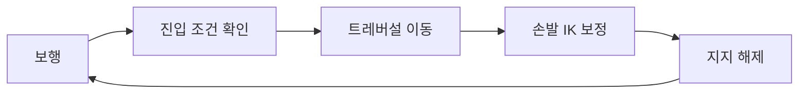

## 구현한 기능

DCB에 StepUp, Climb, SideStep을 구현했다. 기존 애니메이션을 재생하면서 캐릭터 위치와 손발 IK를 지형에 맞게 보정하고, 동작이 끝나면 일반 보행으로 전환한다. 애니메이션 클립과 3D 모델 원본은 기존 자산을 사용했다.

## 동작별 진입과 지지 조건

| 동작 | 진입 조건 | 접촉과 전환 |
| --- | --- | --- |
| StepUp | 턱 높이와 착지 공간 확인 | 착지 후 보행 IK로 전환 |
| Climb | 오를 표면과 진입 자세 확인 | 상승·정지 중 손발 지지 유지 |
| SideStep | 선반 방향과 이동 범위 확인 | 반대 발이 착지한 뒤 기존 지지 해제 |

동작마다 진입 조건은 다르다. 공통으로 관리하는 부분은 이동 제어와 진입·종료 처리다. 애니메이션 루트 이동과 캐릭터 이동이 중복 적용되지 않도록 제어 주체를 나눴다.

## IK 보정

손발의 위치와 회전을 함께 보정한다. 손목·발목의 방향뿐 아니라 팔꿈치·무릎이 굽는 방향도 확인한다. Avatar의 뼈 회전축과 Humanoid IK 목표 회전을 혼용하면 관절이 비틀릴 수 있다.

진입, 지지, 해제, 보행 복귀 구간을 정상 속도와 근접 화면으로 확인한다. 한 구간의 접촉 오차가 줄어도 다른 구간에서 발이 튀거나 손 지지가 끊길 수 있다.

## AI 사용 범위

구현 후보와 검증 도구를 작성할 때 AI를 사용했다. 같은 Avatar, 지형, 입력으로 결과를 비교했다. 자동 검사 결과와 실제 관절 움직임을 따로 확인했다.

## 검사 결과와 남은 문제

2026년 10월 16일 계산·접촉·보행 전환 관련 검사를 골라 실행했고, 116개 모두 통과했다. 모든 지형에서의 모션 품질을 확인한 것은 아니다.

높은 StepUp에서 발이 튀는 현상과 손 접촉 오차가 남아 있다. 해당 구간은 실제 재생을 보며 수정해야 한다.
