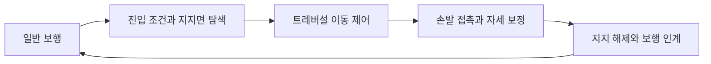

## 풀고 싶은 문제

같은 애니메이션을 재생해도 실제 지형에서는 손이 벽에 닿지 않거나, 발이 지지면을 미끄러질 수 있습니다. DCB에서는 기존 클립을 활용하면서 StepUp, Climb, SideStep을 지형에 맞추고 일반 보행까지 이어주는 시스템을 구현하고 있습니다.

이 작업의 중심은 애니메이션 원본을 새로 만드는 것이 아니라 **기존 모션, 런타임 이동, 손발 접촉의 책임을 나누는 것**입니다.

## 동작마다 다른 지지 조건

| 동작 | 진입에서 판단하는 것 | 유지하고 싶은 조건 |
| --- | --- | --- |
| StepUp | 실제 지지면의 높이와 착지 공간 | 착지 후 보행 IK로 자연스럽게 인계 |
| Climb | 오를 수 있는 표면과 진입 자세 | 상승·정지 중 손발 지지 유지 |
| SideStep | 선반의 방향과 이동 가능 범위 | 반대 발이 착지한 후 지지 해제 |

세 동작은 각자의 조건을 갖지만, 진입과 종료에서 이동 제어권을 주고받는 문제를 공유합니다. 애니메이션 루트 이동과 캐릭터 이동을 중복 적용하지 않도록 소유권을 분명히 해야 합니다.

## 접촉점 다음에 봐야 할 것

손 위치만 벽에 맞춘다고 자연스러운 지지가 되지는 않습니다. 손목·발목의 회전축, 팔꿈치·무릎의 굽힘 방향, 지지 상태가 바뀌는 동안의 연속성도 함께 봐야 합니다. Avatar의 뼈 회전축과 Humanoid IK 목표 회전을 같은 것으로 취급하면 비틀림이 생길 수 있습니다.

그래서 정상 속도의 전체 동작과 손발이 보이는 근접·측면 프레임을 함께 비교합니다. 진입 한 프레임이 좋아졌어도 보행 복귀에서 튀면 같은 동작의 문제로 봅니다.

## AI와 후보를 비교하는 방식

AI와는 접촉 조건, 보정 방식, 재현 가능한 검증 도구를 함께 구현했습니다. 후보를 고를 때는 같은 Avatar·지형·입력으로 비교하고, 자동 검사의 통과 여부와 실제 모션 품질을 나누어 판단합니다. 수치가 나아져도 손 지지나 관절 외형이 나빠진 후보는 채택하지 않는 것이 중요합니다.

## 확인한 범위와 남은 일

2026년 10월 16일 선택한 계산·접촉·보행 인계 검사는 116/116 통과했습니다. 이 결과는 전체 지형에서 실제 모션이 완성됐다는 의미는 아닙니다. 높은 StepUp의 발 튐과 손 접촉 문제는 남아 있어 실제 재생을 통한 개선이 필요합니다.

**기여 범위:** 진입·전환·이동 제어와 IK 구현, AI 협업을 통한 후보 비교와 검증. 애니메이션 클립과 3D 모델 원본은 기존 자산을 활용했습니다.
