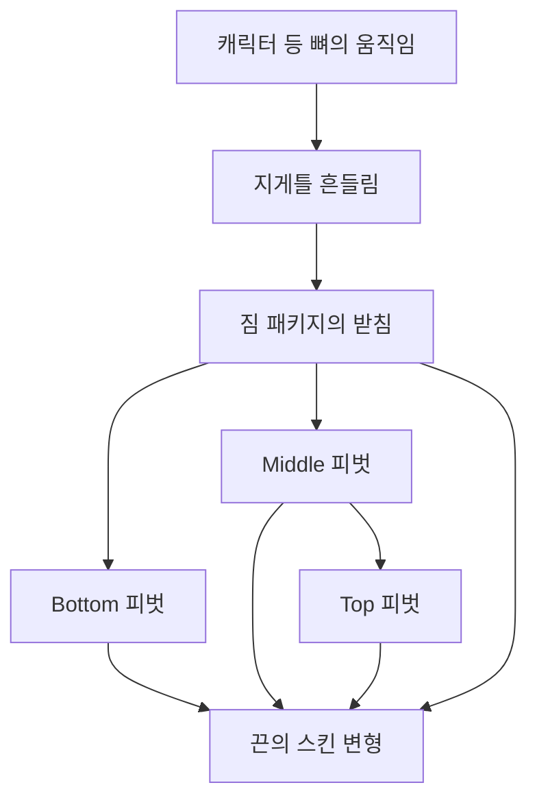

## 걸음이 멈춘 뒤에도 짐은 잠깐 따라 움직인다

DCB의 지게 짐은 캐릭터 등에 붙은 한 덩어리로만 움직이지 않는다. 출발·정지·등반에서 받침이 움직이면 짐이 그 가속도의 반대쪽으로 기울고, 받침이 멈춘 뒤에는 잠깐 출렁이다 돌아오는 구조다. 위에 얹힌 짐은 아래 짐의 움직임까지 받아 서로 다른 시점에 반응한다.

현재 표현은 지게틀 전체의 흔들림, Bottom·Middle·Top 세 짐의 기울기와 위아래 튐, 짐 사이를 잇는 끈의 변형으로 구성된다. 짐을 새로 실을 때는 걷지 않아도 충격을 따로 주며, 바닥에 놓은 지게도 적재 순간에는 흔들린다.

이 글은 2026년 10월 19일 확인한 `SecondaryMotionChain`, 지게 부착·적재 코드, 모델·짐 프리팹과 수정 이력을 기준으로 한다. 날짜는 긴 프레임 발산을 고친 9월 22일의 대표 커밋 작성일이다. 이번에 Unity를 실행하거나 새 플레이 영상을 촬영하지는 않았다.

## 지게틀과 짐을 따로 움직인다

지게틀은 캐릭터의 등 뼈 움직임에서 가속도를 읽는다. 앞뒤·좌우 회전을 감쇠 스프링으로 계산하고, 부착 기본 자세 위에 덧붙인다. 현재 모델 프리팹의 틀 흔들림은 진동수 1.6Hz, 감쇠비 0.4, 최대 각도 5도다.

짐은 각자의 받침에 피벗을 두고 그 위에서 회전한다. Bottom과 Middle은 패키지 루트를 받침으로 쓰고, Top의 피벗은 Middle 피벗 아래에 둔다. 세 짐을 모두 직렬로 연결한 구조는 아니다. Middle이 기울면 Top의 받침도 움직이므로 위쪽에 추가 지연이 생긴다.

갱신 순서도 이 구조를 따른다. `JigeCarrierAttachment`가 애니메이션 자세와 끈을 처리하고 틀 흔들림을 적용한 다음, 짐의 `Tick()`을 직접 호출한다. 짐 자체의 `LateUpdate`는 외부 구동 모드에서 계산을 건너뛴다. 같은 프레임의 틀 움직임을 읽고, 두 번 계산되는 일을 피하기 위한 연결이다.

들기·내려놓기 애니메이션이 지게 루트를 제어하거나 자세를 복원하는 동안에는 틀 흔들림으로 그 회전을 덮지 않는다. 짐 스프링은 별도 경로로 진행하되 구르기·처형 루트 모션·지게 애니메이션 중에는 입력을 현재 설정의 0.3배로 줄인다. 기존 흔들림 속도를 즉시 0으로 만드는 처리와는 다르다.

## 위치를 그대로 복사하지 않고 가속도를 입력으로 쓴다

각 링크는 피벗의 현재 변형 위치가 아니라 **받침에서 계산한 기본 접점의 월드 위치**를 읽는다. 이전 위치와 속도를 저장해 다음 값을 구한다.

$$
v_t = \frac{p_t-p_{t-1}}{\Delta t},\qquad
a_t = \frac{v_t-v_{t-1}}{\Delta t}
$$

이를 기본 자세의 로컬 축으로 옮겨 반대 부호로 사용한다. 앞으로 가속할 때 뒤로 남고, 감속할 때 앞으로 넘어오는 입력이다. 받침이 기울어 중력의 로컬 방향이 달라진 양도 더한다. 이력 초기화 직후의 중력을 기준값으로 저장하므로, 저작된 기본 자세 자체를 곧바로 기울기 입력으로 취급하지 않는다.

입력은 세 목표로 변환한다. 로컬 앞뒤 성분은 pitch, 좌우 성분은 roll, 위아래 성분은 위로 뜨는 거리의 목표가 된다. 각도·거리마다 이득과 한계를 따로 둔다. 모든 물체에 Rigidbody와 Joint를 연결해 충돌·장력을 푸는 구조는 아니며, 입력에 반응하는 보조 움직임을 Transform에 적용한다.

현재 짐 프리팹의 가벼운 적재 상태 기준값은 다음과 같다. 각도는 도, 튐 한계는 cm다.

| 링크 | 진동수 / 감쇠비 | 앞뒤 목표 범위 | 좌우 목표 범위 | 위로 뜨는 한계 |
| --- | --- | --- | --- | --- |
| Bottom | 2.2Hz / 0.5 | −2 ~ 0.5 | ±1.5 | 0.5 |
| Middle | 1.5Hz / 0.38 | −4 ~ 0.7 | ±3.5 | 1.2 |
| Top | 1.2Hz / 0.32 | −6 ~ 1 | ±5 | 2.0 |

몸 쪽 기울기는 작고 몸 반대쪽은 더 크게 허용한다. 위쪽 짐은 더 낮은 진동수와 감쇠비로 움직인다. 목표값은 범위 안으로 제한하지만 실제 스프링 상태는 부드러운 벽으로 되돌리므로 순간적으로 한계를 조금 넘을 수 있다. 이 표를 모든 프레임의 엄격한 회전 상한으로 읽으면 안 된다. 아래로는 받침을 뚫지 않도록 튐 위치와 아래 방향 속도를 별도로 막는다.

## 감쇠 스프링으로 목표를 뒤늦게 따라가게 한다

각도와 튐에 쓰는 기본식은 같다. 상태를 $x$, 목표를 $x_\text{target}$, 속도를 $v$라 하면 다음 가속도를 계산한다.

$$
\ddot x = \omega^2(x_\text{target}-x)-2\zeta\omega v,
\qquad \omega=2\pi f
$$

진동수 $f$는 목표를 따라가는 빠르기, 감쇠비 $\zeta$는 남아 있는 출렁임을 줄이는 정도를 조절한다. 코드는 속도를 먼저 갱신하고 새 속도로 위치를 갱신하는 반암시적 오일러 적분을 쓴다. 한계 밖에서는 추가 복원력을 주고, 바깥으로 나가는 속도에 추가 감쇠를 준다.

적재율도 연결된다. `JigeCargo.FillRatio`를 플레이어의 가벼움·무거움 기준 0.3~0.8에서 다시 0~1로 바꾼 값이 짐에 전달된다. 무거움 1에서 진동수는 0.7배, 기울기·튐 이득은 1.3배, 감쇠비는 0.9배다. 예를 들어 Top의 진동수는 1.2Hz에서 0.84Hz로 바뀐다. 실제 질량과 관성 모멘트를 계산한 결과가 아니라 적재감 표현을 위한 설정이다.

현재 Wanderer의 이동 애니메이션에는 `CarryLoad`를 0.6으로 고정하는 임시 설정이 켜져 있다. **짐 스프링은 그 고정 애니메이션 값 대신 실제 적재율에서 계산한 값을 읽는다.** 걸음 블렌드와 짐의 무게 반응을 같은 값이라고 설명하지 않는 이유다. 이동 속도·스태미너 계산은 [별도 글](/writing/jige-carry-burden/)에서 다룬다.

## 짐을 실을 때는 속도에 충격을 더한다

적재 성공 뒤에는 지게틀과 짐에 각각 충격을 준다. 등 지게는 틀의 각속도에, 바닥 지게는 받침 기준의 충격 연출에 연결된다. 짐 사슬에는 pitch·roll 각속도와 위로 뜨는 속도를 더한다. 각도 충격은 아래 링크 0.5배에서 위 링크 1배까지 커지고, 위로 뜨는 속도는 각 링크에 그대로 더한다.

평소 꺼 두는 바닥 지게의 짐 스프링은 적재 때만 켠다. 현재 코드 기본값으로 1.6초를 기다린 뒤 이력을 초기화하고 다시 끈다. 다시 실으면 대기를 새로 시작한다. 이는 정착 여부를 측정해 끄는 판정이 아니라 정해 둔 시간 뒤에 기본 자세로 돌리는 정책이다.

적재 소리와 새 짐 아래쪽의 먼지도 같은 피드백 경로에 있다. 이 글의 범위는 짐·틀의 운동 연결이며, 소리와 먼지의 품질을 새로 재생해 평가한 것은 아니다.

## 끈도 짐 사이의 움직임을 따라가게 한다

짐만 기울고 끈이 고정돼 있으면 연결 부위가 벌어진다. 끈은 패키지 루트와 세 피벗을 뼈로 사용하는 `SkinnedMeshRenderer`로 바꿨다. 정지 자세를 유지하는 bind pose와 정점 가중치는 에디터 도구에서 굽는다. bind pose의 인덱스가 렌더러의 뼈 인덱스에 대응한다는 API 규약은 [Unity 문서](https://docs.unity.com/en-us/engine/6000.3/script-reference/unityengine/mesh/getbindposes)를 함께 참고했다.

현재 도구는 끈 정점에서 각 영역의 **삼각형 표면까지 거리**를 계산한다. 표면 가까이에서는 가장 가까운 뼈 하나에 붙이고, 사이에 뜬 구간은 가까운 두 뼈에 거리 역제곱 비중으로 배분한다. 작은 두 번째 비중은 하나로 합친다. 서로 다른 짐 사이의 끈이 두 뼈를 따라 보간되는 구조이며, 매 프레임 천·밧줄의 장력을 푸는 시뮬레이션은 아니다.

피벗을 끼울 때는 메시의 월드 자세를 유지한다. 지게 재생성 도구도 사용자가 조정한 뼈 자세와 중첩 짐 인스턴스를 보존하도록 보완했다. 기존 저작 자세를 되돌리거나 짐을 지우면 스프링이 맞아도 화면 결과가 달라지기 때문이다. 재생성 검사는 실제 작업 프리팹을 덮는 대신 임시 사본에서 수행하도록 바뀐 기록을 확인했다.

## 긴 프레임에서 짐이 빙빙 돌던 문제

초기 적분은 프레임 시간을 제한된 서브스텝 수로 나눴다. 정상 프레임에서는 작게 계산됐지만, 0.333초처럼 긴 프레임에서는 당시 상한 4회로 나누어 한 번에 약 0.083초를 진행했다. 한계 밖의 추가 복원력까지 걸리면 이 큰 간격에서 상태가 발산할 수 있었다.

9월 22일 수정은 **서브스텝 개수를 제한하더라도 계산 간격을 키우지 않는 것**이다. 현재 프리팹은 120Hz·최대 8회다. 긴 프레임에는 최대 $8/120\approx0.0667$초만 적분하고 나머지 시간을 이월하지 않는다. 가속도 차분은 실제 프레임 시간을 사용한다.

0.333초를 모두 따라잡는 정확도를 포기하고 보조 움직임의 계산 간격과 비용을 제한한 선택이다. 일정 범위의 히치를 다룬 수정이며, 모든 진동수·강성·프레임 조건에서 안정하다는 보장은 아니다. 순간이동으로 판단하는 20m/s 초과 이동은 입력에서 제외하고, 나머지 가속도도 60m/s²로 제한한다. 순간이동 판정은 이번 입력을 지우는 처리이며 기존 스프링 상태 전체를 초기화하는 `ResetHistory()`와는 구분된다.

## 작업 이력과 확인한 범위

| 작성일 | 커밋 | 확인한 변경 |
| --- | --- | --- |
| 2026-09-16 | `d8ab3846c` | 세 짐 피벗·스프링, 끈 스키닝, 틀 다음 짐 갱신과 재생성 보존 |
| 2026-09-16 | `7e146ca8b` | 플레이 중 각도·한계·끈 범위·정지 후 정착을 계측하는 도구 보완 |
| 2026-09-22 | `bd4b806c6` | 긴 프레임의 서브스텝 간격 확대를 막고 회귀 검사 추가 |
| 2026-10-01 | `e92ded943` | 짐 적재 순간 틀·짐 충격과 먼지 피드백 연결 |

담당한 부분은 캐릭터 이동과 적재 상태를 틀·짐·끈의 움직임에 연결하고, 기존 프리팹 자세와 애니메이션을 보존하는 구조다. 코드와 도구 작성에는 AI 보조를 사용했으며 위 커밋에 공동 작성 기록이 있다. 기존 지게·짐 모델과 캐릭터 애니메이션 원본을 직접 제작한 성과로 포함하지 않는다.

과거 문서에는 경사 코스 보행과 정지 후 정착 검사 결과가 기록돼 있다. 이번에는 당시 원본 실행 로그·캡처를 재대조하지 않았으므로 그 수치를 현재 품질이나 새 실행 결과로 사용하지 않는다. 현재 검사 소스에서 계단 응답, 방향, 부드러운 한계, 순간이동, 초기화와 `LongFramesDoNotDiverge`의 판정 내용을 확인했다. 마지막 검사는 1/3초 프레임 60회에서 받침 위치를 번갈아 바꾸며 유한한 각도와 범위를 검사한다. **검사 코드 확인과 검사 실행은 별개이며, 이번에 해당 Unity 검사·컴파일·Play Mode를 실행하지 않았다.**

## 다음 촬영에서 확인할 장면과 예상

1. **같은 코스에서 출발·등속·정지한다.** 가속·감속 때 서로 반대 방향의 입력이 생기고, 등속에서는 가속도 입력이 줄어야 한다. 캐릭터의 보행 애니메이션 자체가 받침을 계속 움직이므로 정지 후 각도가 항상 정확히 0이 되는 것을 통과 조건으로 두지는 않는다.
2. **적재율을 달리하고 같은 동작을 한다.** 무거움 1의 Top은 0.84Hz 설정을 사용한다. 이동 모션의 임시 고정값 0.6을 바꾼 결과와 구분하고, 실제 각도·끈 관통·정착 시간을 함께 기록한다.
3. **긴 프레임과 순간이동을 따로 재현한다.** 전자는 적분 시간 제한, 후자는 입력 제외가 작동해야 한다. NaN만 없는지 보지 말고 최대 각도·화면의 회전·복귀까지 확인한다. 틀 흔들림은 별도의 단일 프레임 적분이므로 짐 사슬 수정만으로 전체 지게의 히치 검증을 대신하지 않는다.

바닥 적재의 1.6초 복원 순간, 등·바닥 지게 교체와 들기·내려놓기의 끈 모양도 함께 확인할 항목이다. 실제 관통·음향·프레임 비용은 새 촬영과 측정 전까지 미검증으로 남긴다.
