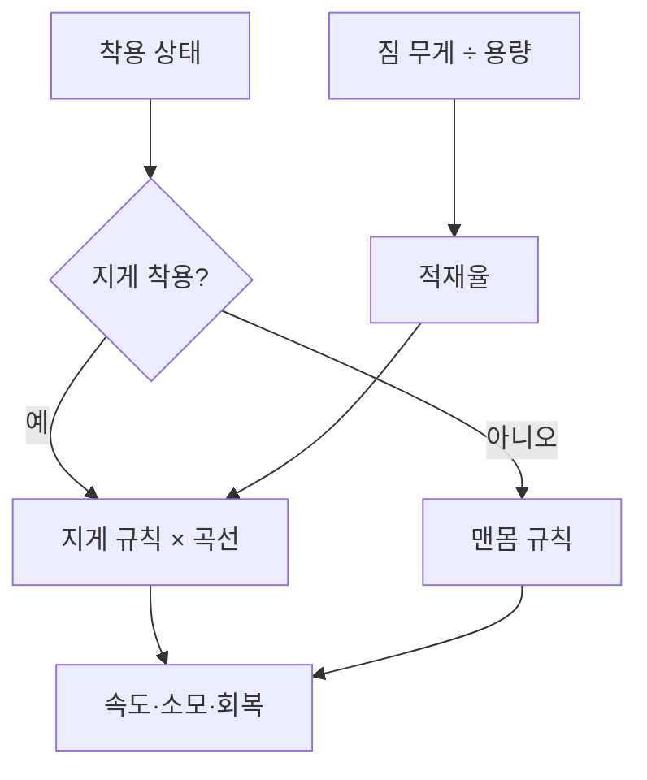

## 지게 착용 상태와 짐 무게

DCB는 지게로 짐을 운반하는 액션 게임이다. 운반 중 이동과 행동 비용을 조정하기 위해 지게를 진 상태와 내려놓은 상태의 규칙을 나눴다. 여기에 짐의 적재율로 계산하는 배율을 추가할 수 있게 구성했다.

짐과 틀이 늦게 따라 흔들리는 움직임, 끈 변형과 적재 충격은 [지게 짐의 출렁임](/writing/jige-cargo-secondary-motion/)에서 설명한다. 이 글은 이동 속도·행동 비용·회복 계산을 다룬다.

다른 이동 보정과 입력·행동 제어를 이어서 다루는 목록은 [게임플레이 밸런싱과 제어](/portfolio/dcb/features/gameplay-balancing/)에서 확인할 수 있다.

이 글은 소스의 계산 경로와 2026년 10월 17일 확인한 설정을 다룬다. **현재 저장된 카탈로그의 적재 속도·소모·회복 곡선은 모두 배율 1이다.** 지게 착용 여부에 따른 차이는 있지만, 짐 무게가 늘 때 추가로 느려지거나 소모가 커지는 설정은 꺼져 있다. 코드에 있는 기본 곡선과 실제 적용 데이터는 구분해야 한다.

## 적재율과 착용 여부를 따로 계산하기

`JigeCargo`는 짐 무게와 지게 용량을 관리한다. 부담 계산에 사용하는 `LoadRatio`는 다음 비율이다.

$$r = \frac{W_{cargo}}{C_{cargo}}$$

용량으로 나눌 때는 0에 가까운 값이 들어오는 것을 막는다. 계산용 비율은 1을 넘을 수 있게 두고, 짐의 표시 단계를 정하는 `FillRatio`는 0~1로 제한한다. 화면 표시가 가득 찼다는 이유로 초과 적재 정보까지 사라지지 않도록 두 값을 구분했다.

플레이어가 실제로 부담하는 비율은 착용 여부를 한 번 더 확인한다. 지게를 내려놓으면 지게에 짐이 남아 있어도 플레이어의 부담 적재율은 0이다. 적재 배율은 1로 돌아가고 맨몸 규칙을 사용한다.



착용 여부와 적재율에 따른 계산 흐름이다.

## 상태별 규칙과 적재 곡선

밸런스 값은 `GameBalanceCatalog`에 모았다. `WandererCarryBurdenBalance`는 맨몸·지게 상태의 규칙과 적재율 곡선을 읽어 배율을 계산한다. 플레이어 코드는 계산 결과를 이동 스탯과 스태미너에 적용한다.

걷기·달리기·질주의 초당 소모, 행동 비용 배율, 정지·이동 중 회복 배율은 착용 상태별 값이다. 적재율에 따른 속도·소모·회복 곡선은 별도 값이다. 빈 지게의 부담과 짐을 더 실었을 때의 추가 부담을 따로 조정할 수 있다.

계산 관계를 줄이면 다음과 같다. 적재 배율은 지게를 진 동안만 적용하고, 이동 중 회복 배율은 움직일 때만 곱한다.

```text
이동 속도 = 상태 기준 속도 × 적재 속도 배율 × 다른 이동 보정
이동 소모/초 = 해당 걸음의 초당 소모 × 적재 소모 배율
행동 비용 = 행동 기준 비용 × 착용 상태의 행동 배율 × 적재 소모 배율
회복/초 = 기본 회복량 × 착용 상태의 회복 배율 × 이동 중 회복 배율 × 적재 회복 배율
```

이동 속도는 기존 스탯 보정 체계의 `JigeCargoWeight` 항목으로 적용한다. 지게 코드가 최종 속도를 덮어쓰지 않으므로 인벤토리 무게·갈증·물속 감속과 함께 계산할 수 있다. 적재 보정이 필요 없어지면 해당 항목을 제거한다.

현재 카탈로그는 맨몸과 지게 상태의 달리기 소모·행동 비용·회복 배율을 다르게 설정한다. 반면 세 적재 곡선은 중립값이다. 곡선을 활성화했을 때의 운반 시간과 조작감은 따로 확인해야 한다.

## 이동 소모를 처리하는 시간 기준

이동 중 스태미너 소모는 `FixedUpdate`에서 계산한다. 이번 스텝에 차감할 양은 초당 소모량에 `Time.fixedDeltaTime`을 곱한 값이다. 이동 입력과 현재 걸음을 확인하며, 공격·구르기·지게 동작·기어오르기 중에는 이 경로의 이동 소모를 적용하지 않는다.

이전 구현에는 렌더 프레임마다 실행되는 코루틴에서 고정 시간 간격을 곱해 차감하던 경로가 있었다. 초당 실행 횟수와 곱하는 시간 간격이 달라 렌더 프레임 수에 따라 초당 차감량이 달라질 수 있었다. 현재는 이동 소모의 호출 주기와 시간 간격을 물리 스텝 기준으로 맞췄다.

이 설명은 이전 작업 기록과 현재 소스의 계산 경로를 대조한 내용이다. 프레임 제한을 바꾼 최신 빌드의 비교 측정은 아직 하지 않았다.

## 고갈·회복과 입력 처리

스태미너가 고갈되면 소모가 있는 이동 상태를 계속 선택하지 않도록 질주→달리기→걷기 순서로 확인한다. 현재 지게를 진 상태에서는 전력질주 입력을 사용하지 않고, 기본 걷기와 버튼을 누른 동안의 달리기를 사용한다.

고갈 처리는 이동 상태를 바꾸는 것과 함께 달리기 입력의 유지 상태를 해제한다. 버튼을 계속 쥔 채 회복됐다는 이유로 다시 가속하지 않고, 다시 눌렀을 때 달리도록 처리한다. 입력 상태와 실제 걸음 전환은 함께 확인해야 할 부분이다.

이동 소모 중에는 스태미너 회복을 중단한다. 소모가 끝나면 회복 지연을 거쳐 다시 회복한다. 공격·구르기·패리 때문에 이동 소모가 끊긴 경우에는 이동 코드가 회복을 바로 켜지 않고, 행동 종료 경로에서 회복을 재개하게 한다.

## 조절 도구와 비용

밸런스 조절 창에서 상태별 값과 적재 곡선을 함께 편집할 수 있다. 예시 적재율에 따른 계산 결과를 보고, 플레이 중에는 현재 상태·속도·스태미너 변화량을 대조하는 구조다. 계산 예상값과 실제 이동 결과는 따로 확인한다.

상태와 곡선을 나누면 조절 항목이 늘어난다. 코드의 기본값, 저장된 카탈로그와 런타임에 로드한 값도 대조해야 한다. 현재 카탈로그의 적재 곡선처럼, 계산 경로가 있어도 설정에 따라 추가 효과가 없을 수 있다.

## 확인한 범위와 남은 일

2026년 10월 16일 기록에서 `JigeCarryBurdenBalanceTests` 10개가 통과했다. 검사 범위는 상태·적재 배율 계산, 곡선 보간과 범위 제한, 카탈로그 직렬화와 조절 창의 속성 연결이다. 이 결과가 실제 운반 플레이의 통과를 뜻하지는 않는다.

이번 글 작성에서는 적재 데이터, 플레이어 적용 경로, 입력·행동 비용, 밸런스 계산과 카탈로그를 읽어 대조했다. Unity 검사나 게임 플레이를 다시 실행하지 않았다.

다음 확인은 같은 길에서 맨몸·빈 지게·적재 상태를 비교하는 것이다. 사용할 카탈로그를 먼저 확정하고, 적재 곡선이 중립인지 활성 상태인지 함께 기록해야 한다. 지게 내려놓기 후 보정 해제, 고갈 후 버튼 유지·재입력, 공격 종료 후 회복도 같은 조건에서 확인한다. 실제 화면과 측정 자료는 아직 첨부하지 않았다.

## 담당 범위

지게 규칙과 게임 시스템 구현을 담당했다. DCB 개발 과정에서 코드 초안과 검증 도구 작성에 AI를 사용했다. 3D 모델·애니메이션 원본은 기존 자산을 사용했다.

트레버설의 접촉과 보행 전환은 [IK 트레버설 구현](/writing/ik-traversal/)에서, AI 사용과 검증 구분은 [AI를 사용한 구현과 검증 과정](/writing/working-with-ai/)에서 다룬다.
