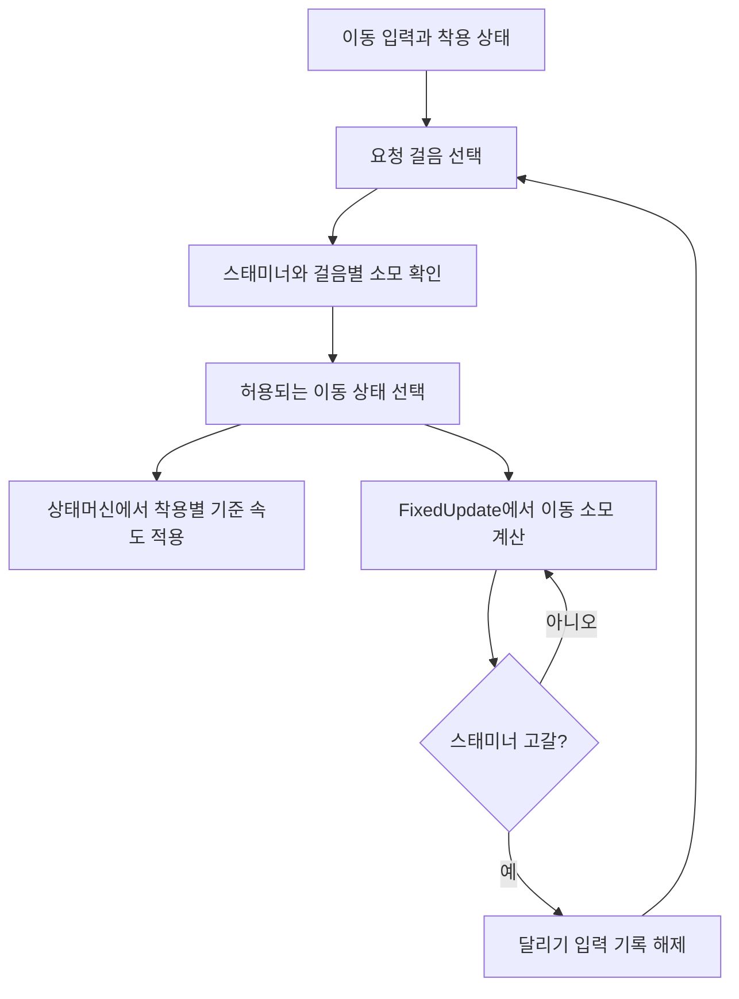

## 같은 이동 버튼을 착용 상태에 맞게 해석한다

DCB에서 지게를 진 동안은 기본적으로 걷고, Shift를 누르면 달린다. 지게를 내려놓으면 기본 이동이 달리기로 바뀌고 Shift는 질주 입력이 된다. Ctrl로 걷기를 요청할 수도 있다. 스태미너를 모두 쓰면 지게 달리기는 걷기로, 맨몸 질주는 달리기로 내려간다.

고갈 뒤에는 **걸음 전환과 달리기 입력 기록 해제**를 함께 처리한다. Shift를 계속 쥐고 있는 동안 스태미너가 조금 회복됐다는 이유로 자동으로 다시 가속하지 않게 한 구조다. 회복 후 Shift를 놓았다 다시 누르면 높은 걸음을 요청한다.

글 날짜는 걸음별 소모와 고갈 처리를 통합한 작업의 작성일이다. 이번에는 게임 코드나 값을 바꾸지 않았고, Unity 실행·입력 재현·속도 측정도 새로 하지 않았다. 아래 규칙은 현재 소스와 저장값에서 확인한 내용이다.

## 현재 선택하는 걸음과 기준값

이동 입력이 있고 무기 전환 등의 별도 제한이 없는 조건을 기준으로 한다. 표의 속도는 카탈로그 기준값이며 인벤토리 무게·갈증·경사·물속·충돌 등의 영향이 반영된 실제 이동 속도가 아니다.

| 착용 상태 | 이동 요청 | 선택 상태 | 기준 속도 | 이동 스태미너 소모 |
| --- | --- | --- | --- | --- |
| 맨몸 | 기본 이동 | 달리기 `MOVE_STATE` | 2.40 m/s | 0/초 |
| 맨몸 | Shift | 질주 `SPRINT_STATE` | 3.60 m/s | 10/초 |
| 맨몸 | 걷기 입력 활성 | 걷기 `WALK_STATE` | 1.12 m/s | 0/초 |
| 지게 착용 | 기본 이동 | 걷기 `WALK_STATE` | 1.50 m/s | 0/초 |
| 지게 착용 | Shift | 달리기 `MOVE_STATE` | 4.19 m/s | 5/초 |
| 지게 착용 | 걷기 입력 활성 | 걷기 `WALK_STATE` | 1.50 m/s | 0/초 |

`GameBalanceCatalog`의 `wanderer.movement`와 `wanderer.carryBurden`에 저장된 값이다. 현재 적재 소모 곡선은 배율 1이므로 표에 추가 적재 배율은 붙지 않는다. 지게용 질주 속도·소모 필드도 있지만, 현재 지게 착용 중에는 질주 상태를 선택하지 않는다. 필드가 있다는 사실과 실제 사용 상태를 구분해야 한다.

보따리를 든 동안도 기본은 걷기이고 질주를 허용하지 않는 예외가 있다. 이 글의 맨몸 표는 지게도 보따리도 들고 있지 않은 조건이다.

### 키를 누르고 있다는 사실과 게임이 보관한 요청

`GameInputSystem`의 `IsSprintPerformed`는 물리적인 Shift 키를 매번 직접 조회한 값이 아니다. 입력 시작 때 켜고 취소 때 끄며, 게임의 고갈 처리에서도 지울 수 있는 **달리기 요청 기록**이다. 이처럼 입력 이후에도 보관하는 상태를 여기서는 래치라고 부른다.

키보드 Shift는 누른 동안 유지하는 방식이다. 패드 L3는 누를 때마다 요청을 켜고 끄는 토글이며, 스틱을 중립으로 되돌리면 패드의 달리기·걷기 기록을 해제한다. 패드의 작은 스틱 기울기로 걷기에 들어가는 경로도 따로 있다. 따라서 패드의 재입력은 Shift를 놓았다 누르는 조작과 구분해 확인해야 한다.

상태 선택 함수는 걷기 기록을 먼저 검사한다. 다만 입력 처리에서는 Ctrl을 누르면 달리기 기록을 지우고, Shift를 누르면 걷기 기록을 지운다. **실제 두 키의 동시 유지가 언제나 Ctrl 우선이라는 뜻은 아니다.** 두 플래그가 모두 켜진 경우의 함수 우선순위와, 누른 순서대로 플래그가 바뀌는 입력 동작을 구분했다. 두 키를 다른 순서로 누르고 놓는 결과는 현재 실행에서 다시 확인할 항목이다.

## 입력·허용 여부·기준 속도를 나눠 적용한다

이동 상태 선택은 `GetMoveStateByInput()`이 맡는다. 무기 넣기·꺼내기 중에는 걷기를 선택하고, 그 외에는 착용 상태의 기본 걸음과 입력 기록으로 요청 상태를 만든다. 이어 `StepDownToAffordableMoveState()`가 현재 스태미너로 허용할 걸음을 확인한다.



이 흐름도는 호출 책임을 요약한 것으로 실제 실행 화면이나 프레임별 계측 결과는 아니다. 소모 계산은 아래에서 설명하는 이동 조건을 충족할 때만 수행한다.

`CanAffordMoveState()`는 스태미너가 남아 있거나 해당 걸음의 소모가 0이면 허용한다. 질주가 불가능하면 달리기를, 달리기도 불가능하면 걷기를 선택한다. 현재 맨몸 달리기는 소모가 0이므로 고갈 뒤에도 달릴 수 있다. 지게 달리기는 소모가 5이므로 걷기로 내려간다. 이름이 같은 달리기 상태라도 착용별 소모 설정에 따라 결과가 달라진다.

현재 판정은 **스태미너가 0보다 큰가**를 본다. 다음 물리 스텝 비용을 전부 낼 수 있는지나 최대치의 일정 비율까지 회복했는지를 검사하지 않는다. 아주 적게 회복한 뒤 재입력해도 진입할 수 있고, 다음 소모에서 바로 고갈될 수 있다. 최소 재진입 자원이나 별도 재입력 대기 시간을 구현했다고 설명할 수는 없다.

선택한 상태에 들어가면 `PlayerBehaviourStateMachine`이 `PlayerController.GetLocomotionSpeed()`로 착용별 속도를 가져와 스탯과 이동 가중치에 적용한다. 입력 함수가 최종 이동 속도를 직접 덮어쓰는 구조는 아니다.

### 같은 걷기 상태에서도 지게를 내려놓으면 속도를 다시 넣는다

이동 키를 누른 채 지게를 내려놓으면 `UpdateCarryLocomotion()`이 바뀐 착용 상태를 감지해 입력에 맞는 상태를 다시 고른다. 기본 이동은 지게 걷기에서 맨몸 달리기로 바뀐다.

걷기 요청을 유지하고 있으면 상태 이름은 계속 `WALK_STATE`일 수 있다. 같은 상태로 `SetState()`를 호출하는 것만으로는 진입 처리가 다시 실행되지 않으므로, `RefreshLocomotionSpeed()`로 기준 속도도 갱신한다. 이 경로가 있어야 같은 걷기 안에서도 지게 기준 1.50과 맨몸 기준 1.12를 구분할 수 있다.

`Player.Carry`의 오래된 설명 주석에는 맨몸 속도 1.8·3.6·4.7이 남아 있다. 현재 카탈로그와 컨트롤러는 1.12·2.40·3.60을 사용한다. 이 글의 수치는 주석의 초기값 대신 현재 저장값과 적용 경로를 기준으로 적었다.

## 고갈 처리에서 상태를 고르는 순서가 문제였다

첫 수정에서는 지게를 내려놓았을 때 맨몸 이동 규칙을 적용하면서 질주 해제 순서도 수정했다. 당시 기록과 diff에서 확인한 문제는 **달리기 요청을 남겨 둔 채 상태를 다시 고르는 것**이었다.

질주를 취소하려고 해도 입력 기록이 여전히 켜져 있으면 상태 선택 함수가 질주를 다시 요청할 수 있었다. 이미 같은 질주 상태라면 재진입 처리가 실행되지 않는 문제도 겹쳤다. 수정은 다음 순서로 이뤄졌다.

1. 질주를 끊어야 하는 경로에서 `ClearSprintInput()`으로 요청을 먼저 지운다.
2. 지워진 입력과 현재 착용 상태로 이동 상태를 다시 선택한다.
3. 스태미너 0에서는 비용이 있는 높은 걸음에 새로 진입하지 못하게 한다.

이어진 수정에서는 이 처리를 지게 달리기까지 확장했다. 질주 고갈은 `CancleSprint()`를 거치고, 지게 달리기 고갈은 입력 기록을 지운 뒤 `GetMoveStateByInput()`으로 돌아간다. 이름이 비슷한 취소 함수 하나로 모든 상황을 똑같이 처리하지 않고, 실제로 소모하던 걸음에 맞춰 연결한 것이다.

### 지게 달리기에서 고갈되는 순서

다음은 현재 설정을 적용한 소스상 흐름이다. 이번에 촬영하거나 재실행한 결과는 아니다.

1. 지게를 지고 이동하며 Shift를 눌러 달리기 요청을 켠다. 스태미너가 남아 있으면 `MOVE_STATE`를 선택한다.
2. 이동 소모에서 `5 × Time.fixedDeltaTime`을 차감하고, 부족해지면 자원을 0으로 제한한다.
3. 고갈 처리에서 달리기 요청을 지운다. 지게의 기본 걸음인 `WALK_STATE`를 다시 선택한다.
4. 다음 이동 소모 갱신에서 걷기의 비용 0을 확인하고 소모 중 상태를 끝낸다. 다른 행동이 회복을 막지 않으면 지연 후 회복한다.
5. Shift를 계속 쥐고만 있으면 새로운 입력 시작이 없어 지워진 요청을 다시 켜지 않는다. 회복 후 Shift를 놓았다 누르면 달리기를 다시 요청한다.

맨몸 질주는 고갈 시 입력 기록을 지운 뒤 기본 달리기로 돌아간다. 현재 맨몸 달리기 비용은 0이라, 질주를 멈추더라도 이동 전체를 걷기로 제한하지 않는다.

고갈 직후 빠르게 재입력했지만 자원이 아직 0인 경우는 별도로 봐야 한다. 입력 시작은 요청 기록을 켜지만 상태 선택은 낮은 걸음으로 제한한다. 이 진입 제한 자체는 기록을 다시 지우지 않는다. 이후 회복과 다른 이동 상태 변경 이벤트가 만나는 결과까지 엄격한 재입력 잠금으로 보장하는 구조는 아니다. 이 경계 조건도 실제 입력 순서로 재현할 필요가 있다.

### 멈춤과 모든 행동 취소에서 입력을 지우지는 않는다

질주에서 일반 이동이나 멈춤으로 넘어가는 상태 진입은 `CancleSprint(false)`를 사용해 달리기 기록을 건드리지 않는다. 키보드 Shift를 쥔 채 이동 키만 놓았다 다시 누르는 상황과 고갈을 구분하려는 처리다.

반대로 지게 착용 중에는 같은 버튼이 질주가 아닌 달리기다. 일반 `CancleSprint()` 경로마다 무조건 기록을 지우면 공격·구르기·가드 후에도 매번 Shift를 다시 눌러야 한다. 현재 취소 함수는 질주 가능 여부와 상태 재선택 여부를 확인하고, 지게 달리기의 **고갈 경로에서 필요한 해제는 따로 수행**한다. 행동별 실제 복귀와 입력 제한은 후속 분석에서 더 추적할 범위다.

## 초당 소모의 호출 주기와 시간 간격을 맞췄다

이 글의 대표 작업에서는 질주 전용 소모 코루틴을 없애고 걷기·달리기·질주의 소모를 `FixedUpdate` 한 경로로 모았다. 이전 코루틴은 `yield return null`로 렌더 프레임마다 반복하면서 차감량에는 `Time.fixedDeltaTime`을 곱했다. 호출 횟수와 시간 간격의 기준이 달랐다.

고정 시간 간격을 0.02초, 설정 소모를 10/초로 둔 **단순 계산 예**는 다음과 같다. 이는 새로 측정한 결과가 아니다.

```text
이전 방식의 한 번 차감 = 10 × 0.02 = 0.2
1초에 60번 반복하면 0.2 × 60 = 12
1초에 144번 반복하면 0.2 × 144 = 28.8
```

현재는 물리 스텝에서 해당 스텝 시간만큼 차감한다. 렌더 프레임이 늘었다는 이유만으로 소모를 더 자주 적용하던 경로를 제거했다. 다만 이 수정만으로 프레임 제한별 실시간 소모·정지·일시정지·시간 배율의 모든 경우가 검증됐다고 할 수는 없다. 최신 실행 비교는 남아 있다.

이 경로는 이동 상태와 이동 입력을 확인한다. 공격·구르기·지게 동작·기어오르기 중에는 이동 소모를 제외하며, 실제 좌표 이동량이 0인지로 소모를 판정하지 않는다. 따라서 벽에 막힌 채 이동 입력을 유지할 때의 자원 소모는 별도로 확인해야 한다.

소모 중에는 다른 경로에서 회복을 켜더라도 플레이어의 회복 갱신이 적용하지 않는다. 행동 제한이 없는 일반 이동에서 소모가 끝나면 저장값 기준 0.3초의 회복 지연을 거친다. 지게를 지고 움직일 때 회복 배율은 `0.8 × 0.6 = 0.48`이며, 현재 적재 회복 곡선은 배율 1이다. 실제 회복량은 시트의 최대 스태미너·회복 시간과 다른 자원 상태의 영향도 받는다. [행동 비용과 회복 지연·재개](/writing/action-stamina-cost-and-recovery/)에서는 공격·구르기의 종료 처리와 다른 패리 경로를 구분해 설명한다.

## 작업 기록에서 확인한 변경

| 순서 | 확인한 변경 | 현재 설명에 적용할 범위 |
| --- | --- | --- |
| 1 | 맨몸 기본 달리기·Shift 질주, 착용 변화 시 속도 갱신, 질주 해제 순서 수정 | 입력·상태 책임과 수정 원인. 당시 속도를 현재값으로 사용하지 않음 |
| 2 | 착용별 걸음 비용, 고정 스텝 소모, 비용에 따른 하향 선택·달리기 기록 해제 | 이 글의 대표 작업과 현재 고갈 처리 |
| 3 | 정면 걸음 주기와 맨몸 기준 속도 1.12·2.40·3.60으로 추가 조정 | 현재 카탈로그 수치와 과거 속도 기록의 구분 |

첫 수정의 작업 기록에는 당시 배치 Play Mode에서 맨몸 이동·착용 전환·고갈 반증을 통과했다는 내용이 있다. 그 당시 환경에서 남긴 기록이고 보고서 원본은 확보하지 못했으며, 이후 속도·애니메이션·소모 경로가 바뀌어 현재 동작의 검증으로 쓰지 않았다.

검사 코드는 세 곳에 있다. `JigeCarryBurdenBalanceTests`는 모드별 비용·곡선·회복 계산과 직렬화를, `JigeCarryBurdenPlayModeVerifyTool`은 자원 3에서 달리다 고갈된 뒤 걷기 전환, 입력 기록 해제, Shift 유지 중 재가속 없음, 재입력 후 달리기를, `JigeBareLocomotionPlayModeVerifyTool`은 맨몸 질주의 고갈 뒤 상태와 입력 기록을 확인한다. 이번에는 세 가지 모두 실행하지 않았다.

## 다음 실행에서 비교할 조건

[플레이어 밸런싱 도구](/writing/player-balance-tuning-tool/)로 자원을 설정하고 상태·속도·초당 소모를 보면서 고갈 조건을 만들 수 있다. 비교할 때는 코드 ref, 적용 카탈로그, 시작 자원, 착용과 적재, 동선, 입력 시각, 렌더 제한과 고정 시간 간격을 함께 기록한다. 아래는 아직 실행하지 않은 확인 목록이다.

- 지게 달리기 중 고갈 뒤 Shift를 유지하고 회복했을 때 걷기 전환, 요청 기록 해제, 자동 달리기 없음. 이어서 Shift를 놓았다 누르면 달리기 재진입과 소모
- 맨몸 질주 중 고갈 뒤 비용 0인 달리기로 전환하고 질주 요청이 해제되는지
- 자원 0에서 재입력해 유지하다 다른 이동 이벤트를 만났을 때 진입 제한과 요청 기록의 잔류, 회복 후 재선택
- Shift 유지 중 이동 키만 놓았다 누르기, 지게 들기와 내려놓기, Ctrl과 Shift의 입력·해제 순서, 패드 L3 토글과 스틱 중립 복귀가 기록과 걸음에 미치는 영향
- 평지와 벽에 막힘, 렌더 제한 60과 144에서 입력 기반 소모와 실제 이동량의 차이

걷기 비용을 양수로 바꾸는 실험은 주의가 필요하다. 걷기보다 낮은 이동 상태가 없어 자원이 0이어도 걷기를 막지 않고, 걷는 동안 소모 중 상태가 이어져 회복을 막을 수 있다. 현재 저장값의 걷기 비용은 0이며 이번에 바꾸지 않았다.

## 담당한 범위와 연결되는 분석

이 작업의 범위는 착용별 이동 규칙, 입력 기록과 상태 재선택 순서, 비용에 따른 걸음 제한, 소모 시간 기준과 확인 경로를 연결한 부분이다. 관련 작업에는 Claude 공동 작성 기록이 있다. AI 보조를 받은 코드 작성과 별개로, 현재 어떤 조건을 선택하고 어디까지 확인했는지 근거를 나눠 남겼다. 이 글에서 모델·애니메이션 원본 제작이나 현재 플레이 감각까지 검증했다고 주장하지 않는다.

속도·자원·적재 계산은 [지게 운반의 이동 속도와 스태미너](/writing/jige-carry-burden/), 값을 편집하고 조건을 재현하는 도구는 [플레이어 밸런싱 도구 제작](/writing/player-balance-tuning-tool/)에서 이어진다. 행동 비용·회복 지연·다른 이동 보정과 입력 제약의 분석은 [게임플레이 밸런싱과 제어 목록](/portfolio/dcb/features/gameplay-balancing/)에 순서대로 연결한다.
