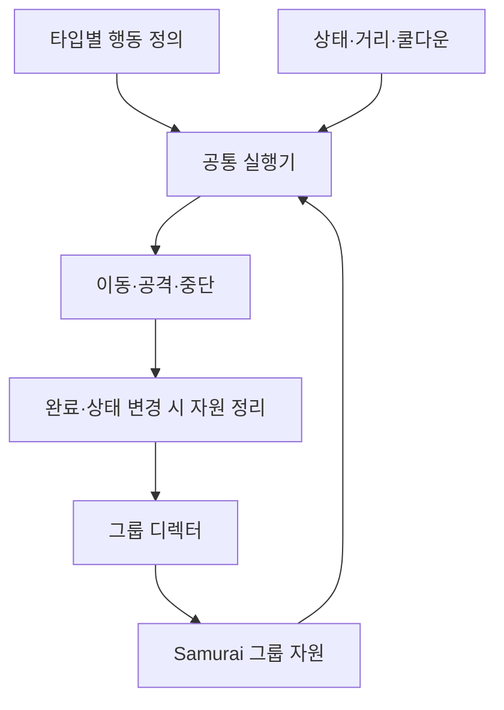

현재 Samurai가 자리를 나누고 접근·공격·블러프를 이어 가는 흐름은 [Samurai의 그룹 전투](/writing/monster-combat/)에서 먼저 설명한다. 이 글은 기존 첫 글의 구현 분석 부분을 분리한 것이며, 대표 수정 이력의 작성일인 2026년 8월 14일을 유지한다.

## 개별 패턴과 그룹 제어의 역할

DCB의 몬스터 행동은 개별 패턴과 그룹 전투 제어로 나눴다. 개별 패턴은 인지·추격·공격·피격 복구를 실행한다. 그룹 제어는 여러 몬스터가 사용할 공격 기회와 접근 위치를 배정한다.

Okgwi, Oni, Samurai의 패턴은 상태·조건·행동·전이를 C#으로 조합하는 DSL(도메인 전용 언어)로 정의했다. 타입별 정의를 레지스트리에 등록하고, 스폰 시 공통 실행기인 `MonsterBehaviorRunner`를 만든다. 풀에서 다시 태어날 때도 실행기와 행동 인스턴스를 새로 구성한다.

그룹 제어에는 `CombatGroupDirector`를 사용한다. **현재 세 종류 중 그룹 전투 조건과 행동을 사용하는 정의는 Samurai다.** 그룹 관련 조건이나 행동을 조회할 때 참여자를 등록한다. 일반 몬스터가 모두 같은 그룹 규칙에 자동으로 들어가는 구조는 아니다.



개별 행동과 그룹 자원의 관계를 간추린 구조도다. 아래는 현재 구조가 된 이유를 설명하는 수정 기록이다. 기능 설명 글과 마찬가지로 2026년 10월 18일 소스와 이전 이력을 대조했으며, 이번 보완에서 게임을 실행해 얻은 결과는 아니다.

## 상태가 바뀔 때 이동이 끊긴 문제

추격에서 공격으로 넘어갈 때 멈칫하는 현상에는 실행 순서 문제가 있었다. 7월 28일 작업 기록에서는 스케줄러가 즉시 끝나는 설정 행동도 한 틱에 하나씩 처리한 점을 원인으로 남겼다. 대상 지정이나 이동 옵션 설정이 여러 개 이어지면, 실제 이동 행동에 도달하기까지 틱을 소모했다.

`MonsterBehaviorScheduler`는 즉시 `Success`를 반환한 행동 다음으로 같은 틱 안에서 이어 실행하도록 바꿨다. 이동이나 모션 대기처럼 `Running`을 반환하는 행동에서는 멈춘다. 실패, 시퀀스 한 바퀴 완료, 상태 변경도 중단 조건이며 한 틱의 실행 수에는 상한을 뒀다.

복합 행동 안에서 상태가 바뀌는 경우도 처리해야 했다. 공격 후보를 고르는 내부 분기가 추격 상태로 돌려보내면서, 바깥 행동은 `Success`를 반환할 수 있다. 반환값만 보고 다음 행동을 계속 실행하면 이전 상태의 남은 지시가 새 상태를 덮을 수 있다. 현재는 행동 실행 전후의 상태를 비교해 달라졌으면 이어 실행을 멈춘다.

8월 9일에는 실행기가 전이를 적용한 직후 틱을 끝내는 경로도 수정했다. 전역 전이, 현재 상태의 전이 순서로 처음 성립한 전이 하나를 적용하고, 새 상태의 행동을 같은 틱에 실행한다. 이때 전이를 다시 검사하지 않아 한 틱에서 여러 전이가 연쇄 적용되는 것을 막는다. 상태 노드와 실제 상태가 일치하는지도 확인한다.

이 변경은 상태와 행동 사이의 실행 공백을 줄이기 위한 처리다. 애니메이터 전이, 루트 모션과 실제 이동의 연결 품질은 별도로 재생해 확인해야 한다.

## 플레이어를 따라 포위 대열 전체가 회전한 문제

8월 10일 작업 기록에는 플레이어가 빙빙 돌 때 몬스터가 무작정 따라오는 피드백이 있다. 당시 포위 슬롯의 기준축은 `player.transform.forward`였다. 플레이어가 제자리에서 시선만 돌려도 슬롯 전체가 함께 회전했고, 몬스터는 계속 움직이는 목적지를 쫓게 됐다.

현재 `UpdateSlotAnchor`는 살아 있는 참여자 위치의 평균을 구하고, 플레이어에서 그 중심으로 향하는 수평 방향을 목표축으로 사용한다. 현재 코드의 허용 편차는 30도이며, 그 안에서는 기존 축을 유지한다. 편차가 커지면 초당 최대 40도로 따라간다. 중심이 플레이어와 거의 겹쳐 방향을 정할 수 없으면 기존 축을 유지하고, 축이 아직 없을 때만 플레이어 정면을 초기값으로 쓴다.

슬롯의 배정과 목적지 계산은 같은 축을 사용한다. 반면 플레이어에게 보이는 방향을 평가하는 전방 보너스나 후방 페널티는 실제 시선을 기준으로 계산한다. 위치를 배치할 기준과 시야를 판단할 기준을 구분한 것이다.

### 슬롯 후보와 재추첨도 함께 수정하기

기준축을 바꾼 뒤에도 슬롯 배정과 갱신에서 문제가 남았다.

- **측면 슬롯이 후보에서 빠지는 문제:** 세 명용 측면 슬롯을 전방 각도 필터로 제외하면서 가까운 자리 배정이 무너지고, 등록 순서에 따른 빈자리 배정으로 넘어갔다. 후방 슬롯을 후보에서 삭제하는 대신 비용을 더해 선호도를 낮췄다. 가까운 측면 자리를 계속 비교할 수 있게 했다.
- **도착 전에 목적지가 다시 바뀌는 문제:** 슬롯을 재배정할 때 무작위 각도까지 다시 뽑아 목적지가 튀었다. 8월 14일 수정에서는 슬롯 각도를 배정 대상 수가 달라질 때만 새로 만들도록 캐시했다. 어느 개체가 어느 자리를 쓸지는 주기적으로 다시 계산한다.

현재 구현에는 진형의 기준축, 슬롯 각도, 개체별 배정의 갱신 시점을 나누는 처리가 들어 있다. 실제 전투에서 교차 이동이나 목적지 떨림이 얼마나 남는지는 최신 씬에서 재확인해야 한다.

## 세 몬스터가 압박 동작만 반복한 문제

그룹 전투는 두 권한을 나눠 사용한다. 공격 토큰은 공격에 들어갈 기회이고, `Wind` 클레임은 앞으로 다가가 압박하는 동작을 수행할 권한이다. 토큰 없이 클레임만 가진 개체는 공격하는 척한 뒤 물러나는 블러프를 할 수 있다.

Samurai의 정규 공격 전이는 다음 조건을 함께 확인한다.

```text
대치 상태 + Wind 단계 + 공격 쿨다운 완료
+ 공격 토큰 + Wind 클레임 + 사거리 충족 + 플레이어가 구르는 중이 아님
```

헛스윙, 구르기 후딜과 가드 유지에 반응하는 공격은 별도 전이다. 이 전이들도 토큰을 요구하지만, 정규 대치 사이클의 Wind 조건을 모두 거치는 것은 아니다.

8월 10일 기록에서는 세 명이 모두 접근·급진입 동작을 반복한 원인을 여러 경로에서 찾았다. 일반 클레임 상한이 토큰 두 개와 블러프 한 자리를 더한 세 개여서, 세 명 모두 압박에 들어갈 수 있었다. 대치 도중 추격으로 전환될 때 클레임이 남는 경로와, 권한을 사용하지 못하는 개체에 토큰이 배정되는 경로도 있었다.

수정은 다음처럼 나눴다.

| 원인 | 현재 구현의 처리 |
| --- | --- |
| 클레임 상한이 참여 인원과 같아 제한이 작동하지 않음 | 세 명 이상에서는 일반 클레임 상한을 참여 인원보다 하나 적게 제한 |
| 재도전 대기 중이라 압박에 들어갈 수 없는데 토큰을 받음 | 다수 전투의 일반 토큰 후보에서 재도전 대기 중인 개체 제외 |
| 대치 본문이 중단되어 끝부분의 반납 행동에 도달하지 못함 | 추격 상태 진입을 감지해 클레임을 비블러프 종료로 반납 |
| 권한을 보유했던 시간까지 장기 대기로 계산해 즉시 재부여 | 토큰 반납 시 대기 시작 시각 갱신. 블러프 후에는 재도전 대기가 끝난 시점부터 계산 |

두 명일 때는 클레임 상한을 인원보다 하나 적게 줄이지 않는다. 토큰과 클레임이 서로 다른 개체에 배정되면, 둘을 함께 요구하는 정규 공격 조건을 아무도 만족하지 못할 수 있기 때문이다.

토큰의 유휴 회수 시간도 공격 준비 시간과 맞춰야 했다. 과거에는 준비가 끝나기 전에 토큰을 회수하는 경우가 기록돼 있다. 현재 저장된 밸런스 카탈로그의 유휴 회수 시간은 2.4초다. 코드에서는 실제 `Attack` 진입 여부를 기록해, 이미 공격에 들어간 개체를 이 유휴 회수 대상으로 보지 않는다. 이 값은 현재 카탈로그 설정이며 최신 플레이의 적정성을 측정한 결과는 아니다.

### 일반 상한과 강제 부여 경로의 차이

현재 `UpdateBackstop`에는 쿨다운이 끝났는데 토큰·클레임을 오래 받지 못한 개체에 두 권한을 함께 주는 보완 경로가 있다. 이 경로에는 일반 배정의 토큰·클레임 상한을 다시 검사하는 코드가 없다.

따라서 일반 배정에 제한이 들어갔다는 설명과, 모든 상황에서 동시 공격자 수가 그 제한을 지킨다는 실행 결과는 구분한다. 장기 대기 보완이 발동할 때의 권한 수와 공격 진입은 반복 전투에서 확인할 항목이다.

## 정상 완료와 중단 경로에서 자원 반납하기

반납을 행동 시퀀스의 마지막에만 두면, 피격이나 추격 전환으로 시퀀스가 끊겼을 때 자원이 남는다. 디렉터는 실제 몬스터 상태 변경 이벤트를 구독해 중단 경로도 처리한다.

| 상황 | 소스에서 확인한 처리 |
| --- | --- |
| 정상 공격 완료 | `FinishAttackCycle`에서 다음 쿨다운을 정하고 토큰·클레임 반납 |
| 공격 상태 진입 | 공격 진입 표시 후 클레임 반납. 토큰은 공격 동안 유지 |
| 피격·패리 취소·처형 상태 진입 | 토큰·클레임 회수. 패리 취소에는 별도 패널티와 이양 처리 |
| 대치에서 추격으로 전환 | 압박 중단으로 보고 클레임 반납 |
| 사망·귀환·평시 복귀 | 참여 해제 시 토큰·클레임과 상태 이벤트 구독 정리 |

디렉터의 정리 경로는 비활성·시뮬레이션 수면 상태의 개체도 제거 대상으로 확인한다. 이런 경로가 있다는 사실과 실제 스폰·사망·풀 재사용을 반복해도 자원이 남지 않는다는 결과는 별도 검증이다.

## 확인한 범위와 실행 검증이 남은 부분

이 글은 스폰의 실행기 생성, Samurai의 인지·추격·대치·공격 전이, 거리 층과 슬롯, 토큰과 클레임의 배정·반납, 플레이어 신호와 기술 선택, 동료 사망 반응, 저장된 밸런스 설정을 읽고 썼다. 기술 선택의 쿨다운 대체 경로와 `Press` 역할의 미구현 분기도 확인했다. 수치는 카탈로그 저장값이며 실제 씬에서 잰 위치·애니메이션 길이·공격 간격이 아니다. 작업 이력은 다음 변경을 중심으로 확인했다.

| 시점 | 수정 기록 |
| --- | --- |
| 7월 28일 | 즉시 끝나는 행동을 같은 틱에서 이어 실행하고, 행동 내부의 상태 변경 시 중단 |
| 8월 9일 | 전이가 적용된 틱에도 도착 상태의 본문 실행 |
| 8월 10일 | 포위 기준축·슬롯 후보, 토큰 유휴 회수와 클레임 배정·반납 수정 |
| 8월 14일 | 슬롯 각도 재추첨 시점 등 대치 동작 수정 |

과거 기록의 체감이나 수치를 최신 빌드의 결과로 쓰지 않았다.

검사 코드는 세 곳에 있다. `MonsterBehaviorDslTests`는 정의 생성과 전이 순서, 피격 중단을, `MonsterAnimationFlowTests`는 소스 문자열을, `GroupCombatBalanceFacadeTests`는 밸런스 속성의 연결을 확인한다. 이번에는 Unity 컴파일, EditMode 검사, 실제 전투를 실행하지 않았고, 10월 16일 선택 검사 167개에도 이 검사들은 들어 있지 않다. 전투 화면과 비교 영상도 아직 없다.

다음 실행에서 조건을 고정해 볼 것은 다음과 같다.

- 같은 위치에서 시선만 돌렸을 때 슬롯 기준축과 개체 배정, 대열의 교차와 떨림
- 한 명·두 명·세 명 이상에서 토큰과 클레임 수, 정규·반응 공격 진입, 장기 대기 보완의 발동
- 헛스윙과 연속 공격의 일부 실패, 구르기 후딜, 가드, 밀착의 신호와 전용 쿨다운, 적격 기술 선택. 구르기 중과 종료 뒤의 반응 구분
- 동료 사망·패리·압박 중 거리 벌리기·피격·사망 뒤의 권한 회수와 공격 재개, 물러나는 역할의 실제 재생, 처형 중 주변 공격 여부
- 스폰·사망·풀 반환을 반복했을 때 이전 실행기의 상태, 이벤트 구독, 점유의 잔류

## 담당 범위

몬스터 행동 정의와 실행 흐름, 그룹 공격 기회·포위 위치 제어를 구현했다. DCB 개발 과정에서 코드 후보와 검증 도구 작성에 AI를 사용했다. 모델·애니메이션 원본은 기존 자산을 사용했으며, 위 설명의 상태·이동 제어와 구분한다.

AI 사용과 검증 구분은 [AI를 사용한 구현과 검증 과정](/writing/working-with-ai/)에서, 여러 작업의 분리·통합은 [워크트리 병행 작업](/writing/parallel-ai-worktrees/)에서 다뤘다.
