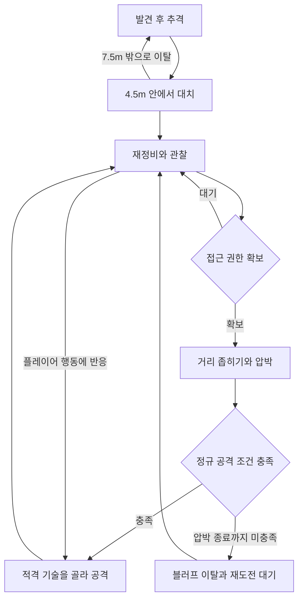

## 현재 Samurai 전투는 어떻게 진행되는가

Samurai는 플레이어를 발견하면 쫓아오다가, 가까워지면 주변에 자리를 잡고 거리를 잽니다. 각자 재정비, 관찰, 압박의 리듬을 타고, 그룹에서 공격 기회를 받은 개체만 베기나 밀치기로 들어갑니다. 기회 없이 접근한 개체는 물러나는 블러프로 압박을 끝냅니다.

이 글은 현재 전투 흐름을 먼저 설명하고, 이를 받치는 행동 DSL과 수정 과정은 뒤에서 다룹니다. 아래 수치는 현재 행동 정의와 밸런스 카탈로그 저장값입니다.

### 발견 → 추격 → 대치

평시에는 주변을 배회합니다. 플레이어를 시야로 발견하면 대상을 잡고 추격합니다. 소리만 들었을 때는 우선 제자리에서 소리 난 방향을 살핍니다. 소리가 1.5초 이상 이어지거나 세 차례 누적되면 추격을 검토합니다. 실제로 대상을 획득할 수 있어야 추격으로 올라갑니다. 소리가 다시 들리지 않은 채 4초가 지나면 경계를 풀고 돌아갑니다.

추격 중 플레이어와의 거리가 **4.5m 이내**가 되면 대치로 전환합니다. 이때부터는 계속 달려들기보다 자기 자리로 이동하고, 멈춰 바라보고, 공격할 때 거리를 좁힙니다. 플레이어가 **7.5m 밖**으로 멀어지면 대치를 접고 다시 추격합니다. 대치에 들어오는 거리와 다시 쫓는 거리를 다르게 둬 경계에서 상태가 반복 전환되는 것을 줄였습니다.

추격에는 활동 범위도 있습니다. 출생 위치에서 25m 넘게 벗어나고 플레이어도 5m 밖에 있으면 복귀합니다. 복귀 중에는 출생 위치의 15m 범위 안으로 돌아오거나 플레이어가 3.5m 안에 붙어야 시야 재획득을 통한 재교전이 열립니다. 이 거리 조건과 별도로, 교전 중 대상을 1.2초 동안 놓치면 복귀하는 경로도 있습니다.

## 여러 Samurai는 자리를 어떻게 나누는가

각 개체의 자리는 플레이어 주위의 **거리 층과 방향**으로 정합니다. 공격 권한을 가진 개체는 안쪽을 쓰고, 다음 기회를 기다리는 개체와 나머지 인원은 더 바깥에서 움직입니다.

| 역할 | 현재 기준 거리 | 현재 배정 방식 |
| --- | --- | --- |
| 교전 `Engaged` | 3.3m | 공격 권한 보유자 |
| 대기 `Ready` | 5.25m | 권한이 없는 참여자 중 최대 3명 |
| 외곽 `Reserve` | 9m | 나머지 참여자. 일반 공격 권한·접근 권한 배정에서는 제외 |

이 값은 실제 위치를 고정하는 원이 아니라 이동 목표를 계산하는 기준입니다. 재정비에서는 기준보다 0.8m 바깥으로, 관찰에서는 기준 거리로 목표를 잡습니다. 압박에 들어가면 자기 슬롯을 벗어나 플레이어에게 접근합니다. 외곽에서 오래 기다린 개체는 안쪽 대기 자리의 우선순위가 올라가고, 막 자리를 바꾼 개체에는 최소 체류 시간을 둡니다.

방향은 그룹 참여자들의 중심을 기준으로 나눕니다. 슬롯을 배정할 대상이 두 명이면 기준축의 좌우 50도, 세 명이면 중앙과 좌우 약 110~130도 후보를 사용합니다. 여기에 개체별 좌우 이동이 더해지므로 항상 같은 각도에 서 있는 진형은 아닙니다. 플레이어가 제자리에서 시선만 돌렸다고 진형 전체가 같은 속도로 따라 돌도록 만들지는 않았습니다.

**아래의 인원 수는 현재 디렉터에 등록된 참여자 수입니다.** 맵에 존재하는 Samurai 전체 수나 미리 정해진 3인 팀의 정원을 뜻하지 않습니다. 현재 디렉터는 등록된 참여자들을 함께 조율하며, 이 글에서 별도의 부대별 지휘 체계를 구현했다고 설명하지 않습니다.

## 거리를 재다가 접근하고, 공격하거나 빠집니다

대치 중 개체마다 재정비 `Recover`, 관찰 `Watch`, 압박 `Wind`를 돕니다. 공격 뒤에는 쿨다운을 새로 뽑고 남은 시간으로 단계를 정하며, 첫 대치 진입 시점도 분산합니다. 그래서 전원이 같은 박자로 움직이지 않고, 쿨다운 값이 실제 공격 간격을 보장하지도 않습니다.

| 단계 | 현재 행동 |
| --- | --- |
| 재정비 | 플레이어를 보면서 거리를 벌리거나 자기 슬롯으로 자리를 바꿉니다. 조건이 맞으면 좌우·뒤 회피 스텝도 씁니다 |
| 관찰 | 대체로 멈춰 상대를 봅니다. 자리에서 많이 벗어났을 때만 짧게 보정 이동합니다 |
| 압박 | 접근 권한을 받은 개체가 가속해 다가갑니다. 마지막 한 걸음은 급진입 모션이고, 짧은 정지 뒤 공격 또는 이탈로 갑니다 |

### 공격 기회와 접근 기회는 따로 있습니다

실제로 공격에 들어갈 권한이 **공격 토큰**, 다가가 압박 동작을 할 권한이 **Wind 클레임**입니다. 접근만 허용하고 공격은 허용하지 않을 수 있어서 같은 접근이 실제 공격도 되고 블러프도 됩니다.

| 등록된 참여자 | 일반 공격 토큰 상한 | 일반 Wind 클레임 상한 |
| --- | --- | --- |
| 1명 | 1개 | 토큰 보유자만 접근. 토큰 없는 블러프는 열지 않음 |
| 2명 | 1개 | 2개 |
| 3명 | 2개 | 2개 |
| 4명 이상 | 2개 | 3개 |

세 명이면 A가 공격을 준비하고 B가 접근했다 빠지고 C가 자리를 잡는 구성이 나옵니다. 역할은 고정이 아니라 쿨다운·거리·권한 배정에 따라 바뀝니다. 토큰은 후보를 잠시 모아 가까운 개체, 플레이어 정면 쪽, 공격성이 높은 개체, 오래 기다렸거나 거절당한 개체를 우선하며, 한 명만 남으면 수집 대기와 재획득 제한을 생략합니다. 이 표는 일반 배정의 상한이고, 오래 권한을 못 받은 개체를 구제하는 경로는 상한을 다시 검사하지 않습니다. 따라서 동시 공격 수가 항상 1~2명이라고 확인된 것은 아닙니다.

### 접근 뒤 무엇으로 이어지는가

정규 공격은 쿨다운·토큰·클레임이 준비되고 사거리 안이어야 열리며, 플레이어가 구르거나 무적이면 보류합니다. 공격 후보는 밀치기 `Skill02`, 주력 베기 `Skill03`, 연속 베기 `Skill04`, 큰 베기 `Skill05`이고, 조건을 만족한 후보끼리 가중 선택하므로 정해진 순서를 반복하지 않습니다. 큰 베기는 공격적인 성향에게만 열립니다. 기술별 쿨다운을 먼저 적용하되, 쓸 수 있는 후보가 하나도 없으면 그 제한을 풀고 다시 고릅니다.

공격으로 이어지지 않으면 클레임을 반납하고 재도전 대기에 들어갑니다. 블러프 이탈은 대체로 후퇴이고 일부는 옆으로 돌아 빠지며, 몸이 바짝 붙어 있으면 후퇴합니다. 접근 권한이 없는 개체는 자기 슬롯을 기준으로 재배치하며 차례를 기다립니다.

위 흐름의 현재 저장값은 다음과 같습니다.

| 항목 | 값 |
| --- | --- |
| 공격 뒤 쿨다운 | 1.9~2.7초 |
| 급진입 목표 간격 | 약 2.2m |
| 접근 이동이 멈추는 거리 | 약 3.05m. 급진입보다 0.85m 멀고, 마지막 전진은 모션의 루트 이동 |
| 급진입 뒤 정지 | 0.2~0.4초. 공격 조건을 이미 만족하면 전이가 먼저 성립할 수 있음 |
| 일반 토큰의 후보 수집 시간 | 0.15초 |
| 정규 공격 사거리 | 2.5m |
| 베기 가중치 | 주력 1, 연속 0.7, 큰 베기 0.5 |
| 블러프 뒤 재도전 대기 | 1.8~2.6초 |
| 블러프 이탈 | 후퇴 80%, 옆으로 빠지기 20%. 1m 이내면 후퇴 |

현재 분기를 간추린 그림입니다. 반응 공격에도 토큰·거리·전용 쿨다운 조건이 있고, 피격·패리·사망과 귀환 전이는 생략했습니다.

## 플레이어의 헛스윙·구르기·가드에 반응하기

Samurai는 자기 대치 리듬만 기다리지 않습니다. 플레이어에게 빈틈이 생기면 정규 압박 사이클보다 먼저 다음 반응 전이를 검사합니다.

| 플레이어 행동 | 현재 반응 조건 |
| --- | --- |
| 가까이에서 공격을 빗맞힘 | 무명중 스윙 종료 후 0.6초 이내 신호를 사용합니다. 헛스윙 발생 위치의 3m 반경과 현재 거리 3m 이내를 확인하며, 반응 전용 쿨다운은 3.5초입니다. |
| 구르기를 끝냄 | 종료 후 0.4초 이내, 현재 거리 3.5m 이내에서 후딜 압박을 시도합니다. 반응 전용 쿨다운은 3초입니다. |
| 가드를 계속 유지함 | 2초 이상 유지했고 2.5m 안에 있으면 공격 진입을 열고 밀치기를 높은 가중치의 후보에 넣습니다. 밀치기의 공유 쿨다운은 7.5초입니다. |

이 반응도 공격 토큰이 있어야 합니다. 헛스윙·구르기 반응은 추격 또는 대치에서, 가드 반응은 대치에서 검사합니다. 입력 하나에 모든 개체가 무조건 달려들거나 해당 기술을 확정 재생하는 방식으로 설명할 수는 없습니다. 공격 진입 뒤에는 적격 기술의 가중 선택이 남아 있습니다.

가드와 별개로 1m 이내에 2초 이상 계속 붙어 있으면 밀치기 후보가 열립니다. 이 밀치기는 정규 공격 등으로 공격 상태에 들어간 뒤 고르는 후보이며, 밀착만으로 곧바로 공격 상태로 바뀌는 독립 전이는 아닙니다. 가드 밀치기와 같은 쿨다운을 공유합니다.

헛스윙은 공격 버튼 입력만으로 판정하지 않습니다. 실제 스윙 또는 연속 공격의 한 단계가 끝날 때 유효타가 없었는지 기록합니다. 정규 공격을 잠시 보류하게 만드는 회피와, 회피가 끝난 뒤의 빈틈을 노리는 반응은 서로 다른 시점을 사용합니다.

## 패리하거나 동료를 쓰러뜨리면 어떻게 바뀌는가

Samurai를 패리하면 해당 개체의 공격이 취소되고 공격 쿨다운에 0.8초 패널티를 더합니다. 취소 모션 중에는 거리·방향 조건을 만족하면 정면 처형 기회가 열리며, 취소 모션의 실제 길이를 기준으로 기회를 유지합니다. 동시에 다른 적도 살펴야 합니다. 디렉터는 외곽을 제외한 다른 후보에게 토큰을 직접 넘기고 쿨다운을 완료시켜 공격 재개를 준비합니다. 공격 진입에는 해당 개체의 나머지 조건도 필요합니다.

교전 중 등록된 동료가 죽으면 남은 개체의 공격성이 갈립니다. 현재 공격성이 0.5 이상이면 0.15를 더하고, 그보다 낮으면 0.15를 뺍니다. 공격성이 높은 쪽은 다음 사이클에서 더 긴 압박 준비 구간과 큰 베기 후보를 가질 수 있습니다. 낮은 쪽은 다른 성향 구간으로 내려갈 수 있으며, 시간이 지나면 각자 처음의 기준 공격성으로 서서히 돌아갑니다.

동료 사망 시에는 플레이어 정면에서 가장 가까운 적격 개체 한 명에게 물러나는 역할을 배정합니다. 현재 Samurai의 대치 본문에는 이 `Evade` 역할을 받아 대기 거리 쪽으로 빠지는 행동이 연결돼 있습니다. 디렉터는 다른 적격 개체에 `Press` 역할도 기록하지만, **현재 Samurai 정의에는 이 역할을 읽어 별도의 측면 압박을 실행하는 분기가 없습니다.** 따라서 ‘한 명이 물러날 때 다른 한 명이 반드시 측면에서 파고든다’는 완성된 연계 패턴으로 소개하지 않습니다.

플레이어 입장에서 보이는 것은 네 가지입니다. 주변에서 자리를 바꾸는 움직임, 짧은 관찰, 다가온 뒤의 공격 또는 이탈, 그리고 빈틈에 대한 반응입니다.

## 구현과 자산

행동과 그룹 제어는 AI와 함께 구성했고, 모델과 애니메이션은 기존 자산을 사용했습니다. 상태 전환의 이동 공백, 포위 대열의 회전, 토큰과 클레임 정리는 [몬스터 행동 DSL·그룹 제어의 문제 해결 과정](/writing/monster-combat-analysis/)에서 다룹니다. Unity Behavior에서 자체 구조로 바꾼 배경은 [FSM·DSL 전환 글](/writing/unity-behavior-to-code-fsm/)에서 이어집니다.
