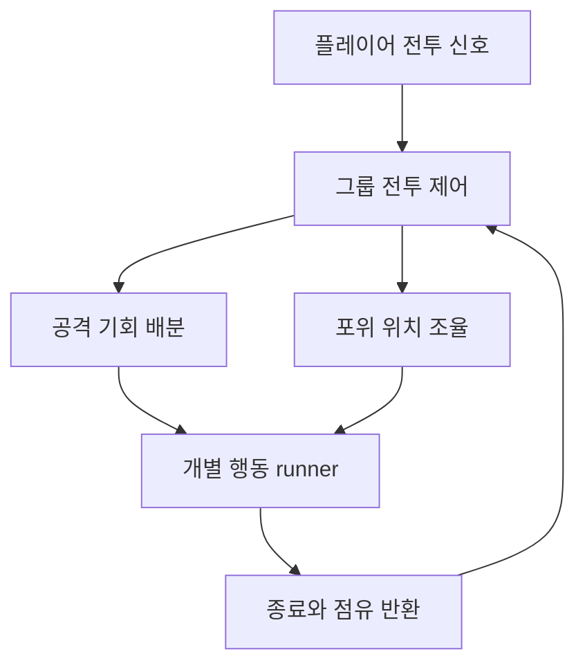

## 개별 패턴만으로 부족한 장면

몬스터 한 마리의 공격이 자연스러워도 여러 마리가 모이면 전투의 느낌이 달라집니다. 각자 공격 거리만 보고 접근하면 같은 자리에 겹치거나 동시에 공격하게 됩니다. DCB에서는 **개별 패턴의 실행**과 **그룹의 기회·위치 조율**을 분리했습니다.

## 상태와 행동을 읽을 수 있게

Okgwi·Oni·Samurai의 행동은 코드 기반 DSL로 정의하고 공통 runner가 실행합니다. 상태, 전이 조건, 행동을 조합해 패턴의 의도를 읽기 쉽게 구성합니다. 에디터 뷰어에서는 구성한 그래프를 확인할 수 있습니다.

이 구조에서 쿨다운을 표시하는 시점, 행동의 종료 콜백, 전이한 상태가 실행되는 시점은 공통 계약입니다. 패턴별로 애니메이터를 임의 초기화하기보다 runner와 행동이 책임지는 구간을 구분합니다.

## 그룹이 소유하는 정보

`CombatGroupDirector`는 등록된 멤버와 공격 토큰, 준비 상태와 포위 슬롯을 다룹니다. 개별 몬스터가 할 수 있는 행동과 지금 그 행동을 해도 되는지를 나누는 방식입니다. 그룹 관련 행동을 사용하는 시점에 멤버가 등록되며, 해제 시 구독과 점유 상태를 함께 정리합니다.

## 포위 대열의 기준축

포위 위치를 플레이어의 정면에만 붙이면 플레이어가 방향을 바꿀 때 몬스터 전체가 원을 그리며 따라갈 수 있습니다. 현재 구현은 플레이어에서 그룹 중심으로 향하는 방향을 기준으로 사용하고, 각도 여유와 제한된 추종 속도로 위치 변화가 과도해지지 않도록 합니다.

중요한 것은 공격 횟수를 줄이는 기능 하나가 아니라, **기회 배분과 공간 배치가 전투 의도에 맞는지**입니다.

## 다음에 확인할 장면

한 종류의 접근·공격·피격 후 재개와, 여러 몬스터의 토큰 배분·방향 전환·사망 후 점유 해제를 함께 확인합니다. 이 글은 현재 구현 구조를 정리한 노트이며, 최신 게임 씬에서의 스폰과 반복 전투 영상은 별도로 확인해 덧붙입니다.
