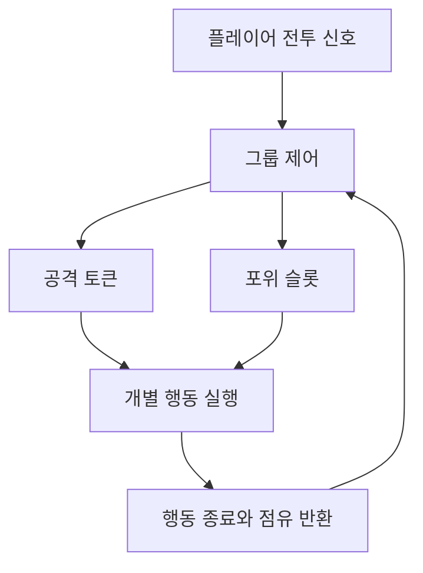

## 구성

DCB의 몬스터 행동은 개별 패턴과 그룹 전투 제어로 나눴다. 개별 패턴은 접근·공격·피격 등의 행동을 실행한다. 그룹 제어는 여러 몬스터의 공격 기회와 위치를 조정한다.

## 행동 DSL

Okgwi, Oni, Samurai의 행동을 코드 기반 DSL로 정의하고 공통 runner로 실행한다. 상태, 전이 조건, 행동을 조합하는 구조다. 에디터 뷰어에서 구성한 그래프를 확인할 수 있다.

쿨다운 표시, 행동 종료 콜백, 전이한 상태의 실행 시점은 공통 실행 규칙을 따른다. 행동이 끝났다는 이유만으로 애니메이터를 초기화하면 상태 전환 중 모션이 끊길 수 있어 처리 시점을 구분했다.

## 그룹 제어

`CombatGroupDirector`는 멤버 목록, 공격 토큰, 공격 준비 상태와 포위 슬롯을 관리한다. 개별 몬스터가 공격할 수 있는 상태인지와 그룹에서 공격 기회를 받았는지를 함께 확인한다.

그룹 관련 행동을 사용할 때 멤버를 등록한다. 멤버를 해제할 때는 이벤트 구독과 토큰·준비 상태 점유도 정리한다.

## 포위 위치 계산

포위 기준축을 플레이어 정면으로 잡으면 플레이어가 방향을 돌릴 때 몬스터 전체가 따라 움직일 수 있다. 현재는 플레이어에서 그룹 중심으로 향하는 방향을 기준으로 사용한다.

각도 차이에 여유를 두고 추종 속도를 제한해 작은 방향 변화마다 포위 위치를 다시 잡지 않도록 했다.

## 확인할 항목

현재 글은 소스에 구현된 구조를 정리한 내용이다. 최신 게임 씬에서의 반복 전투는 아직 재확인하지 않았다.

재확인할 항목은 개별 패턴의 중단·재개, 다수 몬스터의 공격 토큰 배분, 플레이어 방향 전환 시 포위 위치, 사망·해제 후 점유 반환이다.
