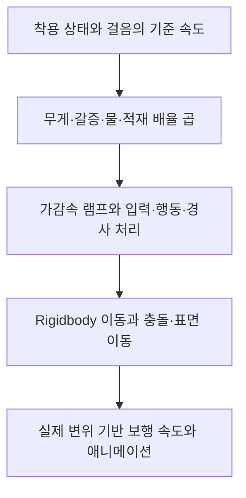

## 걸음의 기준 속도와 감속 원인을 따로 둡니다

<div id="걸음의-기준-속도와-감속-원인을-따로-둔다" aria-hidden="true" style="scroll-margin-top: 90px;"></div>

DCB의 걷기·달리기·질주는 이동 상태가 기준 속도를 고릅니다. 같은 달리기라도 인벤토리 무게가 운반 한도에 가까운지, 갈증이 낮은지, 얼마나 깊은 물을 지나고 있는지에 따라 다른 배율이 적용됩니다.

현재 구조는 원인마다 최종 속도를 덮어쓰는 방식이 아닙니다. **상태 기준 속도에 원인별 배율을 곱해 스탯 속도를 구하고, 이동 컨트롤러가 가감속과 방향·경사 등의 조건을 추가로 처리**합니다. 물에서 나왔다고 갈증이나 무게의 보정까지 지우면 안 되고, 걸음이 바뀌었다고 기존 보정이 사라져서도 안 됩니다.

## 원인별 키로 등록한 배율을 곱합니다

<div id="원인별-키로-등록한-배율을-곱한다" aria-hidden="true" style="scroll-margin-top: 90px;"></div>

`PlayerStat`은 기준 속도와 최종 속도를 나누어 보관합니다. 상태머신이 `MoveSpeed`에 값을 넣으면 기준값을 바꾸고 현재 수정자를 다시 계산합니다. `SetMoveSpeedModifier()`는 원인을 키로 사용해 보정값을 저장하며, `RecalculateMoveSpeed()`가 다음 값을 만듭니다.

```text
스탯 이동 속도 = 상태 기준 속도
              × 무게 배율
              × 갈증 배율
              × 현재 적용된 물 배율
              × 지게 적재 배율

각 배율 = 1 + 해당 키의 보정값
```

| 수정자 키 | 배율을 결정하는 값 | 등록·해제 책임 |
| --- | --- | --- |
| `WeightMoveSpeed` | 인벤토리 무게 ÷ 플레이어 운반 한도의 곡선 | 속성 컨트롤러의 초기 계산과 무게·한도 변경 리스너 |
| `ThirstPenalty` | 현재 갈증 단계의 속도 보정 | 갈증 시스템이 단계에 맞게 등록·해제 |
| `WaterWading` | 수심·걸음·이동 방향·유속으로 구한 배율 | 물속 감속 컴포넌트가 평활해 갱신·해제 |
| `JigeCargoWeight` | 지게 적재율의 속도 곡선 | 지게 부담 갱신이 적용·제거. 현재 곡선은 배율 1 |

예를 들어 20% 감속은 보정값 `-0.2`, 적용 배율 `0.8`입니다. 계산 결과가 배율로 나오는 무게·물 코드에서는 `배율 - 1`을 등록합니다. 이 변환 없이 0.8을 그대로 보정값에 넣으면 1.8배로 해석됩니다.

같은 키에 다시 등록하면 그 원인의 값을 교체합니다. 반복 호출마다 같은 감속이 누적되는 구조는 아닙니다. `RemoveMoveSpeedModifier(WaterWading)`는 물 항목만 없애고 무게·갈증은 유지합니다. 기준 속도를 걷기에서 달리기로 바꿔도 같은 수정자들을 새 기준에 곱합니다.

고정된 배율끼리는 곱셈 순서가 결과를 바꾸지 않습니다. 다만 실제로는 무게 변경 이벤트, 갈증의 고정 스텝 갱신, 물의 `Update`가 서로 다른 시점에 값을 바꿉니다.

## 인벤토리 무게는 한도 전후의 곡선으로 계산합니다

<div id="인벤토리-무게는-한도-전후의-곡선으로-계산한다" aria-hidden="true" style="scroll-margin-top: 90px;"></div>

`PlayerInventoryInfo.GetCurrentWeight()`는 일반 아이템 목록과 별도 보관 목록인 `DummyItemUIInfos`를 순회합니다. 일반 항목은 아이템 단위 무게에 개수를 곱하고, 조합 항목은 파츠 트리를 순회해 무게를 합칩니다. 목록 변경 경로는 이 값을 `RuntimeStat.Weight`에 넣습니다. 이름이나 주석만 보고 캐릭터의 모든 장비·지게 화물을 같은 무게로 계산한다고 가정하지 않았습니다.

속성 컨트롤러는 현재 무게와 `PlayerStat.WeightCapacity`를 `WeightMoveSpeedCalculator`에 전달합니다. 무게가 바뀌거나 운반 한도가 바뀌면 다시 계산해 `RuntimeStat.WeightMoveSpeed`에 넣고, 그 결과를 `PlayerStat`의 무게 수정자에 연결합니다. 두 곳에 같은 배율이 있다고 이를 두 번 곱하는 것은 아닙니다.

### 코드 기본값과 실제 프리팹의 곡률이 다릅니다

<div id="코드-기본값과-실제-프리팹의-곡률이-다르다" aria-hidden="true" style="scroll-margin-top: 90px;"></div>

계산기의 코드 기본값은 하한 `mMin=0.35`, 가벼움 보너스 `mMax=1.10`, 한도 이하 곡률 `p=6`, 초과 곡률 `h=12`입니다. 하지만 현재 `PlayerAttributeController` 프리팹은 **p=20, h=20**을 저장합니다. 계산기는 해당 컴포넌트를 참조합니다. 현재 곡선을 설명할 때 6·12를 그대로 사용하면 한도 부근의 변화량이 달라집니다.

양의 운반 한도를 전제로 무게 비율을 `r = 현재 무게 ÷ 운반 한도`라고 하면, 현재 저장값의 두 곡률이 같아 식을 다음처럼 정리할 수 있습니다.

```text
현재 프리팹의 무게 배율 = 0.35 + 0.75 ÷ (1 + r^20 ÷ 6.5)
```

 아래는 같은 식을 별도로 계산한 결과입니다.

| 무게 ÷ 운반 한도 | 현재 저장 곡선의 배율, 약 |
| --- | --- |
| 0 | 1.100 |
| 0.8 | 1.099 |
| 1.0 | 1.000 |
| 1.1 | 0.719 |
| 1.2 | 0.459 |
| 1.5 | 0.351 |

한도 이하는 가벼움 보너스가 남고, 한도를 넘으면 곡선이 빠르게 낮아져 하한 0.35에 가까워지는 설정입니다. `r=1`에서는 배율 1입니다. 운반 한도가 0에 가까운 예외에서는 계산기가 배율 1을 반환합니다. 무게 비율을 계산할 수 없다고 즉시 이동 불가로 만드는 처리는 아닙니다.

### 배고픔은 무게 배율에 간접적으로 영향을 줍니다

<div id="배고픔은-무게-배율에-간접적으로-영향을-준다" aria-hidden="true" style="scroll-margin-top: 90px;"></div>

현재 배고픔이 10 이하이면 플레이어 운반 한도에 ×0.7을 적용합니다. 물건을 더 줍지 않았어도 같은 무게를 더 작은 한도로 나누므로 무게 배율이 달라질 수 있습니다. 속성 컨트롤러가 한도 변경에도 리스너를 두는 이유와 연결됩니다.

예를 들어 **가상의 무게 80·기존 한도 100**은 비율 0.8, 배율 약 1.099입니다. 한도가 70이 되면 비율 약 1.143, 배율 약 0.583으로 바뀝니다. 이는 현재 곡선을 적용한 계산 예입니다. 배고픔의 운반 한도 보정과 지게 화물의 적재 용량은 서로 다른 값입니다.

초기 생성의 시트 값·능력치 보정 순서, 아이템 추가·삭제·장착 경로가 모두 원하는 시점에 변경 이벤트를 보내는지는 현재 Play Mode에서 다시 확인하지 않았습니다. 무게 합산 함수와 해당 리스너가 있다는 사실을 모든 인벤토리 조작의 검증 완료로 사용하지 않습니다.

## 갈증은 별도 키로 0.8배를 적용합니다

<div id="갈증은-별도-키로-08배를-적용한다" aria-hidden="true" style="scroll-margin-top: 90px;"></div>

현재 카탈로그의 갈증 2단계 문턱은 **현재 수치 10 이하**입니다. 최대치의 10%가 아닙니다. 이 단계와 0에서 `ThirstSystem.ApplyPhase2Penalty()`가 `ThirstPenalty=-0.2`를 등록합니다. 문턱을 넘겨 회복하면 해당 수정자를 제거합니다.

이 보정은 무게 곡선을 대체하지 않습니다. 무게 배율이 0.719인 상태에서 갈증 배율 0.8을 적용하면 두 값을 곱합니다. 배고픔은 한도를 통해 무게 곡선에 간접적으로, 갈증은 이동 속도 수정자로 직접 들어간다는 차이가 있습니다.

갈증 25 이하의 회복 시간 패널티는 별도 스태미너 회복 보정입니다. 이를 이동 속도에 또 곱하지 않습니다. 자원별 전체 보정과 해제 조건은 [행동 비용·회복과 배고픔·갈증](/writing/action-stamina-cost-and-recovery/)에서 설명합니다.

## 물속 감속은 등록된 수면의 수심·물살을 읽습니다

<div id="물속-감속은-등록된-수면의-수심물살을-읽는다" aria-hidden="true" style="scroll-margin-top: 90px;"></div>

`PlayerWadingSlowdown`은 발 역할을 하는 플레이어 루트 위치에서 `WaterWakeBodyRegistry.TryGetWadeContact()`를 조회합니다. 등록된 사용 가능한 수역의 범위·표면 샘플을 확인하고, 흐르는 수역은 젖은 정도도 확인합니다. 반환한 수면 높이와 발 위치의 차이가 수심이 됩니다.

물처럼 보이는 셰이더가 있다는 이유만으로 이 감속이 자동 적용되는 것은 아닙니다. 물결 시스템의 수역 등록과 표면 샘플이 필요합니다. 감속 컴포넌트는 `VFX_MudWater_Footstep` 프리팹에 있고, Wanderer 프리팹이 이를 자식 프리팹으로 참조합니다. 저장된 설정은 물살 적용 켜짐, 응답 시상수 0.25초입니다. 현재 실행 중인 씬의 모든 물과 등록 상태까지 검증한 것은 아닙니다.

### 수심과 걸음에 따라 목표 물 배율을 구합니다

<div id="수심과-걸음에-따라-목표-물-배율을-구한다" aria-hidden="true" style="scroll-margin-top: 90px;"></div>

`WadingSlowdown`은 수심 0.02m 이하를 감속 없는 조건으로 취급합니다. 그보다 깊으면 캐릭터의 측정된 무릎 높이로 수심을 환산합니다. 측정값이 없으면 기본 무릎 높이 0.62m를 사용하며, 계산 함수의 기준 무릎 높이는 0.6m입니다.

정지한 물의 수심 곡선은 걷기와 달리기를 다르게 계산합니다. `MoveVectorWeight` 0.5는 걷기 쪽, 1 이상은 달리기 쪽이며 질주도 달리기 쪽으로 제한합니다. 물살은 이동 방향과 유속의 내적·가로 성분으로 거슬러 오름·따라감·가로지름을 나누어 추가 배율을 만듭니다. 방향은 실제 수평 속도를 우선하고 충분히 움직이지 않으면 카메라 기준 입력 방향을 사용합니다.

순수 계산의 최종 물 배율은 `수심 배율 × 물살 배율`을 0.33~1.10으로 제한합니다. **0.33은 물 배율의 하한이며 전체 이동 속도의 하한이 아닙니다.** 예를 들어 무게 배율이 0.35에 가깝고 갈증 0.8, 물 0.33이 겹치면 곱은 약 0.0924입니다. 다른 조건을 제외해도 상태 기준의 약 9.24%까지 낮아지는 계산입니다. 현재 플레이에서 그 조합의 이동·발 접지를 측정한 값은 아닙니다.

### 목표 물 배율과 지금 적용된 배율을 구분합니다

<div id="목표-물-배율과-지금-적용된-배율을-구분한다" aria-hidden="true" style="scroll-margin-top: 90px;"></div>

컴포넌트는 수심이 흔들릴 때 속도가 바로 튀지 않도록 목표를 평활합니다. 계속 적용 중일 때의 보간 계수는 다음과 같습니다.

```text
보간 계수 = 1 - exp(-deltaTime / responseSeconds)
적용 후보 = 이전 값에서 목표 값으로 위 계수만큼 보간
```

시상수 0.25초는 그 시간이 지나면 반드시 목표에 도달한다는 뜻이 아닙니다. 첫 적용과 한 프레임의 루트 이동이 1m를 넘는 경우에는 목표를 바로 사용합니다. 배율 변화가 0.001을 넘을 때 수정자에 다시 쓰는 조건도 있습니다. 따라서 같은 순간의 `TargetFactor`와 `AppliedFactor`가 다를 수 있습니다.

물 밖에서는 목표가 1이 되고, 기존 감속이 남아 있으면 평활하며 풀립니다. 목표와 적용 후보가 모두 0.999 이상이면 물 수정자를 제거합니다. 반면 사망·데이터 미준비·비활성이나 적용 대상 스탯 교체 같은 정리 경로에서는 이전 스탯의 물 항목을 제거합니다. 물 밖 이동과 비활성 정리를 모두 같은 즉시 해제로 설명하지 않습니다.

순수 함수에는 1.10 상한이 있지만 플레이어 적용기는 위 조건에서 물 수정자를 없앱니다. 이 때문에 **현재 캐릭터가 물살을 타면 무조건 최대 10% 가속한다**고 쓰지 않았습니다. 약한 물살이 수심 감속을 일부 줄이는 계산과 실제 플레이어에게 1보다 큰 배율이 유지되는 결과를 구분해야 합니다.

## 중첩 계산 예: 같은 기준 속도에서 무엇이 줄었는가

다음 표는 지게 달리기 기준 4.19m/s에, **가상의 무게 110·한도 100과 적용 중인 물 배율 0.6**을 넣은 예입니다. 무게 배율은 현재 프리팹 곡선에서 약 0.71855입니다.  지게 적재 배율은 현재 저장값 1로 두었습니다.

| 계산 단계 | 배율 적용 | 스탯 속도, 약 |
| --- | --- | --- |
| 상태 기준만 | 4.19 | 4.190m/s |
| 무게 포함 | 4.19 × 0.71855 | 3.011m/s |
| 갈증 10 이하 포함 | 위 값 × 0.8 | 2.409m/s |
| 적용 물 배율 포함 | 위 값 × 0.6 | 1.445m/s |

최종 배율은 약 0.3449입니다. 감속률들을 단순히 더해 빼는 계산과 다릅니다. 물 항목이 제거되면 이 예의 무게·갈증 조건이 그대로인 동안 약 2.409m/s로 돌아갑니다. 4.19로 모두 복구되는 것이 아닙니다.

지게를 내려놓으면 기준 속도와 걸음 규칙이 바뀌고 적재 보정도 정리됩니다. 이 역시 무게·갈증·물 보정까지 일괄 초기화하는 동작으로 설명할 수 없습니다. 현재 적재 곡선이 배율 1인 이유와 별도의 운반 계산은 [지게 운반의 속도·스태미너](/writing/jige-carry-burden/)에서 연결됩니다.

## 스탯 속도와 실제 이동 결과는 다릅니다

<div id="스탯-속도와-실제-이동-결과는-다르다" aria-hidden="true" style="scroll-margin-top: 90px;"></div>

`PlayerController.CalcFinalMoveSpeed()`는 최종 스탯 속도를 음수 아닌 값으로 읽습니다. 이동 입력이 있으면 이를 목표로 가감속 램프를 갱신하고, 조준·락온 방향, 가드·패리 배율, 입력 크기와 경사 처리를 거쳐 Rigidbody 속도를 만듭니다. 움직이는 표면의 속도도 별도로 더해집니다.



`MeasuredGroundSpeed`는 실제 위치 차이에서 표면에 실려 간 몫을 빼고 접지 평면에 투영한 뒤 시간으로 나누어 평활합니다. 스탯 속도나 `ResultMoveSpeed`의 명령 벡터 크기와 같은 값은 아닙니다. 가속 중이거나 벽에 막힌 상태를 포함해 스탯 숫자만으로 이동 시간을 확정하면 안 됩니다.

물 수정자는 일반 보행 속도 경로에 들어갑니다. 구르기·회피·공격의 루트 모션 변위에 같은 물 배율을 곱하는 구조는 아닙니다. 물속에서 모든 행동의 이동 거리가 같은 비율로 줄어든다고 설명하지 않습니다.

물 감속을 추가할 때 이동 소음도 별도로 처리했습니다. 컨트롤러는 소음 계산 전에 `ResultMoveSpeed`를 적용된 물 배율로 나누어 물 감속 영향을 되돌리는 경로를 둡니다. 물에서 느려진 만큼 조용해지는 결과를 그대로 사용하지 않으려는 변경입니다.

## 속도 보정을 연결한 과정

| 순서 | 확인한 변경 | 현재 설명에서 구분할 점 |
| --- | --- | --- |
| 1 | 무게 계산기를 초기화·무게·한도 변경에 연결 | 무게 곡선과 변경 이벤트의 출발점 |
| 2 | 갈증 속도 보정과 원인별 곱셈 구조, 무게 배율의 스탯 연결 | 계산한 무게 비율을 실제 이동 속도에 반영한 경로 |
| 3 | 물 배율을 별도 키로 추가, 물 접촉·평활·해제와 소음 보정 | 기존 무게·갈증을 덮어쓰지 않는 확장. 이 글의 대표 작업 |
| 4 | 지게 적재 속도 곡선을 별도 수정자로 연결 | 현재 곡선 배율 1과 지원 구조를 구분 |

## 담당 범위와 관련 글

원인별 속도 보정, 무게·운반 한도 변경의 연결, 물 감속의 등록·해제와 보행·소음 경로를 구성했습니다. 물 감속과 지게 부담 코드는 AI와 함께 작성했습니다.

걸음 선택과 스태미너 고갈 후 입력 처리는 [이동 전환·재입력](/writing/locomotion-stamina-reinput/), 자원 단계와 회복은 [행동 비용과 회복](/writing/action-stamina-cost-and-recovery/)에서 이어집니다. 다음 행동 중 이동·입력 제약 분석은 [게임플레이 밸런싱과 제어 목록](/portfolio/dcb/features/gameplay-balancing/)에 연결합니다.
