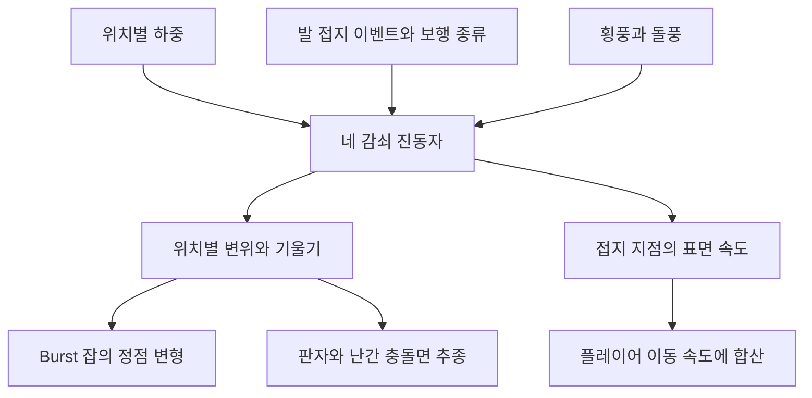

## 다리 위에서 서고 걸을 때 서로 다른 힘이 들어갑니다

DCB의 밧줄 다리는 올라선 위치의 하중으로 처지고, 발이 닿을 때마다 추가 충격을 받으며, 옆바람과 돌풍에 횡으로 밀리고 비틀리는 구조입니다. 하중과 바람이 사라져도 남은 진동은 감쇠한 뒤 원래 모양으로 돌아옵니다.

다리만 흔들리는 화면으로 끝나지 않도록 바닥 충돌면도 움직이고, 플레이어의 접지 이동에 다리 표면의 속도를 더합니다. 난간은 높이에 따른 횡 변위를 더 크게 표현합니다. 고정부와 양끝은 움직임을 줄여 지형과의 연결을 유지합니다.

## 네 진동자의 합으로 모양을 만듭니다

다리의 모든 판자와 밧줄에 Rigidbody·Joint를 붙인 방식은 아닙니다. 수직 1차·수직 2차·횡 1차·롤 1차의 네 감쇠 진동자를 계산하고, 그 값을 위치별 형상 함수에 곱해 정점을 변형합니다. 게임의 하중과 접지에 반응하는 물리 기반 표현이며 실제 교량의 구조 해석이나 밧줄 장력 해석을 수행하지 않습니다.

다리 길이 방향 위치를 $s\in[0,1]$로 정규화하면 두 기본 형상은 다음과 같습니다.

$$
\phi_1(s)=\sin(\pi s),\qquad
\phi_2(s)=\sin(2\pi s)
$$

1차는 중앙에서 가장 크고 양끝에서 0입니다. 2차는 앞뒤 절반의 부호가 달라 S자 변형을 만듭니다. 여기에 양끝 페이드 가중치를 곱합니다. 현재 페이드 설정은 길이의 0.05 비율이며 고정 대상으로 지정한 렌더러는 변형 수집에서 제외합니다.

네 모드는 각각 다음 식으로 목표를 따라갑니다. $F$는 바람 난류처럼 계속 주는 가진 가속도이며, 발걸음은 별도로 속도에 충격을 더합니다.

$$
\ddot x = \omega^2(x_\text{target}-x)-2\zeta\omega\dot x+F,
\qquad \omega=2\pi f
$$

진동수·감쇠비를 실행 중 바꾸면 기존 위치·속도를 유지하고 계수만 다시 읽습니다. 힘을 바꾸는 튜닝과 상태 자체를 초기화하는 일을 구분했습니다.

## 서 있는 하중과 발 접지 충격을 분리합니다

플레이어는 자동으로 하중 1로 등록합니다. 현재 이 값은 지게 짐 무게에 따라 자동 증가하지 않습니다. 다른 대상은 `AddLoad()`로 등록할 수 있지만, 이 API가 있다고 모든 몬스터가 자동으로 다리 하중에 참여하는 것은 아닙니다.

하중 인정은 다리 로컬 길이·폭·높이 범위로 판단합니다. Trigger에 들어왔다는 사실만 쓰거나, 발이 정확히 접촉한 한 점을 하중 위치로 쓰는 구조는 아닙니다. 하중 위치의 형상값만큼 정적 처짐 목표를 더합니다.

발 충격은 `FootstepAudioPlayer.FootContact`를 구독합니다. 이 이벤트는 보행 애니메이션의 발 접지 위상에서 나오며, 실제 물리 충돌의 힘을 측정한 값은 아닙니다. 누적 접지 수를 다음 시뮬레이션에서 소비하고 걷기·달리기·질주 배율을 적용합니다. 좌우 충격의 부호는 번갈아 줍니다.

이벤트 제공자가 없는 등록 하중만 이동 거리와 보폭으로 접지를 대신합니다. 이벤트 경로와 거리 경로를 동시에 더하지 않습니다. 발 접지 제공자 자체의 기본 이동 속도 게이트는 0.5m/s, 재발동 간격은 0.12초입니다. 제자리에서 다리가 흔들린다고 발걸음 충격을 계속 만드는 것을 막는 데 관련되는 조건입니다.

## 바람은 다리 옆 방향으로 투영합니다

다리 중앙에서 `WindField`를 샘플링하고 바람 방향을 다리의 횡축에 투영합니다. 지속 바람에 양의 돌풍 성분을 배율 1.5로 더한 값이 횡 변위·롤 목표에 들어갑니다. 별도의 노이즈는 잔진동 입력으로 사용합니다. 다리 길이를 따라 부는 바람과 옆에서 부는 바람을 같은 횡 충격으로 취급하지 않습니다.

정점 변위에는 난간 높이와 좌우 위치도 들어갑니다. 난간이 데크보다 크게 옆으로 움직이고 롤에 따라 양쪽 높이가 달라지는 이유입니다. 바람 세기를 곧바로 실측 풍속이나 실제 재료의 탄성 계수로 해석하지 않습니다.

## 메시만 처져 캐릭터가 떠 보이던 문제

초기 구현은 화면의 메시를 변형하고 기존 충돌면은 그대로 뒀습니다. 그 결과 다리 중앙이 처져도 캐릭터는 원래 충돌면 위에 서 있어 판자에서 떠 보일 수 있었습니다.

다음 작업에서는 콜라이더마다 길이 방향 위치, 기준 중심과 자세를 기록하고 그 구간의 변위·기울기를 적용하도록 바꿨습니다. 변형된 메시로 MeshCollider를 매 프레임 다시 굽는 대신 충돌체 오브젝트를 옮기는 방식입니다.

이후 큰 데크·밧줄 MeshCollider를 끄고, 판자와 난간을 작은 BoxCollider들로 나눴습니다. 밧줄 전체를 중앙 변위만큼 통째로 옮기면 양끝 근처 플레이어까지 밀어낼 수 있었기 때문입니다. 현재 대표 프리팹에는 판자 상자 26개와 난간 상자 52개가 있습니다.

판자 콜라이더의 앞뒤 기울기 추종은 켜져 있고 롤 회전 추종은 꺼져 있습니다. 넓은 플레이어 캡슐 밑에서 판자가 좌우로 회전하면 몸을 들어 올리거나 밀 수 있었기 때문입니다. 롤이 만드는 위치 변위까지 없앤 것은 아닙니다. 각 상자는 대표 지점의 움직임을 따라가므로 변형된 표면 전체와 정확히 일치하는 충돌 메시도 아닙니다.

Rigidbody를 추가하지 않은 선택은 기존 StepUp·Climb·SideStep의 표면 판정과도 관련됩니다. 현재 연결을 유지하기 위한 방식이며 모든 동적 플랫폼에 적용할 일반 해법으로 소개하지 않습니다.

## 다리의 횡이동에 플레이어도 실리게 합니다

바닥 높이를 맞춘 것만으로는 다리가 옆으로 움직일 때 캐릭터가 함께 이동하지 않습니다. 이를 위해 `IGroundCarrier.TryGetSurfaceVelocity()`로 발밑 지점의 표면 속도를 제공합니다. 변위에 사용한 형상과 같은 방식으로 네 모드의 속도를 합성합니다.

플레이어 컨트롤러는 발밑 Collider가 바뀔 때 부모의 `IGroundCarrier`를 찾습니다. 접지 이동과 루트 모션 속도에 이 표면 속도를 더합니다. 플랫폼의 자식으로 플레이어를 재부모화하는 처리는 아닙니다.

걸음 속도를 계측할 때는 실려 간 몫을 뺍니다. 다리 위에 가만히 서서 좌우로 밀리는 이동까지 보행으로 읽으면, 걸음 애니메이션·발 접지 충격이 다리 움직임에 다시 반응할 수 있기 때문입니다. 표면 이동과 플레이어가 스스로 움직인 양을 구분한 연결입니다.

## 양끝에서 내려설 때 걸리던 홈을 메웁니다

작업 기록에는 마지막 판자 다음 지형이 낮아 한 번 떨어졌다 다시 올라가던 문제가 남아 있습니다. 초기화 때 끝 판자의 바깥 윗모서리부터 바깥 방향으로 지면을 탐색하고, 판자와 지면을 잇는 고정 착지 상자를 만들도록 보완했습니다.

현재 탐색은 0.25m 간격으로 최대 1.5m, 높이 일치 허용은 5cm입니다. 높이가 맞지 않아도 마지막으로 찾은 지면이 0~0.5m 아래라면 내리막 상자를 만들 수 있습니다. 더 깊은 절벽이나 유효한 지면이 없는 경우에는 만들지 않습니다. 두 착지 상자가 모든 배치에서 반드시 생성되는 기능은 아닙니다.

상자는 실행 중 생성되며 씬에 저장된 지형 자체를 평평하게 바꾸지 않습니다.

## 현재 저장값은 과거 기본 튜닝과 다릅니다

아래는 현재 `Bridge_00`의 저장값입니다. 신사 구간의 중첩 인스턴스에서는 이 흔들림 수치를 덮어쓴 설정이 없음을 확인했습니다. 다른 배치나 에디터의 미저장 실행 상태까지 같은 값이라고 단정하지 않습니다.

| 항목 | 현재 저장값 | 의미 |
| --- | --- | --- |
| 수직 1차 | 1Hz / 감쇠 0.2 | 중앙 처짐과 발 충격의 주된 상하 운동 |
| 수직 2차 | 2.6Hz / 감쇠 0.25 | S자 성분 |
| 횡 / 롤 | 1Hz·0.05 / 1.2Hz·0.18 | 좌우 움직임과 비틀림 |
| 정적 처짐 목표 계수 / 2차 비율 | 0.5m / 0.2 | 하중 위치별 목표 계산. 실제 중앙 처짐을 0.5m로 보장하지 않음 |
| 발 접지 수직 / 횡 충격 | 0.8 / 0.15m/s | 모드 속도에 더하는 기준 |
| 걷기 / 달리기 / 질주 | 1.6 / 2 / 3배 | 발 충격 배율 |
| 난간 횡 증폭 / 기준 높이 | 1 / 1.1m | 해당 높이에서 횡 기본 성분을 2배로 표현 |
| 모드 제한 | 수직 ±0.35m / 횡 ±0.45m / 롤 ±0.2rad | 각 진동자 상태의 제한. 합성 표면 전체의 단일 상한은 아님 |

튜닝 문서의 정적 처짐 4.5cm·수직 1.6Hz를 현재 적용값으로 옮기지 않았습니다. 예를 들어 중앙 하중 1의 1차 목표는 −0.5m지만 상태는 −0.35m에서 제한됩니다. 중앙 보행 한 번의 수직 1차 속도 충격은 $-0.8\times1.6=-1.28$m/s입니다. 이 계산은 코드·저장값의 예이며 화면에서 관찰한 진폭은 아닙니다.

## 갱신 비용과 시간 간격의 한계

변형용 메시와 정점별 형상 계수는 초기화 때 만듭니다. Burst 잡으로 정점 위치를 계산한 뒤 `Complete()`로 완료를 기다리고 메시를 갱신합니다. 따라서 메시 업로드 전에는 메인 스레드의 대기가 있습니다. 파괴할 때는 메시와 NativeArray를 정리합니다. [Unity Parallel jobs 문서](https://docs.unity.com/en-us/engine/6000.3/manual/scripting/programming-distribute-work-threads/job-system/parallel-for-jobs)

하중·바람·남은 진동이 없으면 원형으로 복원하고 휴면합니다. 현재 코드 기본값의 카메라 경계 거리 80m 밖이면서 하중이 없으면 모드 계산은 계속하고 정점·콜라이더 갱신만 건너뜁니다. 가까워지면 현재 모드 상태로 맞춥니다. 화면 밖이라는 이유만으로 즉시 전체 계산을 끄는 방식은 아닙니다.

시간 적분은 목표 간격 1/50초, 최대 8회로 나누지만 긴 프레임에는 전체 시간을 그 8회에 나눕니다. 따라서 0.16초를 넘으면 간격이 목표보다 커질 수 있습니다. [지게 짐의 긴 프레임 수정](/writing/jige-cargo-secondary-motion/)처럼 남는 시간을 버리는 방식까지 적용돼 있다고 설명하지 않습니다.

## 접촉과 이동을 보완한 과정

| 순서 | 문제와 변경 |
| --- | --- |
| 1 | 하중·바람을 받는 네 모드와 메시 변형 추가 |
| 2 | 메시만 처지고 충돌면은 남는 문제에 구간별 콜라이더 추종 추가 |
| 3 | 횡이동 실림, 표면 이동을 뺀 보행 계측, 판자·난간 상자로 교체 |
| 4 | 이동 거리 추정에서 발 접지 이벤트로 전환하고 보행별 충격 연결 |
| 5 | 판자 끝과 지형 사이 홈을 착지 상자로 연결 |
| 6 | 멀고 하중이 없는 다리의 정점·콜라이더 갱신 생략 |

담당한 부분은 다리의 시각 변형을 기존 지면 판정·플레이어 이동·발 접지·바람 시스템에 연결하고, 서로 어긋나던 접촉과 이동을 보완하는 구조입니다. 코드와 도구 작성에는 AI 보조를 사용했고 관련 작업에도 공동 작성 기록이 있습니다. 기존 다리 모델·텍스처의 원본 제작을 직접 담당한 성과로 포함하지 않습니다.
