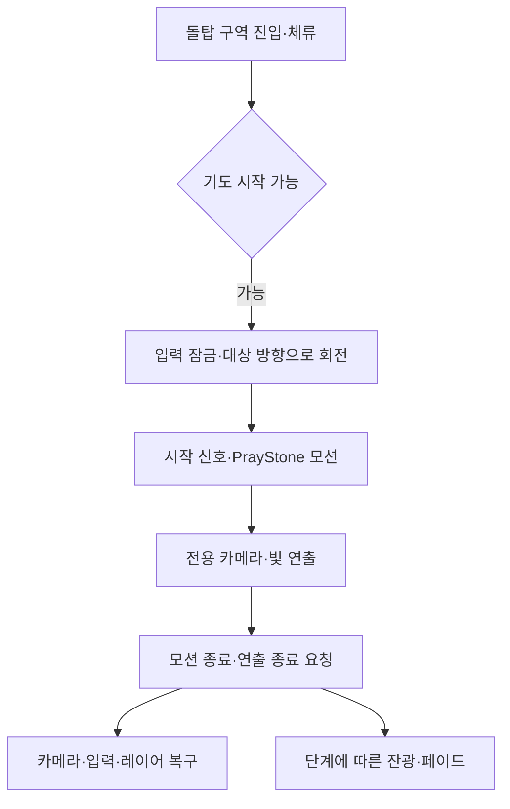

## 돌탑에 다가가면 이어지는 연출

ShrineZone의 돌탑 구역에 들어가면 플레이어가 대상을 향해 몸을 돌리고 돌을 얹어 기도하는 모션을 시작합니다. 나무와 수면에 빛이 피어나고, 합장 시점에는 나무의 빛 일부가 플레이어 쪽으로 날아옵니다. 몸에 모인 빛은 마무리 섬광 이후 잔광으로 남았다가 떨어져 나갑니다.

돌탑 주변의 기본 조명 배치와 지역 안개는 [ShrineZone의 햇빛과 물안개](/writing/shrine-light-and-fog/)에서 다룹니다.

## 구역 진입과 모션 시작을 나눕니다

기도의 시작점은 `PlayerPrayStoneRegionFeature`입니다. 플레이어가 구역에 들어왔을 때 재생을 시도하고, 아직 조건을 충족하지 못했으면 구역 안에 머무는 동안 다시 시도합니다. 별도의 상호작용 버튼을 눌러 시작하는 흐름으로 소개하지 않습니다.

플레이어가 공격·다른 행동·트레버설·피격 등으로 기도할 수 없는 상태면 시작을 거부합니다. 다른 전용 모션이 이미 재생 중인 경우에는 해당 방문을 소비해, 끝나는 순간 같은 상자 안에서 다음 기도가 자동으로 이어지는 대기열을 만들지 않습니다.

| 현재 규칙 | 적용 |
| --- | --- |
| 한 방문의 재생 시도 | 기도를 시작한 뒤 같은 방문에서는 반복 시작하지 않습니다. |
| 구역 이탈 | 방문 소비 상태를 초기화합니다. |
| `playOnce` | 현재 트리거 프리팹은 꺼져 있습니다. 다시 나갔다 들어오면 재생을 시도할 수 있습니다. |
| 바라보는 방향 | 존에서 연결한 대상을 향합니다. 현재 존의 회전 시간은 0.5초입니다. |
| 기도 카메라 | 전용 모션 시작 신호에서 켜고 종료 신호에서 해제합니다. |

이 방문 상태는 런타임 컴포넌트의 상태입니다. 저장 파일에 기록되는 영구적인 1회 보상 규칙으로 설명하지 않습니다.

## 입력·애니메이션·카메라를 한 흐름으로 묶습니다

기도를 시작할 때는 이동과 공격 입력을 잠그고, 버퍼에 남은 공격 입력을 비웁니다. 이동을 정지시키고 전용 루트 모션을 사용하며, 상체 레이어의 가중치를 저장한 뒤 잠시 내려 다른 동작이 기도 모션에 겹치지 않게 합니다. 전용 모션 중에는 무적 상태도 켭니다.

대상을 향한 회전이 끝나면 모션 시작 이벤트를 보내고 Animator의 `PrayStone` 트리거를 설정합니다. 카메라와 빛 연출은 이 시작 신호를 받아 동작합니다. 여기서 이벤트는 회전 이후의 시작 신호이며, 빛의 세부 발생 시점은 Animator 상태 시간으로 맞춥니다.

종료 경로에서는 전용 루트 모션·무적·레이어 가중치와 입력 상태를 정리합니다. 입력은 시작 전 활성 여부와 플레이어 상태를 확인한 뒤 복구합니다. Animator가 정해진 시간 안에 기도 상태로 들어가지 못하는 경우에도 정리 경로로 빠집니다.

이펙트의 존 인스턴스에는 기도 트리거와 나무 참조가 직접 연결돼 있습니다. 자동으로 가까운 트리거·나무를 찾는 대체 경로도 있지만, 현재 배치 설명은 이 명시적인 연결을 기준으로 합니다.

## 나무의 형상에서 플레이어까지 빛을 이동시킵니다

`PrayStoneBlessingEffect`는 나무 형상의 점구름을 참조해 빛 티끌을 배치합니다. 임의의 공간에 같은 입자를 뿌리는 대신 나무와 리본의 형상을 따라 나타나도록 하는 구성입니다. 피어나는 시각도 분산해 한 프레임에 전체가 켜지지 않게 합니다.

| 기도 모션 기준 시각 | 현재 프리팹의 연출 기준 |
| --- | --- |
| 2.9초 | 나무의 빛 티끌과 수면 입자가 나타나기 시작합니다. |
| 6.45초 | 오디오 컴포넌트가 돌을 얹는 소리의 기준으로 사용하는 시각입니다. |
| 8.0초 | 합장 섬광과 함께 나무 티끌의 분산·플레이어 방향 이동이 시작됩니다. |
| 10.35초 | 플레이어에 모인 빛의 마무리 섬광 기준입니다. 종료 요청에 따라 더 일찍 마무리될 수도 있습니다. |
| 마무리 이후 | 잔광은 최대 10초에 걸쳐 옅어지며, 몸에서 떨어져 나가는 운동이 이어집니다. |

이펙트는 기도 중 Animator의 상태 시간과 클립 길이를 읽습니다. 일정한 별도 타이머만으로 애니메이션과 효과를 각각 진행시키는 방식보다 모션의 실제 진행에 맞출 수 있는 구조입니다. 마무리 이후에는 프레임 시간으로 잔광을 이어 갑니다. 최신 실행에서 히치나 시간 배율 변경에도 시각이 정확히 일치하는지는 별도 확인 대상입니다.

현재 나무 티끌 수는 2,200개이며, 플레이어 방향으로 이동하는 비율 `streamShare`는 0.36입니다. 모든 티끌이 몸에 들어오는 것은 아닙니다. 일부는 흩어져 사라지고, 이동하는 빛은 손과 몸 주변의 여러 목표로 나뉩니다. 이 수치는 효과의 저장된 설정이며 GPU 비용이나 화면상 가시 입자 수의 측정값은 아닙니다.

## 수면의 빛은 낙하와 파문으로 마무리합니다

수면에는 별도로 364개의 빛 입자를 사용합니다. 나무의 빛이 피어나는 시점부터 수면에서 나타나 잠시 머문 뒤 떠오릅니다. 태어나는 자리에는 작은 파문이 생깁니다.

합장 섬광이 시작되면 수면의 빛은 나무 중심에서 퍼지는 파동이 닿는 순서에 따라 떨어집니다. 수면에 닿을 때 짧게 밝아지고 낙하 파문을 남깁니다. 뒤따르는 고리와 위로 튀었다 다시 떨어지는 작은 물방울도 같은 시퀀스에서 처리합니다.

파문은 전용 셰이더와 HDRP 왜곡 패스를 사용합니다. 수면 화면의 약한 굴절과 입자·고리 표현을 조합한 효과이며, 주변 물 전체의 물리 시뮬레이션을 다시 계산한 결과로 설명하지 않습니다.

## 잔광은 몸에 붙어 있다가 떨어집니다

몸에 도착한 빛 일부는 마무리 이후 잔광으로 남습니다. 현재 구조는 부위별 뼈 위치와 타원형 두께, 표면에서의 간격을 사용해 붙을 위치를 잡습니다. 실제 스킨드 메시의 매 정점에 정확하게 붙는 표면 샘플링으로 설명하지 않습니다.

멈춰 있어도 일정 시간에 걸쳐 몸을 떠나 바깥·위쪽으로 솟았다가 중력과 저항을 받으며 내려옵니다. 움직이거나 회전하면 더 일찍 떨어져 나가 지나온 위치에 흔적을 남깁니다. 바닥에 도달한 빛은 짧게 남았다가 사라집니다.

이 방식은 기도가 끝나는 순간 몸의 메시를 굽고 많은 표면 점을 탐색하던 경로를 대체한 것입니다.

## 종료와 소리도 같은 단계를 따릅니다

기도 종료 신호는 이펙트의 `RequestEnd`로 전달됩니다. 빛이 플레이어로 이동하는 단계라면 마무리 섬광으로 이어지고, 그 전이라면 취소 페이드로 걷습니다. 모션 종료와 모든 빛 입자의 즉시 삭제를 같은 시점으로 처리하지 않습니다.

사운드는 별도 `PrayStoneBlessingAudio`가 효과의 단계·시각을 읽어 냅니다. 피어남, 돌 얹기, 합장 섬광, 빛의 상승과 몸에 모이는 마무리를 나누고 나무 쪽과 몸 쪽의 음원 위치도 구분합니다.

`onBlessingBurst` 이벤트는 제공되지만, 현재 프리팹의 저장된 호출 목록은 비어 있고 존에서 이를 덮어쓴 연결도 확인되지 않았습니다. 현재 연결은 기도 연출을 다루며 체력·기력 회복이나 보상은 이 이벤트에 지정되어 있지 않습니다. 돌을 얹는 모션과 돌탑의 물리 적층도 별개입니다.

## 자산과 작성 범위

나무·리본·플레이어 모델과 기도 애니메이션은 기존 자산을 사용합니다. 사운드는 AI 생성 결과를 후처리·선별한 자료를 사용합니다. 상호작용과 효과의 연결을 설명하는 글은 AI와 함께 작성했습니다.
