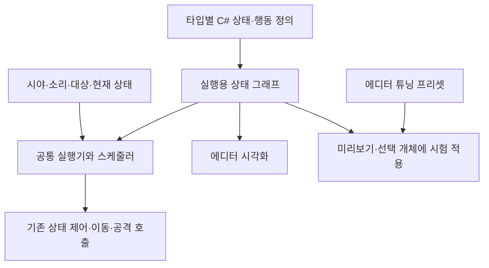

## 패턴을 바꿀 때마다 그래프 구조까지 수정해야 했습니다

<div id="패턴을-바꿀-때마다-그래프-구조까지-수정해야-했다" aria-hidden="true" style="scroll-margin-top: 90px;"></div>

DCB로 이어진 Deluge 프로젝트의 몬스터 행동에는 처음에 Unity Behavior를 사용했습니다. 당시 패키지는 `com.unity.behavior` 1.0.14였습니다. `BehaviorGraphAgent`에 그래프를 연결하고, 몬스터 자신·태어난 위치·시야·소리 감지기·상태와 피격 이벤트를 Blackboard에 전달했습니다. 그래프는 이 참조와 커스텀 행동 노드를 이용해 인지·추격·공격·귀환을 구성했습니다.

문제는 패턴이 늘어날 때의 수정 과정이었습니다. 행동의 C# 코드만 바꾸는 것으로 끝나지 않고, 그래프에서 노드를 추가하거나 제거하고 연결·조건·변수 참조도 함께 확인해야 했습니다. AI에게 다음 패턴을 구현하도록 요청할 때도 현재 그래프의 구조를 파악하고 그 구조에 맞춰 수정하는 과정이 필요했습니다.

몬스터가 많을 때 `BehaviorGraphAgent.Update` 비용이 커진다고 보고하며 개선 방안을 요청했습니다. 그보다 중요한 목표는 **앞으로 추가할 패턴까지 AI가 읽고 수정하기 쉽게 관리하는 것**이었습니다. 구조를 바꾸어도 비용 문제가 해결되지 않는다면 추가 개발을 하지 않아도 된다는 조건도 있었습니다. 이 요청 기록은 전환의 배경이며, 변경 후 성능이 개선됐다는 측정 근거는 아닙니다.

따라서 패키지를 제거하는 것 자체를 목표로 삼지 않았습니다. 몬스터의 상태와 전이 조건을 코드로 읽을 수 있고, 변경한 부분을 비교·검사할 수 있도록 저작 방식을 바꾸었습니다.

## 기존 상태 제어는 재사용하고 행동 정의를 옮기기

Unity Behavior를 사용하던 시점에도 `MonsterStateController`는 있었습니다. 이번 변경은 게임 전체에 FSM을 처음 도입한 작업이 아닙니다. 기존 상태 제어와 인지·이동·전투 코드를 유지하면서, 그 위에서 패턴을 구성하던 그래프를 코드 기반 정의와 실행기로 옮긴 작업입니다.

여기서 FSM은 현재 상태와 조건에 따라 다음 상태를 결정하는 구조입니다. DSL은 그 상태 안의 행동과 전이를 C#의 제한된 호출 형태로 작성하는 방식입니다. 현재 구조는 **상태 전이를 중심으로 행동 시퀀스와 분기를 조합하는 FSM·DSL**에 가깝습니다. 범용 Behavior Tree 편집기를 그대로 다시 만든 것은 아닙니다.



실행기와 스케줄러, 몬스터 코드의 연결을 나타낸 구조도입니다.

## 코드로 옮긴 뒤 수정 단위가 명확해졌습니다

<div id="코드로-옮긴-뒤-수정-단위가-명확해졌다" aria-hidden="true" style="scroll-margin-top: 90px;"></div>

예를 들어 추격 중 공격 거리 조건을 바꾸고, 대상을 잃었을 때 귀환하도록 만드는 요구를 생각할 수 있습니다. 이전에는 관련 그래프 분기와 커스텀 노드, Blackboard 연결을 함께 따라가야 했습니다. 변경 후에는 해당 타입의 definition에서 상태·조건·목표 상태를 읽고 수정할 수 있습니다.

아래는 작성 형태를 설명하는 의사 코드입니다. 현재 API나 밸런스 값을 그대로 복사한 실행 예제는 아닙니다.

```text
상태 Chase
  행동: 공격 대상 지정 → 추격 설정 → 추격 실행
  전이: 공격 가능 거리이면 Attack
  전이: 대상을 일정 시간 잃으면 Return

피격 이벤트
  현재 상태의 예외 규칙이 있으면 그 규칙 적용
  그 외에는 공통 피격 전이 적용
```

실제 definition은 `MonsterBehaviorGraphBuilder`로 상태를 만들고 등록된 action·condition을 조합합니다. 이 공통 행동·조건을 primitive라 부르며, 각각 이름과 매개변수가 정해져 있습니다. 임의의 C# 본문을 그래프 노드로 해석하는 파서는 만들지 않았습니다. 새 패턴은 기존 primitive를 조합하고, 새 동작이 필요할 때 공통 action이나 condition을 추가합니다.

| 바꾸려는 내용 | 변경 후 확인할 위치와 이점 |
| --- | --- |
| 특정 상태의 이동·공격 순서 | definition의 action 순서를 코드로 읽고 diff로 확인합니다 |
| 감지·거리·시간에 따른 전이 | 조건과 목표 상태를 같은 정의에서 확인합니다 |
| 피격 같은 공통 중단 | 전역 규칙과 상태별 예외를 나눠 표현합니다 |
| 새 몬스터 타입의 패턴 | definition과 registry 등록을 명시적으로 확인합니다 |
| 조건·행동의 재사용 | 이름과 매개변수를 가진 공통 primitive를 조합합니다 |
| 잘못된 타입·메서드 호출 | C# 도구의 탐색·참조 확인·컴파일 검사 대상으로 삼을 수 있습니다 |

문자열로 구분하는 쿨다운 키, Animator 트리거나 실제 애니메이션 연결까지 컴파일러가 검증해 주는 것은 아닙니다. 코드로 작성한 것과 게임에서 올바르게 동작하는 것도 별개입니다.

## AI가 변경할 범위를 코드로 한정하기

AI와의 작업에서도 요청의 대상이 구체적이 되었습니다. 특정 상태의 조건 하나를 바꾸거나, 재사용할 행동을 추가하거나, 전이 우선순위를 확인하는 식으로 변경 범위를 지정할 수 있습니다. 수정 결과는 definition과 공통 실행기의 diff로 검토합니다.

패턴의 원본은 각 몬스터 타입의 C# definition으로 정했습니다. 구조를 바꿀 때는 이 정의를 수정하고 같은 정의에서 뷰어를 만듭니다. 코드와 그래프를 별도로 편집해 두 원본의 연결을 맞추는 절차를 줄인 것입니다. AI의 변경도 definition과 공통 실행기의 diff를 기준으로 검토할 수 있습니다.

조건·행동은 등록된 primitive만 사용합니다. 이 제약은 AI가 생성한 코드의 검토 범위를 줄이고, 공통 동작과 타입별 조합을 구분하는 데 도움이 됩니다. 새로운 primitive나 Animator 연결을 추가한 경우에는 해당 구현도 별도로 검토해야 합니다.

이 이점은 당시 요구와 현재 구현 구조를 대조해 설명한 것입니다. 같은 패턴을 만드는 데 걸린 시간이나 AI 수정 성공률을 전후 비교한 기록은 없어, 작업 시간 절감률은 제시하지 않습니다.

## 한 종류부터 이관하고 마지막에 패키지를 제거하기

변경은 두 단계로 진행했습니다. 첫 구현에서는 당시 Bandit을 대상으로 새 실행기를 추가하고 기존 Behavior 경로를 남겼습니다. registry에 코드 정의가 있는 타입은 새 실행기로 시작하고, 그렇지 않은 타입은 기존 그래프를 사용하는 방식이었습니다. 시야와 소리 감지, 이동과 공격 동작도 가능한 범위에서 기존 의미를 재사용했습니다.

이 단계에서 기존 그래프를 먼저 지우면 아직 옮기지 않은 몬스터의 행동까지 끊깁니다. 정의의 등록 여부로 실행 경로를 구분해 이관 범위를 명시한 이유입니다.

두 번째 단계에서는 남아 있던 Behavior 그래프·행동 래퍼·이벤트 연결과 prefab의 관련 참조를 정리하고 패키지 의존을 제거했습니다. 현재 registry에는 Okgwi·Oni·Samurai 정의가 등록되어 있습니다. 현재 코드는 미등록 타입을 예전 그래프로 자동 대체하지 않고 경고를 남깁니다. 초기 이관 단계의 fallback과 현재 동작을 구분해야 합니다.

| 순서 | 확인한 변경 |
| --- | --- |
| 1 | 코드 기반 DSL 초안, 공통 실행기·스케줄러와 기존 경로 병행 |
| 2 | 이벤트와 조건·행동 보완 |
| 3 | 상태·전이·행동을 읽는 뷰어 추가 |
| 4 | 매개변수 override 프리셋과 선택 개체 시험 적용 경로 추가 |
| 5 | 기존 몬스터 Behavior 자산·참조와 패키지 정리 |
| 6 | 현재 상태와 잠금·실행 상태를 확인하는 디버깅 표시 보완 |

## 코드가 원본이어도 시각화와 튜닝은 필요했습니다

<div id="코드가-원본이어도-시각화와-튜닝은-필요했다" aria-hidden="true" style="scroll-margin-top: 90px;"></div>

코드로 바꾼 뒤에도 전체 전이를 한눈에 보고 현재 어떤 상태에서 멈췄는지 확인할 도구는 필요했습니다. 그래서 별도 Behavior DSL Viewer를 추가했습니다.

초기 뷰어는 읽기 전용이었습니다. definition에서 만들어진 그래프를 view model로 바꾸고, 상태와 전이·내부 행동 순서·분기 가중치를 표시했습니다. action과 condition의 `Describe()`가 주요 매개변수를 제공해 이름만 나열하는 화면보다 실제 조건을 확인하기 쉽게 했습니다.

이후에는 값을 시험할 수 있는 override preset과 현재 실행 상태 표시를 추가했습니다. 선택한 몬스터의 현재·이전 상태, 잠금 여부, 실행기 존재·동작 여부, 현재 상태에 해당하는 노드가 있는지를 구분할 수 있습니다. 같은 종류의 선택 개체에 새 graph와 runner를 적용하는 에디터 경로도 있습니다.

구조를 편집하는 원본과 튜닝 값을 시험하는 도구의 역할은 나눴습니다. **현재 일반 스폰은 뷰어의 preset을 자동으로 읽지 않습니다.** 시험한 값을 기본 동작에 반영하려면 definition의 상수나 인자를 수정해야 합니다. 또 일부 override 경로는 행동·전이의 순번을 포함하므로, definition의 순서를 바꾼 뒤에는 기존 preset의 연결을 다시 확인해야 합니다.

이 방식으로 코드의 비교·검색 편의성과 그래프의 시각적 확인을 함께 사용할 수 있었습니다. 대신 뷰어와 preset 유지보수는 자체 구현의 책임으로 남았습니다.

## 실행 규칙을 직접 정하고 검사할 수 있게 하기

자체 실행기의 또 다른 이점은 전이와 중단 규칙을 코드·검사 대상으로 명시할 수 있다는 점입니다. 현재 실행기는 전역 전이를 먼저, 현재 상태 전이를 다음으로 평가하고 처음 성립한 전이 하나를 적용합니다. 피격은 상태별 예외가 있으면 그 규칙을, 없으면 공통 규칙을 사용합니다. 정지할 때는 상태와 스케줄러의 실행 자원을 정리합니다.

빌더의 상태·행동·전이 구성, 전이 순서, 공통 피격 중단, graph를 다시 만들 때 action·condition 인스턴스가 공유되지 않는지, 뷰어 매개변수 표시 등을 확인하는 검사 코드가 있습니다. 상태를 가진 타이머나 대상을 여러 몬스터가 공유하지 않도록 확인할 수 있는 구조입니다.

실행 순서의 오류를 고치는 책임도 함께 가져왔습니다. 이후에는 상태를 바꾼 틱에서 새 상태의 본문을 실행하지 않아 이동에 공백이 생기는 경로를 수정했습니다. 현재는 전이는 한 틱에 한 번만 평가하면서 도착 상태의 행동은 같은 틱에 실행합니다. 구체적인 수정 과정은 [몬스터 행동 DSL과 그룹 전투](/writing/monster-combat/)에서 다뤘습니다.

`BehaviorGraphAgent` 의존을 제거한 뒤에도 조건 평가, action 실행, 시야·이동·전투 계산은 공통 실행기에서 처리합니다.

## 직접 정한 것과 AI를 사용한 것

| 구분 | 내용 |
| --- | --- |
| 직접 보고하고 요청한 것 | 몬스터가 많을 때의 `BehaviorGraphAgent.Update` 비용 보고와 개선 방안 요청 |
| 직접 제시한 목표와 조건 | 현재뿐 아니라 이후 추가할 패턴까지 읽고 수정하기 쉬운 원본 구조. 구조를 바꿔도 비용 문제가 해결되지 않으면 추가 개발을 하지 않아도 된다는 조건 |
| 이 작업에서 설명할 수 있는 기여 | 반복해서 수정할 패턴의 원본 형태를 타입별 C# definition으로 정하고, 기존 Behavior 경로와 병행해 이관한 뒤 시각화·튜닝·검사 경로를 연결한 과정 |
| AI를 사용한 것 | 코드 기반 DSL, 공통 실행기와 스케줄러, 뷰어, override 프리셋, 디버깅 표시의 구현. 설명 작성 |
| 재사용한 것 | 기존 `MonsterStateController`와 인지·이동·전투 코드. 전환 전에는 Unity Behavior 1.0.14를 사용했습니다 |

Unity Behavior도 C# 연동과 재사용 가능한 그래프, Play Mode 시각화를 제공합니다. 이번 선택은 DCB의 패턴 변경과 AI 협업 방식에 맞춰 원본과 도구의 역할을 바꾼 사례입니다. 패키지 소개는 [Unity Behavior 공식 문서](https://docs.unity3d.com/Packages/com.unity.behavior@1.0/manual/behavior-features.html)에 있습니다. 관련 개념은 [FSM의 전이·중단 규칙](/writing/fsm-transition-interruption/)과 [Behavior Tree의 실행·중단](/writing/behavior-tree-running-abort/)에서 이어집니다.
