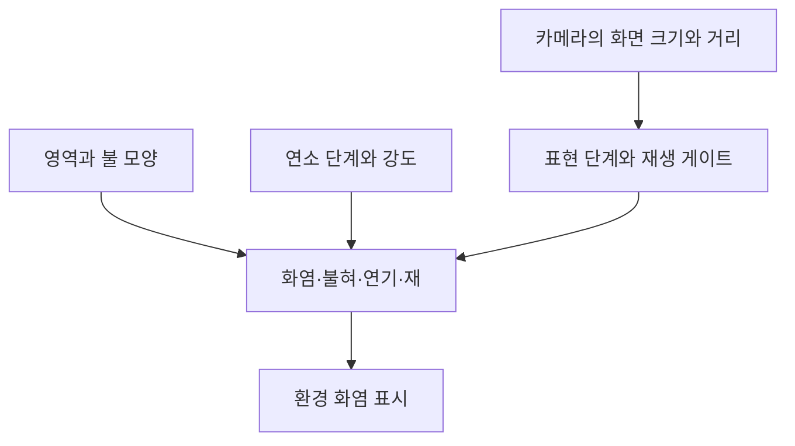

## 배치한 영역에 맞는 불을 보여 줍니다

DCB의 환경 화염 중 `FireZoneV2` 계열은 불이 차지할 영역과 모양을 정하고, 그 안의 화염·얇은 불혀·연기·재와 광원을 함께 제어합니다. 작은 불무더기, 넓게 끓는 불, 바닥·벽·지붕을 따라 붙는 불과 잔불처럼 배치 목적에 맞는 형태를 사용합니다.

## 하나의 불을 여러 표현으로 구성합니다

| 표현 | 현재 역할 |
| --- | --- |
| 밀도 볼륨 | 불의 연결된 몸통과 큰 실루엣 |
| 디테일 셸 | 볼륨 주위에서 갈라지고 움직이는 얇은 불혀 |
| six-way 연기 | 빛의 방향을 반영하는 연기 표현 |
| 재·탄화 조각 | 화염 위와 주변에서 이동하는 작은 부유물 |
| 왜곡·광원 | 불 근처의 열감과 주변을 비추는 표현 |

큰 형태는 소수의 절차적 소스로 만들고, 얇은 디테일은 고정된 셸과 플립북으로 보탭니다. 소스마다 위치·폭·높이·기울기와 모양을 다르게 줘 하나의 영역을 구성합니다. 현재 Custom 형태도 최대 5개 소스를 사용합니다. 불을 크게 만든다고 같은 효과 오브젝트를 끝없이 늘리는 규칙은 아닙니다.

이렇게 만든 형태는 `ProceduralStructureFireEffect`에 전달됩니다. 연기·재와 광원은 불 전체의 강도와 활성·재생 상태에 맞춰 조절합니다.

## 강한 불과 잔불을 구분합니다

모양 선택과 연소 단계는 별도입니다. 모양은 불이 어느 영역을 어떤 실루엣으로 차지하는지를 정합니다. 연소 단계는 같은 영역의 높이·강도·연기와 잔불 표현을 바꾸는 조절입니다.

| 조절 | 현재 예 |
| --- | --- |
| 모양 | 작은 무더기, 넓은 불, 지붕 능선, 벽 타기, 모서리 감싸기, 강한 불기둥, 낮은 잔불 |
| 연소 단계 | 강하게 타는 단계 `Blazing`, 약해지는 단계 `Guttering`, 숯불 단계 `Coals` |
| 개별 배율 | 움직임, 바람 결합, 연기·재·왜곡·광원 양 |

현재 대표 `FireZoneV2` 프리팹은 넓은 불 모양과 강하게 타는 단계를 저장하고, 활성화 시 자동 재생하도록 돼 있습니다. 연소 단계 설정이 있다는 사실만으로 주변 오브젝트에 자동으로 옮겨붙고 연료를 소모해 소화되는 전체 게임 규칙이 완성됐다고 쓰지는 않습니다. 여기서 확인한 중심은 배치된 환경 화염의 표시와 제어입니다.

바람과 비의 입력을 받을 경로도 있습니다. 다만 대표 프리팹의 비 억제 값은 0이므로, 이 프리팹이 현재 비를 맞으면 자동으로 약해진다고 설명할 수는 없습니다. 기능이 지원하는 입력과 실제 저장된 설정을 나눠 봐야 합니다.

## 카메라에서 차지하는 크기로 표현을 줄입니다

가까운 큰 불과 멀리 보이는 작은 불에 같은 표현을 모두 적용하지 않도록 Full·Reduced·Minimal·Culled 단계를 사용합니다. 화면에 투영된 높이와 카메라 시야를 보고 표현 단계를 고릅니다. 단계 경계에는 여유 구간을 둬 작은 변화로 계속 오르내리는 것을 줄입니다.

화면 기준의 생략은 표현 단계와 재생 시간을 나눠 다룹니다. 일부 레이어를 생략해도 불의 시간이 처음으로 초기화되는 방식은 아닙니다. 화면 밖의 광원이 주변에 영향을 주는 경우도 함께 고려합니다.

거리 기준도 별도로 있습니다. 대표 프리팹의 거리는 45m이며 거리에 따라 강도를 줄이고, 거리 컬링이 걸리면 재생 게이트를 멈춥니다. 따라서 화면 크기 기준의 생략과 거리 때문에 재생을 멈추는 경로를 같은 것으로 설명하지 않습니다.

## 캐릭터 동작에 붙는 효과는 타임라인으로 재생합니다

환경 화염과 별개로, 캐릭터·무기에 붙는 효과는 애니메이션 이펙트 타임라인에서 발생 프레임과 부착점을 지정할 수 있습니다. `OneShot`은 정해진 프레임에 한 번 재생하고 자체 수명이 끝나면 정리합니다. `Sustained`는 시작 프레임부터 지정한 구간 동안 유지하고 정지합니다.

등록·로딩 중 준비·재생·정지·풀 반환을 이어 두었으므로 같은 효과를 매번 새 오브젝트로 만들어 사용하는 것을 피합니다. 환경 불의 모양·강도를 제어하는 일과 애니메이션의 특정 타격 시점에 효과를 붙이는 일은 서로 다른 사용 흐름입니다.

## 구현과 자산

형태와 접점, 발생 시점과 잔존 시간의 기준을 정해 조정했습니다. 코드·셰이더·도구는 AI와 함께 작성했고, 화염 플립북은 Unity ParticlePack 자산을 재사용했습니다. 세부 구조는 [불 이펙트의 레이어와 품질 단계](/writing/fire-vfx/)에서 설명합니다.
