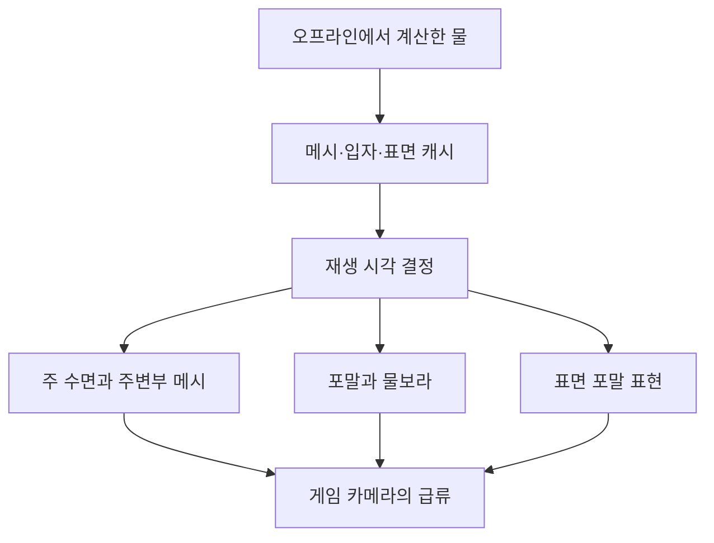

## 급류의 형태와 표면 디테일을 함께 재생한다

DCB의 현재 급류는 지형과 바위의 충돌 형상을 바탕으로 미리 계산한 물 데이터를 재생한다. 수면의 큰 덩어리, 주변부의 물, 포말과 물보라를 따로 저장하고 같은 재생 시간에 맞춰 보여 준다.

물은 게임 중 매 프레임 전체 유체를 새로 푸는 방식으로 움직이지 않는다. 오프라인에서 만들어 둔 프레임을 읽어 수면 메시와 입자·표면 데이터를 갱신한다. 따라서 제작한 흐름의 형태를 재생하는 기능이며, 임의로 지형을 바꾸거나 물길을 막았을 때 새로운 급류를 자동 계산한다고 설명할 수는 없다.

이 글은 **현재 소스와 저장값 기준의 기능 안내**다. 이번에 게임 장면이나 GPU 성능을 실행·측정하지 않았다.

## 화면을 만드는 계층

| 계층 | 현재 역할 |
| --- | --- |
| 주 수면 메시 | 급류 본체의 점유와 프레임별 표면 형태 |
| 주변부 `shore` 메시 | 본체 주변과 경계의 물 표현을 별도 메시로 재생 |
| 보조 입자 | 포말·물보라 등의 위치·크기·색을 기록한 데이터 재생 |
| 표면 포말 | 기록된 포말의 움직임을 수면용 배열 데이터로 적용 |
| 바위 접촉·물보라 디테일 | 저작된 접촉 지점과 별도 디테일 캐시·머티리얼을 이용한 표현 |

한 장의 투명한 평면에 색과 노멀만 흘리는 방식보다 많은 데이터가 필요하다. 대신 수면의 굴곡과 튀는 물, 바위 근처의 흰 물을 서로 다른 계층에서 조정할 수 있다. 실제 경계에 틈이 없는지와 겹침이 과한지는 게임 카메라에서 따로 확인해야 한다.

현재 주요 두 급류 프리팹은 이름이 서로 달라도 `BakedRapidsEffect`를 사용하고 같은 `Forest01Final` 캐시 계열에 연결돼 있다. 현재 보조 입자 데이터는 120프레임이며, 과거 성능 분석의 180프레임 자료와 다르다.

## 한 시각으로 여러 데이터를 맞춘다

재생기는 경과 시간과 재생 배율에서 현재 샘플을 정한다. 주 메시와 주변부 메시는 해당 프레임의 정점·인덱스·bounds를 적용하고, 보조 입자는 기록을 읽어 입자 시스템에 전달한다. 포말 표면 데이터도 재생 시간에 맞춰 셰이더에 연결한다.

재생 속도를 바꾸면 물 계층들이 사용하는 시간이 함께 달라진다. 이는 기존 캐시를 빠르거나 느리게 읽는 조절이며 실제 유입량이나 새 물리 해를 변경하는 조절은 아니다.

메시에는 바로 업로드할 수 있는 RMC 데이터를 사용한다. 프레임마다 형태와 정점 수가 달라질 수 있어 현재 프레임의 사용 범위도 갱신한다. 읽기를 미리 예약하는 버퍼와 표시할 Unity 메시의 역할은 나눠 두었다. 파일 배치와 업로드·수명 관리의 상세는 별도 분석 글에서 다룬다.

## 유한한 캐시를 반복해서 보여 주기

저장된 데이터에는 처음과 끝이 있다. 현재 주요 급류 프리팹은 반복을 켜고, 경계에서 다른 시각의 데이터를 재생하는 보조 리그를 이용해 교차 표시한다. 두 리그가 잠시 함께 보이는 구간을 두어 끝 프레임에서 첫 프레임으로 바로 튀는 표현을 줄이는 구성이다.

이 반복은 화면에서의 교차 전환이다. 물리 솔버가 끝과 시작을 하나의 연속된 유체 상태로 계산한 결과는 아니다. 전환 중 본체·포말·물보라의 중복이나 밝기 변화를 실제 화면에서 확인해야 한다.

## 멀거나 화면 밖에 있으면 갱신을 줄인다

현재 두 주요 프리팹은 화면 밖 갱신 생략을 켰고 거리 기준은 80m다. 카메라와 물의 경계를 보고 새 읽기·업로드·입자 갱신을 생략한다. 재생 시계는 계속 흐르므로 다시 보일 때 처음부터 재시작하지 않고 현재 시각으로 이어 간다.

현재 저장값에서 `nonBlockingStreaming`은 꺼져 있다. 필요한 메시 프레임이 준비될 때까지 기다리는 정책이다. 코드에는 준비되지 않은 프레임 대신 이전 메시를 잠시 유지하는 선택지도 있으나, 현재 주요 프리팹에서 그 선택이 켜져 있다고 쓰지는 않는다.

화면 밖 갱신 생략도 이미 예약한 모든 읽기를 즉시 취소하는 기능은 아니다. 다시 보이는 순간의 읽기 지연과 반복 전환의 비용은 실제 플레이에서 확인해야 한다.

## 현재 확인 범위

현재 캐시 연결, 주 메시·주변부 메시·보조 입자·표면 포말의 재생 경로, 반복과 갱신 생략 설정을 확인했다. 최신 캐시의 전체 시각 품질, 물과 지형의 접점, 카메라 재진입과 CPU/GPU 비용은 이번에 재생하거나 측정하지 않았다. 이 글은 물의 렌더링 재생을 설명하며 수영·부력·이동 제한 같은 플레이어 상호작용의 완성을 뜻하지 않는다.

급류 표현과 재생 구성을 요구하고 실제 플레이의 프레임 드롭을 제기했으며, 코드·변환 도구·셰이더 작업에는 AI 보조를 사용했다. 과거 CPU 비교와 읽기·변환·업로드를 나눈 문제 해결 과정은 [물 캐시 재생과 메시 업로드](/writing/water-playback/)에서 확인할 수 있다.
