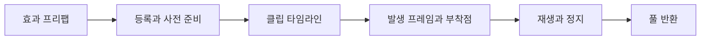

## 레이어 구성

환경 화염의 현재 모양·연소 단계와 화면 크기별 동작은 [DCB의 환경 화염](/writing/dcb-fire-overview/)에서 먼저 설명한다. 여기서는 표현 계층과 재생·준비 구조의 분석을 다룬다.

DCB의 불 이펙트는 볼륨 화염, 디테일, six-way 연기, 재·탄화 조각으로 구성했다. 각 레이어는 불 이펙트 전체의 재생·정지 상태에 맞춰 동작한다.

`FireZoneV2`에서 연료 영역과 화염 모양을 정의하고, `ProceduralStructureFireEffect`에서 절차적 밀도 볼륨과 디테일 셸을 제어한다.

## 품질 단계

화면에서 차지하는 크기와 카메라 시야 범위를 기준으로 Full, Reduced, Minimal, Culled 단계를 선택한다. 단계별 진입·해제 기준에 차이를 두는 hysteresis를 적용해 경계에서 품질이 반복해서 바뀌는 현상을 줄였다.

품질 단계와 재생 시간은 별도로 관리한다. 레이어를 생략하더라도 재생 시간이 초기화되지 않도록 했다. 화면 밖에 있는 불의 광원이 화면에 영향을 주는 경우도 고려한다.

## 애니메이션 이펙트 재생

`AnimationEffectTimeline`에 재생 시작 프레임, 캐릭터·무기의 부착점과 재생 방식(OneShot·Sustained)을 지정한다. 효과 등록, 로딩 중 사전 준비, 실제 재생과 풀 반환을 처리한다.

## 클립 조회와 첫 재생 준비

Addressables에서 같은 클립이 여러 번들에 복제되면 객체 참조가 달라질 수 있다. 현재 매니저는 클립 이름으로 타임라인을 찾고, 클립 참조별 조회 결과를 캐시한다. 이름 중복과 등록 시점도 관리해야 한다.

풀 인스턴스 생성과 최초 재생에 필요한 준비는 로딩 중 여러 프레임에 나눠 실행한다. 시간 예산을 기준으로 다음 프레임에 작업을 넘길지 결정한다. 개별 작업은 이 예산보다 오래 걸릴 수 있다.

## AI와 재사용 자산

AI를 사용해 코드·셰이더 후보를 작성하고 형태, 접점, 발생 시점과 잔존 시간을 비교했다. 생성 경로와 실제 프리팹의 재질·텍스처 연결도 확인했다.

화염용 플립북 텍스처는 Unity ParticlePack 자산을 재사용했다.

## 검사 결과

불 관련 검사를 골라 실행했고, 22개 모두 통과했다. 실제 GPU 시간은 같은 카메라, 해상도와 품질 조건에서 별도로 측정해야 한다.
