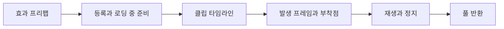

## 하나의 불을 여러 책임으로 나누기

불을 하나의 파티클 설정으로만 조절하면 본체의 점유, 표면의 디테일, 연기와 재를 독립적으로 다루기 어렵습니다. DCB의 불은 볼륨 화염, 디테일, six-way 연기, 재·탄화 조각을 레이어로 나누고 소유 효과의 재생 상태에 연결합니다.

`FireZoneV2`는 연료 영역과 화염 모양을 정의하고, `ProceduralStructureFireEffect`가 절차적 밀도 볼륨과 디테일 셸을 제어합니다.

## 화면에서 차지하는 크기와 비용

카메라 투영 크기와 frustum에 따라 Full, Reduced, Minimal, Culled 표현 단계를 선택합니다. 단계 경계에는 여유를 두어 작은 카메라 변화마다 품질이 흔들리지 않게 합니다.

중요한 것은 **품질 단계와 재생 시간을 분리하는 것**입니다. 비용을 줄이기 위해 레이어를 생략한 동작이 Pause·Stop처럼 위상을 초기화해서는 안 됩니다. 화면 밖이어도 광원이 화면에 영향을 주는 상황은 별도로 고려합니다.

## 효과를 실제 게임에 연결하기

`AnimationEffectTimeline`에는 발생 프레임과 캐릭터·무기 부착점, OneShot과 Sustained 수명을 정의합니다. 등록·워밍업·풀 반환까지 연결해야 프리뷰에서 좋았던 효과가 실제 클립에서도 같은 시점과 위치에 나타납니다.

## 에디터 밖에서 드러나는 문제

Addressables에서 같은 클립이 여러 번들에 복제되면 객체 참조만으로 타임라인을 찾는 방식이 달라질 수 있습니다. 현재 매니저는 클립 이름 색인과 참조별 조회 캐시를 함께 사용합니다. 등록 시점과 이름 중복도 관리해야 하는 구조입니다.

첫 재생의 준비 비용은 풀 인스턴스 생성과 Play 경로 선실행으로 나누어 로딩 중 여러 프레임에 분산합니다. 시간 예산은 작업 사이에 양보하는 기준이며 단일 작업의 절대 상한을 뜻하지는 않습니다.

## AI 협업과 기여 범위

AI와 외형·코드·셰이더 후보를 만들 때는 자연스러운 형태, 접점, 발생 시점, 잔존 시간을 기준으로 비교합니다. 채택 후에는 실제 프리팹의 재질·텍스처와 생성 경로가 일치하는지 확인합니다.

현재 참조 화염 재질의 플립북 원본은 Unity ParticlePack을 재사용합니다. 원본 텍스처 제작과 레이어·셰이더·재생 시스템 구현을 구분합니다. 2026년 10월 16일 불 관련 선택 검사는 22/22 통과했으며, GPU 비용을 수치로 제시하려면 같은 카메라·해상도·품질에서 별도 측정해야 합니다.
