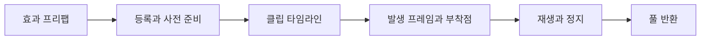

## 레이어 구성

DCB의 불 이펙트는 볼륨 화염, 디테일, six-way 연기, 재·탄화 조각으로 구성했다. 각 레이어는 소유 효과의 재생 상태에 맞춰 동작한다.

`FireZoneV2`에서 연료 영역과 화염 모양을 정의하고, `ProceduralStructureFireEffect`에서 절차적 밀도 볼륨과 디테일 셸을 제어한다.

## 품질 단계

카메라 투영 크기와 frustum을 기준으로 Full, Reduced, Minimal, Culled 단계를 선택한다. 단계 전환에는 hysteresis를 적용해 경계에서 품질이 반복해서 바뀌는 현상을 줄였다.

품질 변경과 재생 시간은 별도로 관리한다. 레이어를 생략하더라도 재생 위상이 초기화되지 않도록 했다. 화면 밖에 있는 불의 광원이 화면에 영향을 주는 경우도 고려한다.

## 애니메이션 이펙트 재생

`AnimationEffectTimeline`에 발생 프레임, 캐릭터·무기 부착점과 OneShot·Sustained 수명을 지정한다. 등록, 로딩 중 준비, 재생과 풀 반환을 연결했다.

## 클립 조회와 첫 재생 준비

Addressables에서 같은 클립이 여러 번들에 복제되면 객체 참조가 달라질 수 있다. 현재 매니저는 클립 이름으로 타임라인을 색인하고, 참조별 조회 결과를 캐시한다. 이름 중복과 등록 시점도 관리해야 한다.

풀 인스턴스 생성과 최초 Play 경로 준비는 로딩 중 여러 프레임에 나눠 실행한다. 코드의 시간 예산은 작업 사이에 실행을 양보하는 기준이며, 단일 작업의 시간 상한은 아니다.

## AI와 재사용 자산

AI를 사용해 코드·셰이더 후보를 작성하고 형태, 접점, 발생 시점과 잔존 시간을 비교했다. 생성 경로와 실제 프리팹의 재질·텍스처 연결도 확인했다.

현재 참조 화염 플립북은 Unity ParticlePack 자산이다. 직접 만든 원본 텍스처로 표기하지 않는다.

## 검사 결과

2026년 10월 16일 실행한 불 관련 선택 검사는 22/22 통과했다. 실제 GPU 시간은 같은 카메라, 해상도와 품질 조건에서 별도로 측정해야 한다.
