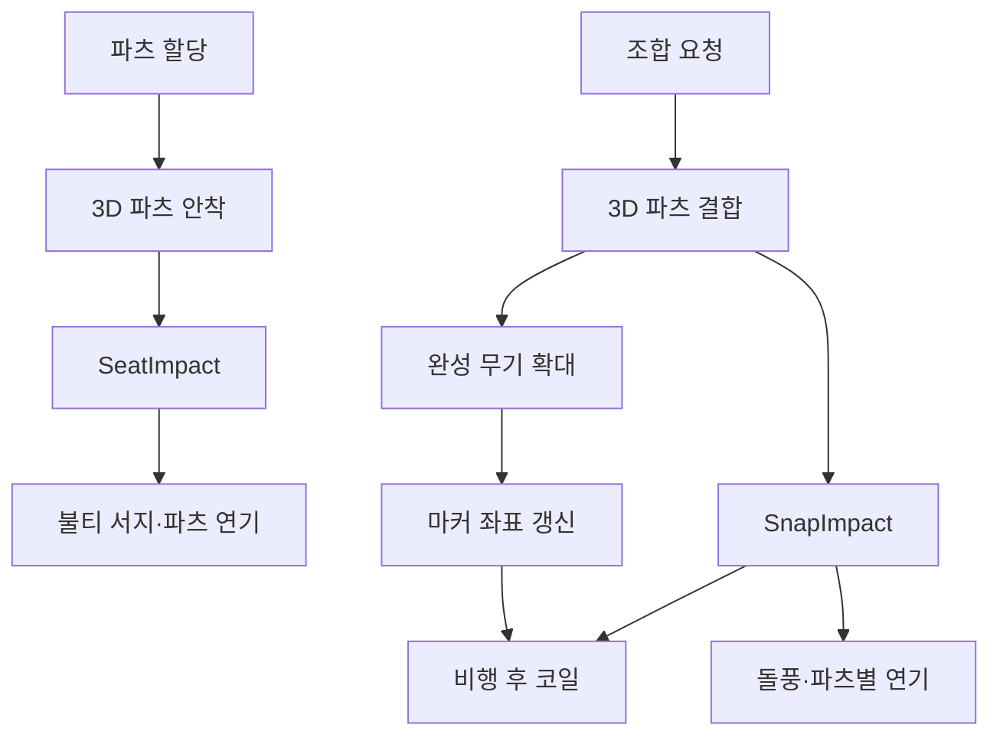

## 조립 동작과 이펙트의 발생 시점을 맞추기

DCB의 모루 화면에서는 파츠를 선택하고, 무기에 붙이고, 조합을 완성한다. 파츠가 움직이는 동안 효과가 먼저 터지거나 완성 무기와 떨어진 곳에서 불티가 사라지면 조립 동작과 연출이 따로 보인다.

연출을 조립 상태에 연결했다. 평소에는 배경의 불티와 연기가 흐르고, 파츠가 닿는 순간에는 주변 연기가 밀려난다. 조합을 완성할 때는 좌하단에서 분사된 불티가 무기로 이동해 축을 감아 오른 뒤 끝부분에서 흩어진다.

모루의 현재 사용 흐름은 [DCB의 장비 조합](/writing/dcb-equipment-overview/)에서, 파츠 데이터·2D·3D 조립과 저장 구조는 [장비 파츠 조합 구현](/writing/modular-equipment/)에서 다뤘다. 여기서는 모루 UI의 렌더링, 입자 움직임과 접촉 이벤트를 설명한다. **2026년 10월 18일 현재 소스·프리팹과 7월 작업 이력을 대조했으며, 이번에 Unity나 실제 조합 화면을 실행하지는 않았다.**

## 3D 프리뷰와 UI 이펙트의 역할

무기는 `ForgeWeaponPreview`의 카메라가 RenderTexture에 그린다. 불티와 연기는 `MaskableGraphic`을 상속한 두 컴포넌트가 UI 메시로 그린다. 이펙트용 카메라나 RenderTexture를 별도로 추가한 구조는 아니다.

| 구성 | 역할 |
| --- | --- |
| `AnvilForgePopup` | 조립 상태와 접촉 이벤트를 받아 연출을 호출한다. |
| `ForgeWeaponPreview` | 3D 파츠의 안착·결합을 재생하고, UI에 투영할 무기·파츠 범위를 제공한다. |
| `AnvilForgeVfxField` | 불티의 배경 흐름, 시간 분산 분출, 비행과 코일 경로를 갱신한다. |
| `AnvilForgeSmokeField` | 연기 플립북을 재생하고 돌풍·파츠 주변 밀림을 적용한다. |
| `UI/AnvilForgeAdditive` | 불티의 정점 색과 텍스처를 가산 합성한다. 연기는 기본 UI 알파 블렌딩을 사용한다. |



설명용 구조도다. 조립 애니메이션의 접촉과 결과 화면의 확대는 서로 다른 단계이며, 이펙트는 두 단계에 필요한 정보를 각각 사용한다.

### Canvas에 직접 메시를 그리는 방식

`Graphic`은 UI 기하를 만드는 기반 클래스다. 이 구현은 입자 위치를 갱신한 뒤 `SetVerticesDirty()`를 호출하고, `OnPopulateMesh(VertexHelper)`에서 사각형의 정점·UV·색과 삼각형을 채운다. API의 역할은 [Unity uGUI Graphic 문서](https://docs.unity3d.com/Packages/com.unity.ugui@2.0/api/UnityEngine.UI.Graphic.html)를 기준으로 확인했다.

불티 하나는 넓고 옅은 후광과 작고 선명한 중심의 두 사각형으로 구성한다. 속도 방향으로 길이를 늘리고 수직 방향을 폭으로 사용해, 느릴 때는 점에 가깝고 빠를 때는 짧은 궤적이 되게 했다. 현재 프리팹에서 불티와 연기의 `raycastTarget`은 꺼져 있어 포인터 입력 대상으로 사용하지 않는다.

두 필드는 무기·버튼보다 뒤에서 그리도록 형제 순서를 정한다. 연기는 불티보다도 뒤에 배치한다. `MaskableGraphic`을 사용했다는 사실만으로 모든 마스크·중첩 Canvas 조합을 검증한 것은 아니다.

## 흰 빛무리와 반짝임을 줄인 과정

7월 11~13일 이력에는 중앙의 흰 스파크, 무기 여열 발광과 결과 패널의 광택을 제거한 변경이 있다. 중앙의 옅은 안개도 빛무리처럼 읽혀 제거했고, 이후 배경 연무는 별도 플립북 필드로 구성했다. 선택 파츠를 발광·림·딤으로 강조하던 시도 역시 최종적으로 제거했다.

이 변경을 모든 글로우가 사라진 것으로 설명하면 현재 코드와 다르다. **개별 불티의 부드러운 후광은 남아 있다.** 제거한 것은 무기나 화면 중앙을 덮는 별도의 강조 표현이다.

불티의 밝기를 주기적으로 바꾸던 flicker도 제거했다. 흐름장의 속도 변화, 입자별 크기·색·수명과 소멸 페이드는 유지한다. 밝기가 박자처럼 반복해서 뛰는 현상과 바람의 강약을 별도로 조정한 것이다.

가산 합성은 겹칠수록 밝아진다. 현재 셰이더의 `Blend SrcAlpha One`은 단순화하면 아래 식이다. 블렌딩 계수의 의미는 [Unity 블렌딩 문서](https://docs.unity3d.com/6000.0/Documentation/Manual/writing-shader-blending-modes.html)를 따른다.

$$
C_{out}=C_{src}\alpha_{src}+C_{dst}
$$

붉은색 입자도 많은 후광이 같은 위치에 겹치면 밝은 덩어리가 될 수 있다. 그래서 색상만 바꾸지 않고 중앙 발광의 유무, 입자의 크기·분포·궤적 길이도 조정했다. 연기는 불티의 가산 머티리얼을 공유하지 않는다.

## 배경 흐름과 풀무질 서지

평상시 불티는 위치와 시간에 따라 방향이 조금씩 변하는 공유 흐름장을 따른다. 각 입자에 서로 무관한 흔들림만 주는 대신, 같은 위치에서는 비슷한 바람을 받고 개별 사행을 추가한다. 실제 유체 방정식을 푸는 시뮬레이션은 아니며, 사인 함수와 감쇠로 만든 연출용 속도장이다.

파츠가 닿으면 같은 불티 표현을 사용해 좌하단에서 우상향으로 더 많이 분출한다. 초기 발사 속도는 감쇠하고 흐름장의 바람이 이어받는다. 수량 배수와 힘 배수를 나눠, 양을 늘리기 위해 비행 속도까지 함께 올릴 필요가 없게 했다.

### 한 프레임의 폭발을 짧은 지속 분출로 바꾸기

총 입자 수가 같아도 전부 같은 프레임에 만들면 순간적인 폭죽에 가깝다. 분출 시간을 두고 소수 누적기를 사용했다.

```text
초당 발생량 = 총 개수 / 분출 시간
누적기 += 초당 발생량 × 이번 갱신 시간
이번 발생량 = min(남은 개수, floor(누적기))
누적기 -= 이번 발생량
남은 개수 -= 이번 발생량
```

현재 조합 코일은 **200개를 0.5초 동안** 발생시키도록 저장돼 있다. 평균 발생률은 초당 400개다. 60Hz를 가정하면 갱신당 약 6.67개이므로 정수로 버린 나머지를 다음 갱신에 넘겨야 한다. 실제 프레임 간격은 일정하지 않으므로 매번 6개 또는 7개라고 고정하지 않는다.

필드는 `Time.unscaledDeltaTime`을 사용한다. 게임 시간 배율과 별도로 UI 연출을 진행하기 위한 선택이다. 0.1초보다 긴 간격은 최대 0.05초로 줄이는 보호 코드가 있으므로, 큰 히치에서는 벽시계 시간 0.5초와 시뮬레이션의 분출 완료 시각이 달라질 수 있다.

## 파츠가 닿을 때 연기를 밀어내기

파츠를 클릭한 순간에 연기를 만들지 않고, `ForgeWeaponPreview`가 낙하·안착 중 발생시키는 `SeatImpact`에 연결했다. 팝업은 이 이벤트에서 불티 서지와 해당 파츠의 연기 반응을 호출한다. 과거에 넣었던 스테이지 확대 펀치는 제거했고, 파츠 자체의 낙하와 접촉을 남겼다.

파츠 크기는 고정 원 하나로 처리하지 않는다. 렌더러 bounds를 프리뷰 카메라로 투영해 UI에서의 중심·축·길이·두께를 구한다. 길이가 두께의 2.2배를 넘으면 길쭉한 파츠로 판정한다.

| 형태 | 연기가 밀리는 기준 |
| --- | --- |
| 길쭉한 파츠 | 축 선분의 최근접점에서 바깥쪽으로 밀어 양옆에 반응을 만든다. |
| 짧은 파츠 | 중심에서 바깥쪽으로 밀어 방사형 반응을 만든다. |

선분 $A\!B$에서 위치 $P$에 가장 가까운 점은 다음과 같이 구한다. 선분 길이가 거의 0이면 분모를 계산하지 않고 $A$를 사용한다.

$$
t=\operatorname{clamp}\left(\frac{(P-A)\cdot(B-A)}{\lVert B-A\rVert^2},0,1\right),\qquad Q=A+t(B-A)
$$

밀림 방향은 $P-Q$다. 여기에 거리·시간에 따른 지수 감쇠를 적용한다. 파츠 주위에는 새 연기 퍼프도 생성한다. 배경 돌풍인 `EmitGust`가 기존 연기를 미는 처리와, `EmitPartPush`가 새 연기를 추가하는 처리는 구분해야 한다.

조합 완료 때는 장착된 모든 파츠의 범위를 모아 연기를 만든다. 각각의 생성 알파 배수는 0.8이다. 단, 현재 구현에서 **생성 위치는 파츠마다 순회하지만 지속 밀림을 저장하는 선분 상태는 하나**다. 같은 프레임의 호출이 그 상태를 덮어쓰므로 모든 파츠의 독립적인 바람장이 동시에 유지된다고 설명할 수는 없다.

### 배경 연기와 생성 연기의 알파를 분리하기

배경 연기는 오래 머무르며 은은하게 보여야 한다. 접촉 순간의 연기에 같은 낮은 알파와 긴 페이드인을 적용하면 반응이 늦고 약해진다. 7월 13일에는 배경 알파에 배수만 곱하는 방식에서 생성 연기 자체의 알파 엔벨로프로 바꿨다.

현재 저장된 생성 알파 기준은 0.5에서 0.11로 옅어지는 설정이다. 실제 출력에는 0.12초의 등장 램프, 1.5초의 정착 구간, 수명 끝 페이드와 이벤트별 알파 배수가 함께 곱해진다. 따라서 화면의 최고 불투명도가 정확히 0.5라고 단정하지 않는다. 배경 알파 0.056과도 독립적이다.

연기 모양은 `WispySmoke03b_8x8`의 64프레임 시트를 사용한다. 수명의 진행도로 프레임을 고르고, 인접 두 프레임을 가중 알파로 겹쳐 프레임 변화가 덜 끊겨 보이게 구성했다. 이는 두 번의 알파 합성이며, 두 이미지의 정확한 선형 보간과는 차이가 있다. UV에는 반 텍셀 여백을 둔다. 이 텍스처는 프로젝트의 출처 기록상 [Unity Technologies SpaceshipDemo](https://github.com/Unity-Technologies/SpaceshipDemo)에서 가져온 재사용 자산이며 직접 시뮬레이션해 제작한 원본으로 소개하지 않는다.

## 분사된 불티가 그대로 무기를 감싸게 하기

초기에는 좌하단 분사와 무기 주변 코일이 별도 입자였다. 분사된 입자가 사라진 뒤 다른 입자가 무기를 감싸면 두 효과의 연결이 약했다. 7월 14일에는 하나의 입자가 두 단계를 이어가도록 통합했다.

1. 좌하단 영역에서 입자를 만든다.
2. 무기 아래쪽 코일의 시작 위치를 목표로 비행한다.
3. 도착하면 같은 입자의 상태를 비행에서 코일로 바꾼다.
4. 무기 축을 따라 감아 오르며 끝부분에서 분산·페이드한다.

비행과 코일은 위치를 직접 계산한다. 배경 불티의 속도 적분과 바람을 그대로 적용하지 않는다. 바람만으로 입자가 우연히 무기에 도달하기를 기다리는 방식 대신, 조합 동작에 필요한 경로를 지정한 것이다.

### 메시 전체의 대각선보다 조립 축을 먼저 사용하기

무기를 감싸는 축을 전체 AABB의 긴 대각선으로 잡으면 낫처럼 휜 무기에서 실제 조립 방향과 어긋날 수 있다. 현재 호출은 조립 라인의 축을 먼저 사용한다. 렌더러 bounds의 코너를 그 축에 투영해 무기의 범위를 정하고, 프리뷰 카메라를 통해 UI 좌표로 옮긴다. 조립 라인이 없으면 전체 무기 bounds의 화면 범위로 대체한다.

코일 위치의 중심식은 다음처럼 간추릴 수 있다. $s$는 축 진행도, $N$은 축에 수직인 UI 단위벡터, $r$은 반경이다.

$$
P(s)=A+s(B-A)+N\,r\cos(\phi_0+\omega s)
$$

실제 코드에는 밑동의 벌어짐, 끝부분 분산, 부상과 작은 사행이 더해진다. 사인 위상으로 입자의 크기·밝기도 달리해 깊이감을 보탠다. **2D 축 주변의 경로이며 실제 3D 메시 표면을 샘플하거나 충돌·깊이 판정으로 감싸는 방식은 아니다.** 무기보다 뒤에 그리는 UI 순서도 함께 사용한다.

축을 화면 위쪽으로 정규화하므로 모든 무기의 의미상 손잡이·날끝을 판별하는 규칙도 아니다. 뒤집힌 무기나 심하게 굽은 형태는 실제 화면에서 별도로 확인해야 한다.

### 결과 확대 중에도 현재 무기 위치를 사용하기

결과 화면은 조립 스테이지를 1.5배로 확대한다. 발생 순간의 월드 좌표만 저장해 두면 무기가 커져도 코일 축은 이전 크기에 남는다.

7월 15일 변경에서는 마커 레이어의 로컬 중심·끝점과 `RectTransform`을 함께 보관하도록 바꿨다. 매 갱신에서 현재 변환으로 월드 좌표를 구하고 불티 필드의 로컬 좌표로 옮긴다. 이미 비행 중인 입자의 목적지와 코일 입자가 같은 축을 참조한다.

여기서 추적하는 것은 **보관한 로컬 범위에 대한 UI 변환**이다. 매 프레임 3D 메시의 전체 실루엣을 다시 투영하는 구조는 아니다. 결과 확대 대응과 임의의 3D 회전·파츠 변경 대응을 같은 것으로 설명하지 않는다.

## 비행에서 코일로 넘어갈 때 속도도 연결하기

같은 입자라도 도착 직전과 직후의 방향·속도가 다르면 경계가 보인다. 현재 비행 경로는 3차 베지어 곡선을 사용하고, 끝 제어점을 코일의 시작 속도에 맞춰 계산한다.

$$
B(u)=(1-u)^3P_0+3(1-u)^2uP_1+3(1-u)u^2P_2+u^3P_3
$$

$u=t/T$이고 $T$가 비행 시간이면, 도착 시 시간에 대한 속도는 $3(P_3-P_2)/T$다. 고정된 축에서 도착 속도를 $V$에 맞추려면 다음처럼 정할 수 있다.

$$
P_2=P_3-\frac{T}{3}V
$$

현재 코드는 코일 경로를 작은 진행도 차이로 샘플해 시작 속도를 근사한다. 또한 비행 시간을 넘긴 프레임에서는 초과 시간만큼 코일 진행도를 즉시 증가시킨다. 흔들림·깊이 크기·궤적 길이 변화도 코일 시작 뒤 0.1초 동안 점진적으로 적용한다.

이것은 경계의 멈춤과 급격한 방향 변화를 줄이기 위한 구현이다. 움직이는 목표점의 추가 속도, 이산 갱신과 근사 접선까지 포함해 모든 조건에서 수학적으로 완전한 속도 연속을 보장한다고 쓰지는 않는다. 최신 화면에서 도착 순간을 프레임 단위로 확인하는 일이 남아 있다.

## 현재 프리팹의 설정과 비용

아래는 소스 기본값이나 빌더의 생성값이 아니라 현재 `AnvilForgePopup` 프리팹의 저장값이다. 실제 인스턴스의 별도 변경 여부와 재생 결과는 촬영 때 확인해야 한다.

| 항목 | 저장값과 의미 |
| --- | --- |
| 배경 불티 | 목표 수 29개, 배경 크기 배수 0.5 |
| 배경 연기 | 목표 수 9개, 알파 0.056, 8×8·64프레임, 프레임 겹침 ON |
| 파츠 안착 서지 | 기준 수 128 × 힘 1 × 수량 배수 1.3, 분출 시간 1초 |
| 조합 코일 | 200개, 분출 시간 0.5초, 개별 비행 시간 0.65~0.95초 |
| 비행·코일 궤적 길이 상한 | 각각 28·45 UI 로컬 단위 |
| 생성 연기 | 파츠당 5개, 기준 수명 3초에 개별 편차 적용, 조합 알파 배수 0.8 |
| 결과 화면 | 무기 스테이지 확대 1.5배 |

코일 축 조회에 성공하면 200개 통합 경로를 사용한다. `combineGustCountScale: 1.7`과 1.5초 분출은 기존 분사 대체 경로의 설정이며, 정상 코일의 200개에 추가로 곱하지 않는다.

현재 불티는 입자마다 두 사각형을 만든다. 200개가 모두 동시에 보이면 코일만 1,600정점·800삼각형이다. 연기는 프레임 겹침 중 퍼프당 최대 두 사각형이다. 이는 코드로 계산한 기하량이며, 실제 동시 생존 수나 draw call·GPU 시간을 측정한 값은 아니다.

오브젝트를 입자마다 만들지는 않지만 CPU에서 입자를 갱신하고 UI 메시를 다시 구성한다. 화면을 넓게 덮는 투명 연기는 픽셀 중첩 비용도 만든다. 따라서 Canvas 메시로 옮겼다는 이유만으로 더 빠르다거나 한 번의 draw call이라고 주장할 수 없다.

## 독립 예제와 실습

아래 JavaScript는 분출 누적기와 베지어 끝 속도만 분리한 예제다. 브라우저 콘솔이나 Node.js에서 실행할 수 있다. 게임 소스의 전체 구현을 옮긴 것이 아니며 UI·무기·렌더링은 포함하지 않는다.

```javascript
function emission(total, seconds, hz) {
  let remaining = total;
  let carry = 0;
  let frames = 0;
  const rate = total / seconds;
  while (remaining > 0 && frames < hz * 10) {
    carry += rate / hz;
    const count = Math.min(remaining, Math.floor(carry));
    remaining -= count;
    carry -= count;
    frames++;
  }
  return { emitted: total - remaining, elapsed: frames / hz };
}

for (const hz of [30, 60, 144]) {
  const result = emission(200, 0.5, hz);
  console.log(hz, result.emitted, result.elapsed.toFixed(3));
}

const end = [100, 200];
const targetVelocity = [30, 60];
const duration = 0.75;
const control = end.map((x, i) => x - targetVelocity[i] * duration / 3);
const arrivalVelocity = end.map((x, i) => 3 * (x - control[i]) / duration);
console.log("끝 제어점", control);
console.log("도착 속도", arrivalVelocity);
```

Node.js에서 실행한 출력은 다음과 같다. 144Hz의 완료 시각에는 한 갱신만큼의 지연이 반영됐다.

```text
30 200 0.500
60 200 0.500
144 200 0.507
끝 제어점 [ 92.5, 185 ]
도착 속도 [ 30, 60 ]
```

예제는 양의 총 개수·시간·갱신 빈도를 전제로 한다. 실제 도구로 확장한다면 0·음수·비정상 수 입력과 취소·재진입 정책부터 정의해야 한다.

### 실습 1: 200개를 프레임마다 정수로 나누면

60Hz·0.5초에서 매 갱신 `floor(400 / 60)`개만 만들고 30번 뒤 중단하면 총 몇 개가 생기는가? 위 누적기와 비교해 보자.

**풀이:** 매번 6개이므로 180개다. 소수 나머지를 유지하는 예제는 남은 개수가 0이 될 때까지 진행해 200개를 만든다. 30·60·144Hz에서 총량을 비교하고, 완료 시각은 갱신 단위와 부동소수점 누적 때문에 명목 시간보다 한 갱신 늦어질 수 있음을 확인한다. 이 예제에는 게임의 히치 시간 제한을 넣지 않았다.

### 실습 2: 길쭉한 파츠 주변의 밀림

$A=(0,0)$, $B=(0,200)$인 파츠 옆에 연기가 $P=(30,80)$에 있다. 최근접점과 밀림 방향은 무엇인가? 연기가 $(30,250)$에 있다면 어떻게 달라지는가?

**풀이:** 첫 경우 $t=0.4$, $Q=(0,80)$이므로 오른쪽으로 밀린다. 두 번째는 투영값이 1을 넘지만 clamp 후 $Q=(0,200)$이다. 방향은 $(30,50)$을 정규화한 값으로, 끝점을 기준으로 오른쪽 위로 밀린다. 축에 무조건 수직인 고정 방향을 주는 것과 끝부분 동작이 다르다.

### 실습 3: 위치만 맞춘 비행의 끝 제어점

목표 위치 $(100,200)$, 비행 시간 0.75초, 코일 시작 속도 $(30,60)$일 때 끝 제어점을 계산하자. `control = end`로 바꾸면 어떤 차이가 생기는가?

**풀이:** $T/3=0.25$이므로 끝 제어점은 $(92.5,185)$다. 예제는 도착 속도 $(30,60)$을 출력한다. 제어점과 끝점이 같으면 베지어의 도착 속도는 0이 된다. 코일이 즉시 움직이면 위치는 이어져도 속도 변화가 생긴다. 이 계산은 고정 목표에 대한 것이며 움직이는 축의 최종 품질은 실제 재생으로 판단한다.

## 작업 이력과 확인 범위

| 기록 | 확인한 변화 |
| --- | --- |
| 7월 11일 `e3e9d3dbe`·`db7c08c3b` | 무기 여열과 중앙 안개를 제거하고 불티 궤적을 조정했다. |
| 7월 12일 `22d845e55`·`81afacb51` | 밝기 flicker를 제거하고 스케치를 기준으로 좌하단 분사·큰 흐름을 구성했다. |
| 7월 13일 `264a7df87`·`fe8ffcf42` | 파츠 길이에 따른 연기 밀림과 생성 연기의 독립 알파 엔벨로프를 추가했다. |
| 7월 14일 `d2ae20ddd`·`310e6cfc6` | 조합 시 파츠별 연기를 생성하고, 불티의 비행·코일을 통합했다. 이 통합 커밋의 작성일을 글 날짜로 사용한다. |
| 7월 15일 `74952ae0c`의 관련 파일 변경 | 결과 확대 좌표 추적, 비행 끝 접선·초과 시간 처리와 궤적 길이 조정을 확인했다. 커밋 제목은 다른 이펙트 작업이므로 실제 diff를 대조했다. |

7월 14일 커밋에는 합성 무기로 분사 분포·경로를 촬영하는 `AnvilCombineSplitVisualTest`와 낫 축을 계산하는 `AnvilSickleAxisTest`가 추가돼 있다. 두 도구는 7월 27일 정리 커밋에서 제거됐다. 이번에는 과거 소스를 읽었으며, 원본 결과 로그·캡처와 최신 실행 성공을 확인한 것은 아니다. 남아 있는 `AnvilWorkbenchSmokeTest`도 이전 팝업용이므로 현재 `AnvilForgePopup` 코일의 검증 결과로 사용하지 않는다.

**이번 확인은 소스·프리팹·셰이더·자산 출처·커밋 대조와 독립 수치 예제의 범위다.** Unity 컴파일·Play Mode·Player 렌더링, 실제 조합 왕복, 입력과 소리의 동기, 화면 비교·CPU/GPU 측정은 새로 수행하지 않았다. 아직 실제 게임 영상은 첨부하지 않았다.

다음 촬영에서는 아래 장면을 같은 환경과 정상 속도로 확인한다.

1. 길쭉한 파츠와 짧은 파츠의 접촉 시점, 연기 위치·방향과 무기 가림 정도.
2. 직선 무기와 낫의 분사 → 도착 → 코일 → 끝부분 소멸. 경계의 멈춤·꺾임도 근접 촬영한다.
3. 결과 1.5배 확대 중 코일 축의 위치, 마지막 입자 이후의 잔존 여부.
4. 연출 도중 닫기·다시 열기, 연속 조합, 키보드·마우스와 패드의 조작 가능 여부.
5. 게임 시간 배율, 해상도·화면 비율 변경과 Player에서의 마스크·레이어·블렌딩.

## 요구와 제작 기여

작업 기록과 코드 주석에는 스케치를 기준으로 한 좌하단 분사 방향, 밝기 박동 제거, 색·크기·수량 조정, 분사된 불티가 끊기지 않고 무기를 감싸야 한다는 요구가 남아 있다. 내 기여는 이 시각적 기준과 수정 방향을 정하고 후보를 조정한 부분이다. 코드·셰이더와 시각 검사 도구 작성에는 AI 보조를 사용했다. 대표 통합 커밋에도 공동 작성 기록이 있다.

불티의 UI 메시·경로·접촉 배선과 연기 재생 제어를 구성했으며, 연기 플립북과 무기 모델 원본은 기존 자산을 재사용했다. 구현 의도와 현재 연결은 코드로 확인할 수 있지만, 최종 가독성과 조작감은 실제 조합 화면의 촬영·검토로 보완해야 한다.
