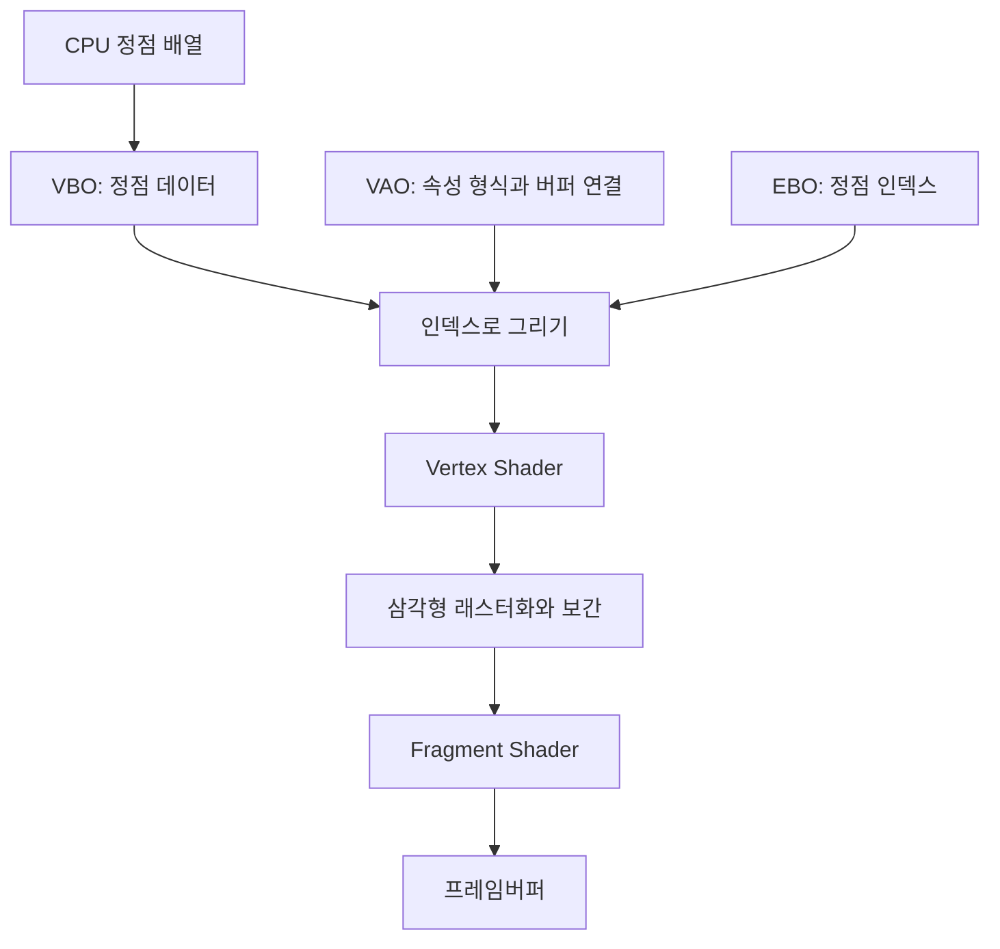

## 정점에서 텍스처까지 연결한 구조

[imjae/LearnOpenGL](https://github.com/imjae/LearnOpenGL)은 OpenGL을 직접 호출해 창·정점·셰이더·텍스처를 연결한 프로젝트입니다. `Chapter01`의 정점 데이터가 셰이더 입력과 최종 색으로 이어지는 과정을 설명합니다.

현재 구현에는 OpenGL 3.3 Core 컨텍스트 생성, 정점 버퍼와 속성 설정, 인덱스를 이용한 사각형, 외부 GLSL 파일, 텍스처 두 장과 uniform 혼합값이 있습니다. 범위는 카메라·조명 이전의 렌더링 파이프라인이며, 아래에서 프래그먼트 셰이더의 문법 문제도 다룹니다.

이 글에서는 **CPU의 데이터가 어떤 설정을 거쳐 셰이더 입력이 되고, 텍스처가 최종 색에 연결되는지**를 살펴봅니다.

## 창, 컨텍스트와 함수 로더는 역할이 다릅니다

<div id="창-컨텍스트와-함수-로더는-역할이-다르다" aria-hidden="true" style="scroll-margin-top: 90px;"></div>

창은 운영체제에 표시하는 영역입니다. OpenGL 컨텍스트는 그리기 명령을 처리하는 데 필요한 상태와 실행 환경을 제공합니다. GLFW는 창·입력·컨텍스트 생성을 돕고, GLAD는 현재 컨텍스트에서 사용할 OpenGL 함수 주소를 불러옵니다.

현재 초기화 순서는 GLFW 초기화→3.3 Core 요청→창 생성→컨텍스트를 현재 스레드에 연결→GLAD 로딩입니다. 함수 로딩보다 먼저 유효한 컨텍스트가 필요합니다. [GLFW의 컨텍스트와 함수 로더 설명](https://www.glfw.org/docs/latest/quick.html#quick_context_current)

프레임 반복에서는 입력 확인, 화면 지우기, 텍스처·VAO 바인딩과 그리기, 버퍼 교환, 이벤트 처리를 수행합니다. 버퍼 교환은 그리기와 별개 단계입니다. 창 크기 변경 콜백은 `glViewport`를 갱신합니다. viewport는 정규화된 장치 좌표를 프레임버퍼의 어느 영역에 매핑할지 정하는 설정입니다.

## 정점 데이터와 VBO VAO EBO의 관계

정점은 위치만을 뜻하지 않습니다. 이 프로젝트의 정점 하나에는 위치 3개, 색 3개, UV 2개로 총 여덟 개의 float가 들어갑니다. UV는 텍스처에서 샘플링할 위치를 나타내는 두 좌표입니다.

| 속성 | GLSL location | 성분 수 | 정점 시작 기준 오프셋 |
| --- | --- | --- | --- |
| 위치 | 0 | 3 | 0 |
| 색 | 1 | 3 | `3 * sizeof(float)` |
| UV | 2 | 2 | `6 * sizeof(float)` |

다음 정점의 같은 속성까지 간격인 stride는 모두 `8 * sizeof(float)`입니다. 프로젝트에서 사용하는 4바이트 float 기준으로 한 정점은 32바이트, UV 시작은 24바이트입니다. API의 stride와 오프셋에는 float의 개수가 아니라 바이트 단위를 전달합니다. [glVertexAttribPointer의 인자](https://registry.khronos.org/OpenGL-Refpages/gl4/html/glVertexAttribPointer.xhtml)



- **VBO**에는 정점 데이터 바이트를 올립니다.
- **VAO**에는 활성 속성, 성분 수·형식·stride·오프셋과 해당 버퍼 연결을 설정합니다. 정점 데이터를 복사해 담는 컨테이너로 이해하지 않습니다.
- **EBO**에는 정점을 참조할 인덱스를 올립니다. Core 프로파일에서 이 요소 버퍼의 바인딩은 VAO 상태에 속하므로 설정 순서를 함께 봅니다.

현재 인덱스는 `0, 1, 3`과 `1, 2, 3`입니다. 정점 네 개를 두 삼각형으로 참조합니다. `glDrawElements`의 count 6은 삼각형 수나 바이트 수가 아니라 **읽을 인덱스 원소 수**입니다. `GL_UNSIGNED_INT`는 그 인덱스의 자료형입니다. [glDrawElements의 count와 type](https://registry.khronos.org/OpenGL-Refpages/gl4/html/glDrawElements.xhtml)

## Vertex Shader 출력이 Fragment Shader로 가는 과정

현재 Vertex Shader는 위치를 `gl_Position`에 쓰고 색과 UV를 출력합니다. 이 위치는 모델·뷰·투영 행렬을 거치지 않은 clip 좌표입니다. w를 1로 두므로 이 예제에서는 원근 나눗셈 후 x·y·z가 같은 값이 됩니다. 3D 카메라의 행렬 변환을 추가하기 전 단계입니다.

삼각형이 화면의 어느 부분을 덮는지 계산하는 래스터화 단계 뒤에는 프래그먼트 처리가 이어집니다. 정점에서 보낸 UV 등은 보간되어 Fragment Shader 입력이 됩니다. 프래그먼트가 언제나 최종 화면 픽셀 하나와 일대일로 대응하는 것은 아닙니다. 깊이·스텐실·블렌딩이나 멀티샘플링 등 후속 조건도 출력에 관여할 수 있습니다.

색 속성도 전달되지만 현재 최종 색 계산에는 사용하지 않습니다. 따라서 CPU의 정점 색 숫자만 고쳐서는 최종 텍스처 색이 바뀌는 식이 아닙니다. 사용되지 않는 셰이더 입력·출력은 최적화로 제거될 수도 있습니다. 선언·전달·최종 사용을 각각 확인해야 합니다. [GLSL 3.30의 입력·출력과 정적 사용](https://registry.khronos.org/OpenGL/specs/gl/GLSLangSpec.3.30.pdf)

## 텍스처 객체와 텍스처 유닛과 sampler

현재 코드는 `container.jpg`와 `awesomeface.png`를 읽어 서로 다른 텍스처 객체를 만듭니다. 이미지 로더는 CPU에 픽셀을 읽고, `glTexImage2D`는 그 데이터를 텍스처 저장소에 전달합니다. 업로드 후 CPU 이미지 메모리는 해제합니다.

그리기 전에 첫 객체를 texture unit 0에, 두 번째 객체를 unit 1에 바인딩합니다. sampler uniform에는 각각 정수 0과 1을 설정합니다.

```text
sampler texture1 = 0 → texture unit 0 → 첫 텍스처 객체
sampler texture2 = 1 → texture unit 1 → 둘째 텍스처 객체
```

sampler에 넣는 정수는 텍스처 객체 ID가 아닙니다. 어떤 유닛에서 읽을지 지정하는 번호입니다. `glActiveTexture`는 이후 바인딩을 변경할 유닛을 고르고, `glBindTexture`는 그 유닛의 대상에 객체를 연결합니다. 이 관계를 섞으면 로드는 성공했는데 두 sampler가 같은 이미지를 읽는 문제가 생길 수 있습니다. [sampler uniform 설정](https://registry.khronos.org/OpenGL-Refpages/gl4/html/glUniform.xhtml)

혼합값 t는 `mixValue` uniform으로 전달합니다. 두 샘플 색 A와 B의 선형 혼합은 다음과 같습니다.

$$
C = (1-t)A + tB
$$

t가 0이면 A, 1이면 B, 0.5이면 두 색의 중간값입니다. 이 함수가 자동으로 t를 0~1로 제한하지는 않습니다. 고정 비율의 색 혼합과 텍스처 알파를 사용한 합성도 서로 다른 연산입니다. [GLSL mix 정의](https://registry.khronos.org/OpenGL-Refpages/gl4/html/mix.xhtml)

## 현재 코드에서 먼저 확인할 문제

### GLSL 생성자에 들어간 new

현재 `shader.fs`의 벡터 생성식에는 `new vec2(...)`가 있습니다. GLSL 3.30은 `vec2(...)`처럼 생성자를 호출하며 C#·C++식 `new`를 붙이지 않습니다. `new`는 해당 GLSL 버전에서 예약된 단어입니다. 아래는 **블로그에 적은 수정 후보 한 줄**이며 원본 저장소를 수정한 결과가 아닙니다.

```glsl
vec2 faceDirection = vec2(TexCoord.x, TexCoord.y);
```

이 식은 원래 UV와 같은 두 성분을 구성하므로 방향을 반전시키지는 않습니다. 좌우 반전을 연습하려면 x를 `1.0 - TexCoord.x`로 바꿨을 때의 의미를 별도로 확인합니다. 현재 소스의 문법 문제와 수정 후 실제 화면 확인은 구분해야 합니다. 근거는 [현재 프래그먼트 셰이더](https://github.com/imjae/LearnOpenGL/blob/bc9d85f98433b87aa1392234b14f15172748599f/Chapter01/shader.fs)와 [GLSL 3.30의 예약어·생성자 규칙](https://registry.khronos.org/OpenGL/specs/gl/GLSLangSpec.3.30.pdf)입니다.

`Shader` 클래스는 파일 읽기, 각 셰이더 컴파일, 프로그램 링크의 오류를 출력합니다. 다만 실패를 출력했다고 실행 흐름이 자동으로 중단되는 구조는 아닙니다. 화면이 비었을 때 텍스처 설정부터 바꾸기 전에 이 로그와 성공 상태부터 확인해야 합니다.

### 이미지 포맷과 샘플링 설정

현재 PNG 업로드의 외부 픽셀 형식은 RGBA지만 내부 형식은 RGB입니다. 이 조합에서는 텍스처 저장소에 알파를 보존하는 설정이 아닙니다. 투명 합성이 목표라면 내부 형식, 셰이더의 색 계산과 블렌딩 상태를 함께 검토해야 합니다. 현재 화면을 확인해 알파 문제가 해결됐다는 뜻은 아닙니다. [glTexImage2D의 입력·내부 형식](https://registry.khronos.org/OpenGL-Refpages/gl4/html/glTexImage2D.xhtml)

또한 mipmap을 생성하지만 축소 필터는 `GL_LINEAR`입니다. mipmap을 생성한 사실과 실제 축소 샘플링에서 mip 단계를 선택하는 설정은 다릅니다. 이는 텍스처 필터링 글에서 비교할 항목으로 남깁니다. RGB 데이터의 행 바이트 정렬, 이미지별 채널 수, 상대 파일 경로도 로딩 문제를 추적할 때 함께 확인합니다. [축소 필터와 mipmap 선택](https://registry.khronos.org/OpenGL-Refpages/gl4/html/glTexParameter.xhtml)

## 구현 순서

| 시점 | 기록과 현재 구현에서 확인한 내용 | 이 글의 확인 수준 |
| --- | --- | --- |
| 2023년 6월 | GLFW·GLAD 설정, 창·입력·버퍼 교환, 삼각형·인덱스 사각형 구현 이력 | Git 변경 기록 |
| 2026년 2월 | 셰이더 클래스, uniform과 정점 속성 실험 | Git 기록과 현재 코드 |
| 2026년 3월 5~9일 | 이미지 로드, 텍스처와 색, 두 텍스처 혼합·UV 연습 | Git 기록과 현재 코드 |
| 2026년 3월 11일 | uniform `mixValue` 설정 | 현재 main `bc9d85f` 대조 |

원본 구현은 [Main.cpp](https://github.com/imjae/LearnOpenGL/blob/bc9d85f98433b87aa1392234b14f15172748599f/Chapter01/Main.cpp), [Vertex Shader](https://github.com/imjae/LearnOpenGL/blob/bc9d85f98433b87aa1392234b14f15172748599f/Chapter01/shader.vs), [Shader 도우미](https://github.com/imjae/LearnOpenGL/blob/bc9d85f98433b87aa1392234b14f15172748599f/Chapter01/includes/shader.h)에서 볼 수 있습니다.

## 실습과 풀이

아래에서는 정점 형식과 텍스처 연결을 계산하는 과제를 다룹니다.

### 실습 1: 정점 형식 계산

위치 3개·색 3개·UV 2개가 정점마다 차례로 저장되고 float가 4바이트일 때 stride와 색·UV 오프셋을 계산합니다. UV의 stride만 8바이트로 설정하면 왜 잘못되는지도 설명합니다.

**풀이:** stride는 32바이트, 색은 12바이트, UV는 24바이트입니다. UV 두 성분 자체는 8바이트이지만 다음 정점의 UV까지 거리는 32바이트입니다. 8바이트로 지정하면 다음 UV를 읽을 때 다른 속성 영역을 읽게 됩니다.

### 실습 2: 텍스처 유닛 연결

sampler 두 개가 모두 0을 가리키고 unit 0에 첫 텍스처가 바인딩되어 있습니다. 혼합값만 바꾸면 두 이미지가 섞일까요?

**풀이:** 같은 UV라면 두 sampler가 같은 객체를 샘플링하므로 혼합값을 바꿔도 서로 다른 두 이미지의 혼합이 되지 않습니다. 둘째 텍스처를 unit 1에 바인딩하고 둘째 sampler가 1을 읽도록 설정하는 연결을 확인합니다. 실제 실습에서는 셰이더 컴파일·링크 성공을 먼저 확인하고 t=0, 1, 0.5 화면을 각각 비교합니다.

### 실습 3: 혼합값 계산과 반전

A의 RGB가 `(1, 0, 0)`, B가 `(0, 0, 1)`일 때 t=0.25의 색을 계산합니다. 이어서 UV x가 0.2인 위치를 좌우 반전하면 어디를 읽을지 구합니다.

**풀이:** 혼합색은 `(0.75, 0, 0.25)`입니다. 반전된 UV x는 0.8입니다. 이 계산은 조명·색 공간 변환·블렌딩을 적용하기 전 함수 입력과 출력의 관계입니다. 실제 모니터에서 같은 숫자 비율로 밝아 보인다고 해석하지 않습니다.

## 외부 라이브러리와 관련 주제

관련 항목은 컨텍스트, 정점 버퍼·인덱스, 속성 형식, 셰이더 컴파일·링크, UV 보간, 텍스처 유닛, 필터·mipmap, 좌표 변환·깊이입니다. 이 중 마지막 좌표·깊이 항목은 현재 저장소의 완료 기능과 구분해 새 예제로 다룹니다.

현재 저장소는 Visual Studio v143 프로젝트와 GLFW·GLAD·stb_image 등 외부 라이브러리, 샘플 텍스처를 사용합니다. 기여 범위는 이 자산을 활용한 예제 코드의 수정·연결입니다. 설명 작성에는 AI를 활용했습니다.
