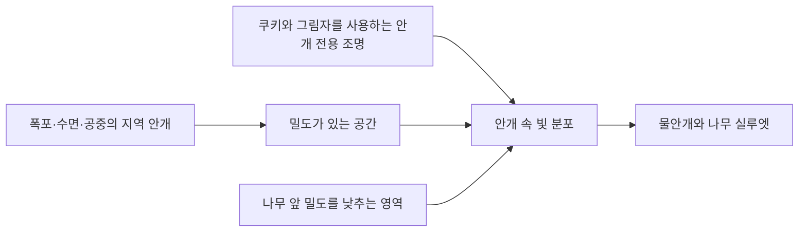

## 폭포와 나무가 있는 구간의 빛

DCB의 ShrineZone은 절벽 안에 폭포와 연못, 돌탑과 리본이 걸린 나무가 모여 있는 구간입니다. 이곳의 환경 연출은 물 주변의 낮은 안개와 나무 사이로 들어오는 빛을 함께 구성합니다. 기도할 때 발생하는 빛 입자와 달리, 구간에 배치된 조명과 안개가 공간의 기본 모습을 만듭니다.

## 안개를 역할별로 나눕니다

`VFX_ShrineWaterfallMoonlight`는 빛을 받는 공중 안개와 수면 근처 안개를 구분합니다. `VFX_ShrineWaterfallMist`는 폭포 주변에 더 작은 안개 덩어리들을 배치합니다. 두 프리팹 모두 HDRP의 `LocalVolumetricFog`를 사용합니다.

| 배치 | 역할 |
| --- | --- |
| 폭포 충돌부 | 물이 떨어지는 자리 주변에 물안개를 모읍니다. |
| 나무 뒤와 연못 위 | 빛줄기가 지나갈 공중의 밀도를 만듭니다. |
| 물가의 낮은 안개 | 바닥 가까이에 옅은 흐름을 남깁니다. |
| 나무 앞 빛 도달 구간 | 가지를 지난 빛이 물가 쪽 안개에 드러나게 합니다. |
| 나무 주변 밀도 조절 영역 | 줄기 앞의 안개를 옅게 만들어 실루엣을 남깁니다. |

안개마다 범위·색·밀도와 가장자리 페이드를 따로 저장합니다. 폭포 쪽에 필요한 밀도를 연못 전체에 적용하면 나무와 돌탑까지 가려질 수 있기 때문입니다. 밝게 보일 부분의 밀도를 더하는 일과, 가리면 안 되는 부분의 밀도를 낮추는 일을 함께 다룹니다.

여기서 물안개는 배치한 시각 효과입니다. 물의 유량이나 충돌을 실시간으로 해석해 안개 발생량을 자동 계산하는 유체 시뮬레이션으로 설명하지 않습니다.

## 밀도 텍스처와 가장자리 페이드

일반 안개 영역은 3D 밀도 텍스처를 참조합니다. 텍스처의 반복 크기와 이동 속도를 조절해 상자 안이 균일한 색으로 채워지지 않도록 합니다. 월드의 안개 오브젝트 전체를 이동시키는 대신, 밀도 무늬가 천천히 바뀌도록 설정한 구조입니다.

상자 경계는 축의 양·음 방향별 페이드로 줄입니다. 수면 가까운 아랫부분과 공중으로 퍼지는 윗부분을 같은 비율로 처리할 필요가 없으므로 방향을 나눠 저장합니다. 별도의 거리 페이드도 있습니다.

| 현재 자산에서 확인한 값 | 의미 |
| --- | --- |
| 물가의 낮은 안개 `meanFreePath` 160 | 같은 조건에서 다른 짙은 안개 영역보다 옅게 두는 설정 |
| 주 달빛 프리팹의 거리 페이드 95~130m | 해당 지역 안개가 거리에 따라 사라지는 구간 |
| 폭포 물안개 프리팹의 거리 페이드 65~90m | 별도 물안개의 거리 전환 구간 |
| 주 달빛 프리팹의 안개 `anisotropy` 0 | 현재 저장된 산란 방향성 값 |

값은 현재 저장된 설정입니다. 모든 카메라에서 같은 밝기로 보이거나 거리 전환이 눈에 띄지 않는다는 실행 결과는 아닙니다.

## 표면 조명과 안개 조명을 나눕니다

주 달빛 효과에는 나무를 향한 빛줄기와 폭포 물안개를 보완하는 조명이 있습니다. 두 조명은 HDRP 설정에서 **표면의 확산·정반사 기여를 끄고 볼류메트릭 기여를 켭니다.** 빛줄기를 보이게 하려고 나무와 바위의 표면까지 함께 밝히지 않도록 역할을 나눈 것입니다.

나무를 향한 조명은 Pyramid 형태와 쿠키를 사용해 빛의 단면을 정합니다. 그림자도 사용하므로, 배치된 물체의 가림과 안개 속 밝은 구간이 함께 관여합니다. 표면의 재질·반사·기본 조명은 별도의 요소로 남습니다.

빛의 방향과 폭은 나무·폭포의 배치에 맞춘 저작값입니다. 모든 나무에 자동으로 맞춰지는 범용 조명 배치로 확장하지 않습니다.

## 나무 앞의 안개를 옅게 만듭니다

밝은 안개가 줄기 앞까지 덮으면 나무가 배경과 분리되지 않습니다. 이를 조절하는 `08_Tree_Clearing`은 다른 안개 뒤에 적용되도록 우선순위를 높이고 `Multiply` 블렌드를 사용합니다.

저작 코드에서 지정한 밀도 유지 비율은 0.2이며, 프리팹에는 이에 대응하는 `meanFreePath` 5와 우선순위 100이 저장돼 있습니다. 영역 중심에서는 안개 밀도를 줄이고 경계에서는 영향이 풀리도록 페이드합니다. 이는 화면의 밝기를 20%로 만드는 후처리와는 다른 조절입니다.

씬에 들어간 크기는 원본 프리팹과 다를 수 있습니다. 현재 존의 해당 영역은 약 **41.44 × 20.85 × 30.8m**로 덮어써져 있습니다. 따라서 제작 도구의 초기 크기만으로 현재 영향 범위를 설명하면 안 됩니다.

## 제작 도구와 현재 적용값을 구분합니다

조명 셋업 도구에는 대비·색·간접광과 반사 프로브를 만드는 코드가 있습니다. 그러나 현재 `ShrineMoodVolumeProfile`에 저장된 컴포넌트는 `WaterRendering`입니다. 도구에 색 보정 코드가 남아 있다는 사실을 현재 지역 프로파일에 그 색 보정이 적용됐다는 근거로 삼지 않습니다.

이 초안에서 설명한 중심은 실제 연결된 지역 안개, 안개 전용 조명, 밀도 조절과 존의 덮어쓴 값입니다. 최종 화면에는 전역 조명·노출·카메라·반사 등도 관여하므로, 한 요소만으로 첨부 화면 전체의 외형을 설명하지 않습니다.

## 자산과 작성 범위

기존 나무·바위·리본과 물 자산에 조명·안개를 배치한 구성을 설명합니다. 글 작성에는 AI를 활용했습니다.

돌탑에 접근한 뒤 나무와 수면의 빛이 움직이는 흐름은 [돌탑 기도와 나무·연못의 빛 상호작용](/writing/shrine-prayer-interaction/)에서 이어서 다룹니다.
