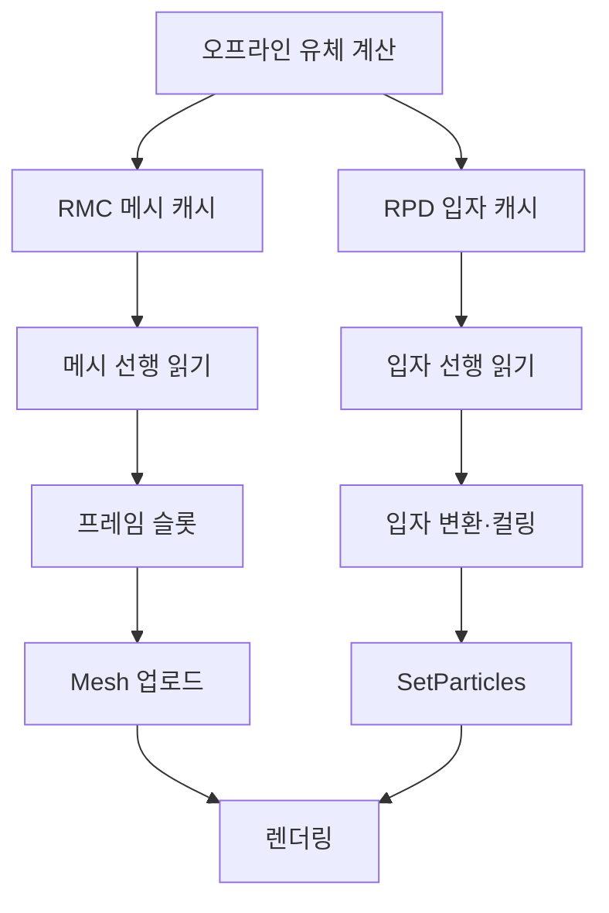

## 베이크한 물도 재생 비용은 남았다

현재 급류가 어떤 계층으로 구성되고 반복 재생되는지는 [DCB의 급류](/writing/dcb-water-overview/)에서 먼저 설명한다. 여기서는 캐시의 읽기·변환·업로드와 비용을 줄인 과정을 다룬다.

DCB의 급류는 지형과 바위의 충돌 형상을 바탕으로 오프라인에서 계산한 액체 표면과 보조 입자를 재생한다. 게임 중에는 전체 FLIP 유체 계산을 반복하지 않는다. 이 재생 구조는 DCB로 이어진 Deluge 프로젝트에서 작업한 것이다.

문제는 이미 계산된 데이터를 재생하는 데에도 큰 CPU 비용이 든다는 점이었다. 매 샘플의 Alembic 평가, 메시 데이터 구성, 정점별 포말 색 적용, 입자 레코드 해석과 업로드가 남았다. 반복 전환에서는 한 렌더 프레임에 두 재생 리그를 갱신했다.

2026년 9월 10일 나는 전달받은 영상의 부드러운 움직임과 실제 에디터 플레이의 심한 프레임 드롭이 다르다는 점을 제기하고 수정을 요청했다. 고정된 30fps로 저장한 영상은 게임이 그 속도로 실행됐다는 증거가 될 수 없었다. 이후 작업은 물의 형상을 줄이는 대신 재생 경로를 바꾸고, 읽기·변환·업로드·대기를 나누어 확인하는 방향으로 진행됐다.

## 계산 결과와 재생 데이터를 분리하기

원본 제작 데이터는 재베이크와 변환에 사용하고, 런타임에는 표시할 프레임을 직접 읽는 데이터를 둔다.

| 데이터 | 역할 |
| --- | --- |
| Alembic ABC | 오프라인에서 계산한 액체 메시의 제작 원본 |
| RFD | 원본 메시의 정점 순서에 맞춘 포말 농도 |
| RMC | 위치·법선·포말 색·삼각형·bounds를 담은 직접 업로드용 메시 캐시 |
| RPD | 포말·물보라·기포의 종류, 위치와 속도 등을 담은 보조 입자 캐시 |
| RMS | 큰 RMC를 여러 파일로 나눠 저장할 때 사용하는 매니페스트 |

RMC 변환기는 Alembic에서 실제로 평가한 메시와 RFD의 포말 색을 한 프레임으로 묶는다. 런타임은 이를 `BakedRapidsMeshCache`로 읽고, RPD 입자는 별도 경로로 해석한다. 현재 효과에는 지형 접점을 채우는 shore 메시와 수면 백수 캐시도 연결된다.

이 변환은 기존 계산 결과를 재생하기 좋은 형태로 저장하는 작업이다. 새 유체 시뮬레이션이나 메시 간소화를 수행하지 않는다. 초기 RMC 경로에는 위치·법선의 양자화나 프레임 보간도 넣지 않았다.

## Alembic 평가를 메시 버퍼 업로드로 옮기기

### 프레임마다 다시 준비하던 데이터를 미리 저장했다

RMC의 정점 하나는 위치 `float3` 12바이트, 법선 `float3` 12바이트, 포말 `Color32` 4바이트로 총 28바이트다. 삼각형 인덱스는 `uint32`로 저장한다. 프레임마다 정점·인덱스 개수와 bounds도 함께 기록한다.

`BakedRapidsMeshCache`는 처음에 최대 용량으로 메시 버퍼를 만들고 레이아웃을 지정한다. 이후에는 `SetVertexBufferData`와 `SetIndexBufferData`로 해당 프레임의 데이터만 전달한다. 포말 색이 정점 안에 있으므로 이 경로에서는 RFD 파일을 별도로 열고 `SetColors`를 반복할 필요가 없다.

Unity의 직접 버퍼 API는 입력 데이터와 메시 레이아웃이 일치해야 한다. 이 구현에서는 저장 포맷의 28바이트 정점과 `Position / Normal / Color` 선언을 맞췄다. [Unity의 SetVertexBufferData 설명](https://docs.unity3d.com/6000.3/Documentation/ScriptReference/Mesh.SetVertexBufferData.html)도 이 레이아웃 일치를 요구한다.

### 최대 용량과 이번 프레임의 사용량을 구분했다

유체 메시의 정점·삼각형 수는 프레임마다 달라진다. 최대 크기의 버퍼를 확보했다고 그 전체를 그리면 이전 프레임의 데이터나 사용하지 않는 영역이 표시될 수 있다.

업로드 후에는 `SubMeshDescriptor`에 현재 인덱스 수와 활성 정점 수를 넣고, submesh bounds와 `Mesh.bounds`를 해당 프레임 값으로 갱신한다. 셰이더가 수면을 팽창시키는 표현은 렌더러 경계에 별도로 반영한다. [SetSubMesh의 범위·bounds 규칙](https://docs.unity3d.com/6000.3/Documentation/ScriptReference/Mesh.SetSubMesh.html)에 맞춰 CPU 버퍼 용량과 렌더링 범위를 분리한 것이다.

검사 비용을 생략하는 `DontValidateIndices`도 사용한다. 대신 파일 헤더와 오프셋, 프레임별 길이·개수·bounds를 확인하고, 각 프레임을 처음 읽을 때 모든 인덱스가 활성 정점 범위 안에 있는지 검사한다. Unity의 기본 검사를 생략한 만큼 로더가 입력의 유효성을 책임진다. [MeshUpdateFlags 설명](https://docs.unity3d.com/6000.3/Documentation/ScriptReference/Rendering.MeshUpdateFlags.html)

## 세 슬롯으로 읽기를 앞당기고 수명을 관리하기

디스크 읽기를 메인 스레드에서 매번 끝낼 때까지 기다리면 렌더링도 함께 멈춘다. 메시 캐시는 리그마다 세 슬롯을 두고, 각 슬롯이 읽기 스트림·정점 배열·인덱스 배열·진행 중인 작업을 소유하도록 했다.

현재 요청 프레임을 처리하면서 다음 두 프레임의 읽기를 작업 스레드에 예약한다. 재사용할 슬롯을 고를 때에는 현재 요청과 선행 읽기로 보호할 프레임을 제외한다. 임의 탐색 때문에 슬롯을 바꿔야 해도 진행 중인 읽기가 사용하는 배열을 바로 덮어쓰지 않는다.

작업 스레드는 파일 읽기와 바이트 검사를 담당한다. Unity 메시 업로드와 소유 객체 해제는 해당 캐시를 생성한 스레드에서 수행하도록 검사한다.

| 상황 | 현재 코드의 처리 |
| --- | --- |
| 같은 메시 프레임 재요청 | 이미 업로드한 프레임이면 다시 올리지 않는다. |
| 순차 재생 | 현재 요청을 처리하고 다음 두 프레임의 읽기를 예약한다. |
| 임의 탐색 | 사용 중인 슬롯의 읽기를 끝낸 뒤 재사용한다. 대기가 발생할 수 있다. |
| `Stop` | RPD/RFD 스트림을 닫고 표시를 숨긴다. 주 리그의 메시 캐시 버퍼와 스트림은 유지한다. |
| 비활성화·파괴 | 진행 중인 읽기를 마친 뒤 메시 캐시·스트림·소유 메시를 해제한다. |

RPD 선행 읽기도 세 슬롯을 사용하지만 큰 바이트 배열은 `ArrayPool`에서 빌려 재사용한다. 메시 슬롯의 고정 배열과 입자 슬롯의 풀 배열은 별도 수명이다. 정지·파괴 시 양쪽을 같은 방식으로 처리한다고 가정하면 핸들이나 버퍼가 남을 수 있다.

## 보조 입자의 읽기·변환·업로드를 나누기

메시 경로를 줄인 뒤에도 보조 입자의 CPU 처리는 남았다. RPD의 44바이트 레코드를 한 번에 읽고, 타입별 입자 데이터로 변환한 뒤 `SetParticles`로 전달하는 경로를 정비했다.

표시 범위 밖의 입자는 셰이더에서 잘라내기 전에 CPU에서도 제외한다. 입자 중심만 검사하면 경계에 걸친 큰 물보라까지 사라질 수 있으므로 billboard의 크기와 변환을 포함해 완전히 바깥인 입자만 제거한다. 남긴 입자의 타입별 순서와 위치·크기·색·회전은 유지한다. 원본 개수와 실제 업로드 개수도 별도로 집계한다.

변환의 기본 경로에는 Burst로 컴파일하는 `IJob`과 재사용 `NativeArray`를 사용한다. 이 구현은 `Run()`으로 호출한 스레드에서 변환을 끝낸다. 디스크 선행 읽기의 비동기 처리와 입자 변환의 Burst 적용은 서로 다른 변경이다. 구형 물보라 디테일 선택이 필요한 경우와 지원하지 않는 바이트 순서는 관리 코드 경로를 유지한다.

프로파일러 구간도 다음처럼 나눴다.

| 마커 | 확인할 비용 |
| --- | --- |
| `BakedRapids.MeshCache.Read` | 작업 스레드의 메시 프레임 읽기·검사 |
| `BakedRapids.MeshCache.Wait` | 필요한 메시 프레임을 기다리는 시간 |
| `BakedRapids.MeshCache.Upload` | 활성 메시 데이터 업로드 |
| `BakedRapids.Secondary.Read` | 보조 입자 프레임을 가져오는 구간 |
| `BakedRapids.Secondary.Decode` | 레코드 변환·통계·표시 범위 컬링 |
| `BakedRapids.Secondary.Upload` | 타입별 `SetParticles` 적용 |

이 구분으로 읽기 지연을 변환 문제로 오해하거나, 부모 마커와 하위 마커를 더해 비용을 중복 계산하는 일을 피할 수 있다.

## 반복 전환과 화면 밖 갱신에서 남은 비용

### 반복 경계의 준비 비용을 초기화로 옮겼다

유한한 캐시의 끝과 시작은 자동으로 이어지지 않는다. 이 효과는 다른 시각의 캐시를 재생하는 두 번째 리그를 준비해 화면에서 교차 표시한다. 물리 솔버가 순환 경계를 계산한 결과와는 구분해야 한다.

초기 RMC 작업에서는 두 번째 리그와 첫 메시 업로드를 재생 준비 때 미리 수행하고 숨겼다. 처음 반복 경계에 들어갈 때 큰 준비 작업을 몰아서 하는 문제를 줄이는 방식이다. 대신 시작할 때의 비용과 두 리그의 메모리 사용량이 늘어난다.

### 선행 읽기만으로 대기가 없어지지는 않았다

9월 27일 프레임 드롭 기록에는 카메라 밖 급류까지 계속 읽고 업로드하는 문제와, 반복 구간에서 두 리그가 같은 파일을 읽으며 기다리는 문제가 남아 있었다. 이때 메시 대기의 최대값은 약 28ms로 기록됐다.

이에 `BakedRapidsEffect`에는 메인 카메라 절두체와 경계까지의 거리를 기준으로 갱신을 건너뛰는 경로를 추가했다. 처음에는 경계를 만들기 위해 그린다. 이후 화면 밖이거나 거리 조건을 넘으면 새 읽기·업로드·입자 갱신을 생략한다. 시계는 계속 진행하므로 다시 보일 때에는 현재 시각으로 이어진다. 이미 예약한 읽기를 취소하는 기능은 아니다.

`BakedRapidsMeshCache.UpdateFrame`에는 기다리지 않는 선택지도 추가했다. 이 모드에서 요청 프레임이 아직 준비되지 않았으면 `false`를 반환하고 기존 메시를 유지하면서 선행 읽기를 계속한다. 일반 플레이의 시간 진행에는 이 정책을 적용할 수 있고, 명시적 `SetPreviewTime`과 에디터 프리뷰·캡처는 요청한 프레임을 기다린다. 반복 보조 리그에도 부모의 대기 정책을 전달한다.

이 선택에는 표현상의 비용이 있다. 디스크가 늦으면 메시가 잠시 같은 프레임에 머물 수 있다. 또한 현재 RPD 읽기는 요청 데이터가 준비될 때까지 기다리는 경로이고, 주 메시와 shore 메시도 각각 업로드한다. 따라서 옵션 하나로 전체 물 효과가 완전히 비동기화되거나 모든 계층의 표시 프레임이 항상 같아진다고 볼 수 없다.

## 큰 캐시를 분할해도 재생 경로는 유지하기

직접 업로드용 데이터를 저장하면서 파일 크기도 커졌다. 9월 24일에는 큰 RMC를 RMS 매니페스트와 최대 1,000,000,000바이트 단위의 조각으로 저장하는 경로를 추가했다.

`BakedRapidsCacheStream`은 이를 탐색 가능한 하나의 논리 스트림으로 보여 준다. 요청 구간이 조각의 끝을 넘으면 다음 조각을 열어 이어 읽는다. 재생 전에 전체 파일을 메모리나 별도 대형 파일로 합칠 필요가 없다. 기존 단일 RMC도 같은 진입점에서 읽는다.

이 방식은 총 데이터 용량을 줄이는 압축이 아니다. 원래 바이트와 프레임 오프셋을 유지하며 파일 단위만 나눈 것이다. 런타임 로더는 매니페스트와 조각의 존재·길이를 확인한다. 전체·조각 SHA256 대조는 변환·검증 도구의 역할이며, 런타임에서 매번 전체 해시를 검사하는 구조로 쓰지 않았다.

제작 원본 ABC도 배포용 캐시와 분리했다. 게임 실행에 필요한 파일과 다음 물 작업에 필요한 원본을 구분해야 했기 때문이다. 이후 나는 데이터 정리 작업에서도 게임에 영향이 없고 재제작에 필요하지 않은 항목만 제거하도록 범위를 정했다. 재생 성능과 저장 공간 관리는 별개의 문제로 다뤘다.

## 당시 측정에서 줄어든 구간과 지불한 비용

다음은 **9월 10일 초기 180프레임 캐시의 에디터 CPU 측정 기록**이다. 같은 샘플 구간을 순차 평가하며 12회 준비 후 36회 측정했고, 표는 중앙값이다. 렌더링을 제외한 동기 평가 구간이며 일부 개별 구간에는 리플렉션 호출 비용이 포함된다.

| 구간 | 변경 전 | RMC 적용 후 |
| --- | ---: | ---: |
| 전체 캐시의 다음 샘플 평가 | 54.7971ms | 5.6990ms |
| 액체 메시 평가 | 27.0304ms | 1.7447ms |
| 보조 입자 프레임 처리 | 9.4465ms | 4.5558ms |
| 반복 전환 구간 평가 | 81.3466ms | 11.7063ms |

이는 해당 데이터와 코드 시점에서 캐시 평가 CPU 구간이 줄었다는 근거다. 전체 FPS나 GPU 시간, 작업 스레드의 전체 CPU 사용량을 나타내지 않는다. 이후 입자 컬링·Burst·선행 읽기 변경의 측정과도 합산하지 않는다.

9월 27일에는 배치 Play Mode에서 화면 밖 갱신 생략과 대기 정책을 포함한 후속 수정을 측정했다. 당시 변경에는 폭포의 파티클 경고, 벽면 효과 탐색과 터레인 설정 수정도 함께 들어갔다. 전체 프레임 시간의 변화를 물 캐시 수정 하나의 효과로 배분할 수는 없다.

직접 업로드는 CPU 계산을 줄이는 대신 저장 공간과 상주 버퍼를 요구한다. 초기 측정 캐시의 추가 파일 크기는 약 1.955GB였고, 최대 프레임의 배열 크기는 다음과 같았다.

$$M_{slot} = N_{vertex} \times 28 + N_{index} \times 4$$

정점 211,120개와 인덱스 1,267,068개를 넣으면 슬롯당 10,979,632바이트다. 세 슬롯이면 리그당 약 32.94MB, 두 반복 리그면 CPU 메시 배열만 약 65.88MB다. 여기에 Unity 메시의 보관분, 그래픽 API 버퍼, 입자 배열, 파일 스트림과 작업 객체가 추가된다. 이 계산을 전체 프로세스 메모리나 VRAM 측정값으로 사용하지 않는다.

## 현재 연결된 설정은 당시 측정 조건과 다르다

2026년 10월 18일 DCB의 프리팹과 씬 참조를 대조했다. 이름에 Winding이 들어가는 실제 급류 프리팹도 `BakedRapidsEffect`를 사용하며, 현재 주 메시·shore 메시·보조 입자는 `Forest01Final` 캐시에 연결돼 있다. 보조 입자 캐시는 120프레임이다. 위 성능 표와 원본 동등성 검사의 초기 180프레임 데이터와 다르다.

특히 **현재 주요 급류 프리팹 두 개는 `pauseWhenOffscreen: 1`, 거리 기준 80m, `nonBlockingStreaming: 0`이다.** 코드의 필드 기본값은 기다리지 않는 모드가 켜져 있지만, 저장된 프리팹 값이 우선한다. 해당 씬의 급류 인스턴스에서도 이 정책을 바꾸는 override는 확인하지 못했다.

따라서 현재 적용 상태는 화면 밖·원거리 갱신을 생략하면서, 필요한 메시 프레임은 기다리는 설정으로 설명해야 한다. 기다리지 않는 경로를 구현한 사실을 현재 모든 급류에서 켜져 있는 동작처럼 쓸 수 없다. 이 옵션을 꺼 둔 이유나 현재 플레이에서의 대기 시간은 이번 코드 조사만으로 확정하지 않았다.

## 검증 기록과 아직 확인하지 않은 부분

### 과거에 실행한 검사

초기 RMC 작업에는 180프레임 전체를 실제 런타임 메시 업로드로 읽어 위치·법선·포말 색·삼각형·로컬 bounds를 원본과 대조한 기록이 있다. RPD 일괄 해석도 당시 1,444,677개 레코드의 11개 필드를 기존 결과와 비트 단위로 비교했다.

당시 Play Mode 기록에는 두 번의 반복 전환, 이후 프레임 진행, Stop/Play, 비활성화 후 자동 재생, 파괴와 파일 핸들 해제 검사가 남아 있다. 이는 그 시점의 캐시와 재생 코드에 대한 결과다. 이후 추가된 변환 검사까지 이 기록으로 통과했다고 보거나 현재 캐시 전체의 검증으로 대체하지 않는다.

초기 물 전용 Windows 검증 빌드는 스크립트 컴파일 후 셰이더 변형 준비 단계에서 중단했다. 이후 별도의 프로젝트 전체 Windows 빌드는 성공했지만, 남은 실행 기록은 그래픽 출력 없는 시작 확인이다. 어느 기록도 현재 물의 실제 화면·GPU 비용·게임플레이 검증을 대신하지 않는다.

### 10월 16일 선택 검사에서 남은 두 실패

보조 입자 컬링 검사 19개 중 17개가 통과했고 2개가 실패했다. 당시 XML 결과와 독립적인 원본 RPD 집계가 남아 있다.

| 실패한 가정 | 실제 데이터와 대조한 내용 |
| --- | --- |
| 전체 캐시의 컬링 비율이 40~50%일 것 | 검사 대상의 입자 200,130개 중 121,915개가 범위 밖이었다. 실제 비율은 약 60.92%로 원본 집계와 일치했다. |
| 정지 후 탐색했을 때 업로드 입자가 1개 이상일 것 | 첫 프레임 원본에는 물보라 1,077개가 있지만 검사 기본 XZ 범위 `[-1, 1]` 안에 남는 입자는 0개였다. 선행 읽기 payload 동일성 단언에서 실패한 것은 아니었다. |

두 검사는 `Forest01Final`과 다른 기존 180프레임 캐시를 고정 참조한다. 실패를 없애려고 런타임이나 기대 범위를 수정하지 않았다. 이 분석은 고정 가정과 데이터 분포의 불일치를 설명하며, 다른 런타임 문제가 없다는 증명은 아니다. 합성 데이터로 경계·순서·수명 규칙을 검사하고 실제 캐시의 분포 검사를 따로 두는 정비가 남아 있다.

### 이번 보완에서 새로 실행하지 않은 항목

이번에는 DCB 소스·프리팹·씬 연결, 커밋과 기존 검사 산출물을 읽어 대조했다. Unity 컴파일·EditMode·Play Mode, 캐시 재생성, 새 화면 캡처와 CPU/GPU 측정은 실행하지 않았다.

현재 버전에서 확인할 항목은 다음과 같다.

- 현재 120프레임 캐시에서 첫 로드·순차 재생·임의 탐색·반복 경계의 읽기·대기·업로드 시간을 따로 측정한다.
- 같은 카메라·같은 시각·같은 데이터로 대기 정책을 비교하고, 메시 정지와 shore·입자의 시간 차이가 화면에 보이는지 확인한다.
- 실제 게임 카메라에서 수면 전 폭과 지형 접점, 화면 밖에서 복귀할 때의 표시, 반복 시작·끝의 연결을 확인한다.
- Stop/Play·비활성화·재활성화·씬 종료를 반복하며 핸들과 CPU/GPU 메모리가 안정되는지 측정한다.
- 완성된 Player에서 물을 렌더링하고 GPU 시간과 전체 프레임 시간을 측정한다.

## 내 기여와 AI를 사용한 범위

나는 물의 속도·양에 관한 표현 요구를 정하고, 실제 플레이의 프레임 드롭을 해결하도록 요청했다. 전달받은 영상과 실제 실행의 차이를 제기해 성능 문제를 별도로 다루도록 했다. 데이터 정리에서는 게임 실행과 다음 제작에 필요한 파일을 보존하는 조건도 정했다.

재생 포맷, C# 로더와 버퍼 처리, 변환·검사 도구의 작성과 수정에는 AI를 사용했다. 코드 작성과 자동 측정은 이 보조 범위에 포함한다. 유체 계산은 Blender Mantaflow 솔버, 원본 메시 재생은 Unity Alembic 패키지를 사용한다. 이 글에서 다룬 변경은 그 결과를 저장하고 Unity의 메시·입자 API로 재생하는 경로다.

작업 이력은 다음과 같이 이어진다.

| 시점·커밋 | 변경 내용 |
| --- | --- |
| 9월 10일 · `cd6b904a4` | Alembic·RFD를 RMC로 변환하고 직접 업로드, 세 슬롯 선행 읽기와 동등성·수명 검사 추가 |
| 9월 14일 · `1d3d91c5b` | 보조 입자 표시 범위 컬링, Burst 변환과 입자 선행 읽기 등 후속 최적화 반영 |
| 9월 24일 · `c1ce1030c` | 무손실 분할 스트림과 제작 원본·배포 캐시 분리 |
| 9월 27일 · `fd5397e1c` | 프레임 드롭 진단을 바탕으로 화면 밖 갱신 생략과 메시 비대기 경로 추가 |
| 9월 28일 · `bc4dec1a7` 이후 현재 설정 | 지형 접점·캐시 적용이 바뀌었고 주요 급류의 메시 비대기 옵션은 꺼져 있음 |
