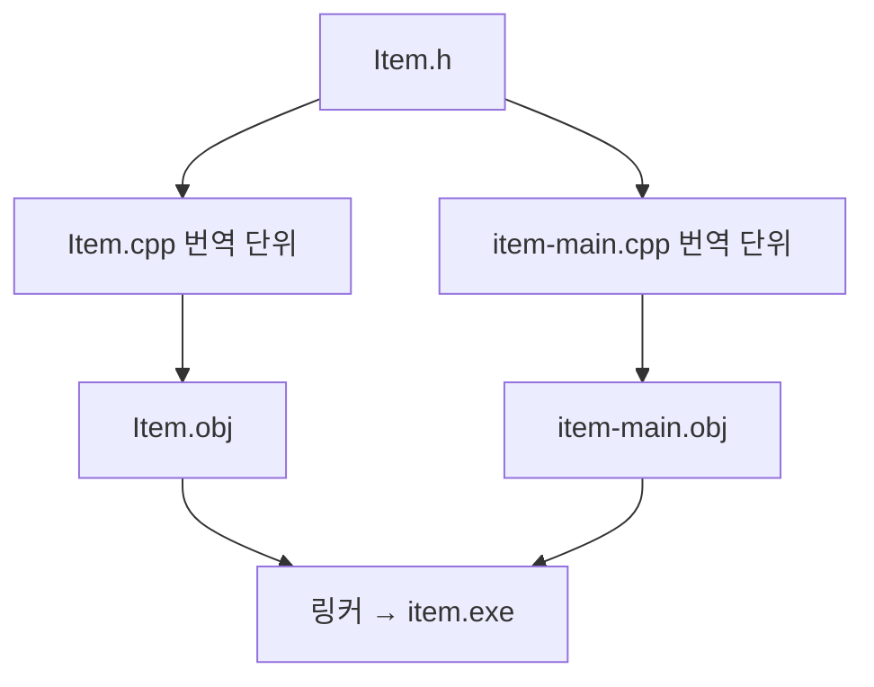

## 파일 경계와 데이터의 소유자를 함께 정하기

[1주차의 객체와 메모리](/writing/cpp-objects-memory-lifetime/)에서는 포인터가 무엇을 가리키고 언제 무효해지는지 살펴봤습니다. 이번에는 그 객체들을 여러 파일과 컨테이너에 나누어 배치합니다. C#·C와 공통인 제어문·함수 문법은 생략하고, C++에서 선언·정의·소유권이 코드 구조에 미치는 영향을 설명합니다.

마지막에는 ID로 아이템을 조회하고 수량을 더하거나 제거하는 저장소를 만듭니다. 조회 결과를 잠깐 빌리는 API와 독립적인 목록을 복사하는 API를 나누고, 같은 키의 추가·없는 키의 조회·원소 삭제가 어떤 의미인지 정합니다. [12주 전체 계획](/writing/unreal-cpp-engine-12-week-plan/)과 [주차별 글 목록](/series/unreal-cpp-engine/)에서 앞뒤 과정을 확인할 수 있습니다.

1~5일차 코드는 **표준 C++20 콘솔 프로그램**입니다. 각 실습은 별도 폴더에서 실행합니다. 마지막 언리얼 예제는 엔진 모듈 안에서 호출하는 함수이므로 콘솔 예제와 빌드 방법이 다릅니다.

## 1일차 — 헤더와 구현 파일이 나뉘는 이유

### 선언, 정의, 번역 단위

선언은 이름과 형식을 알립니다. 정의는 함수 본문이나 클래스의 구체적인 구성을 제공합니다. `int Count() const;`는 함수 선언이고, `int Item::Count() const { return count_; }`는 함수 정의입니다. 클래스의 멤버 구성을 적은 `class Item { ... };` 역시 클래스 정의이므로 헤더를 “선언만 들어가는 파일”로 이해하면 곤란합니다.

보통 각 `.cpp`는 포함한 헤더와 함께 독립적인 **번역 단위**로 컴파일됩니다. `#include`는 다른 C++ 파일을 실행하는 명령이 아니라, 전처리 단계에서 해당 파일의 내용을 포함하는 지시문입니다. 컴파일러는 현재 번역 단위에서 선언을 보고 사용법을 검사하고, 링커는 여러 목적 파일의 함수 정의를 연결합니다. [Microsoft의 헤더 파일 설명](https://learn.microsoft.com/en-us/cpp/cpp/header-files-cpp?view=msvc-170)



### 실습 1: 세 파일로 아이템 정의하기

같은 폴더에 다음 세 파일을 만듭니다. 이름은 아이템 객체가 소유하고, 조회 함수는 그 이름을 읽는 참조를 반환합니다.

**`Item.h`**

```cpp
#pragma once
#include <string>

class Item {
public:
    Item(std::string name, int count);
    const std::string& Name() const;
    int Count() const;

private:
    std::string name_;
    int count_;
};
```

**`Item.cpp`**

```cpp
#include "Item.h"
#include <utility>

Item::Item(std::string name, int count)
    : name_(std::move(name)), count_(count) {}

const std::string& Item::Name() const {
    return name_;
}

int Item::Count() const {
    return count_;
}
```

**`item-main.cpp`**

```cpp
#include "Item.h"
#include <iostream>

int main() {
    Item apple{"apple", 3};
    const Item& view = apple;
    std::cout << view.Name() << ": " << view.Count() << '\n';
}
```

Visual Studio의 **x64 Native Tools Command Prompt**에서 두 `.cpp`를 함께 빌드합니다.

```bat
cl /nologo /std:c++20 /EHsc /W4 /utf-8 /Od item-main.cpp Item.cpp /Fe:item.exe
item.exe
```

```text
apple: 3
```

`Item::`은 클래스 밖에서 정의하는 함수가 `Item`의 멤버임을 나타냅니다. 멤버 함수 뒤의 `const`는 그 함수가 객체를 읽는 용도임을 표현하며, 이 예제의 `const Item&`로 호출할 수 있게 합니다. 반환 형식의 `const std::string&`는 이름을 복사하지 않는 읽기 전용 참조입니다. `apple`이 사라진 뒤에는 이 참조를 계속 사용할 수 없습니다.

생성자는 문자열을 값으로 받아 `name_`으로 이동합니다. 호출자가 lvalue 문자열을 주면 매개변수에 복사가 일어날 수 있고, 그 뒤 매개변수의 자원을 멤버로 넘깁니다. 값을 받는 매개변수라고 항상 참조보다 좋거나 나쁜 것은 아닙니다. 함수가 그 데이터를 보유해야 하는지 먼저 봅니다.

### include와 전방 선언의 기준

| 상황 | 필요한 것 |
| --- | --- |
| 멤버를 `std::string name_;`처럼 값으로 보유합니다. | 크기와 구성을 알 수 있는 완전한 형식 정의가 필요합니다. 해당 헤더를 포함합니다. |
| `class Inventory;` 뒤에 `void Print(const Inventory&);`를 선언합니다. | 이 선언에는 전방 선언으로 충분합니다. 함수 본문에서 멤버를 사용하려면 정의가 필요합니다. |
| 헤더가 여러 경로로 다시 포함됩니다. | include guard나 `#pragma once`로 같은 번역 단위의 중복 처리를 막습니다. |
| 헤더에 일반 함수의 본문을 넣고 여러 `.cpp`가 포함합니다. | 외부 연결을 가진 비인라인 함수의 중복 정의 문제가 생길 수 있습니다. `.cpp`로 분리하거나 적합한 `inline` 규칙을 적용합니다. |

`#pragma once`는 MSVC 등에서 널리 지원하는 지시문입니다. 표준 전처리 지시문만 사용하려면 include guard를 쓸 수 있습니다. 이것이 여러 번역 단위 사이의 중복 정의까지 해결하는 것은 아닙니다. 또 `inline`은 반드시 기계어를 호출 위치에 펼치라는 명령이 아닙니다.

자신이 직접 사용하는 형식의 헤더를 직접 포함하고, 다른 헤더가 우연히 포함해 주는 것에 의존하지 않습니다. 구현 파일에서는 자신의 헤더를 먼저 포함하면 누락된 의존성을 찾기 쉽습니다. 헤더 전체에 `using namespace std;`를 쓰면 포함하는 쪽의 이름 검색에도 영향을 주므로 이 예제에서는 사용하지 않습니다.

**변형 과제:** 빌드 명령에서 `Item.cpp`를 빼 봅니다. 헤더 덕분에 사용법은 알지만 함수 정의를 찾지 못하는 링크 오류를 관찰합니다. 이어서 `Item.h`의 함수 선언을 지운 경우와 어느 단계에서 실패하는지 비교합니다.

## 2일차 — 가상 함수와 소유권을 함께 사용하기

### 값 데이터와 다형적 객체

C++의 멤버 함수는 기본적으로 가상 함수가 아닙니다. 기반 클래스의 포인터·참조로 실제 파생 객체의 동작을 호출하려면 `virtual`을 사용합니다. 파생 클래스의 `override`는 기반 가상 함수를 제대로 재정의했는지 컴파일러가 검사하게 합니다. `= 0`을 붙인 순수 가상 함수는 파생 클래스에 구현을 요구하며, 이를 구현하지 않은 클래스는 객체로 만들 수 없습니다. [Microsoft의 가상 함수 설명](https://learn.microsoft.com/en-us/cpp/cpp/virtual-functions?view=msvc-170)

구체적인 파생 객체를 복사 가능한 기반 클래스의 **값**으로 받으면 파생 부분이 잘리는 객체 슬라이싱이 발생할 수 있습니다. 동작의 다형성이 필요할 때는 기반 포인터·참조를 사용하되, 실제 객체의 정리 책임을 별도로 정해야 합니다.

| 표현 | 이 글에서의 역할 |
| --- | --- |
| `std::unique_ptr<T>` | 한 소유자가 객체를 정리합니다. 복사는 금지하고 이동으로 소유권을 넘깁니다. |
| `std::shared_ptr<T>` | 여러 소유자가 수명을 공유합니다. 마지막 강한 소유권이 사라지면 객체를 정리합니다. |
| `std::weak_ptr<T>` | 공유 소유 객체를 강하게 소유하지 않고 관찰합니다. `lock()`으로 사용 가능한 소유권을 얻었는지 확인합니다. |
| `T*`, `T&` | 예제에서는 객체를 잠깐 빌려 사용합니다. 그 자체로 대상의 수명을 연장하지 않습니다. |

`shared_ptr`는 참조 횟수로 수명을 관리하므로 강한 참조끼리의 순환을 자동으로 수거하지 않습니다. 공유 소유가 필요하지 않다면 `unique_ptr`부터 검토합니다. 스마트 포인터의 수명 관리와 대상 객체의 여러 스레드 접근을 안전하게 만드는 일도 구분해야 합니다. [Microsoft의 스마트 포인터 설명](https://learn.microsoft.com/en-us/cpp/cpp/smart-pointers-modern-cpp?view=msvc-170)

### 실습 2: 효과 객체를 컨테이너로 이동하기

`02-polymorphism.cpp`입니다. 앞 실습과 별도 폴더에서 이 파일 하나를 빌드합니다.

```cpp
#include <iostream>
#include <memory>
#include <utility>
#include <vector>

class Effect {
public:
    virtual ~Effect() { std::cout << "destroy Effect\n"; }
    virtual int Apply(int current) const = 0;
};

class Heal final : public Effect {
public:
    explicit Heal(int amount) : amount_(amount) {}
    ~Heal() override { std::cout << "destroy Heal\n"; }
    int Apply(int current) const override {
        return current + amount_;
    }

private:
    int amount_;
};

int main() {
    std::unique_ptr<Effect> owner = std::make_unique<Heal>(25);
    const Effect* observer = owner.get();
    std::vector<std::unique_ptr<Effect>> effects;
    effects.push_back(std::move(owner));

    std::cout << std::boolalpha;
    std::cout << "source empty: " << (owner == nullptr) << '\n';
    std::cout << "same object: "
              << (observer == effects.front().get()) << '\n';
    std::cout << "health: " << observer->Apply(75) << '\n';

    effects.clear();
    // observer is now dangling. Do not use it.
}
```

```text
source empty: true
same object: true
health: 100
destroy Heal
destroy Effect
```

일반 단일 파일 예제는 다음 형태로 빌드합니다. 파일명과 실행 파일명만 각 실습에 맞춰 바꿉니다.

```bat
cl /nologo /std:c++20 /EHsc /W4 /utf-8 /Od 02-polymorphism.cpp /Fe:02-polymorphism.exe
02-polymorphism.exe
```

`observer`는 `Effect*`이지만 실제 객체는 `Heal`입니다. 가상 함수 호출은 `Heal::Apply`로 연결됩니다. `effects.clear()`는 벡터 원소인 `unique_ptr`들을 소멸시키며, 각 소유 객체도 정리합니다.

기본 삭제자를 쓰는 `unique_ptr<Effect>`가 파생 객체를 기반 포인터로 삭제하므로 기반 클래스의 소멸자도 가상이어야 합니다. 가상 소멸자를 제거해서 생기는 정의되지 않은 동작은 “어떤 로그가 찍히는지”로 검증하지 않습니다. 이 예제의 소멸자 본문은 순서 관찰용이고, 별도 처리가 없다면 `virtual ~Effect() = default;`로 둘 수 있습니다.

`final`은 `Heal`을 더 상속하지 못하게 합니다. 마지막 아이템 저장소의 ID·수량 데이터에는 이 상속 구조를 넣지 않습니다. 데이터를 보유하는 문제와 효과별 행동을 바꾸는 문제에 필요한 구조가 다르기 때문입니다.

**변형 과제:** `effects.push_back(std::move(owner))`에서 `std::move`를 빼고 복사가 왜 거절되는지 설명합니다. `Effect effect;`를 선언했을 때의 컴파일 오류도 확인합니다.

## 3일차 — 템플릿과 람다로 검색 조건 분리하기

### 형식과 동작을 매개변수로 받기

템플릿은 형식 등에 따라 코드를 만들어 쓰는 규칙입니다. `template <typename T>`의 `T`는 아직 정하지 않은 형식이며, `std::vector<int>`나 `std::vector<Item>`에서 실제 형식이 정해집니다. 필요한 정의가 구체적인 형식으로 인스턴스화되는 과정에서 해당 연산을 사용할 수 있는지도 검사합니다.

일반적인 포함 방식에서는 템플릿 정의를 사용하는 번역 단위에서 볼 수 있어야 하므로 본문도 헤더에 둡니다. 선언만 헤더에 두고 정의를 다른 `.cpp`에 숨기면 필요한 인스턴스를 만들지 못해 링크 오류로 이어질 수 있습니다. 명시적 인스턴스화 같은 별도 설계도 있지만, 여기서는 정의를 보이는 곳에 두는 방식으로 시작합니다. [Microsoft의 템플릿 소스 구성](https://learn.microsoft.com/en-us/cpp/cpp/source-code-organization-cpp-templates?view=msvc-170)

람다는 호출 가능한 객체를 만드는 표현식입니다. `[minimum](const Item& item) { ... }`에서 대괄호는 **캡처 목록**, 소괄호는 호출할 때 받는 매개변수입니다. `[minimum]`은 당시의 값을 복사하고 `[&minimum]`은 원래 변수를 참조합니다. 참조 캡처가 원래 변수의 수명을 늘려 주지는 않습니다. [Microsoft의 람다 표현식 설명](https://learn.microsoft.com/en-us/cpp/cpp/lambda-expressions-in-cpp?view=msvc-170)

### 실습 3: 같은 검색 함수에 다른 조건 전달하기

`03-template-lambda.cpp`입니다. `FindFirst`는 원소를 복사하지 않고 찾은 원소의 주소를 반환합니다.

```cpp
#include <iostream>
#include <vector>

struct Item {
    int id;
    int count;
};

template <typename T, typename Predicate>
const T* FindFirst(const std::vector<T>& values, Predicate matches) {
    for (const T& value : values) {
        if (matches(value)) {
            return &value;
        }
    }
    return nullptr;
}

int main() {
    std::vector<Item> items{{101, 2}, {202, 5}, {303, 1}};
    int minimum = 3;
    auto copiedRule = [minimum](const Item& item) {
        return item.count >= minimum;
    };
    auto liveRule = [&minimum](const Item& item) {
        return item.count >= minimum;
    };
    minimum = 6;

    const Item* found = FindFirst(items, copiedRule);
    if (found != nullptr) {
        std::cout << "found id: " << found->id << '\n';
        std::cout << std::boolalpha;
        std::cout << "copied rule: " << copiedRule(*found) << '\n';
        std::cout << "live rule: " << liveRule(*found) << '\n';
    }

    std::vector<int> numbers{4, -2, 8};
    const int* negative = FindFirst(numbers, [](int value) {
        return value < 0;
    });
    if (negative != nullptr) {
        std::cout << "negative: " << *negative << '\n';
    }
}
```

```text
found id: 202
copied rule: true
live rule: false
negative: -2
```

`T`는 첫 호출에서는 `Item`, 두 번째 호출에서는 `int`입니다. 조건의 구체적인 형식도 `Predicate`로 전달되므로 이 예제에는 `std::function`이 필요하지 않습니다. `auto`는 형식 추론이며, 이 변수의 형식이 실행 중 마음대로 바뀐다는 뜻은 아닙니다.

`found`는 `items` 원소를 빌립니다. 벡터 소멸·해당 원소 삭제·재할당 이후에는 사용할 수 없습니다. 임시 벡터를 `FindFirst`에 넘겨서 반환 포인터만 보관하는 코드도 피해야 합니다. 임시 벡터가 문장 끝에서 소멸하면 결과가 댕글링 포인터가 됩니다.

콜백을 나중에 실행하도록 저장할 때는 캡처의 수명을 다시 확인합니다. 포인터를 값으로 캡처하더라도 복사되는 것은 주소이며 대상의 소유권이 생기지는 않습니다. 이 예제는 `minimum`이 살아 있는 `main` 안에서 두 람다를 즉시 호출합니다.

**변형 과제:** `minimum = 6`을 `minimum = 1`로 바꾸고 두 조건의 결과를 비교합니다. 검색에 실패하는 조건을 넣어 `nullptr` 분기가 필요한 이유도 확인합니다.

## 4일차 — 컨테이너의 값, 복사 비용과 무효화

### 순서로 보관할지, 키로 조회할지

| 컨테이너 | 선택 기준 | 주의할 점 |
| --- | --- | --- |
| `std::vector<T>` | 연속된 원소를 인덱스·순서로 다룹니다. | 중간 삽입·삭제는 뒤 원소의 이동이 필요합니다. ID 검색은 별도 인덱스가 없으면 선형 탐색입니다. |
| `std::unordered_map<Key, Value>` | 고유한 키로 값을 조회합니다. | 키 검색은 평균적으로 상수 시간이지만 최악에는 선형입니다. 순회 순서는 정해진 출력 순서로 쓰지 않습니다. |

작은 연속 데이터의 순회와 키 기반 조회는 요구사항이 다릅니다. 해시 맵의 평균 복잡도만 보고 모든 상황에서 더 빠르다고 단정하지 않습니다. 원소 수, 할당·해시 비용과 실제 사용 패턴을 함께 봅니다.

범위 기반 반복문의 `auto`도 복사 여부를 바꿉니다. `for (auto item : items)`는 원소를 복사하고, `auto&`는 원본을 수정하며, `const auto&`는 원본을 읽습니다. `std::vector<Item>`을 복사하면 원소도 복사되지만 `Item` 안의 원시 포인터가 가리키는 대상까지 자동으로 복제되지는 않습니다.

### 실습 4: 순회 복사와 조회 중 삽입

`04-containers.cpp`입니다.

```cpp
#include <iostream>
#include <unordered_map>
#include <vector>

struct Item {
    int id;
    int count;
};

int main() {
    std::vector<Item> items{{101, 2}, {202, 1}};
    items.reserve(8);
    std::cout << "size after reserve: " << items.size() << '\n';

    for (auto item : items) {
        ++item.count;
    }
    std::cout << "after value loop: " << items.front().count << '\n';
    for (auto& item : items) {
        ++item.count;
    }
    std::cout << "after reference loop: " << items.front().count << '\n';

    auto snapshot = items;
    snapshot.front().count = 99;
    std::cout << "original: " << items.front().count
              << ", snapshot: " << snapshot.front().count << '\n';

    std::unordered_map<int, int> counts{{101, 3}, {202, 2}};
    const auto missing = counts.find(999);
    std::cout << std::boolalpha;
    std::cout << "find missing: " << (missing == counts.end())
              << ", size: " << counts.size() << '\n';
    const int inserted = counts[999];
    std::cout << "bracket value: " << inserted
              << ", size: " << counts.size() << '\n';
}
```

```text
size after reserve: 2
after value loop: 2
after reference loop: 3
original: 3, snapshot: 99
find missing: true, size: 2
bracket value: 0, size: 3
```

`reserve(8)`은 최소한 그만큼 원소를 담을 용량을 준비하지만 원소 수를 늘리지 않습니다. 원소 수를 바꾸는 `resize`와 구분합니다. 여기서 `snapshot`은 정수 멤버를 가진 원소들의 독립적인 복사본입니다.

`find`는 없는 키를 새로 만들지 않고 `end()`를 반환합니다. 반복자는 컨테이너의 위치를 가리키며 `end()`는 마지막 원소가 아닌 **끝을 나타내는 위치**이므로 역참조하면 안 됩니다. 반면 비상수 `std::unordered_map`의 `operator[]`는 키가 없으면 원소를 추가합니다. 이 예제의 `int` 값은 `0`으로 초기화됩니다. [C++ 표준 초안의 비정렬 연관 컨테이너 요구사항](https://eel.is/c++draft/unord.req)

### 주소와 인덱스를 오래 저장하지 않기

| 변경 | 무효화 규칙 |
| --- | --- |
| `vector`가 더 큰 저장 공간으로 재할당됩니다. | 기존 원소의 포인터·참조·반복자가 모두 무효화됩니다. |
| `vector` 중간 원소를 지웁니다. | 지운 위치와 그 뒤의 반복자·참조가 무효화됩니다. 뒤 원소의 인덱스도 달라집니다. |
| `unordered_map`이 재해시됩니다. | 반복자는 무효화되지만, 삭제되지 않은 원소의 포인터·참조는 유지됩니다. |
| `unordered_map` 원소를 지웁니다. | 지운 원소의 포인터·참조·반복자가 무효화됩니다. |

이 규칙은 `std::vector`와 `std::unordered_map`의 계약입니다. 비슷한 역할을 하는 언리얼 컨테이너에 같은 규칙을 자동으로 적용하지 않습니다. 인덱스나 주소가 바뀔 수 있는 데이터를 오래 식별해야 한다면 안정적인 ID를 저장하고 필요할 때 다시 조회하는 방식을 검토합니다. [vector 수정 규칙](https://eel.is/c++draft/vector.modifiers), [해시 컨테이너의 재해시 규칙](https://eel.is/c++draft/unord.req)

**변형 과제:** `counts[999]`를 조회만 하는 `find(999)`로 바꾸고 원소 수를 비교합니다. `items.reserve(8)`을 `items.resize(8)`로 바꾸면 원소 수와 새 원소 값이 어떻게 달라지는지도 확인합니다.

## 5일차 — 작은 아이템 저장소로 합치기

### 공개 API의 계약

저장소는 양수 ID와 양수 수량을 받습니다. 같은 ID를 추가하면 수량을 합하고, 남은 수량만큼 제거하면 해당 원소를 지웁니다. 보유량보다 많이 제거하는 요청은 상태를 바꾸지 않고 거절합니다.

| API | 반환값과 소유권 |
| --- | --- |
| `Add(id, count)` | 수량을 추가하면 `true`, 잘못된 값이나 정수 범위 초과 요청이면 `false`입니다. |
| `Remove(id, count)` | 제거하면 `true`, 없는 ID·잘못된 수량·보유량 초과이면 `false`입니다. |
| `Find(id)` | 저장소 원소의 읽기 전용 포인터 또는 `nullptr`입니다. 결과가 원소를 소유하지 않습니다. |
| `Snapshot()` | ID 순서로 정렬한 독립적인 값 목록입니다. 호출자가 결과를 소유합니다. |

키 조회가 중심이므로 내부에는 `unordered_map`을 쓰고, 화면 표시용 순서는 복사한 `vector`에서 정합니다. 이 저장소의 원소는 ID와 수량뿐이므로 값으로 보유합니다. 특별한 소멸자·복사·이동 함수를 직접 정의하지 않는 Rule of Zero를 적용합니다.

### 실습 5: 추가·조회·제거와 스냅샷

새 폴더에 다음 세 파일을 만듭니다.

**`Inventory.h`**

```cpp
#pragma once
#include <unordered_map>
#include <vector>

struct ItemStack {
    int id;
    int count;
};

class Inventory {
public:
    bool Add(int id, int count);
    bool Remove(int id, int count);
    const ItemStack* Find(int id) const;
    std::vector<ItemStack> Snapshot() const;

private:
    std::unordered_map<int, ItemStack> items_;
};
```

**`Inventory.cpp`**

```cpp
#include "Inventory.h"
#include <algorithm>
#include <limits>

bool Inventory::Add(int id, int count) {
    if (id <= 0 || count <= 0) {
        return false;
    }
    auto it = items_.find(id);
    if (it != items_.end()) {
        if (count > std::numeric_limits<int>::max() - it->second.count) {
            return false;
        }
        it->second.count += count;
    } else {
        items_.emplace(id, ItemStack{id, count});
    }
    return true;
}

bool Inventory::Remove(int id, int count) {
    auto it = items_.find(id);
    if (count <= 0 || it == items_.end() || it->second.count < count) {
        return false;
    }
    it->second.count -= count;
    if (it->second.count == 0) {
        items_.erase(it);
    }
    return true;
}

const ItemStack* Inventory::Find(int id) const {
    const auto it = items_.find(id);
    return it == items_.end() ? nullptr : &it->second;
}

std::vector<ItemStack> Inventory::Snapshot() const {
    std::vector<ItemStack> result;
    result.reserve(items_.size());
    for (const auto& pair : items_) {
        result.push_back(pair.second);
    }
    std::sort(result.begin(), result.end(),
        [](const ItemStack& a, const ItemStack& b) {
            return a.id < b.id;
        });
    return result;
}
```

**`inventory-main.cpp`**

```cpp
#include "Inventory.h"
#include <iostream>

void Print(const char* label, const std::vector<ItemStack>& items) {
    std::cout << label;
    for (const ItemStack& item : items) {
        std::cout << ' ' << item.id << ':' << item.count;
    }
    std::cout << '\n';
}

int main() {
    Inventory inventory;
    std::cout << std::boolalpha;
    std::cout << "add: " << inventory.Add(101, 2)
              << ' ' << inventory.Add(202, 1)
              << ' ' << inventory.Add(101, 3) << '\n';
    if (const ItemStack* found = inventory.Find(101)) {
        std::cout << "borrowed: " << found->count << '\n';
    }
    const auto snapshot = inventory.Snapshot();

    std::cout << "remove 2: " << inventory.Remove(101, 2) << '\n';
    Print("old snapshot:", snapshot);
    std::cout << "remove stack: " << inventory.Remove(202, 1) << '\n';
    std::cout << "missing: " << (inventory.Find(202) == nullptr) << '\n';
    std::cout << "invalid add: " << inventory.Add(101, -1) << '\n';
    std::cout << "too much: " << inventory.Remove(101, 99) << '\n';
    Print("current:", inventory.Snapshot());
}
```

```bat
cl /nologo /std:c++20 /EHsc /W4 /utf-8 /Od inventory-main.cpp Inventory.cpp /Fe:inventory.exe
inventory.exe
```

```text
add: true true true
borrowed: 5
remove 2: true
old snapshot: 101:5 202:1
remove stack: true
missing: true
invalid add: false
too much: false
current: 101:3
```

`found`는 `items_` 안의 원소를 가리킵니다. 그 원소를 삭제하거나 저장소를 소멸시킨 뒤에는 사용할 수 없습니다. 이 구현의 재해시만으로 원소 포인터가 무효화되지는 않지만, 조회 결과를 장기간 보관하면 이후 삭제를 놓치기 쉽습니다. 예제에서는 조회 직후의 짧은 범위에서만 사용합니다.

`snapshot`은 복사본이므로 저장소의 수량 변경·삭제와 독립적입니다. 이 안정성에는 원소를 복사하고 정렬하는 비용이 따릅니다. 복사할 데이터가 커지면 변경 시점에만 갱신하거나 필요한 필드만 전달하는 식으로 사용 빈도를 함께 설계합니다.

`Add`는 합산 전에 범위를 검사하므로 부호 있는 정수의 오버플로를 일으키는 연산을 먼저 실행하지 않습니다. `false`는 명시한 입력·수량 규칙의 거절이며, 컨테이너 할당 중 발생한 예외까지 `false`로 바꾸는 코드는 아닙니다. 이 저장소에는 파일 저장, 중복 ID 정의 검사, 여러 스레드 동시 접근은 포함하지 않습니다.

**변형 과제:** `Add(101, std::numeric_limits<int>::max())`를 기존 수량이 있는 상태에서 호출해 거절 여부와 수량 유지 여부를 확인합니다. 조회한 포인터가 가리키는 원소를 모두 제거한 뒤에는 포인터를 읽지 말고 ID로 다시 조회합니다.

## 언리얼의 TArray·TMap으로 연결하기

### 이름이 비슷해도 계약을 확인합니다

`TArray`는 순서 있는 원소 목록, `TMap`은 고유한 키와 값의 연결을 다룹니다. 컨테이너가 원소를 소유한다는 말과 원소 안의 원시 포인터가 가리키는 객체까지 소유한다는 말은 다릅니다. `TArray<FItem>`은 `FItem` 값을 보유하지만, `TArray<FItem*>`가 포인터의 대상을 자동으로 삭제하는 것은 아닙니다. [Epic의 TArray 설명](https://dev.epicgames.com/documentation/en-us/unreal-engine/array-containers-in-unreal-engine)

| 작업 | 표준 컨테이너 | 언리얼 컨테이너 |
| --- | --- | --- |
| 순서 있는 목록과 개수 | `vector`, `size()` | `TArray`, `Num()` |
| 용량 확보 / 원소 수 변경 | `reserve` / `resize` | `Reserve` / `SetNum` |
| 없는 키를 삽입하지 않고 조회 | `unordered_map::find`, 실패 시 `end()` | `TMap::Find`, 실패 시 `nullptr` |
| 없으면 기본값을 추가하고 조회 | `unordered_map::operator[]` | `TMap::FindOrAdd` |
| 이미 있는 키의 값 처리 | `insert`는 기존 값을 덮어쓰지 않습니다. `insert_or_assign` 등으로 정책을 선택합니다. | `TMap::Add`는 같은 키의 기존 값을 교체합니다. |

`TMap`의 `operator[]`는 키가 있다는 전제로 접근하며, 없는 키를 자동 삽입하는 `std::unordered_map::operator[]`와 다릅니다. 읽기만 할 때는 `Find`로 존재 여부를 함께 확인합니다. `FindOrAdd`는 저장 공간을 확장하면서 기존 포인터·참조를 무효화할 수 있으므로, 삽입 전 얻은 주소를 이후에도 그대로 쓴다고 가정하지 않습니다. 순회 순서도 출력 순서로 고정하지 않습니다. [Epic의 TMap 조회·삽입 설명](https://dev.epicgames.com/documentation/en-us/unreal-engine/map-containers-in-unreal-engine)

### 엔진 모듈에서 실행할 컨테이너 예제

다음 `StudyContainers.cpp`는 기존 Unreal Engine C++ 모듈의 `.cpp`에 넣고, 같은 파일의 테스트 진입점이나 `BeginPlay`에서 `RunStudyContainers()`를 한 번 호출하는 예제입니다. 독립적인 `main` 프로그램이 아니며, 표준 C++ 콘솔 빌드 명령으로는 빌드할 수 없습니다. `Core` 모듈을 사용할 수 있는 환경을 전제로 합니다.

```cpp
#include "CoreMinimal.h"

struct FStudyItemStack {
    int32 Id;
    int32 Count;
};

void RunStudyContainers() {
    TArray<FStudyItemStack> Stacks;
    Stacks.Reserve(2);
    Stacks.Add(FStudyItemStack{101, 2});
    Stacks.Add(FStudyItemStack{202, 1});
    for (FStudyItemStack& Stack : Stacks) {
        ++Stack.Count;
    }
    UE_LOG(LogTemp, Display, TEXT("array: %d %d"),
        Stacks[0].Count, Stacks[1].Count);

    TMap<int32, int32> Counts;
    Counts.Add(101, 2);
    Counts.Add(101, 3);
    if (const int32* Found = Counts.Find(101)) {
        UE_LOG(LogTemp, Display, TEXT("count: %d"), *Found);
    }
    check(Counts.Find(999) == nullptr);
    check(Counts.Num() == 1);
    int32& Missing = Counts.FindOrAdd(999);
    UE_LOG(LogTemp, Display, TEXT("missing: %d, size: %d"),
        Missing, Counts.Num());
}
```

확인할 값은 배열의 수량 `3`, `2`, ID `101`의 값 `3`, 새로 추가한 ID `999`의 값 `0`과 맵 크기 `2`입니다. `Counts.Add(101, 3)`은 수량을 누적하지 않고 기존 값을 교체합니다. 마지막의 `Missing`은 맵 원소를 빌린 참조이며 이후 맵을 변경한다면 유효성을 다시 확인해야 합니다.

`FStudyItemStack`은 일반 C++ 구조체이며 `UObject`가 아닙니다. 이 코드에 리플렉션·GC 추적이 자동으로 추가되지는 않습니다. `TUniquePtr`·`TSharedPtr` 같은 일반 소유권 도구와 `UObject`의 GC 참조는 별도로 다루며, 4~5주차에서 그 경계를 연결합니다. [Epic의 일반 스마트 포인터와 UObject 구분](https://dev.epicgames.com/documentation/en-us/unreal-engine/smart-pointers-in-unreal-engine)

## 2주차 마무리 과제

하루 2시간을 기준으로 개념·출력 예상 30분, 구현·변형 60분, 결과 설명 30분을 배정합니다. 5일차 저장소를 처음부터 다시 작성하는 데 시간이 더 필요하면 통합 실습을 하루 연장합니다.

| 날짜 | 설명할 질문 | 남길 결과 |
| --- | --- | --- |
| 1일차 | 선언이 보이는데 왜 링크가 실패합니까? | 세 파일 예제와 컴파일·링크 오류의 차이 |
| 2일차 | 기반 포인터는 누구를 호출하고 누가 삭제합니까? | 가상 함수 호출, 소유권 이동·소멸 순서 |
| 3일차 | 람다가 값을 복사합니까, 변수를 참조합니까? | 검색 조건 변경과 캡처 결과 비교 |
| 4일차 | 이 조회는 컨테이너를 바꿉니까? | 값/참조 순회, `find`/`[]`, 무효화 조건 |
| 5일차 | 반환값을 누가 소유하고 언제까지 쓸 수 있습니까? | 아이템 저장소, 독립 스냅샷과 경계 입력 결과 |

자료를 닫고 `Inventory`의 공개 함수만 먼저 적은 뒤 구현을 다시 작성합니다. 잘못된 입력·없는 ID·같은 ID 추가·전량 제거·수량 범위 초과를 각각 확인합니다. 반환 포인터와 스냅샷이 서로 다른 계약인 이유를 설명하고, 언리얼 버전으로 옮길 때 `TMap::Add`와 `FindOrAdd`의 의미를 다시 확인합니다.

변형 과제의 핵심 답은 다음과 같습니다. `Item.cpp`를 빼면 링크 단계에서 정의를 찾지 못합니다. `unique_ptr` 복사와 추상 `Effect` 생성은 컴파일 단계에서 거절됩니다. `minimum = 1`로 바꾸면 예제에서 찾은 아이템은 두 조건을 모두 만족합니다. `find`는 없는 키를 삽입하지 않으며, `resize(8)`은 이 `Item` 형식에서 추가 원소의 두 정수 멤버를 `0`으로 초기화합니다. 저장소의 수량 범위 초과 요청은 `false`를 반환하며 기존 수량을 유지합니다.

설명과 예제는 Codex의 도움으로 작성한 독립 코드입니다. 개인 게임 프로젝트의 원본 구현이나 이미 완료한 학습 기록을 옮긴 것은 아닙니다.
