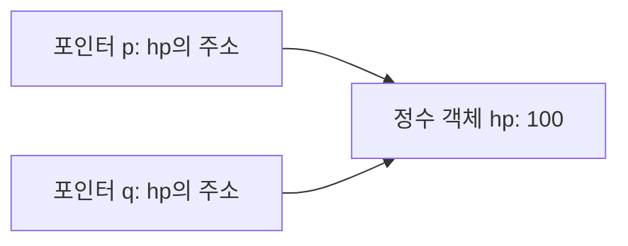

## 같은 문법에서 달라지는 객체의 의미

C#·C에서 사용하는 변수, 조건문, 반복문과 함수의 기본 문법은 알고 있다는 전제에서 시작합니다. 포인터는 주소와 역참조부터 다시 설명합니다. 이번 주에는 **객체의 생성, 참조, 정리 책임**에 집중합니다. 각 문장이 새 객체를 만드는지, 기존 객체를 가리키는지, 누가 언제 정리하는지 구분합니다. [12주 전체 계획](/writing/unreal-cpp-engine-12-week-plan/)과 [주차별 글 목록](/series/unreal-cpp-engine/)에서 앞뒤 순서를 확인할 수 있습니다.

C#의 일반적인 `class` 변수는 객체에 대한 참조를 담습니다. C++의 `Widget a;`는 `Widget` 객체 자체를 선언합니다. `Widget b = a;`가 가능하다면 새 객체 `b`를 복사 생성합니다. C++에서 `class`와 `struct`는 기본 접근 지정자와 기본 상속 접근이 다르며, C#처럼 참조 형식과 값 형식으로 나뉘지 않습니다.

| 익숙한 관점 | C++에서 구분할 점 |
| --- | --- |
| C# `class` 변수 두 개가 같은 객체를 가리킵니다. | `T a`, `T& r`, `T* p`는 각각 객체, 참조, 포인터를 선언합니다. |
| C에서 구조체를 대입하면 멤버 값이 복사됩니다. | C++ 클래스는 복사 생성·대입 동작을 정의하거나 금지할 수 있습니다. |
| C#의 `new`로 객체를 생성합니다. | C++ 클래스는 `new` 없이도 생성됩니다. 일반적인 `new T`는 저장 공간 확보와 객체 초기화를 수행합니다. |
| C에서 `malloc/free`를 짝지어 호출합니다. | 클래스 생성·소멸이 필요한 객체에 이를 `new/delete`와 섞어 쓰지 않습니다. `malloc`은 클래스 생성자를 호출하지 않습니다. |
| C#의 `using`으로 `Dispose` 시점을 정합니다. | C++에서는 자동 객체의 스코프 종료와 소멸자를 이용해 자원을 정리합니다. C#의 finalizer와 호출 시점이 다릅니다. |

이 글의 예제는 **표준 C++20 콘솔 프로그램**입니다. 파일마다 `main`이 있으므로 각각 별도 프로그램으로 실행합니다. 언리얼 프로젝트 안에 한꺼번에 넣지 않습니다.

Windows에서는 Visual Studio의 **x64 Native Tools Command Prompt**에서 다음처럼 실행합니다. 아래 파일명만 각 실습의 이름으로 바꿉니다.

```bat
cl /nologo /std:c++20 /EHsc /W4 /utf-8 /Od 01-values.cpp /Fe:01-values.exe
01-values.exe
```

`/EHsc`는 예외 처리, `/Od`는 최적화 비활성화 설정입니다. `/Od`에서도 언어가 요구하는 복사 생략은 유지됩니다. 예제의 영문 출력은 객체와 호출 순서를 비교하기 위한 이름입니다.

## 1일차 — 값, 참조와 포인터를 함수 경계에서 구분하기

### 포인터의 주소와 역참조

객체는 메모리의 저장 공간을 사용하며, 그 객체를 가리키는 **주소**를 얻을 수 있습니다. `int hp{100};`에서 `hp`는 정수 객체이고 저장한 값은 `100`입니다. `&hp`는 그 객체의 주소를 구하는 표현식입니다.

**포인터 변수는 주소를 담습니다.** `int* p = &hp;`는 `int` 객체를 가리킬 수 있는 포인터 변수 `p`를 만들고 `hp`의 주소로 초기화합니다. 이 선언으로 새로운 체력 값이나 동적 객체가 생기지는 않습니다. `hp`와 `p`는 별개의 객체이며, `p`가 `hp`를 가리킵니다. [Microsoft의 포인터 설명](https://learn.microsoft.com/en-us/cpp/cpp/pointers-cpp?view=msvc-170)

| 표현 | 의미 |
| --- | --- |
| `int* p = &hp;` | 포인터를 선언하고 `hp`의 주소를 저장합니다. 선언의 `*`는 포인터 형식을 나타냅니다. |
| `p` | 포인터가 저장한 주소 값입니다. 체력 값 `100`과 구분합니다. |
| `*p` | 그 주소의 객체에 접근합니다. 이 연산을 **역참조**라고 합니다. |
| `*p = 80;` | `p`가 가리키는 정수 객체의 값을 바꿉니다. 여기서는 `hp`가 `80`이 됩니다. |
| `p = &other;` | `p`에 다른 주소를 저장합니다. `hp`의 값은 바뀌지 않습니다. |
| `&p` | 포인터 변수 `p` 자체의 주소입니다. 형식은 `int**`이며 `p`가 저장한 주소와 구분합니다. |

같은 `*`라도 선언의 `int* p`와 표현식의 `*p`는 역할이 다릅니다. `&`도 `&hp`에서는 주소를 구하지만, `int& ref = hp;` 같은 선언에서는 참조 형식을 나타냅니다.

포인터의 형식은 대상을 어떻게 읽고 쓸지 결정합니다. `int*`를 역참조하면 `int` 객체를 다룹니다. 주소만 같아 보인다고 관련 없는 객체를 임의의 포인터 형식으로 바꾸어 접근해도 된다는 뜻은 아닙니다. [Microsoft의 원시 포인터와 역참조](https://learn.microsoft.com/en-us/cpp/cpp/raw-pointers?view=msvc-170)

### 포인터 복사는 대상 객체를 복사하지 않습니다

`int* q = p;`는 `p`의 주소 값을 `q`에 복사합니다. 두 포인터가 가리키는 `hp`는 하나입니다. 다음 그림은 `hp`가 `100`이고 두 포인터를 초기화한 직후의 관계입니다. 실제 주소 숫자는 실행 환경에 따라 달라지므로 그림에는 관계만 표시합니다.



`*q`를 바꾸면 같은 객체를 가리키는 `*p`에서도 그 변경이 보입니다. 이후 `p = &other;`로 `p`를 재지정하더라도 `q`는 계속 `hp`를 가리킵니다. **주소 값의 복사**와 **대상 객체의 복사**를 구분해야 다음 함수 전달 예제를 읽을 수 있습니다.

### 포인터 기초 실습: 대상 변경과 주소 변경

`00-pointers.cpp`입니다. `p`와 `q`가 각 출력 시점에 어떤 객체를 가리키는지 먼저 표시합니다. 기존 실습 1 앞에서 별도로 실행합니다.

```cpp
#include <iostream>

struct Stats {
    int hp;
};

int main() {
    int hp{100};
    int other{200};
    int* p = &hp;
    int* q = p;

    std::cout << std::boolalpha;
    std::cout << "same target: " << (p == q) << '\n';
    *p = 80;
    std::cout << "hp: " << hp << ", through q: " << *q << '\n';

    p = &other;
    *p = 150;
    std::cout << "hp: " << hp << ", other: " << other
              << ", through q: " << *q << '\n';

    p = nullptr;
    std::cout << "p is null: " << (p == nullptr) << '\n';
    std::cout << "q still reads hp: " << *q << '\n';

    Stats player{60};
    Stats* selected = &player;
    selected->hp -= 10;
    std::cout << "member: " << (*selected).hp << '\n';
}
```

```text
same target: true
hp: 80, through q: 80
hp: 80, other: 150, through q: 80
p is null: true
q still reads hp: 80
member: 50
```

`selected->hp`는 원시 포인터를 사용할 때 `(*selected).hp`와 같은 멤버 접근입니다. 객체 자체에는 `player.hp`처럼 `.`을 쓰고, 객체를 가리키는 포인터에는 `selected->hp`처럼 `->`를 씁니다.

`p = nullptr;`는 이 포인터가 가리킬 대상이 없다는 상태를 저장합니다. 대상을 소멸시키거나 다른 포인터 `q`까지 바꾸는 동작은 아닙니다. 처음부터 대상이 없다면 `int* p = nullptr;`처럼 초기화합니다. `nullptr`는 정수 `0`과 구분되는 널 포인터 상수입니다. [Microsoft의 nullptr 설명](https://learn.microsoft.com/en-us/cpp/cpp/nullptr?view=msvc-170)

역참조 전에 확인할 것은 **대상이 존재하고 아직 유효한가**입니다. 초기화하지 않은 지역 포인터, `nullptr`, 수명이 끝난 객체의 주소로 `*p`나 `p->member`를 사용하면 안 됩니다. `p != nullptr`라는 사실만으로 대상의 수명이 보장되지는 않습니다. 수명이 끝나도 주소 값은 남을 수 있기 때문입니다.

이 예제의 포인터들은 지역 객체의 주소를 빌려 사용합니다. `&hp`나 `&player`로 얻은 주소를 `delete`하면 안 됩니다. 포인터를 만들었다는 사실만으로 삭제 책임이 생기지 않습니다. 소유권과 대상의 수명은 2~3일차에서 이어서 다룹니다.

**변형 과제:** `p = &other;` 바로 다음에 `*q = 70;`을 넣습니다. `hp`와 `other` 중 무엇이 바뀌는지, 마지막에 `p`를 `nullptr`로 바꿔도 `q`로 `hp`를 읽을 수 있는 이유가 무엇인지 설명합니다.

### 함수가 받는 대상과 수정 권한

| 매개변수 | 전달되는 것 | 함수에서 가능한 일 |
| --- | --- | --- |
| `T value` | 별도 매개변수 객체 | 그 객체를 수정합니다. 원본과 자원을 공유하는지는 `T`의 복사 정책에 달려 있습니다. |
| `T& value` | 기존 객체의 별칭 | 원본을 수정합니다. 유효한 객체를 제공한다는 계약입니다. |
| `const T& value` | 기존 객체를 읽는 별칭 | 이 참조를 통한 일반 멤버 수정이 제한됩니다. 객체의 수명을 소유하지 않습니다. |
| `T* value` | 주소 값의 복사 | 대상이 있으면 수정할 수 있습니다. `nullptr` 허용 여부를 정해야 합니다. |
| `const T* value` | 읽기 전용 접근에 쓰는 주소 값 | 대상 수정이 제한됩니다. 포인터 변수 자체는 다른 주소로 바꿀 수 있습니다. |

여기서 포인터도 **값으로 전달**됩니다. `T*` 매개변수에 다른 주소를 넣어도 호출자의 포인터 변수는 바뀌지 않습니다. 호출자의 포인터 변수까지 바꿀 필요가 있다면 `T*&`나 `T**` 같은 별도 계약이 필요합니다.

참조는 초기화할 때 대상이 정해집니다. `r = other`는 참조를 다른 객체로 연결하는 문장이 아니라, `r`이 가리키는 객체에 대입하는 문장입니다. [C++ 표준 초안의 참조 초기화 규칙](https://eel.is/c++draft/dcl.init.ref)

### 실습 1: 복사와 원본 변경

`01-values.cpp`입니다. 실행 전에 마지막 두 줄의 값을 예상합니다.

```cpp
#include <iostream>

struct Stats {
    int hp;
};

void ByValue(Stats value) { value.hp -= 10; }
void ByReference(Stats& value) { value.hp -= 10; }
void ByPointer(Stats* value) {
    if (value != nullptr) {
        value->hp -= 10;
    }
}

void RebindLocal(Stats* value, Stats& other) {
    value = &other;
    value->hp = 50;
}

int ReadHp(const Stats& value) { return value.hp; }

int main() {
    Stats player{100};
    Stats enemy{200};
    Stats* selected = &player;

    ByValue(player);
    std::cout << "value: " << player.hp << '\n';
    ByReference(player);
    std::cout << "reference: " << player.hp << '\n';
    ByPointer(selected);
    ByPointer(nullptr);
    std::cout << "pointer: " << ReadHp(player) << '\n';

    RebindLocal(selected, enemy);
    std::cout << "selected: " << selected->hp
              << ", enemy: " << enemy.hp << '\n';

    Stats& alias = player;
    alias = enemy;
    alias.hp = 60;
    std::cout << "player: " << player.hp
              << ", enemy: " << enemy.hp << '\n';
}
```

```text
value: 100
reference: 90
pointer: 80
selected: 80, enemy: 50
player: 60, enemy: 50
```

`ByValue`는 `Stats`를 복사하므로 원본 체력은 그대로입니다. `RebindLocal`은 자신의 포인터 복사본만 `enemy`로 바꿉니다. 마지막에는 `alias = enemy`가 `player`에 값을 복사하며, `alias`의 대상은 계속 `player`입니다.

`const`도 대상별로 읽습니다. `const T*`는 포인터를 통한 대상 수정을 제한하고, `T* const`는 포인터의 주소 변경을 제한합니다. 둘을 합친 `const T* const`는 양쪽을 제한합니다. `const T&`를 받는다고 다른 별칭까지 쓰기 금지로 바뀌거나, 다른 스레드의 변경이 막히지는 않습니다.

**변형 과제:** `RebindLocal`의 첫 매개변수를 `Stats*&`로 바꿉니다. `selected`가 이후 어느 객체를 가리키는지 설명합니다. 마지막 출력에서 `enemy`가 변하지 않는 이유도 따로 설명합니다.

## 2일차 — 메모리 위치와 객체 수명을 분리하기

### 자동 저장 기간과 동적 저장 기간

지역 객체를 흔히 “스택에 있다”고 설명하지만, C++의 규칙을 읽을 때는 **자동 저장 기간**과 **동적 저장 기간**으로 구분하는 편이 정확합니다. 물리적인 메모리 배치와 최적화는 구현에 따라 달라집니다. `static` 객체와 스레드 지역 객체도 있지만, 이번 실습은 자동 객체와 동적 객체에 집중합니다.

- `T local;`: 일반적인 블록 지역 객체입니다. 블록을 정상적으로 벗어날 때 소멸합니다.
- `T* p`: 포인터 객체입니다. `p`의 수명과 `*p`의 수명은 별개입니다.
- `std::make_unique<T>()`: 동적 객체를 만들고 그 소유권을 `std::unique_ptr<T>`에 담습니다.
- `std::unique_ptr<T> owner`: 소유권을 가진 객체입니다. 기본 삭제자를 쓰는 `owner`가 소멸하거나 `reset()`하면 소유하던 `T`도 소멸하고 저장 공간이 해제됩니다.

메모리 공간 확보와 그 공간에 있는 객체의 수명은 같은 개념이 아닙니다. 이 글의 클래스 예제에서는 저장 공간을 확보하고 초기화가 끝나 객체의 수명이 시작됩니다. 표준상 클래스 객체의 수명은 소멸자 호출이 시작될 때 끝나며, 소멸자 실행과 저장 공간 해제에는 각각의 규칙이 적용됩니다. [C++ 표준 초안의 객체 수명](https://eel.is/c++draft/basic.life)

### 실습 2: 스코프 종료와 명시적인 소유권 해제

`02-lifetime.cpp`입니다. `Trace`의 문자열은 프로그램 내내 유효한 문자열 리터럴입니다.

```cpp
#include <iostream>
#include <memory>

struct Trace {
    const char* name;

    explicit Trace(const char* label) : name(label) {
        std::cout << "construct " << name << '\n';
    }
    ~Trace() {
        std::cout << "destroy " << name << '\n';
    }
};

int main() {
    Trace outer{"outer"};
    {
        Trace first{"first"};
        Trace second{"second"};
        auto owner = std::make_unique<Trace>("dynamic");
        Trace* observer = owner.get();

        std::cout << "observe " << observer->name << '\n';
        owner.reset();
        // observer is now dangling. Do not dereference it.
        std::cout << "leave inner scope\n";
    }
    std::cout << "leave main\n";
}
```

```text
construct outer
construct first
construct second
construct dynamic
observe dynamic
destroy dynamic
leave inner scope
destroy second
destroy first
leave main
destroy outer
```

같은 블록에서 생성이 완료된 자동 객체는 생성의 역순으로 소멸합니다. `dynamic`은 `owner.reset()`에서 먼저 정리됩니다. 이후 빈 `owner`가 소멸해도 `dynamic`을 다시 삭제하지 않습니다.

`explicit`은 이 생성자를 이용한 원치 않는 암시적 변환을 막습니다. `: name(label)`은 **멤버 초기화 목록**으로, 생성자 본문에 들어가기 전에 멤버를 초기화합니다. 여러 멤버의 초기화 순서는 목록에 쓴 순서가 아니라 클래스 안의 **멤버 선언 순서**입니다. 소멸 시에는 소멸자 본문 뒤에 멤버가 선언의 역순으로 정리됩니다. [Microsoft의 생성자 설명](https://learn.microsoft.com/en-us/cpp/cpp/constructors-cpp?view=msvc-170)

### 주소가 남아 있어도 객체는 없을 수 있습니다

`observer`는 `get()`으로 빌린 주소일 뿐 소유자가 아닙니다. `reset()` 이후에도 자동으로 `nullptr`가 되지 않습니다. 이처럼 대상의 수명이 끝난 포인터나 참조를 **댕글링 포인터·참조**라고 부릅니다. 남은 주소로 멤버에 접근하는 코드는 정의되지 않은 동작을 일으킵니다. 실행할 때 우연히 값이 보이는지는 안전성을 판단하는 근거가 되지 않습니다.

참조도 대상을 계속 살려 두는 장치가 아닙니다. 지역 객체의 참조·주소를 반환하면 함수 종료 뒤 유효하지 않습니다. `const T&`가 특정 임시 객체의 수명을 늘리는 규칙은 있지만, 이미 수명이 끝나는 지역 객체를 구해 주는 일반적인 규칙은 아닙니다. 반환할 데이터가 필요하다면 우선 값 반환을 고려합니다.

**변형 과제:** `owner.reset()`을 지웁니다. `dynamic`, `second`, `first`의 소멸 순서를 다시 예측합니다. 동적 객체가 지역 변수보다 무조건 오래 사는 것은 아니라는 점을 설명합니다.

## 3일차 — RAII로 정리 책임을 객체에 묶기

RAII(Resource Acquisition Is Initialization)는 자원을 소유 객체의 초기화와 소멸에 연결하는 방식입니다. 파일, 잠금, 메모리처럼 획득과 해제가 필요한 대상에 적용합니다. 호출하는 쪽이 모든 `return` 경로에 해제 코드를 반복해서 붙이지 않도록 합니다.

C#의 `using`과 `IDisposable`에 익숙하다면 “범위를 벗어날 때 정리한다”는 관점에서 연결할 수 있습니다. C++에서는 자원을 가진 멤버의 소멸도 바깥 객체의 소멸 과정에 포함됩니다. 가비지 컬렉터가 나중에 도달 가능성을 조사해 정리하는 방식과 구분합니다. [Microsoft의 객체 수명과 RAII](https://learn.microsoft.com/en-us/cpp/cpp/object-lifetime-and-resource-management-modern-cpp?view=msvc-170)

### 실습 3: 조기 반환과 예외에서도 정리하기

`03-raii.cpp`입니다. `Buffer`는 배열을 소유하고, `std::unique_ptr<int[]>`가 배열의 해제를 맡습니다.

```cpp
#include <cstddef>
#include <iostream>
#include <memory>
#include <stdexcept>

class Buffer {
public:
    explicit Buffer(std::size_t size)
        : data_(std::make_unique<int[]>(size)) {
        std::cout << "acquire buffer\n";
    }
    ~Buffer() {
        std::cout << "destroy buffer\n";
        // data_ is destroyed after this destructor body.
    }

    Buffer(const Buffer&) = delete;
    Buffer& operator=(const Buffer&) = delete;

private:
    std::unique_ptr<int[]> data_;
};

void Run(bool fail) {
    Buffer buffer{4};
    if (fail) {
        std::cout << "throw\n";
        throw std::runtime_error("job failed");
    }
    std::cout << "early return\n";
    return;
}

int main() {
    Run(false);
    try {
        Run(true);
    } catch (const std::exception& error) {
        std::cout << "caught: " << error.what() << '\n';
    }
}
```

```text
acquire buffer
early return
destroy buffer
acquire buffer
throw
destroy buffer
caught: job failed
```

첫 번째 호출은 `return`에서, 두 번째 호출은 예외가 `catch`로 전달되는 스택 되감기 과정에서 `buffer`를 소멸시킵니다. `destroy buffer`는 소멸자 본문에서 찍히며, **그 본문이 끝난 뒤** `data_`가 배열을 해제합니다. 배열을 직접 `delete[]`하지 않습니다.

`= delete`는 해당 연산을 컴파일 단계에서 금지합니다. 이 `Buffer`는 소유 배열을 어떻게 복사할지 정의하지 않았으므로 복사를 허용하지 않습니다. 소멸자를 직접 선언했기 때문에 이동 연산도 자동으로 만들어지지 않습니다. 이동까지 허용하려면 정책에 맞춰 명시적으로 선언해야 합니다.

RAII를 프로세스 강제 종료나 모든 비정상 종료에서도 실행되는 정리 장치로 이해하면 안 됩니다. 위 예제는 정상적인 스코프 종료와, 실제로 `catch`까지 스택을 되감는 C++ 예외 경로를 보여 줍니다. 언리얼 게임 코드의 예외 사용 정책과는 별도로 보는 콘솔 예제입니다.

**변형 과제:** `Run` 안에 `Buffer`를 하나 더 만들고 생성 순서와 정리 순서를 비교합니다. `Buffer copy = buffer;`를 추가했을 때 왜 컴파일이 거절되는지도 설명합니다.

## 4일차 — 복사와 이동은 객체가 정한 동작입니다

### 생성과 대입을 먼저 구분합니다

| 표현 | 의미 |
| --- | --- |
| `T b = a;` | 새 객체 `b`를 `a`로 복사 생성합니다. |
| `b = a;` | 이미 존재하는 `b`에 복사 대입합니다. |
| `T b = std::move(a);` | 이동 생성이 가능한지 검사하고 적합한 생성자를 선택합니다. |
| `b = std::move(a);` | 이동 대입이 가능한지 검사하고 적합한 대입 연산자를 선택합니다. |

컴파일러가 만드는 복사는 멤버별 복사입니다. `std::vector` 멤버는 원소를 복사하고, 원시 포인터 멤버는 주소를 복사합니다. 따라서 “객체를 복사하면 가리키는 모든 데이터까지 독립적으로 복제된다”고 가정하면 안 됩니다. 원시 소유 포인터를 그대로 복사한 두 객체가 모두 `delete`하면 이중 해제 문제가 생깁니다. [Microsoft의 복사 생성자와 복사 대입](https://learn.microsoft.com/en-us/cpp/cpp/copy-constructors-and-copy-assignment-operators-cpp)

`std::move` 자체는 데이터를 옮기는 함수가 아닙니다. 표현식을 이동 연산의 후보로 사용할 수 있게 변환합니다. 그 결과에 어떤 생성자·대입 연산자가 선택되고, 그 연산이 무엇을 하는지가 실제 동작을 결정합니다. 이름이 있는 변수 `a`는 lvalue이며, `std::move(a)`는 xvalue입니다. `T&&`를 이동 생성자의 매개변수에 쓰는 이유가 여기에 있습니다.

### 실습 4: 네 가지 연산과 소멸 순서

`04-copy-move.cpp`입니다. `Trace`는 호출을 관찰하기 위한 타입입니다. 이동 시 원본의 값을 `-1`로 바꾸는 것은 이 클래스가 직접 정한 동작이며, C++ 전체의 규칙이 아닙니다.

```cpp
#include <iostream>
#include <utility>

class Trace {
public:
    explicit Trace(int value) : id_(++nextId_), value_(value) {
        std::cout << "construct " << id_ << '\n';
    }
    Trace(const Trace& other)
        : id_(++nextId_), value_(other.value_) {
        std::cout << "copy construct " << id_
                  << " from " << other.id_ << '\n';
    }
    Trace(Trace&& other) noexcept
        : id_(++nextId_), value_(std::exchange(other.value_, -1)) {
        std::cout << "move construct " << id_
                  << " from " << other.id_ << '\n';
    }
    Trace& operator=(const Trace& other) {
        value_ = other.value_;
        std::cout << "copy assign " << id_
                  << " from " << other.id_ << '\n';
        return *this;
    }
    Trace& operator=(Trace&& other) noexcept {
        if (this != &other) {
            value_ = std::exchange(other.value_, -1);
        }
        std::cout << "move assign " << id_
                  << " from " << other.id_ << '\n';
        return *this;
    }
    ~Trace() { std::cout << "destroy " << id_ << '\n'; }

    int Value() const { return value_; }

private:
    inline static int nextId_ = 0;
    int id_;
    int value_;
};

int main() {
    Trace a{10};
    Trace b = a;
    Trace c = std::move(a);
    std::cout << "a=" << a.Value() << ", b=" << b.Value()
              << ", c=" << c.Value() << '\n';
    b = c;
    c = std::move(b);
}
```

```text
construct 1
copy construct 2 from 1
move construct 3 from 1
a=-1, b=10, c=10
copy assign 2 from 3
move assign 3 from 2
destroy 3
destroy 2
destroy 1
```

대입은 대상의 `id_`를 유지하며 생성자는 새 번호를 받습니다. 이동한 뒤에도 `a`, `b` 객체는 존재하고 마지막에 소멸합니다. 이 예제의 정수 이동 자체가 성능 이득을 보여 주는 것은 아닙니다. 동적으로 할당한 큰 자원을 복제하는 대신 그 소유권을 넘길 때 이동의 의미가 커집니다.

`std::unique_ptr`를 이동 생성하면 소유권이 전달되고 원본은 비게 됩니다. 반면 이동한 `std::string`의 구체적인 문자열 내용은 비어 있다고 일반화하지 않습니다. 이동 후 사용할 수 있는 연산과 상태는 각 타입의 계약을 읽어야 합니다. `const` 객체에 `std::move`를 적용해도 `const`는 사라지지 않아, 보통의 `T(T&&)` 대신 `T(const T&)`로 복사될 수 있습니다. [Microsoft의 이동 생성과 이동 대입](https://learn.microsoft.com/en-us/cpp/cpp/move-constructors-and-move-assignment-operators-cpp?view=msvc-170)

`noexcept`는 예외가 밖으로 나오지 않는다는 약속입니다. 위 출력 예제는 스트림 예외를 활성화하지 않은 기본 상태를 사용합니다. 예외를 던질 수 있는 실제 처리를 넣고 근거 없이 `noexcept`를 붙이면 안 됩니다. `std::vector` 같은 컨테이너는 재할당 중 예외 안전성을 지키기 위해 이동의 예외 명세와 복사 가능성을 고려합니다.

### 실제 클래스에서는 Rule of Zero부터

로그를 보기 위해 위 예제는 소멸자·복사 생성자·복사 대입·이동 생성자·이동 대입을 모두 정의했습니다. 실제 코드는 `std::vector`, `std::string`, `std::unique_ptr`처럼 소유권을 처리하는 멤버를 조합하고, 특별한 요구가 없으면 이 함수들을 직접 구현하지 않는 **Rule of Zero**를 먼저 고려합니다.

직접 자원을 관리하거나 특별 멤버 함수 하나를 정의해야 한다면, 나머지 복사·이동 동작도 허용할지, 삭제할지, 기본 구현을 쓸지 함께 결정합니다. 이것이 Rule of Five를 확인하는 이유입니다. 함수 다섯 개를 모든 클래스에 의무적으로 작성하라는 뜻은 아닙니다. [C++ Core Guidelines의 C.20·C.21](https://isocpp.github.io/CppCoreGuidelines/CppCoreGuidelines#Rc-zero)

**변형 과제:** `main`의 `Trace a{10};`를 `const Trace a{10};`로 바꿉니다. `std::move(a)`가 있는 줄의 출력이 어떻게 달라지는지 확인합니다.

## 5일차 — 반환과 컨테이너에서 수명 확인하기

### 실습 5: 복사하지 않고 값 반환하기

`05-return.cpp`입니다. 복사·이동 생성자가 모두 삭제되어 있어도 C++20에서 컴파일됩니다.

```cpp
#include <iostream>

struct Ticket {
    Ticket() { std::cout << "construct ticket\n"; }
    Ticket(const Ticket&) = delete;
    Ticket(Ticket&&) = delete;
    ~Ticket() { std::cout << "destroy ticket\n"; }
};

Ticket MakeTicket() {
    return Ticket{};
}

int main() {
    Ticket ticket = MakeTicket();
    std::cout << "use ticket\n";
}
```

```text
construct ticket
use ticket
destroy ticket
```

C++17 이후에는 이 예제처럼 동일 타입의 prvalue로 결과 객체를 초기화할 때, 중간 객체를 복사·이동하는 과정 없이 결과 객체를 직접 초기화합니다. 흔히 “보장된 복사 생략”이라고 부릅니다. 소멸자는 여전히 접근 가능하고 삭제되지 않아야 합니다. [Microsoft C++ 팀의 prvalue와 복사 생략 설명](https://devblogs.microsoft.com/cppblog/guaranteed-copy-elision-does-not-elide-copies/)

반면 `Ticket local; return local;`처럼 이름 있는 지역 변수를 반환하는 NRVO는 별도 규칙입니다. NRVO가 허용된다고 위 `Ticket`처럼 복사·이동이 모두 삭제된 코드를 반환할 수 있는 것은 아닙니다. NRVO가 적용되지 않을 때 사용할 생성자가 필요합니다. 반환값을 억지로 `std::move(local)`로 감싸면 NRVO의 조건을 잃을 수 있습니다. [C++ 표준 초안의 복사·이동 생략](https://eel.is/c++draft/class.copy.elision)

**변형 과제:** 앞의 `Trace` 코드에 `Trace MakeTrace() { Trace local{10}; return local; }`를 추가해 호출합니다. 컴파일러 버전과 최적화 설정을 적고 로그를 비교합니다. 이 NRVO 실험에는 하나의 고정된 출력 순서를 정답으로 두지 않습니다.

### 실습 6: 컨테이너 원소의 주소와 소유한 객체의 주소

`06-container.cpp`입니다. `reserve(capacity() + 1)`로 현재 용량보다 큰 공간을 요청해 재할당을 발생시킵니다.

```cpp
#include <iostream>
#include <memory>
#include <vector>

struct Item {
    int hp;
    explicit Item(int value) : hp(value) {}
};

int main() {
    std::vector<Item> values;
    values.emplace_back(100);
    Item* oldElement = &values.front();
    (void)oldElement;
    values.reserve(values.capacity() + 1);
    // oldElement is invalidated. Do not use it.
    std::cout << "fresh element: " << values.front().hp << '\n';

    auto owner = std::make_unique<Item>(200);
    Item* observer = owner.get();
    std::vector<std::unique_ptr<Item>> owners;
    owners.push_back(std::move(owner));
    owners.reserve(owners.capacity() + 1);

    std::cout << std::boolalpha;
    std::cout << "source empty: " << (owner == nullptr) << '\n';
    std::cout << "same pointee: "
              << (observer == owners.front().get()) << '\n';
    std::cout << "observed hp: " << observer->hp << '\n';

    owners.clear();
    // observer is now dangling. Do not use it.
}
```

```text
fresh element: 100
source empty: true
same pointee: true
observed hp: 200
```

첫 번째 벡터는 `Item`을 원소로 담습니다. 재할당이 일어나면 원소의 포인터·참조·반복자가 무효화되므로 `oldElement`로 접근하지 않고 다시 원소를 얻습니다. `reserve`가 항상 주소를 바꾸는 것은 아니며, **재할당이 일어났는지**가 기준입니다. [C++ 표준 초안의 vector 용량과 무효화 규칙](https://eel.is/c++draft/vector.capacity)

두 번째 벡터는 `unique_ptr<Item>`을 원소로 담습니다. 재할당으로 소유권을 담은 원소가 옮겨져도 별도로 할당한 `Item`은 그 자리에 있습니다. 이때 `observer`는 계속 유효하지만, 벡터 원소인 `unique_ptr` 자체를 가리키던 포인터·참조라면 무효화됩니다. 마지막 `clear()`는 소유자들을 소멸시켜 `Item`도 정리하므로 이후에는 `observer`를 사용할 수 없습니다.

`std::move(owner)`는 여기서 실제 소유권 전달로 이어집니다. 원본 `unique_ptr`를 복사하는 `owners.push_back(owner)`는 허용되지 않습니다. `emplace_back`도 컨테이너 재할당이나 이미 존재하는 원소의 이동을 항상 없애 주는 기능은 아닙니다.

## 언리얼에 연결할 때의 경계

일반 C++ 객체의 값·참조·소유권 구분은 언리얼에서도 필요합니다. 다만 `UObject`에는 엔진의 별도 생성·참조 추적·GC 체계가 있습니다. 위의 `std::make_unique<Item>()`를 `UObject` 생성·해제 방식으로 그대로 바꾸어 적용하지 않습니다. 언리얼의 일반 스마트 포인터 라이브러리도 `UObject` 관리용이 아닙니다. [Epic의 Smart Pointers](https://dev.epicgames.com/documentation/en-us/unreal-engine/smart-pointers-in-unreal-engine)

4~5주차에는 `UObject` 생성과 엔진이 추적하는 참조, `Destroy`·`EndPlay`·GC를 따로 연결합니다. 지금은 엔진 코드의 포인터를 볼 때 **일시적으로 빌린 주소인지, 소유권이나 GC 참조를 나타내는지**부터 구분합니다. `std::vector`에서 확인한 무효화 조건을 다른 컨테이너에 그대로 단정하지 말고 각 컨테이너의 계약을 확인합니다.

## 1주차 마무리 과제

하루 2시간을 기준으로 개념과 출력 예상 30분, 코드 실행·변형 60분, 예상과 결과 비교 30분을 배정합니다. 5일차에 두 예제를 충분히 비교하기 어렵다면 반환과 컨테이너를 하루씩 나눕니다.

| 날짜 | 직접 설명할 내용 | 남길 기록 |
| --- | --- | --- |
| 1일차 | 주소·역참조, 포인터 복사·재지정과 값 전달의 차이 | 포인터 기초 실습과 실습 1의 출력, 객체별 값과 포인터의 대상 |
| 2일차 | 소유 객체와 관찰 포인터의 수명 | 실습 2에서 `reset` 유무에 따른 소멸 순서 |
| 3일차 | 조기 반환·예외 경로의 자원 정리 | 실습 3의 생성·소멸 순서와 복사 거절 이유 |
| 4일차 | 생성·대입, 복사·이동의 구분 | 실습 4의 호출 로그와 `const` 변형 비교 |
| 5일차 | 값 반환, 복사 생략, 컨테이너 참조 무효화 | 실습 5·6의 결과와 무효화되는 대상 표시 |

자료를 닫고 다음 세 가지를 다시 작성합니다.

1. 객체를 읽기만 하는 함수, 수정하는 함수, 소유권을 넘겨받는 함수의 매개변수를 각각 정합니다.
2. 자원을 소유하는 지역 객체를 만들고 조기 반환 뒤의 정리를 예측합니다.
3. 객체를 빌려 쓰는 포인터가 언제 무효해지는지 코드의 특정 문장에 표시합니다.

변형 과제의 핵심 답은 다음과 같습니다. `Stats*&`는 호출자의 `selected`까지 바꾸지만 `alias`는 계속 `player`를 가리킵니다. `reset()`을 제거하면 블록 끝에서 `dynamic → second → first` 순으로 정리됩니다. 두 `Buffer`는 생성의 역순으로 정리되며 복사는 삭제된 함수 때문에 거절됩니다. `const Trace`에 `std::move`를 적용하면 이 예제에서는 복사 생성자가 선택됩니다.

예제와 설명은 Codex의 도움으로 작성한 독립 코드입니다. 게임 프로젝트의 구현 코드나 개인적인 학습 완료 기록을 옮긴 것은 아닙니다.
