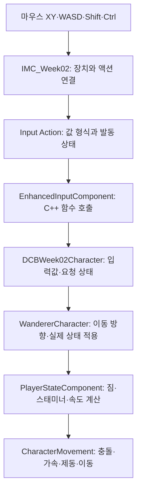

## 이번 주에는 입력부터 실제 움직임까지 따라갑니다

[1주차](/writing/dcb-unreal-first-playable-framework/)에서는 C++ 클래스를 빌드하고, GameMode가 플레이어를 생성하도록 연결했습니다. 이번에는 그 캐릭터를 상속해 **마우스로 시점을 돌리고, 키를 놓으면 이동 요청을 지우고, 걷기·질주·지게 상태에 따라 실제 속도가 달라지는 과정**을 배웁니다.

Unity에서 `InputAction`의 값을 읽어 C# 캐릭터에 전달했다면, 언리얼에서는 어떤 에셋과 C++ 함수가 그 역할을 하는지 대응시켜 봅니다. 설명을 읽은 뒤에는 지정한 에셋을 열고, 값을 바꾸고, Play에서 결과를 확인합니다. 게임 동작은 모두 C++에 작성합니다. **Blueprint 클래스·Event Graph·Level Blueprint는 사용하지 않습니다.** Input Action과 Input Mapping Context는 입력을 설정하는 데이터 에셋이므로 에디터에서 편집합니다.

| 날짜 | 에디터와 코드에서 직접 할 일 | 확인할 변화 |
| --- | --- | --- |
| 1일차 | 1주차 맵·밸런스 데이터를 복제하고 마우스 액션을 만듭니다. | 물리 장치와 액션의 연결을 구분합니다. |
| 2일차 | 1주차 클래스를 상속한 C++ Character·GameMode를 빌드합니다. | 새 Pawn·입력 에셋·저장 슬롯이 선택됩니다. |
| 3일차 | 마우스 감도·상하 반전·카메라와 몸 방향을 바꿔 봅니다. | 입력값이 회전으로 바뀌는 단위를 설명합니다. |
| 4일차 | WASD·Ctrl·Shift와 스태미너 소진을 비교합니다. | 입력 요청과 실제 이동 상태를 구분합니다. |
| 5일차 | 짐 무게를 바꾸고 G·P로 지게와 조작 제한을 실험합니다. | 무게·속도·입력 종료 사이의 관계를 확인합니다. |

하루 약 2시간을 기준으로 진행합니다. 2일차 코드가 길므로 한 번에 외우기보다 먼저 네 파일을 빌드하고, 이후 실습에서 호출되는 함수를 다시 찾아봅니다. 전체 순서는 [12주 계획](/writing/dcb-unreal-port-study-plan/)과 [과정 목록](/series/dcb-unreal-port/)에서 확인합니다.

### 먼저 준비할 1주차 결과물

2026년 10월 29일의 **Unreal DCB·UE 5.8.4·Windows·Visual Studio**를 기준으로 합니다. 새 Third Person 프로젝트가 아니라 `DCB.uproject`와 `Source/DCB`가 있는 전환본을 엽니다. 1주차의 C++ 실습을 마친 상태에서 시작합니다.

- `Source/DCB/Study/`에 `DCBStudyMarker`, `DCBStudyCharacter`, `DCBStudyGameMode`의 `.h`와 `.cpp`, 총 여섯 파일이 있습니다.
- `/Game/01_Game/Study/Week01CPP/L_DCB_Week01_CPP`에서 플레이어가 생성되고 WASD·Shift·Ctrl·G·F가 동작합니다.
- 같은 폴더의 `DA_Week01Tuning`으로 속도를 조절할 수 있고, `StudyBranch`와 `StudyReturn`이 배치되어 있습니다.
- 1주차의 화면에 `Gait`, `Carry`, `Cargo`, `Limit`, `Actual`, `Stamina`가 표시됩니다.

이전 Blueprint 실습만 했다면 먼저 현재의 C++ 1주차 글을 완료합니다. 이번 클래스는 `ADCBStudyCharacter`와 `ADCBStudyGameMode`를 직접 상속하므로 해당 파일이 필요합니다. 기존 여섯 파일을 덮어쓰지 않고 네 파일을 추가합니다.

## 1일차 — 입력을 에셋과 C++ 함수로 나눠 연결합니다

### 실습 1. 2주차 맵과 밸런스 데이터를 분리합니다

1. 에디터에서 1주차 `L_DCB_Week01_CPP`를 엽니다. Play 중이라면 먼저 Stop을 누릅니다.
2. Content Browser에서 `/Game/01_Game/Study` 아래에 `Week02CPP` 폴더를 만듭니다. 에디터의 `Content`는 코드 경로의 `/Game`에 해당합니다.
3. **File → Save Current Level As**에서 `Week02CPP` 폴더를 선택하고 `L_DCB_Week02_CPP`로 저장합니다. 열린 레벨의 이름이 바뀌었는지 확인합니다.
4. Outliner에서 1주차 바닥인 `StudyFloor`를 선택합니다. Details의 Transform → Scale을 **X=200, Y=200, Z=1**로 바꿉니다. 위치는 (0, 0, -50)을 유지합니다. 기본 Cube가 100cm이므로 200m × 200m 바닥이 됩니다. 이후 질주 실험에서 작은 바닥 끝으로 떨어지는 일을 줄입니다.
5. `PlayerStart`의 위치 (0, 0, 110)과 회전 (0, 0, 0)을 유지합니다. 플레이어 Character를 맵에 직접 끌어 놓지 않습니다.
6. `Week01CPP/DA_Week01Tuning`을 선택하고 Duplicate로 복제합니다. 복제본을 `Week02CPP`로 옮기고 이름을 `DA_Week02Tuning`으로 지정합니다. 원본을 이동하지 않았는지 확인합니다.
7. `DA_Week02Tuning`을 열고 아래 기준값을 맞춘 뒤 저장합니다. 1주차에 속도를 변경한 상태라면 이 단계에서 복원합니다.

| 항목 | X | Y | Z | 뜻 |
| --- | --- | --- | --- | --- |
| Carry Speeds | 150 | 300 | 650 | 지게 착용 시 Walk·Run·Sprint의 기본 속도 |
| Bare Speeds | 112 | 240 | 360 | 지게 미착용 시 Walk·Run·Sprint의 기본 속도 |
| Carrying → Gait Cost | 0 | 5 | 10 | Carry 범주에서 Carrying을 펼칩니다. 지게 착용 시 각 이동 단계의 초당 기본 스태미너 비용입니다. |
| Bare → Gait Cost | 0 | 0 | 10 | Carry 범주에서 Bare를 펼칩니다. 지게 미착용 시 각 이동 단계의 초당 기본 스태미너 비용입니다. |

Carry 범주의 `Capacity`는 **30**, Stats 범주의 `Max Stamina`는 **100**으로 둡니다. 속도 단위는 cm/s입니다. `Carry Speeds`의 X·Y·Z는 공간 방향이 아니라 이 데이터 구조에서 세 이동 단계에 대응하는 값입니다.

이번에는 지게 모델이나 사람 애니메이션을 붙이지 않습니다. 1주차의 Cube 몸체로 이동을 관찰하고, **지게 상태는 `Carry=On/Off`와 무게·속도 수치로 확인**합니다. 외형과 운반 자세는 이후 애니메이션 실습에서 다룹니다.

### 실습 2. 기존 입력을 읽고 마우스 전용 액션을 만듭니다

Unity Input System에서는 Action과 Binding을 분리합니다. 언리얼 Enhanced Input도 액션과 장치 연결을 나눠 관리합니다. 다만 같은 이름의 이벤트라고 해서 호출 시점까지 일대일로 같지는 않습니다.

| Unity에서 익숙한 대상 | 이번 언리얼 실습의 대상 | 담당하는 일 |
| --- | --- | --- |
| `InputAction`의 Value Type | `UInputAction` 에셋의 Value Type | 버튼인지, 1차원 값인지, 2차원 벡터인지 정의합니다. |
| Action Map과 Binding 구성 | `UInputMappingContext`의 Mappings | 어떤 키·축을 어느 액션에 전달할지 연결합니다. |
| Binding Processor | Input Modifier | 축의 부호·순서·배율 등을 바꿉니다. |
| Interaction | Input Trigger | 누르기·유지 등 액션의 발동 조건을 정합니다. 정확한 상태 전이는 별도로 확인합니다. |
| `performed`·`canceled` 콜백 등록 | `UEnhancedInputComponent::BindAction` | 해당 액션 이벤트가 발생할 때 실행할 C++ 함수를 연결합니다. |

Enhanced Input의 액션·매핑·Modifier·Trigger 구분은 [Epic의 Enhanced Input 문서](https://dev.epicgames.com/documentation/en-us/unreal-engine/enhanced-input-in-unreal-engine), Unity 쪽의 단계와 콜백은 [Unity Input System Actions 문서](https://docs.unity3d.com/Packages/com.unity.inputsystem@1.20/manual/Actions.html)를 참고합니다.

먼저 **기존 설정을 읽기만** 합니다.

1. Content Browser에서 `/Game/Scripts/GameSystem/InputSystem/GameInputActions`를 엽니다.
2. `IA_Move`를 열어 Value Type이 **Axis2D**인지 확인합니다. 이름을 보면 용도를 알 수 있지만, 실제 값 형식은 이 설정이 결정합니다.
3. `IMC_Player`를 열고 `IA_Move` 아래의 키와 Modifiers를 펼칩니다. WASD의 기본 연결은 다음과 같습니다.

| 키 | 키에서 들어오는 기본 축 | Modifier의 역할 | 캐릭터가 받을 값 |
| --- | --- | --- | --- |
| W | X에 양수 | Swizzle로 X를 Y로 보냅니다. | (0, 1) |
| S | X에 양수 | Negate로 음수로 만들고 Swizzle로 Y에 보냅니다. | (0, -1) |
| A | X에 양수 | Negate로 X를 음수로 만듭니다. | (-1, 0) |
| D | X에 양수 | 기본 X를 유지합니다. | (1, 0) |

`Axis2D`의 X는 좌우, Y는 앞뒤라는 **입력상의 약속**입니다. 언리얼 월드의 X=앞, Y=오른쪽, Z=위와 바로 같은 좌표가 아닙니다. 뒤에서 카메라 방향을 기준으로 월드 이동 방향을 계산합니다.

4. `IMC_Player`에서 `IA_Look` 연결을 확인합니다. 현재 DCB 전환본은 **Gamepad Right 2D-Axis**를 사용합니다. 마우스 입력은 이번에 별도 액션으로 추가합니다.
5. `IMC_Player`를 복제하고 복제본만 `Week02CPP` 폴더로 옮깁니다. 이름은 `IMC_Week02`로 지정합니다. 원본 창은 닫습니다.
6. `Week02CPP`의 빈 곳을 우클릭하고 **Input → Input Action**을 선택합니다. 이름은 `IA_Week02MouseLook`으로 지정합니다.
7. 새 액션을 더블클릭합니다. **Value Type을 Axis2D**로 바꿉니다. 기본 Boolean 상태로 두면 C++의 `FVector2D`와 맞지 않습니다. Triggers와 Modifiers는 빈 상태로 두고 저장합니다.
8. `IMC_Week02`를 엽니다. Mappings의 **+ 버튼**으로 항목을 추가하고 액션에 `IA_Week02MouseLook`을 선택합니다.
9. 해당 액션의 키 목록에서 **Mouse XY 2D-Axis**를 선택합니다. 키 선택창에서 `Mouse XY`로 검색하면 찾기 쉽습니다. `Mouse X` 하나나 `Mouse Position`을 선택하지 않습니다. 이 항목의 Modifiers와 Triggers도 비워 둡니다.
10. 저장합니다. 기존 `IA_Look`의 게임패드 매핑과 WASD·Shift·Ctrl·F·G 연결은 유지합니다.

**IMC를 복제해도 그 안에서 참조하는 Input Action까지 복제되지는 않습니다.** 따라서 `IMC_Week02` 안의 연결은 실습용으로 바꿀 수 있지만, 공유 중인 `IA_Move`나 `IA_Sprint` 자체를 고치면 원래 맵에도 영향을 줍니다. 이번에는 새 마우스 액션만 만듭니다.

`IA_Week02MouseLook → Mouse XY 2D-Axis`는 한 번만 등록합니다. 같은 마우스 축을 기존 `IA_Look`에도 추가하면 뒤에서 작성할 마우스용 계산과 스틱용 계산이 함께 실행될 수 있습니다.

### 실습 3. 입력이 캐릭터까지 도달하는 순서를 읽습니다



액션 에셋을 만들었다고 함수가 자동으로 실행되지는 않습니다. **활성 Mapping Context**, **액션과 함수의 BindAction**, **그 Pawn을 조종하는 PlayerController**가 이어져야 합니다. Unity에서 Action Map을 활성화하고 콜백을 등록하는 단계를 생각하면 이해하기 쉽습니다. 언리얼의 입력 전달 구조는 [Epic의 Input Overview](https://dev.epicgames.com/documentation/en-us/unreal-engine/input-overview-in-unreal-engine)에서 더 볼 수 있습니다.

현재 DCB의 `AWandererCharacter`는 `InputContext`를 로컬 플레이어에 등록하고, `InputActions`에 저장된 액션을 연결합니다. 1주차의 `ADCBStudyCharacter`가 이 에셋 참조를 채웠습니다. 이번에는 **그 참조와 등록 경로를 이어 쓰면서 Context를 `IMC_Week02`로 교체**합니다. 새 Context를 등록하는 코드를 별도로 중복 작성하지 않습니다.

## 2일차 — 1주차 C++ 클래스에 입력 실험을 추가합니다

### 실습 4. 파일 네 개를 같은 폴더에 추가합니다

먼저 **Save All 후 언리얼 에디터를 종료**합니다. 클래스 구조와 `UPROPERTY`를 추가하므로 이번 실습에서는 Live Coding 대신 에디터를 닫고 Development Editor 빌드를 사용합니다.

Visual Studio 또는 코드 편집기에서 `Source/DCB/Study/`에 아래 네 파일을 만듭니다. 1주차 여섯 파일과 같은 폴더여야 짧은 include 경로를 그대로 사용할 수 있습니다. 파일 확장자가 `.h.txt`가 되지 않았는지 확인합니다.

| 새 파일 | 상속 대상 | 추가하는 책임 |
| --- | --- | --- |
| `DCBWeek02Character.h/.cpp` | `ADCBStudyCharacter` | 마우스·이동 입력 처리, 걷기·질주 요청, 화면 상태 출력 |
| `DCBWeek02GameMode.h/.cpp` | `ADCBStudyGameMode` | 새 Character 선택, 2주차 저장 슬롯 지정 |

원래 DCB의 `Move`, `Look`, `SprintStart` 같은 함수는 **private이며 virtual이 아닙니다**. 파생 클래스에서 같은 이름의 함수를 써도 기존 입력 바인딩이 자동으로 새 함수로 바뀌지 않습니다. 그래서 이번 코드는 가상 함수인 `SetupPlayerInputComponent`를 재정의하고, 부모가 연결한 **Move·Look·Sprint·Walk 액션의 바인딩만 제거한 뒤 새 함수로 연결**합니다. F 상호작용과 G 지게 기능은 부모의 연결을 이어 씁니다.

`DCBWeek02Character.h` 전체입니다.

```cpp
#pragma once

#include "CoreMinimal.h"
#include "DCBStudyCharacter.h"
#include "DCBWeek02Character.generated.h"

UCLASS()
class DCB_API ADCBWeek02Character : public ADCBStudyCharacter
{
    GENERATED_BODY()

public:
    ADCBWeek02Character();
    virtual void BeginPlay() override;
    virtual void SetupPlayerInputComponent(UInputComponent* Input) override;
    virtual void EndPlay(const EEndPlayReason::Type Reason) override;

private:
    UPROPERTY(EditAnywhere, Category="Study|Look", meta=(ClampMin="0.01"))
    float MouseDegreesPerUnit = 0.1f;

    UPROPERTY(EditAnywhere, Category="Study|Look", meta=(ClampMin="0.0"))
    float StickDegreesPerSecond = 90.0f;

    UPROPERTY(EditAnywhere, Category="Study|Look")
    bool bInvertMouseY = false;

    UPROPERTY(VisibleAnywhere, Category="Study|Input")
    FVector2D LastMove = FVector2D::ZeroVector;

    UPROPERTY(VisibleAnywhere, Category="Study|Input")
    FVector2D LastMouse = FVector2D::ZeroVector;

    UPROPERTY(VisibleAnywhere, Category="Study|Input")
    bool bControlsBlocked = false;

    UPROPERTY()
    TObjectPtr<UInputAction> MouseLookAction;

    bool bWalkRequested = false;
    bool bSprintHeld = false;
    FTimerHandle InputReportTimer;

    bool CanAcceptControls() const;
    void HandleMove(const FInputActionValue& Value);
    void StopMove();
    void HandleMouseLook(const FInputActionValue& Value);
    void StopMouseLook();
    void HandleStickLook(const FInputActionValue& Value);
    void StartSprint();
    void StopSprint();
    void ToggleWalk();
    void ApplyRequestedGait();
    void ToggleControls();
    void ReportInput();
};
```

처음 보는 C++·언리얼 표기는 아래처럼 읽습니다.

- `: public ADCBStudyCharacter`는 C#의 클래스 상속에 해당합니다. `Super::` 호출로 부모 동작을 실행합니다.
- `virtual ... override`는 엔진이나 부모가 호출하는 함수를 이 클래스가 재정의한다는 뜻입니다.
- `const FInputActionValue&`는 입력값을 복사하지 않고 읽는 참조 매개변수입니다. 함수 안에서 원래 값을 수정하지 않습니다.
- `UPROPERTY(EditAnywhere)`는 에디터에서 감도 같은 값을 편집하게 합니다. `VisibleAnywhere`는 입력값을 읽기만 하게 합니다. `private`은 C++ 접근 범위이며, 에디터 노출 여부는 별도 지정자입니다.
- `TObjectPtr<UInputAction>`는 언리얼 객체 참조입니다. `UPROPERTY`와 함께 선언해 엔진의 객체 추적에 포함합니다. 액션을 직접 `new`로 만들거나 `delete`하지 않습니다.
- `bWalkRequested`와 `bSprintHeld`는 사용자의 요청입니다. 실제 이동 단계는 부모가 가진 `State->Gait`에 있습니다.

`DCBWeek02Character.cpp` 전체입니다. 길지만 중간 함수를 생략하지 않고 한 파일에 넣습니다.

```cpp
#include "DCBWeek02Character.h"
#include "Gameplay/GameplayTuning.h"
#include "Gameplay/PlayerStateComponent.h"
#include "Components/StaticMeshComponent.h"
#include "Engine/Engine.h"
#include "Engine/StaticMesh.h"
#include "Engine/World.h"
#include "EnhancedInputComponent.h"
#include "InputAction.h"
#include "InputActionValue.h"
#include "InputMappingContext.h"
#include "GameFramework/CharacterMovementComponent.h"
#include "GameFramework/InputSettings.h"
#include "GameFramework/PlayerController.h"
#include "UObject/ConstructorHelpers.h"

ADCBWeek02Character::ADCBWeek02Character()
{
    static ConstructorHelpers::FObjectFinder<UGameplayTuning> Balance(
        TEXT("/Game/01_Game/Study/Week02CPP/DA_Week02Tuning.DA_Week02Tuning"));
    Tuning = Balance.Object;

    static ConstructorHelpers::FObjectFinder<UInputMappingContext> Context(
        TEXT("/Game/01_Game/Study/Week02CPP/IMC_Week02.IMC_Week02"));
    InputContext = Context.Object;

    static ConstructorHelpers::FObjectFinder<UInputAction> MouseAction(
        TEXT("/Game/01_Game/Study/Week02CPP/IA_Week02MouseLook.IA_Week02MouseLook"));
    MouseLookAction = MouseAction.Object;

    auto* Front = CreateDefaultSubobject<UStaticMeshComponent>(TEXT("FacingMarker"));
    Front->SetupAttachment(RootComponent);
    Front->SetRelativeLocation(FVector(40.0f, 0.0f, 45.0f));
    Front->SetRelativeScale3D(FVector(0.4f, 0.15f, 0.15f));
    Front->SetCollisionEnabled(ECollisionEnabled::NoCollision);
    static ConstructorHelpers::FObjectFinder<UStaticMesh> Cube(
        TEXT("/Engine/BasicShapes/Cube.Cube"));
    if (Cube.Succeeded())
    {
        Front->SetStaticMesh(Cube.Object);
    }
}

void ADCBWeek02Character::BeginPlay()
{
    Super::BeginPlay();
    UE_LOG(LogTemp, Display, TEXT("WEEK02_READY Context=%s Mouse=%s Tuning=%s"),
        *GetNameSafe(InputContext), *GetNameSafe(MouseLookAction), *GetNameSafe(Tuning));
    GetWorldTimerManager().SetTimer(InputReportTimer, this,
        &ADCBWeek02Character::ReportInput, 0.25f, true);
}

void ADCBWeek02Character::SetupPlayerInputComponent(UInputComponent* Input)
{
    Super::SetupPlayerInputComponent(Input);
    if (auto* PC = Cast<APlayerController>(Controller))
    {
        // Possession is established here; normalize only this controller.
        if (GetDefault<UInputSettings>()->bEnableLegacyInputScales)
        {
            PC->SetDeprecatedInputYawScale(1.0f);
            PC->SetDeprecatedInputPitchScale(1.0f);
        }
    }
    auto* E = Cast<UEnhancedInputComponent>(Input);
    if (!E)
    {
        return;
    }

    // Replace these parent bindings; keep Interaction and Jige bindings.
    const auto ReplaceBindings = [this, E](const TCHAR* Name) -> UInputAction*
    {
        UInputAction* Action = InputActions.FindRef(FName(Name));
        if (Action)
        {
            for (int32 Index = E->GetActionEventBindings().Num() - 1; Index >= 0; --Index)
            {
                if (E->GetActionEventBindings()[Index]->GetAction() == Action)
                {
                    E->RemoveActionEventBinding(Index);
                }
            }
        }
        return Action;
    };

    if (auto* Move = ReplaceBindings(TEXT("Move")))
    {
        E->BindAction(Move, ETriggerEvent::Triggered, this, &ADCBWeek02Character::HandleMove);
        E->BindAction(Move, ETriggerEvent::Completed, this, &ADCBWeek02Character::StopMove);
        E->BindAction(Move, ETriggerEvent::Canceled, this, &ADCBWeek02Character::StopMove);
    }
    if (auto* Look = ReplaceBindings(TEXT("Look")))
    {
        E->BindAction(Look, ETriggerEvent::Triggered, this, &ADCBWeek02Character::HandleStickLook);
    }
    if (auto* Sprint = ReplaceBindings(TEXT("Sprint")))
    {
        E->BindAction(Sprint, ETriggerEvent::Started, this, &ADCBWeek02Character::StartSprint);
        E->BindAction(Sprint, ETriggerEvent::Completed, this, &ADCBWeek02Character::StopSprint);
        E->BindAction(Sprint, ETriggerEvent::Canceled, this, &ADCBWeek02Character::StopSprint);
    }
    if (auto* Walk = ReplaceBindings(TEXT("Walk")))
    {
        E->BindAction(Walk, ETriggerEvent::Started, this, &ADCBWeek02Character::ToggleWalk);
    }
    if (MouseLookAction)
    {
        E->BindAction(MouseLookAction, ETriggerEvent::Triggered, this, &ADCBWeek02Character::HandleMouseLook);
        E->BindAction(MouseLookAction, ETriggerEvent::Completed, this, &ADCBWeek02Character::StopMouseLook);
        E->BindAction(MouseLookAction, ETriggerEvent::Canceled, this, &ADCBWeek02Character::StopMouseLook);
    }
    Input->BindKey(EKeys::P, IE_Pressed, this, &ADCBWeek02Character::ToggleControls);
}

bool ADCBWeek02Character::CanAcceptControls() const
{
    return !bControlsBlocked && Controller && State && !State->IsDead()
        && !Controller->IsMoveInputIgnored();
}

void ADCBWeek02Character::HandleMove(const FInputActionValue& Value)
{
    LastMove = CanAcceptControls()
        ? Value.Get<FVector2D>().GetClampedToMaxSize(1.0f) : FVector2D::ZeroVector;
    SetMoveInput(LastMove);
}

void ADCBWeek02Character::StopMove()
{
    LastMove = FVector2D::ZeroVector;
    SetMoveInput(LastMove);
    UE_LOG(LogTemp, Display, TEXT("WEEK02_MOVE_END input cleared"));
}

void ADCBWeek02Character::HandleMouseLook(const FInputActionValue& Value)
{
    if (!CanAcceptControls() || Controller->IsLookInputIgnored())
    {
        LastMouse = FVector2D::ZeroVector;
        return;
    }
    LastMouse = Value.Get<FVector2D>();
    const float YSign = bInvertMouseY ? -1.0f : 1.0f;
    AddControllerYawInput(LastMouse.X * MouseDegreesPerUnit);
    AddControllerPitchInput(LastMouse.Y * MouseDegreesPerUnit * YSign);
}

void ADCBWeek02Character::StopMouseLook()
{
    LastMouse = FVector2D::ZeroVector;
}

void ADCBWeek02Character::HandleStickLook(const FInputActionValue& Value)
{
    if (!CanAcceptControls() || Controller->IsLookInputIgnored())
    {
        return;
    }
    const FVector2D Axis = Value.Get<FVector2D>();
    const float Step = StickDegreesPerSecond * GetWorld()->GetDeltaSeconds();
    AddControllerYawInput(Axis.X * Step);
    AddControllerPitchInput(Axis.Y * Step);
}

void ADCBWeek02Character::StartSprint()
{
    if (CanAcceptControls())
    {
        bSprintHeld = true;
        ApplyRequestedGait();
    }
}

void ADCBWeek02Character::StopSprint()
{
    bSprintHeld = false;
    ApplyRequestedGait();
}

void ADCBWeek02Character::ToggleWalk()
{
    if (CanAcceptControls())
    {
        bWalkRequested = !bWalkRequested;
        ApplyRequestedGait();
    }
}

void ADCBWeek02Character::ApplyRequestedGait()
{
    if (State && !State->IsDead())
    {
        State->Gait = bSprintHeld ? ELocomotionGait::Sprint
            : bWalkRequested ? ELocomotionGait::Walk : ELocomotionGait::Run;
    }
}

void ADCBWeek02Character::ToggleControls()
{
    auto* PC = Cast<APlayerController>(Controller);
    if (!PC)
    {
        return;
    }
    bControlsBlocked = !bControlsBlocked;
    PC->SetIgnoreMoveInput(bControlsBlocked);
    PC->SetIgnoreLookInput(bControlsBlocked);
    StopMove();
    StopMouseLook();
    bSprintHeld = false;
    ApplyRequestedGait();
    GetCharacterMovement()->StopMovementImmediately();
    UE_LOG(LogTemp, Display, TEXT("WEEK02_BLOCK %s"),
        bControlsBlocked ? TEXT("On") : TEXT("Off"));
}

void ADCBWeek02Character::ReportInput()
{
    if (!State || !Tuning || !GEngine)
    {
        return;
    }
    const float Yaw = Controller ? Controller->GetControlRotation().Yaw : 0.0f;
    const FString Text = FString::Printf(
        TEXT("W02 Block=%d WalkRequest=%d SprintHeld=%d\nMove=(%.2f,%.2f) Mouse=(%.1f,%.1f)\nRatio=%.2f Stage=%d CameraYaw=%.0f BodyYaw=%.0f"),
        bControlsBlocked, bWalkRequested, bSprintHeld,
        LastMove.X, LastMove.Y, LastMouse.X, LastMouse.Y,
        State->LoadRatio(), State->LoadStage(), Yaw, GetActorRotation().Yaw);
    GEngine->AddOnScreenDebugMessage(10003, 0.6f, FColor::Yellow, Text);
}

void ADCBWeek02Character::EndPlay(const EEndPlayReason::Type Reason)
{
    GetWorldTimerManager().ClearTimer(InputReportTimer);
    if (bControlsBlocked)
    {
        if (auto* PC = Cast<APlayerController>(Controller))
        {
            PC->SetIgnoreMoveInput(false);
            PC->SetIgnoreLookInput(false);
        }
    }
    Super::EndPlay(Reason);
}
```

`ReplaceBindings`는 해당 함수 안에서 사용하는 C++ 람다입니다. C#에서 지역 함수나 람다를 만드는 것처럼, 같은 제거 작업을 네 번 반복하지 않도록 묶었습니다. `[this, E]`는 캐릭터와 입력 컴포넌트 참조를 람다에서 사용한다는 뜻입니다. 배열 항목을 지우면 뒤쪽 인덱스가 바뀌므로 **마지막 항목부터 거꾸로** 순회합니다.

`FacingMarker`는 몸체 앞쪽에 붙이는 작은 Cube입니다. 언리얼 Actor의 로컬 +X가 앞쪽이므로 `(40, 0, 45)`에 붙였습니다. 마우스만 움직였을 때 몸도 함께 도는지 관찰하는 표식입니다. 충돌은 기존 Capsule이 담당하므로 표식의 충돌을 끕니다.

`DCBWeek02GameMode.h` 전체입니다.

```cpp
#pragma once

#include "CoreMinimal.h"
#include "DCBStudyGameMode.h"
#include "DCBWeek02GameMode.generated.h"

UCLASS()
class DCB_API ADCBWeek02GameMode : public ADCBStudyGameMode
{
    GENERATED_BODY()

public:
    ADCBWeek02GameMode();
    virtual void InitGame(const FString& MapName, const FString& Options,
        FString& ErrorMessage) override;
};
```

`DCBWeek02GameMode.cpp` 전체입니다.

```cpp
#include "DCBWeek02GameMode.h"
#include "DCBWeek02Character.h"
#include "Gameplay/ExpeditionSave.h"
#include "Engine/GameInstance.h"

ADCBWeek02GameMode::ADCBWeek02GameMode()
{
    DefaultPawnClass = ADCBWeek02Character::StaticClass();
}

void ADCBWeek02GameMode::InitGame(const FString& MapName, const FString& Options,
    FString& ErrorMessage)
{
    Super::InitGame(MapName, Options, ErrorMessage);
    if (UGameInstance* GI = GetGameInstance())
    {
        if (UExpeditionSubsystem* Progress = GI->GetSubsystem<UExpeditionSubsystem>())
        {
            Progress->Slot = TEXT("DCB_Study_Week02_CPP");
            UE_LOG(LogTemp, Display, TEXT("WEEK02_SLOT %s"), *Progress->Slot);
        }
    }
}
```

`DefaultPawnClass`는 자동 생성할 클래스입니다. Unity에서 플레이어 Prefab 참조를 받아 Instantiate할 대상을 정하는 역할과 비교할 수 있습니다. 여기서는 Blueprint Prefab에 해당하는 에셋을 만들지 않고, C++ 클래스의 `StaticClass()`를 지정합니다.

`InitGame`은 Pawn의 `BeginPlay`와 저장 불러오기보다 앞선 시점에 실행됩니다. 부모 `InitGame`이 1주차 슬롯을 지정한 뒤, 이 함수가 `DCB_Study_Week02_CPP`로 다시 지정합니다. 부모는 그 자리에서 저장을 불러오지 않으므로 첫 로드부터 2주차 슬롯을 사용합니다. Output Log에 `WEEK01_SLOT`이 먼저 보여도 뒤의 `WEEK02_SLOT`이 최종 값입니다.

### 실습 5. 빌드하고 맵에서 실행할 GameMode를 바꿉니다

1. 새 파일을 모두 저장합니다. `*.generated.h`는 각 헤더의 마지막 include로 둡니다. 이 파일은 언리얼 헤더 도구가 만들기 때문에 직접 만들지 않습니다.
2. 필요하면 `DCB.uproject`의 우클릭 메뉴에서 **Generate Visual Studio project files**를 실행하고 솔루션을 다시 엽니다.
3. Visual Studio의 구성은 **Development Editor**, 플랫폼은 **Win64**로 선택합니다. **Build → Build Solution**을 실행합니다. 1주차에서 해결한 빌드 환경을 그대로 사용하며 `DCB.Build.cs`에 새 모듈을 추가할 필요는 없습니다.
4. 빌드가 성공하면 `DCB.uproject`를 열고 `L_DCB_Week02_CPP`로 돌아옵니다.
5. **Window → World Settings**를 엽니다. **GameMode Override**를 `DCBWeek02GameMode`로 바꿉니다. 검색할 때 C++ 접두사 A를 제외한 이름으로 찾습니다. Blueprint GameMode를 새로 만들지 않습니다.
6. GameMode 항목을 펼쳐 Default Pawn Class가 `DCBWeek02Character`인지 확인합니다. 맵을 저장합니다.
7. Play 옆 메뉴에서 **Selected Viewport**, 플레이어 **1명**, Net Mode **Standalone**, 시작 위치 **Default Player Start**를 선택합니다. Simulate가 아니라 Play를 누릅니다.
8. **Window → Developer Tools → Output Log**에서 `WEEK02`를 검색합니다.

다음 두 줄의 에셋 이름과 슬롯을 확인합니다. 플레이어 생성 순서에 따라 로그 사이에 다른 메시지가 들어갈 수 있습니다.

```text
WEEK02_SLOT DCB_Study_Week02_CPP
WEEK02_READY Context=IMC_Week02 Mouse=IA_Week02MouseLook Tuning=DA_Week02Tuning
```

화면에는 1주차 상태 표시와 노란색 `W02` 표시가 함께 나타납니다. `W02`가 없다면 입력을 시험하기 전에 GameMode Override와 생성된 Pawn부터 확인합니다. 부모가 남기는 `WEEK01_PLAYER` 로그는 상속 관계 때문에 계속 보일 수 있습니다.

### 실습 6. 화면 숫자와 Details를 연결해서 읽습니다

| 화면 항목 | 관찰하는 대상 | 읽는 방법 |
| --- | --- | --- |
| Move | C++이 보관한 마지막 이동 입력 | W=(0,1), D=(1,0), 키 해제 후 (0,0) |
| Mouse | 최근 마우스 액션 값 | 화면 좌표가 아니라 해당 입력의 이동량입니다. |
| WalkRequest·SprintHeld | 사용자 요청 | Ctrl의 토글 상태와 Shift 유지 여부입니다. |
| Gait | DCB가 현재 선택한 이동 단계 | 요청을 받지만 스태미너가 부족하면 달라질 수 있습니다. |
| Limit | `State->MoveSpeed()` | 현재 상태·짐을 반영한 목표 최대 속도입니다. |
| Actual | 수평 속도의 크기 | 가속·제동·충돌을 거친 실제 이동 속도입니다. |
| Carry·Cargo | 지게 착용 여부·짐 무게 | 지게를 벗어도 짐 무게는 남을 수 있습니다. |
| Ratio·Stage | 속도에 쓰는 무게 비율·짐 단계 | 지게를 벗은 경우 서로 다른 기준을 사용합니다. |
| CameraYaw·BodyYaw | Controller의 수평 회전·Actor의 수평 회전 | 가만히 서서 마우스만 움직여 비교합니다. |
| Block | 이번 실습의 조작 제한 | P로 0과 1을 전환합니다. |

노란 표시는 0.25초, 1주차 표시는 0.5초마다 갱신합니다. 짧게 움직인 마우스 값은 표시 시점에 이미 0일 수 있습니다. `Mouse`가 계속 누적되는 거리라고 해석하지 않습니다. 회전 여부는 화면과 `CameraYaw`도 함께 봅니다.

실행 중 **Shift+F1**로 마우스 커서를 되찾고 Outliner에서 생성된 `DCBWeek02Character`를 선택합니다. Details 검색창에서 `Last Move`, `Mouse Degrees`, `Controls Blocked`를 찾아 화면 표시와 비교합니다. Outliner의 런타임 Pawn을 선택해야 합니다. Content Browser의 C++ 클래스 아이콘은 그 실행 객체가 아닙니다.

## 3일차 — 마우스 이동량을 카메라 회전으로 바꿉니다

### 실습 7. 좌우·상하 입력과 감도를 확인합니다

1. 새 Play를 시작하고 게임 뷰포트를 한 번 클릭합니다. `Block=0`인지 확인합니다.
2. 이동 키를 누르지 않고 마우스를 오른쪽으로 움직입니다. 화면의 시점이 오른쪽으로 회전하고 `CameraYaw`가 변하는지 봅니다.
3. 마우스를 위로 움직입니다. 기본값 `Invert Mouse Y=false`에서 시점이 위로 향해야 합니다. 끝까지 올리면 PlayerCameraManager의 시야 제한 때문에 더 회전하지 않을 수 있습니다.
4. Shift+F1로 커서를 풀고 Pause를 누릅니다. Outliner의 실행 중 캐릭터를 선택합니다. Details에서 `Mouse Degrees Per Unit`을 **0.1 → 0.2**로 바꿉니다.
5. Pause를 풀고 뷰포트를 클릭합니다. 비슷한 거리를 움직여 회전 감도가 커졌는지 비교합니다.
6. 다시 Pause 후 `Invert Mouse Y`를 켜고 실행합니다. 위로 움직였을 때 아래를 보는지 확인합니다. 실습 후에는 감도 **0.1**, 반전 **false**로 되돌립니다.

PIE, 즉 Play In Editor에서 생성된 캐릭터의 값을 바꾸는 것이므로 **Stop하면 런타임 변경은 사라집니다.** 기본 감도를 계속 바꾸고 싶다면 헤더의 초기값을 수정하고 에디터를 닫은 뒤 다시 빌드합니다. 이 과정에서는 Blueprint Class Defaults를 사용하지 않습니다.

핵심 계산은 `HandleMouseLook`에 있습니다. X에는 좌우 이동량, Y에는 상하 이동량이 들어오며 각각 감도를 곱해 Controller에 전달합니다. 이 예제는 별도 Modifier와 기존 배율을 중복 적용하지 않도록 구성합니다.

**마우스와 스틱에 같은 시간 계산을 적용하지 않습니다.** 마우스 액션의 값은 이번 입력에서 움직인 양입니다. 여기에 다시 `DeltaSeconds`를 곱하면 프레임 길이에 따라 감도가 달라집니다. 반면 스틱의 값은 어느 방향으로 얼마나 기울였는지를 나타내므로 `90도/초 × DeltaSeconds × 축 값`으로 회전량을 만듭니다. Unity에서 마우스 `delta`와 스틱 `Vector2`를 구분하던 이유와 같습니다.

현재 DCB/엔진 설정에는 이전 입력 방식의 회전 배율도 적용될 수 있습니다. 이중 감도와 상하 반전을 피하려고 `SetupPlayerInputComponent`에서 **이 플레이어의 Yaw·Pitch 배율을 1로 맞춥니다.** 해당 시점에는 Pawn을 조종할 Controller가 연결되어 있습니다. UE 5.8의 `SetDeprecatedInputYawScale`·`SetDeprecatedInputPitchScale`는 이름처럼 이전 방식과의 호환용 API입니다. 이번에는 기존 프로젝트 설정을 유지하며 실습 캐릭터에만 적용합니다. 향후 입력 설정을 전면 정리할 때는 Legacy Input Scales를 끄고 Enhanced Input의 Modifier로 배율을 관리할 수 있습니다.

따라서 이 글의 `AddControllerPitchInput`에는 기본적으로 **양의 Y**를 전달합니다. 기존 DCB의 Look 함수에서 보았던 음수 부호를 추가로 붙이지 않습니다. 위·아래 방향이 예상과 다르면 먼저 반전 체크, 중복 마우스 매핑, Modifier, 이 배율 설정이 들어 있는지 순서대로 확인합니다.

### 실습 8. 카메라 방향과 몸 방향이 다른 이유를 봅니다

1. 새 Play에서 아무 키도 누르지 않습니다. 작은 `FacingMarker`가 몸체의 어느 쪽에 붙어 있는지 봅니다.
2. 마우스로 캐릭터 주위를 약 90도 돌아봅니다. `CameraYaw`는 바뀌고 `BodyYaw`와 몸체의 표식 방향은 유지되는지 확인합니다.
3. 그 상태에서 W를 누릅니다. 캐릭터가 **카메라가 보는 수평 방향**으로 이동하고 몸도 이동 방향으로 회전하는지 봅니다.
4. W를 놓고 D를 누릅니다. 월드 Y에 고정된 방향이 아니라 현재 카메라 기준 오른쪽으로 이동하는지 확인합니다.
5. Shift+F1 → Pause 후 실행 중 캐릭터를 선택합니다. 컴포넌트 목록에서 `CameraBoom`을 선택하고 `Target Arm Length`를 **450 → 225**로 바꿔 봅니다. 재개하면 카메라가 가까워집니다. 이후 450으로 되돌립니다.

현재 DCB는 아래 설정을 조합합니다.

| 대상·설정 | 현재 역할 | Unity와 비교해 읽기 |
| --- | --- | --- |
| Controller의 Control Rotation | 마우스·스틱으로 바꾸는 시점 기준 | 별도의 카메라 리그 회전 값을 보관하는 역할입니다. |
| CameraBoom의 Use Pawn Control Rotation | 그 회전을 카메라 암에 적용합니다. | 회전 기준 Transform을 따라가는 카메라 리그와 비교합니다. |
| Character의 Use Controller Rotation Yaw=false | 시점 회전을 몸에 즉시 복사하지 않습니다. | 카메라와 플레이어 Transform을 따로 돌리는 구성입니다. |
| CharacterMovement의 Orient Rotation to Movement=true | 이동 방향으로 몸을 회전시킵니다. | 이동 벡터를 보고 캐릭터의 방향을 보간하는 처리와 비교합니다. |

SpringArm은 카메라와 캐릭터 사이의 거리를 유지하고 충돌 상황에서는 카메라를 당길 수 있습니다. 따라서 `Target Arm Length=450`은 항상 실제 거리가 정확히 450이라는 뜻은 아닙니다. 또한 `CameraYaw`는 이 예제에서 **Controller의 회전**을 출력한 이름입니다. 카메라 충돌이나 보간을 포함한 최종 카메라 Transform 전체를 출력한 값은 아닙니다.

## 4일차 — 입력값과 걷기·질주 상태를 분리합니다

### 실습 9. WASD 벡터와 키 해제를 확인합니다

1. 새 Play에서 W만 누르고 `Move=(0.00,1.00)`인지 봅니다.
2. W를 놓고 D만 눌러 `(1.00,0.00)`인지 봅니다.
3. W와 D를 함께 누릅니다. 코드가 벡터 길이를 1 이하로 제한하므로 대략 (0.71, 0.71)이 됩니다. 각 축이 1인 벡터의 길이는 약 1.41이므로 그대로 쓰면 대각선 입력이 더 강해질 수 있습니다.
4. 두 키를 모두 놓습니다. `Move=(0,0)`이 되고 Output Log에 `WEEK02_MOVE_END input cleared`가 찍히는지 봅니다.
5. `Actual`이 0으로 내려오는 동안 `Limit`은 남아 있는지 확인합니다. 벽에 부딪혔을 때도 두 값이 어떻게 다른지 비교할 수 있습니다.

`SetMoveInput`은 DCB가 다음 Tick에서 사용할 입력값을 보관합니다. 부모 `AWandererCharacter`는 카메라의 **Yaw만** 사용해 앞·오른쪽 벡터를 만들고 `AddMovementInput`으로 전달합니다. 카메라를 위로 향해도 W가 공중으로 올라가는 입력이 되지 않는 이유입니다.

실제 이동은 `CharacterMovementComponent`가 처리합니다. 이 예제에서 Actor 위치를 `SetActorLocation`으로 매 프레임 옮기거나, 이동 입력에 직접 속도와 DeltaSeconds를 곱하지 않습니다. Unity의 `CharacterController.Move`에 직접 이동 거리를 계산해 넘기는 코드와 API 계약이 다릅니다. CharacterMovement에는 방향 입력을 전달하고, 컴포넌트가 가속·제동·충돌과 시간에 따른 이동을 계산하게 합니다.

키를 놓았을 때 `Move=0`이어도 제동 때문에 `Actual`이 즉시 0이 되지 않을 수 있습니다. **입력 요청을 지우는 일과 속도를 즉시 0으로 만드는 일은 다릅니다.** 일반적인 키 해제는 전자를 하고, 마지막 날 P 실험에서는 두 작업을 함께 합니다.

### 실습 10. Triggered·Completed·Canceled의 역할을 나눕니다

| Enhanced Input 이벤트 | 이번 코드가 사용하는 곳 | 이번 실습에서의 의미 |
| --- | --- | --- |
| Started | Shift 시작, Ctrl 토글 | 입력 평가가 시작될 때 상태를 한 번 바꿉니다. |
| Triggered | 이동, 마우스, 스틱 | 발동 조건을 충족한 입력값을 읽습니다. 현재처럼 별도 Trigger가 없는 축은 입력이 있는 동안 반복 전달됩니다. |
| Completed | 이동·마우스 종료, Shift 종료 | 발동하던 액션이 끝나면 보관한 값을 지웁니다. |
| Canceled | 이동·마우스 종료, Shift 종료 | 진행 중 조건을 충족하지 못하고 취소된 경우에도 값을 지웁니다. |

Unity의 `started`, `performed`, `canceled`를 그대로 이름만 바꾸면 되는 관계는 아닙니다. 예를 들어 유지 시간 조건이 있는 액션은 임계 시간 전에 키를 놓으면 Canceled가 될 수 있습니다. **현재의 일반 WASD를 놓는 실습에서는 주로 Completed가 보입니다.** Canceled까지 연결했다는 이유로 매번 두 이벤트가 모두 발생한다고 기대하지 않습니다. 자세한 상태 구분은 [Enhanced Input의 Trigger Events](https://dev.epicgames.com/documentation/en-us/unreal-engine/enhanced-input-in-unreal-engine)를 참고합니다.

실습 9에서 키를 놓은 뒤 값이 남지 않는지 먼저 확인합니다. 이어 코드에서 Move의 Completed와 Canceled가 모두 `StopMove`에 연결되어 있는지 찾습니다. 해당 함수는 `LastMove`만 0으로 만드는 것이 아니라 **부모가 사용하는 값에도 `SetMoveInput(0)`을 전달**합니다. 화면 숫자만 지우고 실제 이동 요청을 남기는 실수를 피하는 부분입니다.

### 실습 11. Ctrl 토글과 Shift 유지의 우선순위를 실험합니다

짐을 줍지 않은 새 Play에서 시작합니다. `Carry=On`, `Cargo=0`을 확인하고 아래 순서대로 조작합니다. Ctrl은 **Left Ctrl**, Shift는 **Left Shift**입니다.

| 순서 | 조작 | 요청 상태 | 기대하는 Gait·Limit |
| --- | --- | --- | --- |
| 1 | W 유지 | WalkRequest=0, SprintHeld=0 | Run, 300 |
| 2 | W를 누른 채 Ctrl을 한 번 누릅니다. | WalkRequest=1 | Walk, 150 |
| 3 | Ctrl은 놓고 Shift를 누른 채 유지합니다. | WalkRequest=1, SprintHeld=1 | 스태미너가 있으면 Sprint, 650 |
| 4 | Shift를 놓고 W는 유지합니다. | WalkRequest=1, SprintHeld=0 | Walk, 150 |
| 5 | Ctrl을 다시 한 번 누릅니다. | WalkRequest=0 | Run, 300 |

이번 입력 정책은 **Shift 유지가 Ctrl 걷기 요청보다 우선**입니다. Shift를 누른 상태에서 Ctrl을 누르면 `WalkRequest`만 바뀌고, Shift를 놓았을 때 그 요청으로 돌아갑니다. 이를 `ApplyRequestedGait`의 조건 순서에서 확인합니다.

이 우선순위는 이번 실습 클래스에서 명시적으로 정한 동작입니다. 부모 DCB의 private 입력 함수가 자동으로 같은 방식으로 바뀐 것이 아닙니다. 입력 바인딩을 교체했기 때문에 새 정책이 적용됩니다. 클래스 상속만으로 연결된 콜백까지 바뀐다고 생각하지 않는 것이 중요합니다.

`Limit`을 바꾸려고 실행 중 CharacterMovement의 `Max Walk Speed`만 수정해 보는 것도 비교 과제가 됩니다. 현재 DCB는 매 Tick `State->MoveSpeed()`를 계산해 그 값을 다시 설정하므로 일시적인 편집이 덮어써집니다. **지속적으로 속도를 조절할 곳은 `DA_Week02Tuning`과 상태 계산**입니다. 수정 후에는 바뀐 값을 원래대로 복원합니다.

### 실습 12. 스태미너가 요청한 질주를 허용하지 않는 순간을 봅니다

1. 새 Play에서 짐을 줍지 않고 `Carry=On`, `Stamina=100`, `WalkRequest=0`을 확인합니다.
2. 바닥 중앙에서 W와 Shift를 계속 누릅니다. `SprintHeld=1`, `Gait=Sprint` 상태에서 스태미너가 감소하는지 봅니다.
3. 충분히 유지해 스태미너가 0에 도달하는 순간을 봅니다. 바닥 끝으로 향하고 있다면 마우스로 크게 돌아 중앙 쪽을 향합니다.
4. Shift를 계속 누른 상태에서도 **`SprintHeld=1`인데 Gait가 Walk로 낮아지는지** 확인합니다.
5. W와 Shift를 놓고 쉽니다. 스태미너가 회복되는지 봅니다. 쉬었다는 이유만으로 질주가 자동 시작되지는 않습니다.
6. 다시 W와 Shift를 눌러 새 입력이 들어왔을 때 질주가 시작되는지 확인합니다.

현재 지게 착용 상태에서는 Run도 스태미너를 소모합니다. `PlayerStateComponent::Simulate`는 스태미너가 없으면 비용이 없는 단계까지 Gait를 낮추므로 **Sprint → Run → Walk**가 한 번의 상태 계산 안에서 이어질 수 있습니다. 지게를 벗으면 Bare의 Run 비용이 0이어서 Sprint에서 Run으로 내려갈 수 있습니다.

그래서 `ApplyRequestedGait`를 Tick이나 상태 출력 Timer에서 계속 호출하지 않습니다. 매 프레임 `SprintHeld`만 보고 Sprint로 덮어쓰면 스태미너 로직이 Walk로 낮춘 결정을 반복해서 되돌리게 됩니다. **입력 이벤트가 요청을 바꾸고, DCB의 상태 계산이 실행 가능한 단계를 조정**하도록 둡니다.

Shift를 놓으면 `StopSprint`가 호출되어 걷기 요청이 없을 때 Run을 다시 요청합니다. 반대로 Shift를 계속 유지한 채 W만 놓고 회복을 기다리는 경우에는 새 Started가 없으므로 회복만으로 Sprint를 재요청하지 않습니다. 두 경우를 나눠 보면 키 상태와 액션 이벤트의 차이가 더 분명해집니다.

## 5일차 — 짐 무게와 조작 제한을 직접 바꿉니다

### 실습 13. 같은 Run에서 짐 무게만 바꿉니다

먼저 `DA_Week02Tuning`의 **Cargo Speed** 곡선을 확인합니다. 해당 항목을 펼쳐 곡선 편집기에서 키를 선택하면 시간과 값, 즉 입력과 출력의 관계를 볼 수 있습니다. 이번 비교의 기준 키는 (0, 1), (1, 0.92), (2, 0.75)입니다. 여기의 입력은 시간 경과가 아니라 짐 비율입니다. 원래 복제한 곡선을 유지하며, 다른 실험에서 바꿨다면 이 기준으로 되돌립니다.

현재 속도 계산은 다음 순서로 읽을 수 있습니다.

```text
착용한 지게와 Gait로 기본 속도를 선택합니다.
짐 비율 = CargoWeight / CargoCapacity        (지게 미착용 시 0)
곡선 입력 = 짐 비율을 0~2 범위로 제한합니다.
최종 속도 = 기본 속도 × Cargo Speed 곡선의 출력
지게 미착용 시에는 곡선 대신 배율 1을 사용합니다.
```

중간 값은 곡선의 보간 설정에도 영향을 받습니다. 이 글의 중간 비율 표는 **현재 DCB에서 복제한 곡선**을 기준으로 합니다. 키의 접선이나 보간을 바꿨다면 직접 읽은 곡선 값으로 계산합니다.

1. Stop 후 Outliner에서 `StudyBranch`를 선택합니다. Details의 **Kind=Gather**, **Item=Branch**, **Unit Weight=1**을 확인합니다.
2. **Count=15**로 바꾸고 맵을 저장합니다. C++ 타입의 속성이므로 Details에서는 띄어 쓴 이름으로 표시될 수 있습니다.
3. 새 Play에서 가지 Actor 가까이 이동합니다. 1주차처럼 F 안내가 나오는 거리에서 **F를 한 번** 눌러 줍습니다. Cube 자체를 클릭해서 주운 것으로 처리하지 않습니다.
4. `Cargo=15`, `Carry=On`, `Gait=Run`을 확인합니다. Ctrl이나 Shift를 누르지 않고 W로 짧게 이동해 `Limit`을 읽습니다.
5. Stop하고 같은 Actor의 Count를 **30**, 다음에는 **60**으로 바꾸며 각자 새 Play에서 한 번씩 줍습니다. 실행 중 Runtime Pawn의 `CargoWeight` 숫자만 직접 고치지 않습니다. 아이템 목록과 무게가 어긋날 수 있습니다.
6. 각 실험 중에는 `StudyReturn`으로 귀환하지 않습니다. 귀환하면 짐을 보관하고 비워 같은 무게를 비교할 수 없기 때문입니다.

| 짐 무게 | 착용 시 Ratio | Stage | 기본 Run 300에 적용되는 배율 | Limit |
| --- | --- | --- | --- | --- |
| 0 | 0 | 0 | 1.00 | 300 |
| 15 | 0.5 | 2 | 0.96 | 288 |
| 30 | 1 | 3 | 0.92 | 276 |
| 60 | 2 | 3 | 0.75 | 225 |
| 90, 추가 비교 | 3 | 3 | 곡선 입력은 2로 제한되어 0.75 | 225 |

`Limit`을 비교하는 동안 스태미너 소진으로 Gait가 바뀌지 않도록 짧게 이동합니다. `Actual`은 가속 중에는 표보다 작을 수 있습니다. 매번 **같은 Gait**인지 먼저 확인해야 무게 효과만 비교할 수 있습니다.

`Capacity=30`은 현재 구현에서 획득을 거부하는 절대 상한이 아닙니다. 비율을 계산하는 기준이며 `AddCargo`는 30을 넘는 짐도 받을 수 있습니다. 60을 넣는 실습은 그 구현을 관찰하는 것입니다. 게임 설계상 무게 상한을 둘지는 이후 별도의 규칙으로 정합니다.

`Stage`도 곡선의 키 번호가 아닙니다. 현재 DCB는 짐이 없으면 0, 비율이 0보다 크고 0.5 미만이면 1, 0.5 이상 1 미만이면 2, 1 이상이면 3으로 분류합니다. 그래서 정확히 15/30인 경우 Stage=2입니다.

### 실습 14. 지게를 벗는 일과 짐을 지우는 일을 구분합니다

1. Count=30인 가지를 새 Play에서 한 번 줍습니다. `Carry=On`, `Cargo=30`, `Ratio=1`, `Stage=3`, `Gait=Run`을 확인합니다.
2. G를 한 번 눌러 지게를 벗습니다. **Carry=Off로 바뀌어도 Cargo=30은 유지**되는지 봅니다.
3. 이때 Ratio는 0, Stage는 3인지 확인합니다. Run의 Limit은 **240**인지 봅니다.
4. G를 다시 눌러 지게를 착용합니다. Ratio=1, Run Limit=276으로 돌아오는지 확인합니다.
5. 별도의 새 Play에서는 아무것도 줍기 전에 G로 지게를 벗고 가지 근처에서 F를 누릅니다. 현재 구현은 지게 미착용 시 짐 추가를 거절하므로 Cargo가 늘지 않는지 확인합니다.

이 구현은 `LoadRatio()`가 지게 미착용 시 0을 반환하지만, `LoadStage()`는 남아 있는 짐 무게를 계속 기준으로 삼습니다. **서로 다른 질문에 답하는 함수**이므로 Ratio=0과 Stage=3이 동시에 나올 수 있습니다.

또한 기본 Bare Run은 240, Carry Run은 300입니다. 따라서 무게 30의 지게를 벗었는데 276에서 240으로 느려지는 결과가 나올 수 있습니다. 코드가 무조건 “지게를 벗으면 빨라진다”는 규칙을 가진 것으로 해석하지 않습니다. 착용 여부에 따른 기본 속도와 짐 배율을 각각 계산해 봅니다.

Unity라면 ScriptableObject의 속도 표와 플레이어 컴포넌트의 상태를 나누어 볼 수 있습니다. 언리얼에서도 **`UGameplayTuning`은 조절할 데이터**, **`UPlayerStateComponent`는 이번 실행의 상태와 계산**, **`AWandererCharacter`는 그 결과를 이동에 적용하는 대상**입니다. 여기의 `UPlayerStateComponent`는 DCB에서 만든 ActorComponent 이름이며, 엔진의 `APlayerState`와 같은 클래스가 아닙니다.

### 실습 15. P로 조작을 막고 남아 있는 입력을 지웁니다

P는 이번 글에서 만든 **조작 제한 실험 키**입니다. 게임 시간을 멈추는 Pause나 완성된 인벤토리 메뉴가 아닙니다. Timer와 스태미너 시뮬레이션은 계속 실행됩니다.

1. 새 Play에서 W와 Shift를 눌러 움직입니다.
2. 두 키를 유지한 채 P를 한 번 누릅니다. `Block=1`, `Move=(0,0)`, `SprintHeld=0`이 되는지 봅니다. 캐릭터도 멈춰야 합니다.
3. 제한 상태에서 W와 Shift를 모두 놓습니다. 마우스를 움직여도 시점이 돌아가지 않는지 봅니다.
4. 이동 키를 누르지 않은 상태로 P를 다시 누릅니다. `Block=0`이 되어도 이전 이동 요청 때문에 저절로 출발하지 않는지 봅니다.
5. 이제 W를 새로 눌러 움직이고, 마우스를 움직여 시점을 돌립니다. 이 과정을 세 번 반복합니다.
6. 별도 비교로, 제한 상태에서 W를 누른 채 P를 눌러 해제해 봅니다. 이 경우에는 다음 Triggered가 새 값을 보내므로 이동이 재개됩니다. **지금 실제로 누르는 키로 움직이는 것은 오래된 입력이 남은 현상과 다릅니다.**

`ToggleControls`에서는 네 가지 작업을 합니다.

- Controller의 `SetIgnoreMoveInput`·`SetIgnoreLookInput`으로 이동과 시점 처리를 제한합니다.
- `StopMove`·`StopMouseLook`로 보관한 값을 비웁니다.
- `bSprintHeld`를 false로 만들고 질주 요청을 해제합니다.
- `StopMovementImmediately`로 현재 속도도 멈춥니다.

Move·Look 무시 설정은 중첩 호출을 셉니다. 그래서 매 Tick true를 호출하지 않고 **P 상태 전환마다 true/false를 한 번씩 짝지어** 호출합니다. 제한 상태에서 Play를 끝내면 EndPlay에서도 이 클래스가 걸어 둔 제한을 해제합니다. 다른 시스템의 제한까지 무조건 초기화하는 방식을 쓰지 않습니다.

Shift는 Started에서 질주를 요청합니다. 제한을 해제할 때 Shift를 계속 누르고 있다면 새 Started가 없을 수 있으므로 **놓았다가 다시 눌러** 질주합니다. 이번 실험은 모든 입력을 “한 번 놓을 때까지 무시하는” 시스템이 아닙니다. UI 포커스 이동, 커서 표시, 키 재입력 정책은 7주차 인벤토리 UI에서 이어서 연결합니다.

### 실습 16. 기준 상태를 복원하고 한 동선을 실행합니다

Stop 후 `StudyBranch`의 **Count=3, Unit Weight=1**을 복원하고 저장합니다. `DA_Week02Tuning`의 속도·비용·Capacity도 실습 1의 기준값으로 되돌립니다. 코드의 마우스 감도는 0.1, 반전은 false로 둡니다. 맵의 GameMode Override는 `DCBWeek02GameMode`를 유지합니다.

마지막으로 새 Play에서 다음 동선을 한 번 실행합니다.

1. 마우스로 가지를 바라보고 W로 접근합니다.
2. Ctrl로 걸으며 F로 가지 3개를 줍습니다.
3. Ctrl로 걷기를 해제하고 Shift를 눌렀다가 놓아 Gait와 스태미너를 봅니다.
4. G를 두 번 눌러 지게 착용 전후의 Cargo 유지와 속도 차이를 봅니다.
5. P로 조작을 제한하고 키를 모두 놓은 뒤 P로 해제합니다.
6. 귀환 지점에서 F를 누릅니다. Cargo가 비워지고 보관함 수치가 늘어나는지 봅니다. 2주차 슬롯에서 이전 귀환 기록이 있다면 기존 값에 더해집니다.

이번 주를 마칠 때는 “마우스가 움직인다”뿐 아니라 **어느 에셋이 그 축을 정의하고, 어느 C++ 함수가 받고, 어떤 상태를 바꾸며, 어디서 실제 움직임으로 적용되는지** 파일을 열어 설명할 수 있으면 됩니다.

## 막혔을 때 확인할 위치

| 증상 | 먼저 확인할 대상 | 해결 순서 |
| --- | --- | --- |
| `DCBStudyCharacter.h`를 찾지 못합니다. | 1주차 파일과 폴더 | 1주차 여섯 파일이 `Source/DCB/Study/`에 있는지 확인합니다. 새 네 파일도 같은 폴더에 둡니다. |
| 새 GameMode가 목록에 없습니다. | 빌드 결과와 에디터 재실행 | 에디터를 닫고 Development Editor 빌드가 성공했는지 확인한 뒤 다시 엽니다. Blueprint를 대신 만들지 않습니다. |
| `WEEK02_READY`에 None이 나옵니다. | 에셋의 이름과 위치 | Week02CPP의 세 에셋을 코드의 `/Game/...` 경로와 대조하고 저장 후 에디터를 다시 엽니다. 생성자의 참조 로딩은 재실행으로 확인합니다. |
| 캐릭터가 두 개이거나 조종 대상이 다릅니다. | 맵에 놓인 Pawn, GameMode Override | 직접 배치한 플레이어를 확인하고 GameMode가 PlayerStart에서 생성하도록 맞춥니다. |
| WASD는 되는데 마우스만 안 됩니다. | `IA_Week02MouseLook`·`IMC_Week02` | Axis2D, Mouse XY 2D-Axis, 저장 상태, `WEEK02_READY`의 Context와 Mouse, 뷰포트 포커스, Block 순서로 봅니다. |
| 마우스가 과하게 빠르거나 상하가 반대입니다. | 중복 매핑·배율·반전 | Mouse XY가 새 액션 한 곳에만 있는지 확인합니다. Modifier를 비우고 감도 0.1·반전 false·Controller 배율 정규화 코드를 대조합니다. |
| 키를 놓아도 Move가 남습니다. | 바인딩과 `StopMove` | 부모 바인딩 교체와 Completed·Canceled 연결, `SetMoveInput(0)` 호출을 확인합니다. Actual의 제동 구간과 구분합니다. |
| Shift를 누르는데 Sprint가 유지되지 않습니다. | Stamina와 Gait | 지게 상태별 비용과 스태미너 소진을 먼저 확인합니다. 매 Tick Sprint를 강제로 다시 지정하지 않습니다. |
| 짐을 주워도 비교표와 속도가 다릅니다. | Gait·Carry·Tuning·곡선 | 같은 Run인지 확인하고 Week02 데이터가 실제로 연결됐는지 봅니다. Limit과 Actual을 구분합니다. |
| F를 눌러도 짐이 늘지 않습니다. | Carry·거리·Actor 설정 | 지게를 착용하고 상호작용 안내가 나오는 거리까지 접근합니다. Gather·Count·Unit Weight와 이미 수거한 Actor인지 확인합니다. |
| P 해제 후 Shift만 반응하지 않습니다. | Started 이벤트 | Shift를 완전히 놓았다가 다시 누릅니다. 제한 중 지운 요청과 현재 키 유지 상태를 구분합니다. |
| I를 눌러도 원래 인벤토리가 안 나옵니다. | 1주차의 PlayerController 선택 | 이 과정은 네이티브 PlayerController를 사용합니다. 원래 UMG 화면은 전제하지 않으며 UI는 7주차에 연결합니다. |

## 다음 주로 가져갈 코드와 질문

본문의 네 파일은 Codex와 함께 작성한 실습용 예제입니다. 1주차 C++ 클래스에 입력과 관찰 기능을 추가하고, 현재 전환본의 상태 계산과 상호작용을 호출합니다. 화면의 몸체와 방향 표식에는 엔진 기본 Cube를 사용합니다. 원본을 읽을 때는 `Source/DCB/Gameplay/WandererCharacter.cpp`, `PlayerStateComponent.cpp`, `GameplayTuning.cpp`에서 각각 **입력 적용 → 상태 변경 → 데이터 계산**을 찾습니다.

3주차에는 이번에 문자열 `Branch`, 개수, 단위 무게로 다룬 아이템을 데이터 에셋으로 연결합니다. 아이템 ID·메시·아이콘·무게의 책임을 나누고, C++ 참조가 어떤 에셋을 언제 로드하는지 실습합니다. 이번 주의 `FObjectFinder` 경로, Data Asset 참조, 지게의 아이템 목록이 그 출발점입니다.
