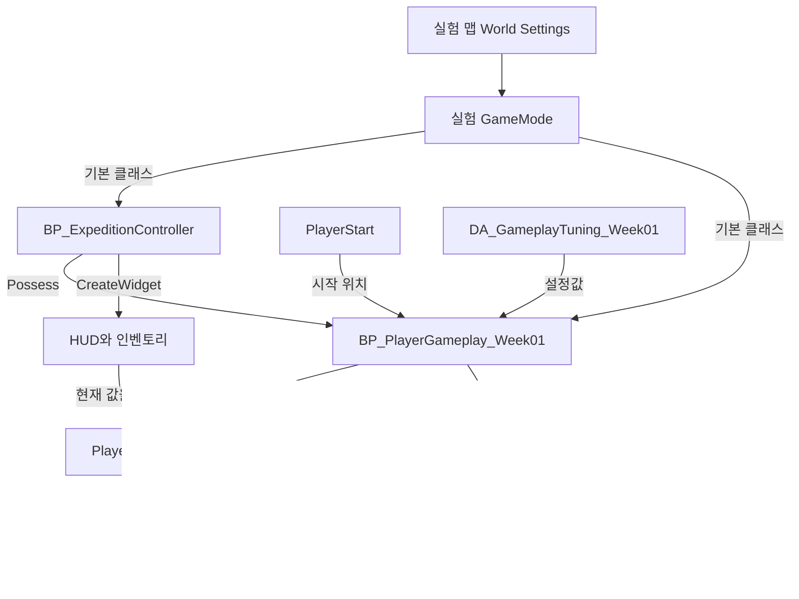

## 이번 주에 실행할 구간

DCB 전환본에서 **플레이어 생성 → 이동 → 가지 채집 → 내려놓기와 재수거 → 귀환 → 새 실행에서 보관함 확인**까지 연결합니다. 이 과정에서 GameMode, Character, Controller, Component, DataAsset, UMG, GameInstanceSubsystem이 맡은 일을 실제 에셋과 함께 살펴봅니다.

기준은 2026년 10월 29일의 DCB 전환본과 Unreal Engine 5.8.4입니다. 에셋 이름과 저장값은 이 시점의 프로젝트를 따릅니다. 메뉴는 영문 이름을 병기하며, 이후 프로젝트에서 값이 바뀌었다면 에디터에 표시된 값을 기록하고 비교합니다. 전체 일정은 [12주 계획](/writing/dcb-unreal-port-study-plan/), 이어지는 글은 [과정 목록](/series/dcb-unreal-port/)에 있습니다.

| 날짜 | 에디터에서 할 일 | 남길 결과 |
| --- | --- | --- |
| 1일차 | 맵·플레이어·밸런스 에셋을 분리하고 저장 슬롯을 지정합니다. | 원본을 참조하는 부분과 바꿔도 되는 부분의 목록 |
| 2일차 | 실제 플레이어와 Controller를 찾고 상태 표시 노드를 만듭니다. | 생성 관계도와 스태미너·적재량 출력 |
| 3일차 | 입력 매핑을 읽고 이동 속도 하나를 바꿉니다. | 변경 전후 설정값과 실행 중 속도 |
| 4일차 | 채집·내려놓기·귀환·저장 불러오기를 비교합니다. | 행동별 아이템 수량과 저장 데이터 |
| 5일차 | 사망 뒤 재출발과 전체 구간을 반복합니다. | 재현 절차 한 건과 2주차의 첫 수정 과제 |

하루 약 2시간을 기준으로 합니다. 처음 보는 개념은 해당 실습 앞에서 읽고, 실습은 Play를 멈춘 상태에서 설정한 뒤 새로 실행합니다.

## 먼저 구분할 객체와 에셋

**Level**은 배치한 Actor와 환경을 저장하는 맵입니다. **World**는 실행 중인 레벨과 Actor가 함께 속한 실행 공간입니다. **Actor**는 World에 배치하거나 생성하는 객체이고, **Component**는 Actor에 붙어 기능을 담당합니다. Component 중 SceneComponent는 위치·회전·크기와 부착 관계를 가집니다. 체력 데이터만 다루는 ActorComponent에는 이런 공간 정보가 필요하지 않습니다.

**Pawn**은 Controller가 조종할 수 있는 Actor입니다. **Character**는 Pawn을 상속하며 캡슐, Skeletal Mesh, CharacterMovement를 갖춘 형태입니다. **Possess**는 Controller가 특정 Pawn을 조종하도록 연결하는 동작입니다. DCB의 플레이어는 `AWandererCharacter`를 상속한 `BP_PlayerGameplay`입니다.

| 개념 | 현재 DCB의 이름 | 맡은 일 |
| --- | --- | --- |
| GameMode | `AExpeditionGameMode` / `BP_ExpeditionGameMode` | 기본 플레이어와 Controller 클래스를 정합니다. |
| PlayerController | `AExpeditionPlayerController` / `BP_ExpeditionController` | Pawn을 조종하고 HUD·인벤토리를 생성하며 입력 모드를 바꿉니다. |
| Character | `AWandererCharacter` / `BP_PlayerGameplay` | 입력을 받아 이동·상호작용·공격을 요청합니다. |
| ActorComponent | `UPlayerStateComponent` | 체력, 스태미너, 지게 상태, 적재 아이템을 보관·계산합니다. |
| DataAsset | `UGameplayTuning` / `DA_GameplayTuning` | 이동 속도·적재 용량·스태미너 규칙의 설정값을 보관합니다. |
| UserWidget | `WBP_GameUI`, `WBP_PlayerInventoryPopup` | 플레이어와 보관함 데이터를 화면에 표시합니다. |
| GameInstanceSubsystem | `UExpeditionSubsystem` | 저장 슬롯과 현재 저장 객체를 관리합니다. |
| SaveGame | `UExpeditionSave` | 보관함 아이템, 성공 귀환 횟수 등 디스크에 기록할 값을 담습니다. |

여기서 `UPlayerStateComponent`는 Character가 소유하는 **ActorComponent**입니다. 엔진의 플레이어별 정보 객체인 `APlayerState`와 이름이 비슷하지만 상속과 수명이 다릅니다. Components 패널에는 `PlayerState`라는 이름으로 나타나고, 블루프린트에서 Character의 `State` 속성으로 접근합니다.

블루프린트는 그래프에 모든 동작이 들어 있어야 하는 에셋이 아닙니다. DCB의 플레이어는 **C++ 부모가 행동을 구현하고, 블루프린트가 메시·입력 에셋·밸런스 에셋 같은 기본값을 연결**합니다. Event Graph가 비어 있어도 부모의 코드로 움직일 수 있습니다. GameMode의 기본 역할과 맵별 설정은 Epic의 [GameMode 설정](https://dev.epicgames.com/documentation/en-us/unreal-engine/setting-up-a-game-mode-in-unreal-engine)을 함께 봅니다.

### 기본값과 실행 중 값

`BP_PlayerGameplay`를 열어 **Class Defaults**에서 보는 값은 앞으로 만들 인스턴스의 기본 설정입니다. 레벨에 배치한 Actor를 선택했을 때 Details에 보이는 값은 그 인스턴스의 설정입니다. Play 중 생성된 Actor는 실행 중 인스턴스이며, 플레이가 끝나면 사라집니다.

예를 들어 가지의 `Count`를 복제한 맵에서 3에서 5로 바꾸면 그 맵에 놓인 가지 Actor의 설정을 바꾼 것입니다. 반면 `DA_GameplayTuning`을 수정하면 그 에셋을 함께 참조하는 플레이어들에게 영향을 줍니다. **맵을 복제해도 참조하는 블루프린트와 DataAsset까지 자동으로 복제되지는 않습니다.** [Blueprint Class Defaults](https://dev.epicgames.com/documentation/unreal-engine/blueprint-editor-defaults-tab?lang=en-US)

## 1일차: 별도 실행 구간을 만듭니다

### 1. 기준 맵과 에셋을 찾습니다

`DCB.uproject`로 에디터를 열고 Content Browser 또는 Content Drawer에서 다음 에셋을 찾습니다. 표의 `/Game/`은 Content Browser의 **Content**에 해당합니다. 검색 결과가 없으면 Content 최상단으로 이동하고 기존 필터를 해제합니다.

| 에셋 | 위치 |
| --- | --- |
| `L_RuntimePort_Validation`, `L_GameScene_01`, `L_GameScene_01_Playable` | `/Game/01_Game/Scenes/` |
| `BP_ExpeditionGameMode` | `/Game/01_Game/Scenes/` |
| `BP_PlayerGameplay` | `/Game/01_Game/Prefabs/Character/Player/` |
| `BP_ExpeditionController`, `WBP_GameUI` | `/Game/01_Game/Prefabs/UI/` |
| `WBP_PlayerInventoryPopup` | `/Game/01_Game/Prefabs/UI/Popups/` |
| `DA_GameplayTuning` | `/Game/01_Game/Balance/` |
| `IMC_Player`, `IA_Move`, `IA_Look` | `/Game/Scripts/GameSystem/InputSystem/GameInputActions/` |

현재 프로젝트를 처음 열 때의 기본 맵은 기존 장면을 변환한 `L_GameScene_01`입니다. 첫 실습에서는 작은 구간인 `L_RuntimePort_Validation`을 엽니다. `L_GameScene_01_Playable`에는 기존 장면과 별도로 배치한 플레이어가 있어, 첫 주의 기본 Pawn 생성 흐름과 구분해서 다룹니다.

검증 맵의 World Outliner에서 다음 Actor를 검색합니다. Actor를 선택하고 뷰포트에서 F를 누르면 해당 위치로 화면을 맞출 수 있습니다. 이때의 F는 **편집 중 화면 맞추기**이며, Play 중 상호작용과는 다른 입력입니다.

| Outliner 이름 | 위치 X, Y, Z | 현재 설정 |
| --- | --- | --- |
| `PlayerStart` | -1200, 0, 110 | 플레이어 시작 지점 |
| `가지 채집` | -700, 0, 60 | `Gather`, `Branch` 3개, 개당 무게 1 |
| `상자 수거` | -100, 180, 60 | `Chest`, `Reed` 3개, 개당 무게 0.5 |
| `지게 메기` | -1100, 300, 60 | 지게 소지·착용 상태 설정 |
| `귀환 · 보관함 저장` | 800, 0, 60 | 귀환과 보관함 저장 |
| `Samurai` | 2600, 0, 110 | 전투·사망을 비교할 적 |

### 2. 맵과 바꿀 에셋을 복제합니다

아래 `Week01` 이름은 이번 실습에서 **새로 만들 이름**입니다.

1. Content Browser에서 `Content/01_Game/Study/Week01` 폴더를 만듭니다.
2. 검증 맵을 연 상태에서 **File → Save Current Level As**로 해당 폴더에 `L_DCB_Week01`을 저장합니다. 이후 열린 맵 이름이 바뀌었는지 확인합니다.
3. Content Browser의 **Duplicate**로 다음 세 에셋을 복제하고, 복제본만 Week01 폴더로 옮깁니다. 이동은 에디터 안에서 처리합니다.
4. `BP_PlayerGameplay_Week01`을 열고 **Class Defaults → Tuning**을 `DA_GameplayTuning_Week01`로 바꿉니다. Components의 PlayerState만 선택해 값을 바꾸지 말고, Character 자체의 기본값을 수정합니다. 시작할 때 Character의 Tuning을 상태 컴포넌트에 전달하기 때문입니다.
5. `BP_ExpeditionGameMode_Week01`의 **Default Pawn Class**를 `BP_PlayerGameplay_Week01`로 바꿉니다. **Player Controller Class**는 기존 `BP_ExpeditionController`를 유지합니다.
6. `L_DCB_Week01`에서 **Window → World Settings → GameMode Override**를 새 GameMode로 지정합니다. 각 블루프린트를 **Compile → Save**하고 맵을 저장합니다.

| 원본 | 복제본 |
| --- | --- |
| `BP_ExpeditionGameMode` | `BP_ExpeditionGameMode_Week01` |
| `BP_PlayerGameplay` | `BP_PlayerGameplay_Week01` |
| `DA_GameplayTuning` | `DA_GameplayTuning_Week01` |

블루프린트가 기본값만 보이는 간단한 창으로 열리면 **Open Full Blueprint Editor**를 선택합니다. Controller·위젯·입력 에셋·모델·애니메이션은 기존 에셋을 함께 참조합니다. 이번에는 내용을 열어 읽기만 합니다. 파일 탐색기에서 `.uasset`을 복사하거나 옮기지 않습니다. [에디터에서 에셋 관리](https://dev.epicgames.com/documentation/en-us/unreal-engine/working-with-assets-in-unreal-engine)

이 맵에서는 GameMode가 PlayerStart에 기본 Pawn을 만들도록 둡니다. 플레이어 블루프린트를 맵에 추가로 끌어놓거나 Auto Possess를 따로 켜면 생성·조종 대상을 혼동할 수 있습니다.

### 3. 실험용 저장 슬롯을 연결합니다

현재 기본 슬롯은 `DCB_Unreal_Expedition_v1`입니다. 맵을 복제해도 이 문자열은 바뀌지 않습니다. 따라서 **첫 Play 전에 복제한 맵의 Level Blueprint에서 실행 중 Subsystem의 Slot을 지정**합니다. 아래 그래프는 이 맵에서 새로 만드는 실습용 설정입니다.

1. `L_DCB_Week01`에서 상단 **Blueprints → Open Level Blueprint**를 엽니다.
2. Event Graph에 **Event BeginPlay**를 추가합니다. 이미 있으면 별도의 BeginPlay를 만들지 말고 기존 실행선에 연결합니다.
3. 빈 곳에서 `Expedition Subsystem`을 검색해 **Get Expedition Subsystem** 노드를 추가합니다. GameInstance Subsystems 분류의 노드이며, 현재 GameInstance에 속한 객체를 반환합니다. 새 Subsystem을 생성하는 노드가 아닙니다.
4. 반환 핀에서 드래그해 **Set Slot**을 만들고 문자열을 `DCB_Study_Week01`로 입력합니다. BeginPlay의 흰 실행선을 Set Slot에 연결합니다.
5. 같은 Subsystem 반환 핀에서 **Load Progress**를 만들고, Set Slot 다음에 실행합니다. 반환 bool을 **Branch**에 연결합니다.
6. True는 **Print String**으로 `Week01 save ready: DCB_Study_Week01`, False는 `Week01 save load failed`를 출력합니다. Print to Log도 켭니다. Compile하고 저장합니다.

```text
Event BeginPlay
  → Set Slot("DCB_Study_Week01")
  → Load Progress
  → Branch(Return Value)
      True  → Print String("Week01 save ready: DCB_Study_Week01")
      False → Print String("Week01 save load failed")

Set Slot과 Load Progress의 Target:
  Get Expedition Subsystem의 반환값
```

`Slot`만 바꾸고 끝내면 메모리에 이미 들어 있는 이전 저장 객체가 남을 수 있습니다. **슬롯 변경 뒤 Load Progress를 실행해 해당 슬롯의 저장 객체로 교체**합니다. Character의 시작 처리도 Load Progress를 호출하므로, 이 절차는 두 Actor의 BeginPlay 실행 순서를 특정 순서라고 가정하지 않습니다. 이 구간의 저장 쓰기는 이후 귀환·사망에서 발생합니다.

새 슬롯이 없으면 빈 SaveGame 객체를 준비하며, 아직 디스크에 기록하지는 않습니다. 첫 Play에서 성공 문구를 확인한 뒤 채집·귀환 실습을 시작합니다. 실패 문구, 노드 오류, 다른 슬롯 값이 보이면 **Stop**하고 설정을 먼저 확인합니다.

이 설정은 복제한 맵의 실행 중 객체에 적용됩니다. Stop 후 원본 맵에서 새로 Play하면 원래 슬롯을 사용합니다. 실험용 맵에서는 다음 실행에도 같은 실험 슬롯을 불러옵니다. 완전히 새 기준이 필요하면 문자열을 `DCB_Study_Week01_B`처럼 새 이름으로 바꾸고 시작 수량을 기록합니다. 기존 저장 파일을 삭제할 필요는 없습니다.

### 4. Play와 관찰 조작을 구분합니다

Play 메뉴에서 **Selected Viewport**, 플레이어 수 **1**, 네트워크 모드 **Standalone**, 시작 위치 **Default Player Start**를 사용합니다. Simulate는 조종하는 Pawn 없이 시뮬레이션을 관찰할 때 쓰므로 이번 첫 실행은 Play로 시작합니다.

| 조작 | 용도 |
| --- | --- |
| 게임 화면 클릭 | 게임 입력 포커스를 가져옵니다. |
| Shift+F1 | 실행을 유지하면서 마우스를 에디터로 돌려줍니다. |
| Pause / Resume | 현재 상태를 멈춰 Details를 읽고 다시 진행합니다. |
| Eject / Possess | 실행 중 캐릭터에서 빠져나와 관찰하고 다시 조종합니다. |
| Stop | PIE 세션을 종료합니다. |

PIE는 **Play In Editor**, 에디터 안에서 게임을 실행하는 방식입니다. 실행 중 Actor에서 바꾼 값이 원본 에셋에 자동 저장되지는 않습니다. 이번에는 Stop 후 복제한 에셋을 수정하고 새 Play로 비교합니다. Esc는 에디터의 PIE 종료 단축키와 겹칠 수 있으므로 인벤토리 실습에서는 I 또는 닫기 버튼을 사용합니다. [Play와 Simulate](https://dev.epicgames.com/documentation/unreal-engine/playing-and-simulating-in-unreal-engine)

## 2일차: 생성된 플레이어와 HUD를 찾습니다

### 1. 클래스 연결을 읽습니다

복제한 GameMode의 Class Defaults에서 Default Pawn Class와 Player Controller Class를 다시 봅니다. 이어서 `BP_ExpeditionController`의 Class Defaults를 읽습니다.

| 확인 위치 | 연결된 값 |
| --- | --- |
| 실험 GameMode → Default Pawn Class | `BP_PlayerGameplay_Week01` |
| 실험 GameMode → Player Controller Class | `BP_ExpeditionController` |
| Controller → Hud Class | `WBP_GameUI` |
| Controller → Inventory Class | `WBP_PlayerInventoryPopup` |
| 실험 Character → Tuning | `DA_GameplayTuning_Week01` |

**GameMode의 HUD Class와 Controller의 Hud Class를 구분합니다.** 현재 GameMode의 HUD Class는 엔진의 `HUD`입니다. DCB의 UMG 화면은 Controller의 C++ `BeginPlay`가 `WBP_GameUI`를 CreateWidget하고 AddToViewport해서 만듭니다. GameMode의 HUD Class 칸에 WBP를 넣는 절차가 아닙니다.



화살표는 생성·소유·참조 관계를 나타냅니다. 모든 객체의 BeginPlay가 위에서 아래로 실행된다는 의미는 아닙니다.

### 2. 실행 중 인스턴스를 살펴봅니다

1. 실험 맵에서 Play하고 슬롯 준비 문구를 확인합니다.
2. Shift+F1을 누르고 Pause합니다. World Outliner에서 `BP_PlayerGameplay_Week01`을 검색해 생성된 Actor를 선택합니다. 실행마다 붙는 숫자 접미사는 달라질 수 있습니다.
3. Details에서 Tuning이 실험용 에셋인지 봅니다. Components에서 Capsule, Mesh, CharacterMovement, CameraBoom, FollowCamera, PlayerState를 구분합니다.
4. PlayerState에서 Health, Stamina, Cargo Weight, Carrying, Gait를 읽습니다. 초기 설정은 최대 체력·스태미너 100, 적재량 0, Carrying 참, Gait Run입니다.
5. CharacterMovement의 Max Walk Speed를 봅니다. 이름은 Walk이지만 현재 CharacterMovement에 적용하는 보행 계열 속도 상한이며, DCB의 Walk·Run·Sprint 상태별 계산 결과가 여기에 들어갑니다.
6. 실행 중 Controller도 찾아 조종 대상이 실험 플레이어인지 확인합니다. 블루프린트 창의 **Debug Object / Debug Filter**를 사용할 때는 같은 클래스의 실제 PIE 인스턴스를 고릅니다.

상태 숫자와 캐릭터 외형은 별도로 봅니다. 현재 모션은 C++에서 클립을 골라 직접 재생합니다. Animation Blueprint의 상태 머신을 연결하는 작업은 4주차입니다.

### 3. 상태를 출력하는 작은 Actor를 만듭니다

Details를 매번 열지 않고 값의 변화를 보기 위해 관찰용 Actor를 하나 만듭니다. 게임 동작은 변경하지 않고 0.5초마다 상태를 읽습니다.

1. Week01 폴더에서 **Blueprint Class → Actor**를 만들고 `BP_Week01Probe`라고 이름을 붙입니다.
2. Event Graph에 **Event BeginPlay → Set Timer by Event**를 연결합니다. Time은 `0.5`, Looping은 참으로 둡니다.
3. Timer의 빨간 Event 핀에서 드래그해 **Add Custom Event**를 만들고 `ReportPlayer`라고 이름을 붙입니다.
4. `Get Player Character`의 Player Index를 `0`으로 둡니다. 반환값을 **Cast To WandererCharacter**의 Object에 연결하고, ReportPlayer 실행선을 Cast에 연결합니다.
5. Cast 성공 결과에서 **Get State**를 꺼냅니다. State에서 **Get Stamina**, **Get Cargo Weight**, **Move Speed**를 꺼냅니다.
6. **Format Text**의 Format에 `Stamina={S} / Cargo={C} / SpeedLimit={V}`를 입력하고 생긴 S·C·V 핀에 세 값을 연결합니다. 출력은 **Print String**의 In String에 연결하고, Cast 성공 실행선을 Print String에 연결합니다. 필요한 Text→String 변환은 연결 시 추가합니다.
7. Print String의 Duration은 `0.6`, Print to Screen은 참으로 둡니다. 반복 로그가 필요하지 않으면 Print to Log는 끕니다. Cast Failed는 `Player not ready`를 출력하도록 연결합니다.
8. Compile·Save한 뒤 Actor를 실험 맵에 하나 배치합니다. Play해서 정지·이동·채집 때 숫자가 어떻게 변하는지 봅니다.

Timer를 쓰면 첫 순간에 플레이어를 얻지 못해도 다음 호출에서 다시 찾습니다. Blueprint 디버거에서 노드 핀을 **Watch this value**로 추가하면 그 노드가 실행될 때의 값을 볼 수 있습니다. 값이 계속 갱신되지 않는다면 디버그 대상과 해당 실행선부터 확인합니다. [Blueprint 디버거](https://dev.epicgames.com/documentation/en-us/unreal-engine/blueprint-debugger-in-unreal-engine)

`Move Speed`는 현재 상태가 계산한 목표 속도입니다. 실제 이동 속도와 비교하려면 Character에서 **Get Velocity → Vector Length XY**를 추가해 출력합니다. 정지 중에는 목표 속도가 0이 아니어도 실제 속도는 0일 수 있습니다. 가속 중이거나 벽에 막혔을 때도 두 값은 다릅니다.

하루가 끝나면 PlayerState를 누가 소유하는지, HUD를 누가 생성하는지, 출력한 값이 설정값인지 현재 상태인지 설명해 봅니다.

## 3일차: 입력과 이동 속도를 연결합니다

### 1. 현재 입력 에셋을 읽습니다

**Input Action**은 이동·상호작용 같은 행동의 입력값과 트리거 조건을 정의합니다. **Input Mapping Context**는 키나 축을 Action에 연결합니다. Context 에셋이 존재하는 것만으로 입력이 활성화되지는 않습니다. 현재 플레이어는 로컬 플레이어의 Enhanced Input Subsystem에 `InputContext`를 추가하고, C++ `SetupPlayerInputComponent`에서 Action과 함수를 연결합니다. [Enhanced Input](https://dev.epicgames.com/documentation/en-us/unreal-engine/enhanced-input-in-unreal-engine)

1. 실험 Character의 Class Defaults에서 Input Context가 `IMC_Player`인지 봅니다.
2. Input Actions 맵에서 `Move` 키가 `IA_Move`, `Interaction`이 `IA_Interaction`을 가리키는지 봅니다. 이 이름은 C++에서 Action을 찾는 키입니다.
3. `IMC_Player`를 열고 **Default Key Mappings → Mappings**를 펼칩니다. `IA_Move`의 W·A·S·D 항목과 Modifier를 살펴봅니다.
4. `IA_Move`의 값 형식이 2차원 축인지 확인합니다. W에는 축 순서를 바꾸는 Swizzle, S에는 Swizzle과 부호를 바꾸는 Negate, A에는 Negate가 연결되어 있습니다. D는 양의 X 입력을 사용합니다. 이렇게 키 하나의 값을 2차원 이동 방향으로 조합합니다.

| 키 또는 장치 | 현재 처리 | 관찰할 점 |
| --- | --- | --- |
| WASD / 방향키 | 이동 | 입력 방향과 실제 속도를 나눠 봅니다. |
| 왼쪽 Shift | 누르는 동안 질주 | 떼면 걷기 토글 상태에 따라 Walk 또는 Run으로 돌아갑니다. |
| 왼쪽 Ctrl | 걷기 토글 | 한 번 누르고 떼어도 상태가 유지됩니다. |
| G | 지게 착용 상태 토글 | 초기 Carrying은 참이므로 처음 누르면 벗는 상태가 됩니다. |
| F | 가까운 대상과 상호작용 | 현재 Interaction Action의 키입니다. |
| 마우스 왼쪽 / Space | 공격 / 회피 | 첫 주에는 연결과 스태미너 변화만 봅니다. |
| I | 인벤토리 전환 | 커서, 이동·시점 입력 무시 상태를 봅니다. |
| 사망 뒤 R | 캠프에서 재출발 | 살아 있을 때의 레벨 재시작 키가 아닙니다. |
| 게임패드 오른쪽 스틱 | 시점 조작 | 현재 `IA_Look`에 연결된 축입니다. |

현재 `IA_Look`의 매핑에는 게임패드 오른쪽 스틱이 있고, 마우스 축은 연결되어 있지 않습니다. `MousePosition` Action이 별도로 있어도 플레이어가 그것을 시점 함수에 바인딩한 상태는 아닙니다. 따라서 마우스를 움직여 시점이 바뀔 것이라고 전제하지 않습니다. 마우스 시점 입력은 2주차에서 별도 Context를 만들고 연결할 과제로 남깁니다.

검증 맵의 상호작용 Prompt에는 `E · 가지 채집` 같은 원본 문자열이 남아 있습니다. 현재 Character는 HUD용 안내를 만들 때 앞의 `E ·`를 `F ·`로 바꿉니다. **저장된 문구, 표시 문구, 실제 매핑을 각각 확인**해야 하는 예입니다. Input Actions 목록에 LockOn·Parry 등이 있어도 현재 C++에 해당 바인딩이 없으면 그 행동이 연결된 것은 아닙니다.

W 입력의 경로는 다음과 같습니다.

```text
W → IMC_Player → IA_Move
  → SetupPlayerInputComponent의 Move 바인딩
  → Move / SetMoveInput에서 방향 저장
  → Character Tick에서 AddMovementInput
  → CharacterMovement가 가속·충돌을 반영해 이동
```

키를 놓으면 Move의 Completed 바인딩으로 입력값을 갱신합니다. 입력 요청이 사라지는 시점과 실제 속도가 감속해 0이 되는 시점은 다를 수 있습니다.

### 2. 밸런스 값 하나만 바꿉니다

현재 `DA_GameplayTuning`의 Bare Speeds는 약 `(112, 240, 360)`, Carry Speeds는 `(150, 300, 650)`입니다. 이 Vector는 위치가 아닙니다. **X=Walk, Y=Run, Z=Sprint** 세 속도를 담는 용도로 사용합니다. Capacity는 30입니다.

지게를 멘 상태에서는 적재량을 용량으로 나눈 비율로 Cargo Speed 곡선을 읽고, 선택한 기본 속도에 곱합니다. Character는 매 Tick마다 `State.MoveSpeed()`를 계산해 CharacterMovement의 `MaxWalkSpeed`에 넣습니다. 따라서 **CharacterMovement의 Max Walk Speed 기본값만 수정하면 실행 중 다시 덮어씁니다.**

1. Stop한 뒤 `DA_GameplayTuning_Week01`의 Carry Speeds Y 값을 기록합니다. 현재 기준은 `300`입니다.
2. 새 Play에서 G·Ctrl·Shift를 누르지 않고 짐이 없는 상태를 유지합니다. Probe 또는 PlayerState에서 Carrying=true, Gait=Run, Cargo Weight=0을 확인합니다.
3. 벽과 상호작용 Actor가 없는 평지에서 W로 이동합니다. 목표 속도와 실제 평면 속도, 키를 놓은 뒤 감속을 적습니다. 너무 오래 달려 스태미너가 0이 되면 상태가 바뀔 수 있으므로 짧게 비교합니다.
4. Stop합니다. **복제한 DataAsset의 Carry Speeds Y만 `150`으로** 바꾸고 저장합니다.
5. 같은 조건으로 새 Play합니다. 목표 속도가 변경됐는지 보고 실제 속도가 그 값에 접근하는지 비교합니다.
6. Stop하고 Y를 기록한 원래 값으로 복원합니다. 원본 `DA_GameplayTuning`은 수정하지 않았는지 확인합니다.

| 조건 | Carry Speeds Y | 목표 속도 | 실제 평면 속도 |
| --- | --- | --- | --- |
| 변경 전: Carrying / Run / 짐 0 | 300 | 직접 기록 | 직접 기록 |
| 변경 후: 같은 상태 | 150 | 직접 기록 | 직접 기록 |
| 복원 후: 같은 상태 | 300 | 직접 기록 | 직접 기록 |

기본 곡선에서 짐 0의 배율은 1이므로 목표 속도는 300에서 150으로 바뀌는 조건입니다. 짧은 시간에 이동한 거리까지 정확히 절반이 된다고 단정하지 않습니다. 가속·감속·충돌과 입력 시간이 함께 작용하기 때문입니다.

값이 안 바뀌면 **현재 Pawn 클래스 → Character의 Tuning → Carrying/Gait/짐 무게 → 실제 속도와 목표 속도의 구분** 순서로 봅니다. G로 지게를 벗으면 Bare Speeds가 선택되므로 Carry Speeds만 고친 실험과 조건이 달라집니다.

## 4일차: 채집·HUD·저장을 비교합니다

### 1. 가지 3개의 흐름을 따라갑니다

실험 슬롯 준비 문구를 확인한 새 실행에서 시작합니다. 인벤토리의 보관함 수량은 이전 실행의 영향을 받으므로 먼저 기록합니다. 이번에는 상자를 건드리지 않고 Branch만 비교합니다.

1. 초기 지게 착용 상태에서 `가지 채집` 가까이 이동하고 F를 누릅니다. 현재 설정대로라면 Branch가 3개, Cargo Weight가 3이 되는 조건입니다.
2. 같은 가지에 다시 F를 눌렀을 때 수량이 계속 늘어나는지 확인합니다. 수거 성공 시 해당 Actor는 consumed 상태가 되고 충돌을 끕니다. 종류에 따라 숨기거나 열림 모션을 재생합니다.
3. I로 인벤토리를 엽니다. 현재 아이템 목록에서 가지를 선택하고 **선택 물건 1개 내려놓기**를 누릅니다. Branch 2개, 무게 2가 되는지 봅니다.
4. 인벤토리를 닫고 떨어진 아이템에 접근해 F로 재수거합니다. Branch 3개, 무게 3으로 돌아오는지 봅니다. 현재 내려놓기 메시에는 임시 표시가 사용될 수 있으므로 원래 가지 외형만 찾아다니지 않습니다.
5. 짐을 가진 상태에서 G로 지게를 벗었다가 다시 멥니다. **지게 착용 상태와 적재 목록은 별개**입니다. G를 눌렀다는 이유만으로 아이템 목록을 비우는 코드는 없습니다.

채집이 안 되면 Carrying 상태부터 봅니다. 시작부터 G를 한 번 누르면 지게를 벗으므로 `지게를 먼저 메세요` 안내가 나올 수 있습니다. 다시 G를 누르거나 지게 Actor와 상호작용해 상태를 확인합니다.

현재 상호작용은 화면 중앙 조준점에서 Raycast한 대상을 고르지 않습니다. 플레이어 위치에서 **Interaction Reach 250 이내의 가장 가까운 상호작용 Actor**를 찾습니다. 3차원 거리를 사용하므로 높이 차이도 포함됩니다. 대상이 겹치면 안내가 다른 대상으로 바뀔 수 있습니다. Outliner에서 가지·상자의 시각용 자식 대신 `RuntimeInteractable`인 부모 Actor의 Kind, Item, Count, Unit Weight를 확인합니다.

### 2. UI의 표시와 상태 보관을 나눕니다

현재 Controller는 인벤토리를 처음 열 때 위젯을 만들고, 이후에는 Visible과 Collapsed를 전환합니다. 열면 커서를 표시하고 이동·시점 입력을 무시하며 Game and UI 입력 모드를 사용합니다. 닫으면 Game Only로 돌아갑니다.

위젯은 `SourceUserWidget` C++ 부모의 NativeTick에서 플레이어 상태와 보관함을 읽습니다. 상태 컴포넌트에 `Changed` Delegate가 있다는 사실만으로 현재 HUD가 그 이벤트에 연결됐다고 해석하지 않습니다.

I로 닫았다 다시 열어도 Branch 수량이 유지되는 이유는 아이템이 위젯에만 보관되지 않기 때문입니다. 원본 위젯의 Designer를 열었는데 실행 중 목록·내려놓기 버튼이 보이지 않을 수도 있습니다. 일부 UI는 NativeConstruct에서 추가됩니다. 고정 장식 아이콘보다 **실행 중 아이템 이름·수량·적재량 표시**를 기준으로 비교합니다.

### 3. 귀환과 새 실행을 비교합니다

1. 인벤토리를 닫고 `귀환 · 보관함 저장` 가까이 이동해 F를 누릅니다.
2. 귀환 성공 문구와 캠프 위치 복귀를 확인합니다. 현재 동작은 같은 맵의 `CampLocation`으로 이동하는 방식입니다. 새 로비 맵을 여는 동작은 8주차에 연결합니다.
3. 적재 목록이 비었는지 보고 보관함의 Branch 수량이 실행 전보다 3 늘었는지 확인합니다. 성공 귀환 횟수도 1 증가하는 조건입니다.
4. Stop하고 같은 실험 맵을 다시 Play합니다. 같은 실험 슬롯을 읽은 뒤 보관함 수량이 유지되는지 봅니다.
5. 새 실행에서는 플레이어 적재 목록이 비고, 맵의 가지 Actor는 다시 배치된 상태로 시작하는지 비교합니다. 현재 저장에는 맵별 채집 완료 상태를 복원하는 처리가 없습니다.

**GameInstanceSubsystem은 GameInstance의 수명을 따라 유지**됩니다. 레벨 전환 중 공유할 데이터를 관리하는 데 사용할 수 있지만 PIE를 끝내면 해당 실행의 객체도 끝납니다. **SaveGame 객체는 저장할 데이터의 형식**이며, 디스크 저장 함수를 호출해야 다음 실행에 남습니다. [Subsystem](https://dev.epicgames.com/documentation/en-us/unreal-engine/programming-subsystems-in-unreal-engine), [SaveGame 저장과 불러오기](https://dev.epicgames.com/documentation/unreal-engine/saving-and-loading-your-game-in-unreal-engine?lang=en-US)

현재 귀환 처리는 기존 SaveGame을 복제해 결과를 반영하고 디스크 저장을 요청합니다. 저장이 성공한 뒤 현재 저장 객체를 교체하고 플레이어의 짐을 비웁니다. 저장 실패 시 짐이 지워졌다고 전제하지 말고 반환값과 상태 문구를 확인합니다.

| 항목 | 인벤토리 닫기 | 귀환 저장 성공 | Stop 후 새 Play |
| --- | --- | --- | --- |
| 플레이어 적재 목록 | 유지 | 보관함에 합산한 뒤 비움 | 빈 목록으로 시작 |
| 보관함 Stored Items | 유지 | 귀환한 아이템 추가 | 같은 슬롯에서 불러옴 |
| 성공 귀환 횟수 | 유지 | 1 증가 | 같은 슬롯에서 불러옴 |
| 맵의 수거 완료 Actor | 유지 | 같은 맵이므로 현재 상태 유지 | 맵의 초기 배치로 시작 |
| 플레이어 체력·스태미너 | 게임 진행에 따라 변화 | 현재 값을 저장 객체에 기록 | 현재 구현은 Tuning의 최대값으로 초기화 |

마지막 행을 따로 확인합니다. 저장 객체에 Health와 Stamina 필드가 있어도, 다음 Character가 그 값을 적용하는 코드가 있어야 복원됩니다. 현재 시작 처리는 Tuning으로 상태를 초기화합니다. **저장 파일에 들어간 값과 새 플레이어에게 실제 적용한 값은 서로 다른 단계**입니다.

보관함과 횟수를 노드로 직접 읽으려면 2일차 Probe에서 Character의 **Get Expedition Progress → Get Save**로 접근합니다. Save가 유효한지 **Is Valid**로 확인한 뒤 Successful Returns를 출력합니다. Stored Items는 Name→Integer 맵이므로 **Find**의 Key를 `Branch`로 지정하고, 키가 없을 때는 0으로 기록합니다. 새 슬롯부터 시작했다고 가정해 기존 수량을 0으로 덮어쓰지는 않습니다.

## 5일차: 실패 경로를 반복합니다

### 1. 사망과 재출발을 비교합니다

기존 성공 기록을 유지한 실험 슬롯에서 새로 Play합니다. 보관함 Branch 수량과 성공 귀환 횟수를 적고, 가지를 다시 채집한 뒤 Samurai 쪽으로 이동합니다. 이번에는 귀환하지 않고 적에게 피해를 받아 사망하는 경로를 봅니다.

현재 사망 처리는 실패 결과를 저장하고, 디스크 저장 성공 시 들고 있던 짐을 비웁니다. **보관함에 짐을 추가하거나 성공 귀환 횟수를 올리지는 않습니다.** 이후 R을 누르면 상태를 초기화하고 캠프 위치로 돌아옵니다. 레벨 전체를 다시 불러오는 함수가 아니므로 이미 수거한 Actor가 이때 다시 생성된다고 예상하지 않습니다.

| 비교 항목 | 귀환 성공 | 사망 후 실패 저장 성공 |
| --- | --- | --- |
| 들고 온 아이템의 보관함 합산 | 합산 | 합산하지 않음 |
| 성공 귀환 횟수 | +1 | 유지 |
| 플레이어 적재 목록 | 비움 | 비움 |
| 캠프로 돌아오는 시점 | 귀환 처리 | 사망 후 R로 재출발 |

공격 모션과 실제 피해가 발생하는 시점도 따로 관찰합니다. 현재 공격 판정은 즉시 충돌 검사로 처리하며, 모션과 판정 시간을 맞추는 작업은 5주차에서 진행합니다.

### 2. 전체 구간을 한 번 더 실행합니다

속도 값을 복원한 뒤 **새 Play → 슬롯 확인 → 이동 → 채집 → I로 수량 확인 → 1개 내려놓기 → 재수거 → 귀환 → Stop → 새 Play → 보관함 확인** 순서로 반복합니다. 반복 출정으로 늘어나는 값은 절대 수량보다 실행 전후 차이로 비교합니다.

다음 양식에는 직접 관찰한 값만 적습니다. 표의 성공·실패 예상은 구현 경로를 설명하는 것이며, 실행 기록을 대신하지 않습니다.

```text
맵 / Pawn 클래스 / Tuning 에셋:
저장 슬롯 / 실행 전 Branch 보관량 / 성공 귀환 횟수:
시작 상태: Carrying / Gait / Cargo Weight
누른 키와 순서:
변경한 값과 복원 여부:
예상한 변화:
실제 변화:
예상과 달라진 첫 단계:
다음에 바꿀 한 가지:
```

다음 주의 첫 과제는 **마우스 시점 입력 연결**로 잡을 수 있습니다. `IMC_Player`의 복제본에 마우스 축을 연결하고, Character의 Input Context를 교체한 뒤 감도·상하 방향·UI 진입 시 입력을 비교합니다. 이번 반복에서 질주 중 인벤토리 열기·닫기로 입력 상태가 어긋나는 문제가 재현됐다면 그 재현 절차부터 다룹니다.

## 막혔을 때 확인할 곳

| 증상 | 먼저 볼 곳 |
| --- | --- |
| Expedition 클래스나 속성이 검색되지 않습니다. | DCB C++ 모듈을 로드한 프로젝트인지 확인합니다. 일반 Third Person 템플릿에는 이 클래스가 없습니다. Compile 오류가 있으면 먼저 해당 오류를 해결합니다. |
| 다른 Pawn이 생성됩니다. | 열린 맵, World Settings의 Override, 실험 GameMode의 Default Pawn Class, 별도로 배치한 Pawn과 Auto Possess를 봅니다. |
| 게임이 실행되지만 키가 먹지 않습니다. | 게임 뷰 포커스, Possession, Input Context, UI의 이동 입력 무시 상태를 확인합니다. |
| 마우스로 시점이 움직이지 않습니다. | 현재 IA_Look은 오른쪽 스틱 매핑입니다. MousePosition 에셋 유무와 시점 바인딩을 혼동하지 않습니다. |
| HUD가 안 보입니다. | GameMode의 HUD Class 대신 Controller의 Hud Class와 실제 Controller 클래스를 봅니다. |
| Max Walk Speed를 바꿔도 원래 속도입니다. | Tick에서 다시 계산합니다. Character가 참조하는 Tuning과 현재 Gait·Carrying을 봅니다. |
| 채집 대상이 보이는데 F가 반응하지 않습니다. | 지게 상태, 상호작용 거리·높이 차이, consumed, UI 입력 차단, 현재 안내 대상을 봅니다. |
| 인벤토리 Designer와 실행 화면이 다릅니다. | SourceUserWidget의 NativeConstruct에서 추가한 런타임 목록·버튼을 구분합니다. |
| 새 실행의 보관함이 기대와 다릅니다. | 슬롯 이름, Load Progress 성공 여부, 귀환 전후 수량 차이, 디스크 저장 결과를 봅니다. |
| 화면의 Probe 값이 멈춰 있습니다. | Pause 여부, Timer 연결, Cast 성공, 선택한 디버그 인스턴스를 확인합니다. |

## 연결을 설명해 봅니다

**맵만 복제했는데 왜 원본 플레이 속도도 바뀔 수 있나요?** 같은 DataAsset을 참조하면 그 설정을 함께 읽습니다. 이번에는 GameMode·Character·Tuning을 복제하고 연결을 바꿨습니다.

**Event Graph가 비어 있는데 플레이어가 움직이는 이유는 무엇인가요?** C++ 부모의 입력 바인딩과 Tick이 실행됩니다. 블루프린트는 이 코드에 필요한 에셋과 기본값을 연결합니다.

**HUD Class라는 칸은 왜 두 곳에 있나요?** GameMode의 칸은 엔진 HUD Actor 클래스이고, 현재 DCB Controller의 같은 이름 속성은 직접 만든 UserWidget 클래스 참조입니다. 타입과 사용처를 함께 봐야 합니다.

**게임을 끄면 Subsystem의 데이터는 어디에 남나요?** 실행 중 객체는 사라집니다. 이 프로젝트가 SaveGameToSlot에 성공해 기록한 데이터만 같은 슬롯에서 다시 읽을 수 있습니다.

**체력을 저장했는데 새 실행은 왜 최대 체력인가요?** 저장 형식에 필드가 있는 것과 새 Character에 적용하는 처리는 별개입니다. 현재 시작 처리는 Tuning의 최대 체력을 사용합니다.

관련 소스는 `ExpeditionGameMode`, `ExpeditionPlayerController`, `WandererCharacter`, `PlayerStateComponent`, `GameplayTuning`, `RuntimeInteractable`, `ExpeditionSave`, `SourceUserWidget` 순서로 찾아봅니다. 전체 파일을 한 번에 읽기보다 **방금 누른 입력 → 바뀐 값 → 그 값을 표시하거나 저장한 함수**를 연결합니다. 기본값과 객체 수명이 헷갈리면 [UObject와 리플렉션](/writing/unreal-uobject-reflection/), [객체 수명과 GC](/writing/unreal-object-lifetime-gc/)의 예제를 함께 봅니다.

기존 모델·애니메이션은 전환본에서 재사용하는 자산입니다. 이 글의 프로젝트 연결 분석, 개념 설명과 실습 절차 작성에는 Codex를 사용했습니다.
