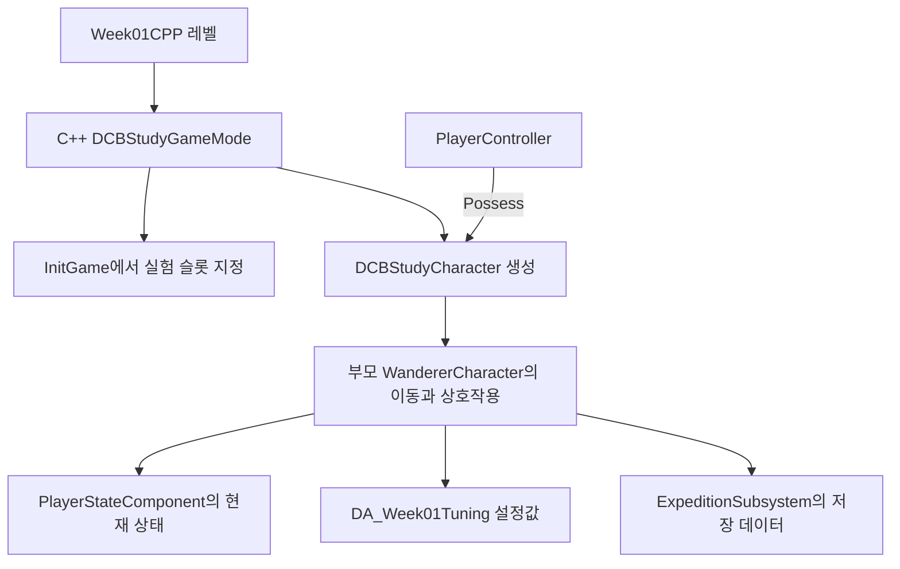

## 이번 주에 만들 파일과 실행 화면

Unity에서 C# 스크립트를 작성하고 Inspector에서 값을 바꾸던 흐름을 언리얼 C++로 옮깁니다. **C++ 파일 작성 → 빌드 → 에디터에서 배치·설정 → Play → 값과 호출 확인**을 반복합니다. 언리얼을 처음 실행하는 사람도 각 단계에서 선택할 창과 입력할 값을 찾을 수 있도록 순서를 나눴습니다.

먼저 회전하며 문구를 출력하는 Actor를 만듭니다. 그다음 실제 DCB의 `AWandererCharacter`를 상속해 이동·지게·스태미너 로직을 사용하고, C++ GameMode로 플레이어를 생성합니다. 마지막에는 가지를 줍고 귀환해 보관함을 다음 실행에서 확인합니다.

이 글에서는 Blueprint 클래스, Event Graph, Level Blueprint를 만들지 않습니다. 게임 동작과 연결 코드는 C++에 작성합니다. 에디터는 **맵 배치, 데이터 에셋 편집, 실행과 관찰**에 사용합니다. Input Action과 Data Asset을 에디터에서 여는 것은 Blueprint 그래프를 작성하는 작업과 다릅니다.

| 날짜 | 직접 할 일 | 남는 결과물 |
| --- | --- | --- |
| 1일차 | DCB를 빌드하고 바닥·빛·시작 위치를 배치합니다. | `L_DCB_Week01_CPP` 맵 |
| 2일차 | C++ Actor를 작성하고 인스턴스별 문구·회전 속도를 바꿉니다. | `DCBStudyMarker.h/.cpp` |
| 3일차 | DCB 캐릭터를 상속하고 GameMode에서 생성합니다. | `DCBStudyCharacter.h/.cpp`, `DCBStudyGameMode.h/.cpp` |
| 4일차 | C++ Timer로 상태를 보고 데이터 에셋으로 속도를 바꿉니다. | `DA_Week01Tuning`, 속도 비교 메모 |
| 5일차 | C++ 상호작용 Actor를 배치해 채집·귀환·저장을 따라갑니다. | 가지·귀환 지점과 한 차례의 실행 동선 |

하루 약 2시간으로 나눠 진행합니다. 빌드 환경을 처음 준비한다면 1일차를 더 길게 잡습니다. 전체 순서는 [C++ 중심의 12주 계획](/writing/dcb-unreal-port-study-plan/), 주차 목록은 [DCB 언리얼 전환 과정](/series/dcb-unreal-port/)에서 이어 갑니다.

### 시작 조건과 기존 1주차에서 넘어오는 방법

2026년 10월 29일의 Unreal DCB, **UE 5.8.4·Windows·Visual Studio**를 기준으로 합니다. Unity 프로젝트나 새 Third Person 템플릿이 아니라, `DCB.uproject`와 `Source/DCB`가 있는 현재 전환본을 엽니다. C#의 변수·조건문·함수·클래스는 알고 있다고 가정하고, 언리얼에서 새로 만나는 C++ 표기와 엔진 동작을 설명합니다.

이전 Blueprint 방식의 실습을 했다면 `BP_Week01Marker`나 `L_DCB_Week01`을 고쳐 쓰지 않고 아래의 **Week01CPP** 맵을 새로 만듭니다. 이전 맵의 Level Blueprint와 플레이어 참조가 새 실행에 섞이는 일을 피할 수 있습니다. 기존 실습 파일은 그대로 두어도 됩니다.

완성 화면의 플레이어는 **세로로 긴 큐브**입니다. 원래 캐릭터 모델과 UMG 화면은 기존 Blueprint 설정을 참조하므로, 이번에는 엔진 기본 메시와 C++ 화면 출력으로 생성·이동·상태의 연결을 먼저 봅니다. 다음 주의 마우스 시점 작업도 이 C++ 캐릭터에서 이어 갑니다.

## 1일차: 빌드와 에디터의 기본 흐름

### 실습 1. 수정하기 전에 현재 DCB를 빌드합니다

Unity에서는 `.cs`를 저장하면 에디터가 스크립트를 다시 컴파일합니다. 언리얼 C++에서는 **어떤 대상과 설정으로 빌드할지**도 확인해야 합니다. 이 글에서는 에디터가 사용할 게임 모듈을 만드는 `Development Editor` 설정을 사용합니다.

1. Visual Studio Installer에서 **Game development with C++** 작업과 프로젝트에 맞는 MSVC·Windows SDK가 설치되어 있는지 확인합니다. Visual Studio의 C# 작업만 설치한 상태로는 C++를 빌드할 수 없습니다. [Microsoft의 설치 안내](https://learn.microsoft.com/en-us/visualstudio/gamedev/unreal/get-started/vs-tools-unreal-install)
2. 열려 있는 언리얼 에디터에서 필요한 변경을 저장하고 에디터를 종료합니다.
3. 프로젝트 폴더의 `DCB.sln`을 Visual Studio로 엽니다. 솔루션이 없거나 새 파일이 보이지 않으면 탐색기에서 `DCB.uproject`를 우클릭하고 **Generate Visual Studio project files**를 실행합니다. Windows 11에서는 **추가 옵션 표시** 안에 있을 수 있습니다.
4. Visual Studio 상단의 **Solution Configuration**을 `Development Editor`, **Solution Platform**을 `Win64`로 설정합니다.
5. **Solution Explorer → Games → DCB**에서 게임 프로젝트를 우클릭하고 **Build**를 선택합니다. 엔진 전체를 다시 빌드하는 명령과 구분합니다.
6. **View → Output**에서 출력 종류를 **Build**로 고릅니다. 빌드가 성공한 다음 `DCB.uproject`를 다시 엽니다.

**확인할 것:** 기존 프로젝트가 빌드되고 에디터가 열려야 다음 단계로 갑니다. 실패했다면 아직 새 예제 코드를 추가하지 말고 Output의 **첫 번째 실제 오류**부터 봅니다. 마지막의 `MSB3073`이나 종료 코드만으로 원인을 판단하지 않습니다.

이 글에서 새 클래스·멤버·컴포넌트를 추가할 때는 **저장 → 에디터 종료 → Build → 다시 열기**를 반복합니다. Live Coding은 실행 중 코드를 다시 반영하는 별도 기능입니다. 특히 `.cpp` 생성자 기본값을 바꿔도 이미 만들어진 객체에 그대로 적용되지 않을 수 있어, 첫 주에는 재시작을 포함한 절차를 사용합니다. Live Coding을 끄고 Hot Reload로 바꾸라는 뜻은 아닙니다. [Epic의 Live Coding 설명](https://dev.epicgames.com/documentation/unreal-engine/using-live-coding-to-recompile-unreal-engine-applications-at-runtime)

### 실습 2. 창과 파일의 역할을 찾습니다

`DCB.uproject`를 열고 아직 Play는 누르지 않습니다. 아래 창을 차례로 찾아 봅니다.

| Unity에서 사용하던 것 | 언리얼에서 사용할 것 | 지금 확인할 내용 |
| --- | --- | --- |
| Project | Content Browser / Content Drawer | 메시·입력·데이터·맵 에셋을 찾습니다. |
| Hierarchy | World Outliner | 현재 맵에 배치된 Actor를 고릅니다. |
| Inspector | Details | 선택한 인스턴스의 위치·속성을 봅니다. |
| Scene 뷰 | Level Viewport | 맵을 편집하는 화면입니다. |
| Console | Output Log | `UE_LOG`로 출력한 문구를 봅니다. |
| C# 파일과 Assembly Definition | `.h/.cpp`와 모듈의 `.Build.cs` | 선언·구현·모듈 의존성을 나눠 봅니다. |

1. 하단의 **Content Drawer**를 누르거나 **Ctrl+Space**를 누릅니다. 계속 열어 둘 창은 **Window → Content Browser → Content Browser 1**로 엽니다.
2. **Window → World Outliner**, **Window → Details**에서 배치 목록과 속성 창을 엽니다.
3. **Window → Developer Tools → Output Log**로 출력 창을 엽니다. 레이아웃에 따라 하단 Output Log 버튼으로 열 수도 있습니다.
4. 탐색기에서 프로젝트의 `Source/DCB`를 엽니다. `DCB.Build.cs`와 `Gameplay` 폴더를 찾습니다.
5. Visual Studio에서 `Gameplay/WandererCharacter.h`와 `.cpp`를 열고, 헤더에는 클래스 선언, cpp에는 `AWandererCharacter::BeginPlay` 같은 함수 구현이 있다는 점만 먼저 확인합니다.

`/Game/`은 에디터의 **Content**에 대응하는 에셋 경로입니다. `Source/DCB`는 C++ 소스가 있는 실제 폴더입니다. Content Browser의 **C++ Classes** 항목은 컴파일된 클래스를 보여 주는 입구이며, `.uasset` 파일을 만드는 폴더가 아닙니다.

### 실습 3. Blueprint가 없는 작은 맵을 만듭니다

1. **File → New Level → Empty Level**을 선택합니다. 다른 장면의 저장 여부를 물으면 작업한 내용을 먼저 정리합니다.
2. Content Browser의 **Content → 01_Game** 아래에 `Study`, 그 아래에 `Week01CPP` 폴더를 만듭니다.
3. **File → Save Current Level As**로 `/Game/01_Game/Study/Week01CPP/L_DCB_Week01_CPP`에 저장합니다.
4. **Window → Place Actors**에서 `Cube`를 검색해 레벨로 끌어다 놓습니다. Outliner 이름을 `StudyFloor`로 바꿉니다.
5. Details의 Transform을 **Location `(0, 0, -50)`**, **Rotation `(0, 0, 0)`**, **Scale `(40, 40, 1)`**로 설정합니다. 기본 Cube의 높이는 100cm이므로 윗면이 Z=0인 바닥이 됩니다. Static Mesh Component의 Collision Presets는 `BlockAll`로 확인합니다.
6. Place Actors에서 **Directional Light**를 추가하고 Rotation을 `(0, -45, 0)`으로 입력합니다. 펼쳐진 축 이름이 **X=Roll, Y=Pitch, Z=Yaw**인지 확인합니다. 빛의 방향이 바닥을 향하도록 Y/Pitch를 음수로 둡니다.
7. Place Actors에서 **Player Start**를 추가합니다. Location은 `(0, 0, 110)`, Rotation은 `(0, 0, 0)`으로 둡니다. 바닥 위에 떠 있는 시작 지점입니다.
8. **Window → World Settings → GameMode Override**에서 엔진의 네이티브 **GameModeBase**를 선택합니다. 프로젝트 기본 GameMode를 따라가는 `None`과 구분합니다. 3일차에 우리가 만든 클래스로 바꿉니다.
9. **Ctrl+S**로 맵을 저장합니다.

지금 만드는 맵에는 하늘 배경이나 기존 DCB 장면이 없어도 됩니다. Viewport를 **Lit**으로 두고 바닥이 보이는지 확인합니다. 화면이 어두우면 Directional Light의 회전과 표시 여부부터 봅니다. 검은 배경 자체는 바닥이 없는 상태를 뜻하지 않습니다.

언리얼의 기본 길이 단위는 cm이고 **X 전방·Y 오른쪽·Z 위쪽**입니다. Unity의 기본적인 Y 위쪽 좌표 사용과 구분합니다. 이동 도구 **W**, 회전 **E**, 크기 **R**은 에디터 조작입니다. 게임을 실행한 뒤의 WASD 입력과는 다른 기능입니다.

## 2일차: C++ Actor를 직접 작성합니다

### 실습 4. 두 파일을 만들고 전체 코드를 입력합니다

Unity에서는 Cube에 `MonoBehaviour`를 붙이는 방식이 익숙합니다. 여기서는 **메시 컴포넌트를 가진 Actor 클래스**를 작성하고 그 Actor 자체를 맵에 배치합니다. `AActor`와 `MonoBehaviour`를 같은 종류로 외우기보다, Actor가 배치 단위이고 Component가 그 안의 기능 단위라는 관계를 먼저 기억합니다.

1. 맵을 저장하고 언리얼 에디터를 종료합니다.
2. 탐색기에서 `Source/DCB/Study` 폴더를 만듭니다. **보기 → 표시 → 파일 확장명**을 켭니다.
3. `DCBStudyMarker.h`와 `DCBStudyMarker.cpp`를 만듭니다. `.h.txt`나 `.cpp.txt`가 되지 않게 확인합니다. Visual Studio의 **File → New → File → Text File**에서 아래 코드를 입력하고 해당 이름으로 저장해도 됩니다.
4. 각 파일의 내용을 아래 코드 전체로 채웁니다. 파일명에는 `A`가 없고 C++ 클래스 이름에는 `A`가 있습니다.

**`Source/DCB/Study/DCBStudyMarker.h`**

```cpp
#pragma once

#include "CoreMinimal.h"
#include "GameFramework/Actor.h"
#include "DCBStudyMarker.generated.h"

class UStaticMeshComponent;

UCLASS()
class DCB_API ADCBStudyMarker : public AActor
{
    GENERATED_BODY()

public:
    ADCBStudyMarker();
    virtual void Tick(float DeltaSeconds) override;

protected:
    virtual void BeginPlay() override;

private:
    UPROPERTY(VisibleAnywhere, Category="Study")
    TObjectPtr<UStaticMeshComponent> Visual;

    UPROPERTY(EditInstanceOnly, Category="Study")
    FString LabelText = TEXT("Hello from C++");

    UPROPERTY(EditInstanceOnly, Category="Study")
    float RotationDegreesPerSecond = 45.0f;
};
```

**`Source/DCB/Study/DCBStudyMarker.cpp`**

```cpp
#include "DCBStudyMarker.h"
#include "Components/StaticMeshComponent.h"
#include "Engine/Engine.h"
#include "Engine/StaticMesh.h"
#include "UObject/ConstructorHelpers.h"

ADCBStudyMarker::ADCBStudyMarker()
{
    PrimaryActorTick.bCanEverTick = true;
    Visual = CreateDefaultSubobject<UStaticMeshComponent>(TEXT("Visual"));
    SetRootComponent(Visual);
    Visual->SetCollisionEnabled(ECollisionEnabled::NoCollision);

    static ConstructorHelpers::FObjectFinder<UStaticMesh> Cube(
        TEXT("/Engine/BasicShapes/Cube.Cube"));
    if (Cube.Succeeded())
    {
        Visual->SetStaticMesh(Cube.Object);
    }
}

void ADCBStudyMarker::BeginPlay()
{
    Super::BeginPlay();
    UE_LOG(LogTemp, Display, TEXT("WEEK01_MARKER %s: %s"),
        *GetName(), *LabelText);

    if (GEngine)
    {
        GEngine->AddOnScreenDebugMessage(
            -1, 5.0f, FColor::Yellow, LabelText);
    }
}

void ADCBStudyMarker::Tick(float DeltaSeconds)
{
    Super::Tick(DeltaSeconds);
    AddActorLocalRotation(FRotator(
        0.0f, RotationDegreesPerSecond * DeltaSeconds, 0.0f));
}
```

5. 두 파일을 저장합니다. 에디터가 닫힌 상태에서 `DCB.uproject`의 **Generate Visual Studio project files**를 실행하고 솔루션을 다시 엽니다.
6. **Development Editor / Win64 → DCB 프로젝트 Build**를 실행합니다.
7. 빌드 성공 후 `DCB.uproject`를 엽니다. Content Browser 설정에서 **Show C++ Classes**를 켜고 **C++ Classes → DCB → Study**를 확인합니다.

**확인할 것:** `DCBStudyMarker` 클래스가 보여야 합니다. 목록의 클래스 이름에는 C++의 `A` 접두사가 생략될 수 있습니다. 파일을 만들었다는 사실만으로 에디터 목록이 갱신되는 것은 아닙니다. 컴파일된 모듈을 다시 읽어야 합니다. [Epic C++ 시작 가이드](https://dev.epicgames.com/documentation/unreal-engine/unreal-engine-cpp-quick-start)

### 코드에서 처음 보는 표기를 읽습니다

| 표기 | 이 예제에서 하는 일 | Unity C#과 비교할 때 주의할 점 |
| --- | --- | --- |
| `.h` / `.cpp` | 사용할 멤버를 선언하고 실제 동작을 구현합니다. | 한 `.cs` 안에 쓰던 내용을 두 파일에서 찾습니다. |
| `UCLASS()` / `GENERATED_BODY()` | 클래스를 언리얼의 타입·리플렉션 체계에 연결합니다. | 이름에 Blueprint가 없어도 에디터가 C++ 클래스를 인식해야 합니다. |
| `DCBStudyMarker.generated.h` | Unreal Header Tool이 만드는 생성 코드를 포함합니다. | 직접 파일을 만들지 않습니다. 헤더의 마지막 `#include`로 둡니다. |
| `DCB_API` | DCB 모듈 밖에서도 이 클래스의 심벌을 사용할 수 있게 합니다. | 모듈 이름에서 온 표기입니다. 그대로 사용합니다. |
| `UPROPERTY(EditInstanceOnly)` | 맵에 배치한 인스턴스의 값을 Details에서 편집하게 합니다. | `[SerializeField]`와 목적이 닮았지만 공개 범위와 편집 조건이 별개입니다. |
| `UPROPERTY(VisibleAnywhere)` | 컴포넌트 참조를 표시하되 참조 자체의 교체를 제한합니다. | 컴포넌트 안의 모든 속성까지 읽기 전용이 된다는 뜻은 아닙니다. |
| `TObjectPtr<UStaticMeshComponent>` | 엔진 객체에 대한 멤버 참조입니다. | `UPROPERTY`와 함께 엔진의 참조 추적에 참여합니다. 직접 `delete`하지 않습니다. |
| `override` / `Super::BeginPlay()` | 부모의 가상 함수를 재정의하고 부모 구현을 호출합니다. | Unity의 이름 기반 메시지 함수와 구분합니다. |
| `TEXT("...")`, `*LabelText` | 엔진 문자열 리터럴과 로그에 넘길 문자 포인터입니다. | 여기서 `*FString`은 문자열을 곱하는 연산이 아닙니다. |

`Visual->SetStaticMesh(...)`의 `->`는 참조하는 객체의 멤버를 호출하는 C++ 표기입니다. 지역 변수 `Cube`의 `Cube.Succeeded()`는 `.`으로 접근합니다. 포인터 자체가 낯설면 [C++ 객체와 메모리](/writing/cpp-objects-memory-lifetime/)의 포인터 절을 먼저 읽어도 됩니다. `TObjectPtr`와 GC의 관계는 [Epic의 객체 포인터 설명](https://dev.epicgames.com/documentation/en-us/unreal-engine/object-pointers-in-unreal-engine)에서 이어집니다.

**생성자, BeginPlay, Tick의 역할도 나눕니다.** 생성자는 기본값과 기본 컴포넌트를 준비합니다. 클래스 기본 객체인 CDO를 만들 때도 실행되므로, 생성자에서 현재 플레이어를 찾거나 저장 파일을 읽지 않습니다. `BeginPlay`에는 실제 실행이 시작될 때 필요한 초기화를, `Tick`에는 프레임마다 필요한 동작을 둡니다. Unity의 `Start`·`Update`와 비교해 볼 수 있지만 초기화 순서까지 일대일 대응하지는 않습니다. [Unity Start](https://docs.unity3d.com/6000.0/Documentation/ScriptReference/MonoBehaviour.Start.html)

이 예제에서 `CreateDefaultSubobject`는 Actor의 기본 메시 컴포넌트를 만들고, `SetRootComponent`는 그 컴포넌트를 Actor의 위치·회전 기준으로 정합니다. `FObjectFinder`는 지정한 경로의 기본 Cube 메시를 생성자에서 찾습니다. 이 방식으로 Unity에서 Inspector에 지정하던 메시 참조를 코드에서 연결합니다.

### 실습 5. C++ 클래스의 인스턴스 두 개를 배치합니다

1. `L_DCB_Week01_CPP`를 엽니다. C++ Classes의 `DCBStudyMarker`를 Viewport에 두 번 끌어 놓습니다. **Create Blueprint class**는 선택하지 않습니다.
2. Outliner의 첫 Actor를 `Marker_A`로 바꾸고 Location `(300, -150, 80)`, Scale `(0.5, 0.5, 0.5)`로 둡니다.
3. Details에서 `Study`를 검색합니다. **Label Text**에 `A: native C++`, **Rotation Degrees Per Second**에 `45`를 입력합니다.
4. 두 번째 Actor는 `Marker_B`, Location `(300, 150, 80)`, Scale `(0.5, 0.5, 0.5)`로 둡니다. Label Text는 `B: another instance`, 회전 속도는 `-90`으로 둡니다.
5. 맵을 저장합니다. Play 옆 메뉴에서 **Selected Viewport**, **Number of Players=1**, **Net Mode=Play Standalone**, 시작 위치는 **Default Player Start**로 맞춥니다.
6. Play를 누르고 화면을 한 번 클릭합니다. 두 문구와 서로 다른 회전을 봅니다. Output Log에서 `WEEK01_MARKER`를 검색합니다.
7. **Shift+F1**로 마우스를 에디터로 돌린 뒤 상단의 **Stop**을 누릅니다.

**예상되는 변화:** A는 초당 45도, B는 반대 방향으로 초당 90도 회전합니다. `Tick`에서 `DeltaSeconds`를 곱했으므로 회전량의 기준은 프레임 수가 아니라 시간입니다. Unity의 `Time.deltaTime`을 곱하는 이유와 연결됩니다.

Details의 값을 바꾸는 작업에는 C++ 재빌드가 필요하지 않습니다. 반면 변수 이름·타입·함수 구현을 바꾸면 코드를 빌드합니다. 맵에 저장된 인스턴스 값은 소스의 초기값과 별도로 유지될 수 있습니다. 예를 들어 A에 45를 저장한 뒤 헤더의 초기값을 바꾸었다고 해서 모든 기존 Actor가 자동으로 새 값이 되는 것은 아닙니다. 값 옆의 기본값 복원 화살표와 새로 배치한 인스턴스를 비교합니다.

**직접 바꿔 볼 것:** Stop 상태에서 B의 회전 속도를 `0`으로 바꾸고 다시 Play합니다. B만 멈추는지 확인한 뒤 `-90`으로 복원합니다. 아직 DCB 캐릭터가 나오지 않는 것은 다음 단계에서 생성 규칙을 연결하기 때문입니다.

## 3일차: DCB의 C++ 캐릭터를 생성합니다

### 실습 6. 기존 DCB 클래스의 책임을 먼저 찾습니다

아래 파일을 Visual Studio에서 열고 각 함수 이름을 검색합니다. 전체 코드를 외울 필요는 없습니다. **어떤 객체가 어떤 일을 하는지** 찾는 단계입니다.

| 현재 DCB 파일·타입 | 찾을 함수·멤버 | 읽을 내용 |
| --- | --- | --- |
| `Gameplay/WandererCharacter.cpp`의 `AWandererCharacter` | 생성자, `SetupPlayerInputComponent`, `Tick` | 카메라·상태 컴포넌트를 만들고 입력을 이동으로 전달합니다. |
| `Gameplay/PlayerStateComponent.h`의 `UPlayerStateComponent` | `Stamina`, `CargoWeight`, `Gait`, `bCarrying` | 현재 플레이어의 체력·스태미너·짐·이동 상태를 갖습니다. |
| `Gameplay/GameplayTuning.h`의 `UGameplayTuning` | `BareSpeeds`, `CarrySpeeds`, `Capacity` | 상태 계산에 사용할 설정값입니다. |
| `Gameplay/ExpeditionSave.h`의 `UExpeditionSubsystem` | `Slot`, `LoadProgress`, `CompleteExpedition` | 저장 슬롯과 출정 결과를 관리합니다. |
| `Gameplay/RuntimeInteractable.cpp`의 `ARuntimeInteractable` | `Interact` | 채집·지게·귀환 종류에 따라 DCB 함수를 호출합니다. |

여기서 DCB의 `UPlayerStateComponent`는 **ActorComponent**입니다. 언리얼 게임 프레임워크의 `APlayerState`와 이름이 비슷해도 같은 클래스가 아닙니다. Unity의 플레이어 상태용 `MonoBehaviour`를 별도 컴포넌트로 두던 구조와 비교합니다.

기존 헤더의 `BlueprintReadOnly`, `BlueprintCallable`은 해당 멤버를 Blueprint에서도 사용할 수 있게 노출하는 지정자입니다. 그 표기가 있다고 함수를 반드시 Blueprint에서 호출해야 하는 것은 아닙니다. 이번에는 같은 멤버를 C++에서 직접 읽고 호출합니다. `UPROPERTY`와 `UFUNCTION`도 언리얼의 리플렉션 기능이므로 C++ 개발에서 계속 사용합니다.

이번에 만들 `ADCBStudyCharacter`는 `AWandererCharacter`를 상속합니다. 부모 생성자가 만든 Capsule·CharacterMovement·State·CameraBoom·FollowCamera를 그대로 쓰며, 자식에서 입력 에셋·밸런스 에셋·눈에 보일 큐브·상태 출력을 연결합니다. 부모의 이동 코드를 복사해 새로 유지할 필요가 없습니다.

### 실습 7. 밸런스 데이터만 별도 에셋으로 복제합니다

1. Content Browser에서 `/Game/01_Game/Balance/DA_GameplayTuning`을 찾습니다.
2. 우클릭 → **Duplicate**로 복제하고 이름을 `DA_Week01Tuning`으로 정합니다.
3. 복제한 에셋을 **Content → 01_Game → Study → Week01CPP**로 옮깁니다. 이동 확인에서는 **Move Here**를 선택합니다.
4. 에셋을 열고 **Carry Speeds**의 X/Y/Z가 `150 / 300 / 650`, **Bare Speeds**가 `112 / 240 / 360`, **Capacity**가 `30`인지 확인합니다. 다르면 이번 실습의 비교 기준에 맞게 **복제본**을 설정합니다.
5. 저장합니다. 최종 경로는 `/Game/01_Game/Study/Week01CPP/DA_Week01Tuning`입니다.

이는 Unity의 `ScriptableObject` 인스턴스를 복제해 별도 밸런스 설정으로 쓰는 일과 비슷합니다. 타입은 이미 C++의 `UGameplayTuning`으로 정의되어 있습니다. 에셋 안의 값을 수정한다고 Blueprint 코드를 만드는 것은 아닙니다. [Epic Data Assets](https://dev.epicgames.com/documentation/en-us/unreal-engine/data-assets-in-unreal-engine)

다음 생성자에는 이 경로를 그대로 적습니다. `/Game/폴더/에셋이름.에셋이름`에서 점 앞은 패키지 경로, 점 뒤는 객체 이름입니다. 먼저 에셋을 만들고 저장한 뒤 코드를 빌드해야 에디터가 새 클래스를 읽을 때 해당 에셋도 찾을 수 있습니다.

### 실습 8. C++ Character와 상태 출력 코드를 작성합니다

맵과 데이터 에셋을 저장하고 에디터를 닫습니다. `Source/DCB/Study`에 다음 두 파일을 추가합니다. 아직 중간 빌드는 하지 말고 실습 9의 GameMode 파일까지 작성합니다.

**`Source/DCB/Study/DCBStudyCharacter.h`**

```cpp
#pragma once

#include "CoreMinimal.h"
#include "Gameplay/WandererCharacter.h"
#include "TimerManager.h"
#include "DCBStudyCharacter.generated.h"

class UStaticMeshComponent;

UCLASS()
class DCB_API ADCBStudyCharacter : public AWandererCharacter
{
    GENERATED_BODY()

public:
    ADCBStudyCharacter();
    virtual void BeginPlay() override;
    virtual void EndPlay(const EEndPlayReason::Type Reason) override;

private:
    UPROPERTY(VisibleAnywhere, Category="Study")
    TObjectPtr<UStaticMeshComponent> StudyBody;

    FTimerHandle StateReportTimer;
    void ReportState();
};
```

**`Source/DCB/Study/DCBStudyCharacter.cpp`**

```cpp
#include "DCBStudyCharacter.h"
#include "Gameplay/GameplayTuning.h"
#include "Gameplay/PlayerStateComponent.h"
#include "Gameplay/ExpeditionSave.h"
#include "Components/StaticMeshComponent.h"
#include "Engine/Engine.h"
#include "Engine/StaticMesh.h"
#include "InputAction.h"
#include "InputMappingContext.h"
#include "UObject/ConstructorHelpers.h"

ADCBStudyCharacter::ADCBStudyCharacter()
{
    StudyBody = CreateDefaultSubobject<UStaticMeshComponent>(TEXT("StudyBody"));
    StudyBody->SetupAttachment(RootComponent);
    StudyBody->SetRelativeScale3D(FVector(0.5f, 0.5f, 1.8f));
    StudyBody->SetCollisionEnabled(ECollisionEnabled::NoCollision);

    static ConstructorHelpers::FObjectFinder<UStaticMesh> Cube(
        TEXT("/Engine/BasicShapes/Cube.Cube"));
    if (Cube.Succeeded())
    {
        StudyBody->SetStaticMesh(Cube.Object);
    }

    static ConstructorHelpers::FObjectFinder<UGameplayTuning> Balance(
        TEXT("/Game/01_Game/Study/Week01CPP/DA_Week01Tuning.DA_Week01Tuning"));
    if (Balance.Succeeded())
    {
        Tuning = Balance.Object;
    }

    static ConstructorHelpers::FObjectFinder<UInputMappingContext> Context(
        TEXT("/Game/Scripts/GameSystem/InputSystem/GameInputActions/IMC_Player.IMC_Player"));
    if (Context.Succeeded())
    {
        InputContext = Context.Object;
    }

    const auto ConnectAction = [this](const TCHAR* Name)
    {
        const FString Path = FString::Printf(
            TEXT("/Game/Scripts/GameSystem/InputSystem/GameInputActions/IA_%s.IA_%s"),
            Name, Name);
        ConstructorHelpers::FObjectFinder<UInputAction> Action(*Path);
        if (Action.Succeeded())
        {
            InputActions.Add(FName(Name), Action.Object);
        }
    };
    ConnectAction(TEXT("Move"));
    ConnectAction(TEXT("Look"));
    ConnectAction(TEXT("Sprint"));
    ConnectAction(TEXT("Walk"));
    ConnectAction(TEXT("Interaction"));
    ConnectAction(TEXT("Jige"));

    CampLocation = FVector(0.0f, 0.0f, 110.0f);
}

void ADCBStudyCharacter::BeginPlay()
{
    Super::BeginPlay();
    UE_LOG(LogTemp, Display, TEXT("WEEK01_PLAYER Class=%s Tuning=%s"),
        *GetClass()->GetName(), *GetNameSafe(Tuning));

    GetWorldTimerManager().SetTimer(StateReportTimer, this,
        &ADCBStudyCharacter::ReportState, 0.5f, true);
    ReportState();
}

void ADCBStudyCharacter::ReportState()
{
    if (!IsValid(State) || !GEngine)
    {
        return;
    }

    const FString GaitName = StaticEnum<ELocomotionGait>()->GetNameStringByValue(
        static_cast<int64>(State->Gait));
    const FString Text = FString::Printf(
        TEXT("Gait=%s Carry=%s Cargo=%.1f\nLimit=%.1f Actual=%.1f Stamina=%.1f"),
        *GaitName, State->bCarrying ? TEXT("On") : TEXT("Off"),
        State->CargoWeight, State->MoveSpeed(), GetVelocity().Size2D(), State->Stamina);
    GEngine->AddOnScreenDebugMessage(10001, 1.0f, FColor::Cyan, Text);

    const UExpeditionSubsystem* Progress = GetExpeditionProgress();
    if (Progress && Progress->Save)
    {
        const FString SaveText = FString::Printf(
            TEXT("Stored Branch=%d Returns=%d\n%s\n%s"),
            Progress->Save->StoredItems.FindRef(TEXT("Branch")),
            Progress->Save->SuccessfulReturns, *InteractionHint, *StatusMessage);
        GEngine->AddOnScreenDebugMessage(10002, 1.0f, FColor::Green, SaveText);
    }
}

void ADCBStudyCharacter::EndPlay(const EEndPlayReason::Type Reason)
{
    GetWorldTimerManager().ClearTimer(StateReportTimer);
    Super::EndPlay(Reason);
}
```

코드가 길지만 새로 작성한 동작은 네 부분입니다.

1. `StudyBody`라는 메시 컴포넌트를 추가해 캐릭터를 큐브로 보이게 합니다. 실제 이동 충돌은 부모의 Capsule이 담당하므로 큐브의 충돌은 끕니다.
2. `Tuning`에 복제한 밸런스 에셋, `InputContext`에 현재 DCB의 `IMC_Player`를 연결합니다.
3. `InputActions`에 부모 코드가 찾는 이름과 실제 Input Action 객체를 넣습니다. `"Move"` 같은 이름은 언리얼 예약어가 아니라 **DCB 부모 코드와 맞춰야 하는 키**입니다.
4. 0.5초마다 `ReportState`를 호출해 실제 `State`와 속도를 화면에 표시합니다. `EndPlay`에서 Timer를 해제합니다.

`ConnectAction`은 생성자 안에서만 사용하는 C++ 람다입니다. `[this]`는 현재 캐릭터의 멤버에 접근한다는 뜻이고, 같은 에셋 경로 규칙을 여섯 번 반복하지 않도록 묶었습니다. 생성자 밖에서 `FObjectFinder`를 호출하는 일반 로딩 함수로 옮기지 않습니다. 이후 비동기 로딩은 별도로 다룹니다.

Unity의 Input System에서 Input Action Asset을 참조하고 C# 콜백을 연결하던 흐름과 비교할 수 있습니다. 여기서는 **키→행동 매핑은 IMC**, **행동별 C++ 함수 연결은 부모의 SetupPlayerInputComponent**가 맡습니다. `InputActions`에 에셋만 넣었다고 새로운 함수가 자동으로 생기는 것은 아닙니다. [Enhanced Input](https://dev.epicgames.com/documentation/en-us/unreal-engine/enhanced-input-in-unreal-engine)

Timer는 Unity의 `InvokeRepeating`이나 일정 간격으로 관찰하는 코루틴과 비교할 수 있습니다. 프레임마다 필요한 이동은 부모의 Tick이 계속 처리합니다. 화면 출력은 관찰용이므로 0.5초 간격으로 줄였습니다. `10001`, `10002`는 기존 화면 메시지를 교체할 키입니다. 매번 새 줄을 쌓는 `-1`과 다릅니다. [Gameplay Timers](https://dev.epicgames.com/documentation/en-us/unreal-engine/gameplay-timers-in-unreal-engine)

### 실습 9. C++ GameMode에서 생성할 클래스를 지정합니다

Unity에서 씬에 플레이어 프리팹을 배치하던 방식과 달리, 이번에는 **GameMode가 PlayerStart에서 캐릭터를 생성하고 PlayerController가 조종**하게 합니다. Character는 이동 가능한 Pawn의 한 종류이고, Possess는 Controller가 그 Pawn을 조종하도록 연결하는 동작입니다.

다음 두 파일도 `Source/DCB/Study`에 추가합니다.

**`Source/DCB/Study/DCBStudyGameMode.h`**

```cpp
#pragma once

#include "CoreMinimal.h"
#include "GameFramework/GameModeBase.h"
#include "DCBStudyGameMode.generated.h"

UCLASS()
class DCB_API ADCBStudyGameMode : public AGameModeBase
{
    GENERATED_BODY()

public:
    ADCBStudyGameMode();
    virtual void InitGame(const FString& MapName, const FString& Options,
        FString& ErrorMessage) override;
};
```

**`Source/DCB/Study/DCBStudyGameMode.cpp`**

```cpp
#include "DCBStudyGameMode.h"
#include "DCBStudyCharacter.h"
#include "Gameplay/ExpeditionSave.h"
#include "Engine/GameInstance.h"
#include "GameFramework/PlayerController.h"

ADCBStudyGameMode::ADCBStudyGameMode()
{
    DefaultPawnClass = ADCBStudyCharacter::StaticClass();
    PlayerControllerClass = APlayerController::StaticClass();
}

void ADCBStudyGameMode::InitGame(const FString& MapName, const FString& Options,
    FString& ErrorMessage)
{
    Super::InitGame(MapName, Options, ErrorMessage);
    if (UGameInstance* GI = GetGameInstance())
    {
        if (UExpeditionSubsystem* Progress = GI->GetSubsystem<UExpeditionSubsystem>())
        {
            Progress->Slot = TEXT("DCB_Study_Week01_CPP");
            UE_LOG(LogTemp, Display, TEXT("WEEK01_SLOT %s"), *Progress->Slot);
        }
    }
}
```

`StaticClass()`는 객체 한 개를 생성하는 함수가 아니라 **언리얼 클래스 정보**를 얻는 함수입니다. `DefaultPawnClass`에 생성할 타입을 지정하면 게임 프레임워크가 인스턴스를 만듭니다. `new ADCBStudyCharacter`로 직접 생성하지 않습니다.

`InitGame`에서는 이번 게임 인스턴스의 Subsystem을 얻어 저장 슬롯을 `DCB_Study_Week01_CPP`로 지정합니다. 이 함수는 Actor들의 실행 초기화보다 먼저 호출됩니다. 이후 부모 캐릭터의 `BeginPlay`가 `LoadProgress`를 호출할 때 이미 실험 슬롯을 사용하게 됩니다. 원래 슬롯이나 클래스 기본 객체의 Slot 값을 바꾸는 방법과 구분합니다.

**세 종류의 수명:** Character는 레벨의 실행 객체입니다. GameInstanceSubsystem은 해당 게임 인스턴스가 유지되는 동안 레벨 전환을 넘어 남을 수 있습니다. SaveGame은 디스크로 기록할 데이터를 담습니다. Unity에서 씬 객체, `DontDestroyOnLoad`로 유지하는 관리자, 파일에 저장한 데이터를 나누던 문제와 연결됩니다. [Gameplay Framework](https://dev.epicgames.com/documentation/en-us/unreal-engine/gameplay-framework-in-unreal-engine)

1. 네 파일을 저장하고 Visual Studio 프로젝트 파일을 다시 생성합니다.
2. `DCB.Build.cs`에서 `Engine`, `CoreUObject`, `InputCore`, `EnhancedInput` 의존성이 이미 있는지 확인합니다. 현재 DCB에는 들어 있으므로 중복으로 추가하지 않습니다.
3. **Development Editor / Win64**로 DCB 프로젝트를 빌드합니다. `.h` 선언을 UHT가 처리하고, C++ 컴파일과 링크가 이어집니다.
4. 성공 후 에디터를 열고 `L_DCB_Week01_CPP`를 엽니다.
5. **World Settings → GameMode Override**를 네이티브 `DCBStudyGameMode`로 바꿉니다. 이 이름의 Blueprint를 새로 만들지 않습니다.
6. 맵을 저장합니다. **DCBStudyCharacter를 레벨에 직접 배치하지 않습니다.** PlayerStart 한 개만 시작 위치로 둡니다.



## 4일차: 직접 조작하고 C++ 실행을 관찰합니다

### 실습 10. 첫 생성과 키 입력을 확인합니다

1. Play 설정이 **Selected Viewport / 1명 / Standalone / Default Player Start**인지 다시 봅니다. **Simulate**와 구분합니다.
2. Play를 누르고 게임 화면을 클릭합니다. 화면의 긴 큐브와 `Gait`, `Carry`, `Cargo` 숫자를 확인합니다.
3. Output Log에서 `WEEK01_`를 검색합니다. `WEEK01_SLOT DCB_Study_Week01_CPP`, `Class=DCBStudyCharacter`, `Tuning=DA_Week01Tuning`을 찾습니다.
4. **W**를 1초 정도 누르고 놓습니다. 다음에는 **A**, **S**, **D**를 각각 눌렀다 놓습니다.
5. **왼쪽 Ctrl**을 한 번 눌러 걷기로 전환하고 다시 한 번 눌러 달리기로 돌아갑니다.
6. **왼쪽 Shift**를 누른 채 W를 눌러 질주하고, Shift와 W를 모두 놓습니다.
7. 멈춘 상태에서 **G**를 눌러 `Carry=Off`, 다시 눌러 `Carry=On`이 되는지 봅니다.

| 입력·표시 | 현재 DCB에서의 뜻 | 이번에 관찰할 점 |
| --- | --- | --- |
| WASD | 이동 벡터 입력 | 키를 놓으면 Actual이 감속해 0으로 돌아갑니다. |
| 왼쪽 Ctrl | 걷기 토글 | 누르고 있어야 걷는 방식이 아닙니다. |
| 왼쪽 Shift | 누르는 동안 질주 상태 요청 | 놓으면 걷기 토글 여부에 따라 Walk 또는 Run으로 돌아갑니다. |
| G | 지게를 멘 상태 전환 | `bCarrying`이 바뀝니다. 짐을 삭제하는 키가 아닙니다. |
| `Limit` | 상태로 계산한 목표 최대 이동 속도 | 멈춰 있어도 0일 필요가 없습니다. |
| `Actual` | 현재 수평 속도 크기 | 가속·감속·충돌 때문에 Limit과 다를 수 있습니다. |

현재 `IMC_Player`의 `IA_Look`에는 오른쪽 게임패드 스틱이 연결되어 있고 **마우스 시점 축은 아직 없습니다**. 이 단계에서 마우스를 움직여도 카메라가 돌지 않는 것은 다음 주에 연결할 부분입니다. 에디터의 우클릭 시점 이동과 실행 중 게임 시점을 혼동하지 않습니다.

기존 인벤토리 화면은 이번 네이티브 `APlayerController`에 연결하지 않았습니다. 따라서 I로 원래 UMG가 뜨는 것을 완료 조건으로 삼지 않습니다. 게임 화면의 상태 출력이 이번 주 관찰 도구이며, C++ UI 구성은 이후 주차에서 이어 갑니다.

### 실습 11. 실행 객체와 컴포넌트를 에디터에서 찾습니다

1. Play 중 **Shift+F1**로 마우스를 해제하고 상단 **Pause**를 누릅니다.
2. Outliner에서 `DCBStudyCharacter`를 검색합니다. 실행 전에 없던 플레이어 인스턴스가 있는지 봅니다.
3. 선택한 Actor의 Details에서 **State**, **PlayerState**, **CharacterMovement**, **CameraBoom**을 찾아봅니다. 컴포넌트 이름 `PlayerState`는 앞에서 본 DCB 상태 컴포넌트입니다.
4. CharacterMovement의 `Max Walk Speed`와 화면의 `Limit`을 비교합니다. Pause 직전 시점이 출력 주기와 다를 수 있으므로 완전히 같은 프레임의 계측으로 보지는 않습니다.
5. **Eject**로 조종에서 빠져나와 캐릭터와 카메라 위치를 살펴봅니다. 다시 **Possess**로 돌아간 뒤 Resume합니다.
6. Stop 후 Outliner를 다시 검색합니다. 게임 중 생성된 플레이어는 사라지고, 맵에 배치한 Marker와 바닥은 남습니다.

Unity Play Mode에서 런타임으로 생성한 GameObject를 보는 경험과 비교합니다. **에디터 맵의 Actor와 PIE 실행 월드의 Actor는 구분**해야 합니다. 실행 중 바꾼 값을 앞으로도 쓰려면 Stop 후 편집 상태에서 해당 설정을 다시 변경하고 저장합니다.

카메라는 부모 생성자의 `CameraBoom`과 `FollowCamera`가 담당합니다. SpringArm은 피벗에서 카메라까지의 거리를 관리하고 충돌에 따라 카메라를 당길 수 있는 컴포넌트입니다. 현재 기본 거리 `450`은 약 4.5m입니다. 이번에는 관계만 찾아보고, 마우스 회전·몸의 방향·감도 조절은 2주차에서 한꺼번에 다룹니다.

### 실습 12. 데이터 에셋으로 이동 속도를 절반으로 바꿉니다

이번 실험의 조건은 **Carry=On, Gait=Run, Cargo=0**입니다. 새 Play 직후에 시작하고 Ctrl·Shift·G를 누르거나 가지를 줍지 않습니다. 스태미너가 충분한 짧은 이동으로 비교합니다.

1. `DA_Week01Tuning`의 **Carry Speeds → Y**가 `300`인지 확인하고 저장합니다.
2. Play 후 W를 짧게 눌러 화면의 Limit과 Actual을 봅니다. Stop합니다.
3. 같은 에셋의 **Y만 `150`**으로 바꿔 저장합니다. X와 Z는 그대로 둡니다.
4. 다시 Play하여 같은 입력을 반복합니다. `Limit=150`으로 바뀌는지 봅니다.
5. Stop 후 Y를 **`300`으로 복원**하고 저장합니다.

`CarrySpeeds`의 X/Y/Z는 여기서는 공간 방향이 아니라 **Walk / Run / Sprint 세 설정값을 담는 칸**입니다. 엔진의 FVector 타입을 데이터 묶음으로 사용한 DCB 규칙입니다. `BareSpeeds`는 지게를 메지 않은 상태의 같은 세 값입니다.

CharacterMovement의 속도는 이 경로에서 cm/s로 사용됩니다. Limit 300은 3m/s에 해당합니다. Actual은 가속 중에는 더 작고, 벽에 막히면 거의 0이 됩니다. Limit을 바꾼 것과 실제 같은 거리를 이동하는 데 걸린 시간을 측정한 것은 다른 결과입니다.

현재 DCB는 매 Tick `State->MoveSpeed()`를 계산해 `MaxWalkSpeed`에 넣습니다. 그래서 PIE에서 CharacterMovement의 Max Walk Speed만 고치면 다음 Tick의 계산으로 덮어써집니다. **값을 소비하는 컴포넌트와 원래 설정값을 소유하는 데이터 에셋**을 함께 찾아야 합니다.

또한 현재 데이터는 맨몸 Run=240, 지게 Run=300입니다. 지게를 벗으면 언제나 빨라진다고 가정하지 않습니다. 짐의 무게 보정과 상태별 기준 속도는 각각 확인해야 합니다. 이 관계와 스태미너 고갈은 2주차의 비교 대상입니다.

### 실습 13. 디버거로 BeginPlay를 한 번 멈춰 봅니다

로그만으로 함수 호출이 익숙해졌다면 C# 디버깅과 같은 방식으로 한 줄에서 멈춰 봅니다.

1. PIE를 Stop합니다. Visual Studio에서 `DCBStudyCharacter.cpp`를 엽니다.
2. `BeginPlay` 안의 `UE_LOG` 줄 왼쪽 여백을 눌러 중단점을 둡니다. `Super::BeginPlay()` 다음 줄입니다.
3. **Debug → Attach to Process**에서 현재 DCB를 연 `UnrealEditor.exe`를 고릅니다. 여러 개면 명령줄의 프로젝트 이름으로 구분하고 **Native code** 디버깅으로 연결합니다.
4. 에디터에서 Play합니다. 중단점에서 멈추면 Visual Studio의 **Locals / Watch**에서 `this`, `State`, `Tuning`을 봅니다.
5. **Call Stack**에서 이 클래스의 BeginPlay가 엔진의 생성·실행 흐름 안에서 호출된 것을 확인합니다.
6. **Continue(F5)**로 진행합니다. 관찰을 마치면 중단점을 해제하고 **Debug → Detach All**로 디버거 연결을 해제합니다.

`Development Editor`에는 최적화가 적용되어 일부 지역 변수가 보이지 않을 수 있습니다. 속이 빈 중단점이면 실행 중인 에디터가 방금 빌드한 모듈·디버그 심벌을 읽었는지부터 확인합니다. 우선 화면 로그와 실제 생성 클래스가 맞는지 확인한 다음 디버깅 범위를 넓힙니다.

## 5일차: 실제 DCB 채집과 귀환을 연결합니다

### 실습 14. C++ 상호작용 Actor 두 개를 배치합니다

원래 DCB의 `ARuntimeInteractable`을 **네이티브 클래스 그대로** 배치합니다. Blueprint로 감싸지 않아도 `UPROPERTY`로 노출한 Kind·Item·Count를 Details에서 바꿀 수 있습니다.

1. Stop 상태에서 **C++ Classes → DCB → Gameplay → RuntimeInteractable**을 찾아 레벨로 끌어 놓습니다. 검색할 때는 `A` 접두사 없이 찾습니다.
2. Outliner 이름을 `StudyBranch`로 바꾸고 Location `(500, 0, 50)`, Scale `(0.5, 0.5, 0.5)`로 둡니다.
3. Actor Details의 **Kind=Gather**, **Item=Branch**, **Count=3**, **Unit Weight=1**, **Prompt=`F · 가지 줍기`**로 설정합니다.
4. 컴포넌트 목록의 **Mesh**를 선택하고 Static Mesh를 엔진 기본 `Cube`로 지정합니다. 에셋 선택기에 안 보이면 설정에서 **Show Engine Content**를 켜고 `/Engine/BasicShapes/Cube`를 찾습니다. `SourceVisual`의 Child Actor Class는 None으로 둡니다.
5. 같은 방식으로 RuntimeInteractable을 하나 더 배치합니다. 이름 `StudyReturn`, Location `(1000, 0, 50)`, Scale `(0.5, 0.5, 0.5)`, **Kind=Return**, **Prompt=`F · 귀환`**으로 설정합니다. Mesh에도 Cube를 지정합니다.
6. 맵을 저장합니다. 시작 위치는 `(0, 0, 110)`이므로 W로 가지 지점, 그다음 귀환 지점에 접근할 수 있습니다.

Kind=Return에서는 Item·Count가 채집 수량으로 쓰이지 않습니다. 같은 클래스라도 인스턴스의 Kind 값으로 실행 경로가 달라집니다. `RuntimeInteractable.cpp`의 `Interact`에서 `ReturnToCamp()`와 `AddCargo()`가 갈리는 위치를 찾아 봅니다.

### 실습 15. 채집부터 다음 실행의 보관함까지 비교합니다

1. Play 후 Output Log의 **`WEEK01_SLOT DCB_Study_Week01_CPP`**를 먼저 확인합니다. 다른 슬롯이면 Stop하고 GameMode Override부터 바로잡습니다.
2. 처음 표시되는 `Stored Branch`와 `Returns`를 적습니다. 전에 실습했다면 0이 아닐 수 있습니다. 이번에는 변화량으로 비교합니다.
3. `Carry=On`을 확인하고 W로 `StudyBranch`에 접근합니다. 화면에 `F · 가지 줍기`가 나오면 W를 놓고 **F**를 한 번 누릅니다.
4. 가지 큐브가 사라지고 **Cargo=3**이 되는지 봅니다. 아직 귀환하지 않았으므로 Stored Branch는 그대로여야 합니다.
5. 그 자리에서 **G**를 누릅니다. Carry=Off가 되어도 **Cargo=3이 유지**되는지 봅니다. 다시 G로 On을 만듭니다. 현재 DCB의 지게 전환은 짐을 바닥에 떨어뜨리는 기능과 다릅니다.
6. 귀환 큐브에 접근해 `F · 귀환`이 나오면 F를 누릅니다. 저장에 성공하면 시작 위치로 돌아가고 **Cargo=0**, **Stored Branch는 시작값+3**, **Returns는 시작값+1**이 됩니다.
7. Stop하고 다시 Play합니다. Cargo는 새 플레이어의 0에서 시작하고, Stored Branch와 Returns는 저장된 값으로 나타나는지 봅니다. 맵의 가지 Actor는 다시 생성됩니다.
8. Stop 후 StudyBranch의 **Count를 `5`**로 바꾸고 저장합니다. 새 Play에서 수거할 때 Cargo가 5가 되는지 확인한 뒤 Stop합니다. Count는 다시 **`3`으로 복원**합니다.

상호작용 키는 **F**입니다. Viewport 편집 중 선택한 Actor에 초점을 맞추는 F와, Play 중 DCB가 받는 F는 맥락이 다릅니다. 이 작은 맵은 가장 가까운 사용 가능한 상호작용 Actor를 찾으므로, 두 지점을 충분히 떨어뜨려 놓았습니다.

| 관찰한 변화 | 현재 DCB의 호출 경로 | Unity와 연결해 볼 개념 |
| --- | --- | --- |
| F로 가지를 줍습니다. | `Interact → RuntimeInteractable::Interact → State::AddCargo` | 입력 콜백에서 상호작용 스크립트와 상태 컴포넌트를 호출합니다. |
| Cargo가 바뀌고 이동 제한 속도가 다시 계산됩니다. | `State → MoveSpeed → CharacterMovement` | 상태 데이터와 이동 시스템 사이의 값 전달입니다. |
| 성공 귀환 때 보관함에 더하고 짐을 비웁니다. | `ReturnToCamp → CompleteExpedition → SaveGameToSlot` | 런타임 데이터 변경과 파일 저장을 연결합니다. |
| Stop 후 다시 Play해도 보관함이 남습니다. | `LoadProgress → SaveGame` | Scene이나 실행 객체의 수명과 디스크 저장을 구분합니다. |

지금의 `ReturnToCamp`는 같은 맵에서 시작 위치로 옮깁니다. 새 레벨을 여는 동작은 8주차에서 연결합니다. SaveGame에 체력·스태미너 필드가 있다는 사실만으로 새 캐릭터에 자동 복원되는 것도 아닙니다. 현재 부모 캐릭터는 시작 시 `State->Initialize(Tuning)`으로 초기화하므로, **저장하는 값과 다시 적용하는 코드**를 따로 찾습니다.

## 막혔을 때 확인할 순서

| 증상 | 먼저 확인할 내용 |
| --- | --- |
| C++ Classes에 새 클래스가 없습니다. | 확장자가 `.h/.cpp`인지, DCB 모듈 아래에 있는지, Development Editor 빌드가 성공했는지, 에디터를 다시 열었는지 봅니다. |
| generated.h를 찾지 못합니다. | 직접 만들지 말고 클래스·파일명 일치, generated.h가 마지막 include인지, 그보다 앞의 UHT 오류를 확인합니다. |
| IDE에는 빨간 밑줄이 있는데 Build는 성공합니다. | IntelliSense 진단과 실제 빌드 결과를 구분하고 프로젝트 파일을 갱신합니다. |
| 큐브 Actor에 Study 항목이 없습니다. | 일반 Cube가 아니라 `DCBStudyMarker` 인스턴스를 선택했는지 확인합니다. |
| 플레이어가 날아다니거나 예전 모델이 나옵니다. | GameMode Override가 GameModeBase나 기존 BP로 남아 있지 않은지 확인합니다. |
| 플레이어가 둘이거나 입력 대상이 이상합니다. | 수동 배치한 캐릭터를 제거하고, PlayerStart 한 개·플레이어 1명·Default Player Start로 맞춥니다. |
| 캐릭터가 떨어지거나 생성되지 않습니다. | 바닥 충돌, PlayerStart의 바닥 위 높이와 BADsize 경고, 시작 위치를 막는 Actor를 확인합니다. |
| WASD가 동작하지 않습니다. | 게임 화면 포커스, Play와 Simulate 구분, InputContext와 Move 에셋 경로, DefaultInput.ini의 EnhancedInput 설정을 봅니다. |
| 밸런스를 바꿔도 Limit이 같습니다. | `WEEK01_PLAYER`의 Tuning 이름, 복제본 저장 여부, Carry/Gait/Cargo 조건, 새 Play인지 확인합니다. |
| `DA_Week01Tuning` 대신 다른 Tuning 이름이 출력됩니다. | 에셋 경로를 찾지 못하면 부모가 임시 설정을 만들 수 있습니다. 경로를 고치고 에디터를 다시 엽니다. |
| 마우스 시점이 움직이지 않습니다. | 현재 IMC에는 마우스 Look 축이 없습니다. 2주차의 C++ 연결 대상으로 둡니다. |
| F를 눌러도 가지를 못 줍습니다. | 실행 화면 포커스, 거리, Carry=On, Kind/Count/UnitWeight, 가장 가까운 지점의 Prompt를 확인합니다. |
| 화면 숫자가 없습니다. | 네이티브 Study 캐릭터가 생성됐는지, `Super::BeginPlay()`를 호출했는지, 화면 디버그 메시지를 숨기지 않았는지 봅니다. |
| 귀환 뒤 보관함 수량이 예상과 다릅니다. | 이전 실습의 저장값에 누적되므로 실행 전 값과 증가량을 비교합니다. 실험 슬롯 로그도 봅니다. |

`Config/DefaultInput.ini`의 현재 DCB 설정은 `DefaultPlayerInputClass`가 `/Script/EnhancedInput.EnhancedPlayerInput`, `DefaultInputComponentClass`가 `/Script/EnhancedInput.EnhancedInputComponent`입니다. 입력이 막혔다고 임의로 여러 방식을 섞기 전에 부모의 `SetupPlayerInputComponent`가 이 컴포넌트를 받는지 확인합니다.

## 글을 닫고 다시 해 볼 작업

1. **새 Marker를 하나 배치합니다.** 문구를 바꾸고 초당 30도로 회전시킵니다. 코드 빌드가 필요한 변경과 맵 저장만 필요한 변경을 구분합니다.
2. **기본 Pawn이 어디에서 결정되는지 찾습니다.** World Settings의 GameMode 선택과 C++ 생성자의 `DefaultPawnClass`를 함께 설명합니다. 캐릭터를 맵에 추가해 해결하지 않습니다.
3. **Carry=On·Run·Cargo=0에서 Limit을 200으로 만듭니다.** `DA_Week01Tuning`의 Y만 바꾸고 새 실행으로 확인한 뒤 300으로 복원합니다.
4. **채집 Count를 4로 바꿔 Cargo=4를 만듭니다.** 상태 컴포넌트의 CargoWeight만 직접 덮어쓰지 않고 실제 채집 경로를 사용합니다. Count는 3으로 복원합니다.
5. **저장 수명 차이를 설명합니다.** Marker의 회전은 새 Play에서 다시 시작하는데 보관함 수량은 남는 이유를 맵 인스턴스·게임 인스턴스·파일로 나누어 말합니다.

이 다섯 가지를 할 수 있으면 [2주차 C++ 입력·이동·지게 실습](/writing/dcb-unreal-cpp-input-movement-carry/)에서 같은 `DCBStudyCharacter`를 바탕으로 **마우스 Look 입력, 카메라와 몸의 회전, 입력 종료, 걷기·질주·지게·짐 무게에 따른 상태 전환**을 연결합니다. 이번 주의 여섯 소스 파일, 실험 맵, 별도 밸런스 에셋을 그대로 이어 씁니다.

본문의 `DCBStudy*` 세 클래스는 이 절차를 위해 Codex와 함께 작성한 예제입니다. DCB에 있던 이동·상태·상호작용·저장 클래스의 공개 인터페이스를 사용하며, 화면에는 엔진 기본 Cube를 씁니다. 원래 캐릭터 모델·모션과 UMG Blueprint를 새로 제작한 결과로 소개하지 않습니다.
