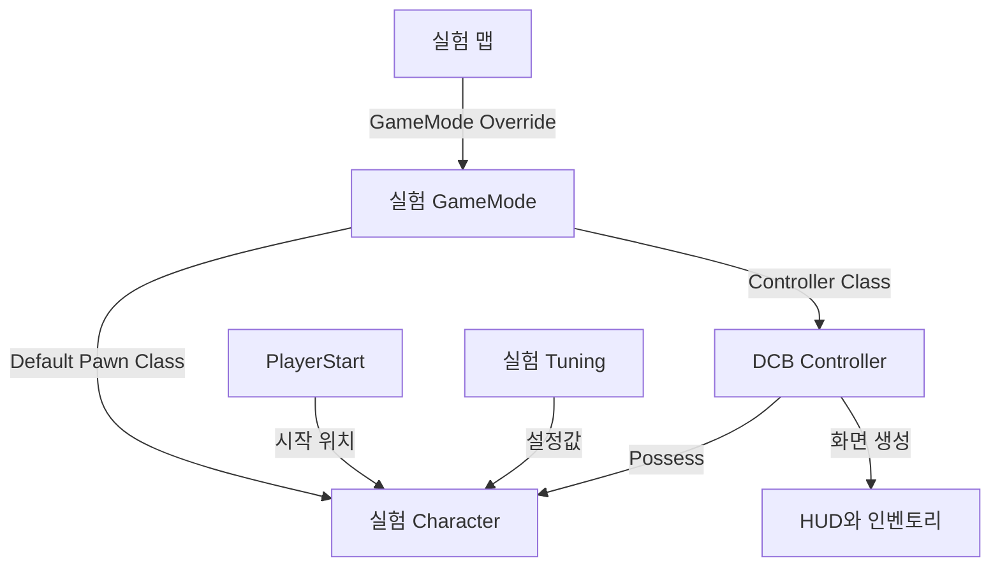

## 이번 주에 직접 만들 것

Unity에서 Scene을 열고, GameObject를 배치하고, Inspector의 값을 바꿔 본 경험을 출발점으로 삼습니다. 언리얼에서는 그 작업을 어느 창에서 하는지부터 따라갑니다. 처음부터 DCB의 C++ 소스를 읽거나 전체 게임 구조를 이해할 필요는 없습니다.

순서대로 진행하면 **DCB의 실험용 맵 하나**, **화면에 문구를 출력하는 Blueprint**, **플레이어 상태를 보여 주는 Blueprint**, **이동 속도를 바꾸는 데이터 에셋**이 남습니다. 마지막에는 가지를 수거하고 귀환해 다음 실행의 보관함까지 확인합니다. 글을 다 읽은 뒤 시작하지 말고, 각 단계의 **직접 할 일 → 화면에서 확인할 것 → Unity와의 차이**를 한 묶음씩 진행합니다.

| 날짜 | 직접 할 작업 | 새로 익힐 기능 |
| --- | --- | --- |
| 1일차 | DCB 맵을 복제하고 큐브를 배치·이동합니다. | Content Browser, Level, Actor, Details, 좌표 |
| 2일차 | 문구를 출력하고 배치한 객체마다 다른 값을 줍니다. | Blueprint, BeginPlay, 핀과 실행선, 변수, 인스턴스 |
| 3일차 | DCB 플레이어를 실험용으로 분리하고 카메라를 조절합니다. | GameMode, Pawn, Character, Controller, Component |
| 4일차 | 속도를 바꾸고 실행 중 상태를 숫자로 표시합니다. | DataAsset, Enhanced Input, Timer, 참조와 Cast |
| 5일차 | 채집 수량을 바꾸고 UI·귀환·저장을 비교합니다. | UMG, 상태 데이터, GameInstanceSubsystem, SaveGame |

하루 약 2시간으로 나눌 수 있지만, 메뉴나 노드 연결이 익숙하지 않으면 한 단계를 다음 날 이어갑니다. 전체 순서는 [12주 계획](/writing/dcb-unreal-port-study-plan/), 주차별 목록은 [DCB 언리얼 전환 과정](/series/dcb-unreal-port/)에서 봅니다.

### 준비와 표기

2026년 10월 29일의 DCB 전환본, Unreal Engine 5.8.4, Windows의 키보드·마우스를 기준으로 합니다. 이미 DCB C++ 모듈과 에셋이 로드되는 프로젝트에서 진행합니다. 새 Third Person 템플릿을 만드는 과정은 아닙니다. `Expedition`이나 `Wanderer`로 시작하는 클래스는 DCB에 추가된 클래스입니다.

메뉴 이름은 영문을 함께 적습니다. `클릭`은 왼쪽 클릭, `우클릭`은 문맥 메뉴 열기, `드래그`는 누른 상태로 이동한 뒤 놓기를 뜻합니다. 경로의 `/Game/`은 에디터에서 보이는 **Content**입니다. 예를 들어 `/Game/01_Game/Scenes/`는 Content 안의 01_Game → Scenes 폴더입니다.

이전 절차에서 `Week01` 폴더와 실험용 에셋을 이미 만들었다면 같은 이름을 계속 늘리지 말고 해당 에셋을 엽니다. 아래 참조 관계와 값이 같은지 확인한 뒤 이어갑니다. 원본 DCB 에셋과 이번에 만드는 실험용 에셋은 이름으로 구분합니다.

## 1일차: 에디터에서 맵과 Actor를 다룹니다

### 실습 1. Unity의 익숙한 창을 찾습니다

`DCB.uproject`를 열고 로딩이 끝날 때까지 기다립니다. 셰이더 준비 중인 화면과 실제 게임 실행을 구분합니다. 지금은 상단의 Play를 누르지 않습니다. 2일차에 Blueprint와 실험용 저장 슬롯을 준비한 뒤 첫 실행을 합니다.

| Unity에서 하던 일 | 언리얼에서 볼 창 | 지금 할 행동 |
| --- | --- | --- |
| Project 창에서 에셋 찾기 | **Content Browser / Content Drawer** | Content 아래의 폴더를 펼칩니다. |
| Hierarchy에서 장면 객체 선택 | **World Outliner** | Actor 이름을 클릭합니다. |
| Inspector에서 값 수정 | **Details** | 선택한 Actor의 Transform을 봅니다. |
| Scene 뷰에서 배치와 시점 조작 | **Level Viewport** | 선택한 Actor를 중심으로 화면을 움직입니다. |
| Console에서 로그 읽기 | **Output Log** | 뒤에서 Print String 출력을 확인합니다. |

1. 아래쪽 **Content Drawer** 버튼을 누릅니다. 기본 단축키는 **Ctrl+Space**입니다. 잠깐 열리는 서랍 형태가 불편하면 **Window → Content Browser → Content Browser 1**로 창을 엽니다.
2. 왼쪽 폴더 목록에서 **Content → 01_Game → Scenes**를 선택합니다. 폴더 목록이 접혀 있으면 창의 폴더 패널 표시 버튼을 눌러 펼칩니다.
3. 검색칸에 `L_RuntimePort_Validation`을 입력합니다. 결과가 없으면 검색칸과 에셋 종류 필터를 비운 뒤 Content 최상단에서 다시 검색합니다.
4. 맵 에셋을 더블클릭합니다. 다른 장면이 열리고, 상단 레벨 탭의 이름이 바뀌는지 봅니다.
5. **World Outliner**가 안 보이면 Window 메뉴에서 해당 패널을 엽니다. `PlayerStart`를 검색하고 한 번 클릭합니다. Details가 안 보이면 Window → Details도 엽니다.

**확인할 것:** Outliner에서 선택을 바꾸면 Details 내용도 바뀝니다. Content Browser에서 선택한 에셋과 Outliner에서 선택한 배치 객체는 서로 다른 대상입니다. 이 구분을 먼저 익힙니다.

Unity의 Scene에 해당하는 역할을 언리얼에서는 **Level**, 보통 **맵**이라고 부릅니다. `L_RuntimePort_Validation`은 DCB의 작은 검증 맵입니다. 프로젝트 시작 시 열리는 `L_GameScene_01`은 변환한 기존 장면이므로, 이번에는 작은 검증 맵을 사용합니다. [Unity와 언리얼의 에디터 비교](https://dev.epicgames.com/documentation/en-us/unreal-engine/unity-to-unreal-engine-overview)

### 실습 2. 맵을 다른 이름으로 저장합니다

Unity에서 원본 Scene을 두고 실험용 Scene을 따로 저장하는 것과 같은 목적입니다. 맵을 복제해도 그 안에서 참조하는 메시·재질·Blueprint까지 모두 복제되지는 않습니다.

1. Content Browser의 **Content → 01_Game**에서 빈 곳을 우클릭하고 **New Folder**로 `Study`를 만듭니다. 그 안에 `Week01` 폴더를 만듭니다.
2. 레벨 편집 화면으로 돌아와 **File → Save Current Level As**를 선택합니다.
3. 저장 창에서 **Content → 01_Game → Study → Week01**을 고릅니다.
4. 이름을 `L_DCB_Week01`로 입력하고 저장합니다. 이미 같은 실험 맵을 만들었다면 기존 맵을 열어 이어갑니다.
5. 상단의 열린 레벨 이름이 `L_DCB_Week01`인지 확인합니다. 이후 맵 배치는 이곳에서 바꿉니다.

**확인할 것:** Content Browser에는 원본 `L_RuntimePort_Validation`과 새 `L_DCB_Week01`이 각각 있습니다. Outliner에는 복사된 장면의 Actor들이 보입니다.

**헷갈리기 쉬운 차이:** 맵 안에 있는 Actor를 복제하는 것과 Content Browser의 에셋을 복제하는 것은 다릅니다. 전자는 같은 레벨에 배치 객체 하나를 더 만들고, 후자는 재사용할 에셋 자체를 새로 만듭니다. 에셋 이동·이름 변경은 파일 탐색기 대신 에디터에서 합니다. [에셋 관리](https://dev.epicgames.com/documentation/en-us/unreal-engine/working-with-assets-in-unreal-engine)

### 실습 3. 큐브 하나를 배치하고 이동합니다

**Actor**는 레벨에 배치할 수 있는 객체입니다. Unity의 GameObject와 비슷한 용도로 찾으면 됩니다. 다만 언리얼에서는 Actor 클래스 자체에도 행동을 구현할 수 있습니다. Actor에 붙은 **Component**는 렌더링·충돌·카메라 같은 기능을 담당합니다. 모든 것을 빈 GameObject에 C# 컴포넌트로 붙이는 방식과 완전히 같지는 않습니다. [GameObject와 Actor 비교](https://dev.epicgames.com/documentation/en-us/unreal-engine/game-objects-in-unreal-engine)

1. **Window → Place Actors**를 엽니다. **Shapes → Cube**를 찾아 레벨 뷰포트로 드래그합니다. 상단 Add 메뉴의 Shapes → Cube를 사용해도 됩니다.
2. Outliner에서 방금 만든 Cube를 선택하고 F2를 눌러 이름을 `Week01_Cube`로 바꿉니다. 이 이름은 이번 레벨에서 알아보기 위한 Actor Label입니다.
3. Details에서 **Transform**을 펼칩니다. Location의 X, Y, Z를 각각 **-1200, -600, 50**, Rotation을 **0, 0, 0**, Scale을 **1, 1, 1**로 입력합니다. 각 숫자 입력 뒤 Enter를 누릅니다.
4. 선택을 유지한 채 뷰포트에 마우스를 놓고 **F**를 누릅니다. 큐브를 중심으로 편집 카메라가 이동하는지 봅니다.
5. Location의 **Z만 150**으로 바꿉니다. 큐브가 위로 올라가는지 확인하고 다시 **50**으로 돌립니다.
6. Scale의 X만 2로 바꿔 한 방향으로 길어지는지 봅니다. 축 비율 잠금이 켜져 있으면 해제한 뒤 입력합니다. 확인 후 X도 1로 돌립니다.
7. 레벨 탭에서 **Ctrl+S**를 눌러 맵을 저장합니다.

**확인할 것:** 큐브의 Z를 100 늘렸을 때 위로 1m 이동하는 조건입니다. Unity의 보통 1유닛=1m 관례와 달리 언리얼의 기본 거리 단위는 cm입니다. 방향도 Unity의 Y 위·Z 앞과 달리 언리얼은 **Z 위·X 앞·Y 오른쪽**입니다. Scale은 길이 단위가 아니라 배율입니다. [좌표계와 공간](https://dev.epicgames.com/documentation/en-us/unreal-engine/coordinate-system-and-spaces-in-unreal-engine), [단위](https://dev.epicgames.com/documentation/unreal-engine/units-of-measurement-in-unreal-engine?lang=en-US)

편집 카메라는 오른쪽 마우스 버튼을 누른 채 WASD로 이동할 수 있습니다. 이때 움직이는 것은 게임 캐릭터가 아니라 장면을 바라보는 편집 카메라입니다. W·E·R은 오른쪽 버튼을 놓은 상태에서 각각 이동·회전·크기 조절 도구로 쓰입니다. 처음에는 드래그보다 Details 숫자 입력으로 결과를 확인하면 됩니다. [Viewport 조작](https://dev.epicgames.com/documentation/en-us/unreal-engine/viewport-controls-in-unreal-engine)

**오늘 남길 것:** 실험 맵과 큐브가 있고, Outliner에서 큐브를 선택해 Details로 위치를 바꿀 수 있으면 됩니다. GameMode나 저장 시스템은 아직 이해하지 않아도 됩니다.

## 2일차: Blueprint로 문구를 출력합니다

### 실습 4. 첫 Blueprint를 만듭니다

Unity에서 C# 스크립트를 만들고 Start에서 Debug.Log를 호출하는 정도의 작업부터 해 봅니다. **Blueprint**는 노드로 로직을 연결하고 컴포넌트·기본값을 함께 정할 수 있는 클래스 에셋입니다. 레벨에 드래그하면 그 클래스의 **인스턴스**, 즉 실제 객체가 하나 만들어집니다.

재사용할 객체 구성을 보관한다는 점은 프리팹과 비슷합니다. 하지만 Blueprint Class 자체가 상속과 로직을 갖는다는 점까지 포함합니다. “프리팹 파일 이름만 달라졌다”로 생각하지 않고, **재사용할 객체 구성과 그 객체의 행동을 편집하는 곳**으로 접근합니다. [Unity Prefab](https://docs.unity.com/en-us/engine/6000.5/manual/working-with-gameobjects/prefabs), [Blueprint 기초](https://dev.epicgames.com/documentation/unreal-engine/blueprint-foundations?lang=en-US)

1. Content Browser에서 **Week01** 폴더를 엽니다. 빈 곳 우클릭 → **Blueprint Class**를 선택합니다.
2. 부모 클래스 선택 창에서 **Actor**를 선택합니다. 이름은 `BP_Week01Marker`로 지정합니다. `BP_`는 구분을 위한 이름 규칙이며 엔진이 강제하는 문법은 아닙니다.
3. 에셋을 더블클릭합니다. 레벨 창과 별도로 Blueprint Editor가 열립니다.
4. 왼쪽 **Components**에는 기본 Root가, **My Blueprint**에는 그래프·변수가 보입니다. 가운데 **Event Graph** 탭을 엽니다. 패널이 사라졌으면 이 창의 Window 메뉴에서 켭니다.
5. 그래프의 **Event BeginPlay** 노드를 찾습니다. 없으면 빈 곳 우클릭 → `BeginPlay` 검색 → **Event BeginPlay**를 추가합니다.
6. BeginPlay 오른쪽의 **흰색 실행 출력 핀**을 빈 곳으로 드래그하고 놓습니다. 검색창에 `Print String`을 입력하고 해당 노드를 선택합니다.
7. BeginPlay와 Print String 사이에 흰 선이 생겼는지 봅니다. Print String의 **In String**에 `Hello Unreal`을 입력합니다. 접힌 추가 항목을 펼쳐 Duration을 `5`, Print to Screen과 Print to Log를 참으로 둡니다.
8. 왼쪽 위 **Compile**을 누릅니다. 오류가 없다면 **Save**를 누릅니다.
9. 레벨 탭으로 돌아와 Content Browser의 `BP_Week01Marker`를 뷰포트로 드래그합니다. Outliner에서 생성된 Actor의 이름을 `Marker_A`로 바꿉니다.

```text
Event BeginPlay ──흰 실행선──▶ Print String
                               In String = Hello Unreal
```

**확인할 것:** Outliner에는 Marker_A가 있지만 화면에 큐브가 하나 더 생기지는 않습니다. 이 Blueprint에는 보이는 Mesh Component를 추가하지 않았기 때문입니다. DefaultSceneRoot는 부착 관계의 기준이며, 모델을 그리는 컴포넌트가 아닙니다.

**Unity와 연결하기:** BeginPlay는 게임 실행에 들어온 객체의 시작 이벤트라는 점에서 Start와 비교할 수 있습니다. Awake·OnEnable·Start와 정확히 일대일로 대응하는 함수는 아닙니다. 이번에는 “이 Actor가 플레이를 시작할 때 여기서 실행이 시작된다”까지만 사용합니다.

### 노드와 핀을 읽는 방법

**노드**는 이벤트·함수 호출·값 읽기 같은 작업 한 개입니다. **핀**은 그 작업의 입력·출력입니다. **흰 실행선**은 실행 순서를, 타입별 색이 있는 **데이터 선**은 전달할 값을 나타냅니다. 핀에 마우스를 올리면 이름과 타입을 볼 수 있으므로 색만 외울 필요는 없습니다.

Print String은 실행선이 도착해야 출력합니다. 데이터 값만 연결해 놓고 실행선을 연결하지 않으면 실행되지 않습니다. 반대로 뒤에서 사용할 Get 변수 같은 노드는 실행 핀이 없으며, 연결된 작업이 값을 요구할 때 읽습니다.

**Target** 핀은 “어느 객체에 이 작업을 할지”를 지정합니다. C#의 `object.Method()`에서 object에 해당합니다. **Return Value**는 작업이 돌려준 결과입니다. **Self**는 지금 이 그래프를 실행하는 객체이고, **None**은 아직 참조할 객체가 지정되지 않았다는 표시입니다. 같은 함수 노드라도 Target이 다르면 다른 객체의 값을 다룹니다.

Compile은 Blueprint 그래프를 검사하고 실행에 사용할 상태로 갱신하는 작업입니다. Save는 에셋을 디스크에 저장합니다. Unity에서 스크립트를 저장하면 C# 재컴파일이 진행되는 경험과 비교하되, 여기서는 **Compile 후 Save를 각각 확인**합니다. Compile 오류가 있으면 아래 Compiler Results에서 해당 오류를 클릭해 노드로 이동합니다.

### 실습 5. 첫 Play 전에 저장 슬롯을 분리합니다

DCB의 기존 캐릭터는 귀환·사망 시 저장합니다. 원본 맵을 복제했어도 저장 슬롯 이름까지 바뀌지는 않습니다. 이제 방금 배운 실행선으로 **이 실험 맵에서 사용할 저장 이름**을 설정합니다. Subsystem의 전체 구조는 5일차에 다시 다룹니다.

**Level Blueprint**는 해당 맵에 속한 그래프입니다. Unity에서 특정 Scene의 시작 작업을 맡는 스크립트와 비교할 수 있습니다. 앞에서 만든 BP_Week01Marker는 여러 맵에 배치할 수 있지만, Level Blueprint는 지금 연 맵의 설정입니다.

1. `L_DCB_Week01`의 레벨 편집 화면으로 돌아옵니다. 상단 **Blueprints → Open Level Blueprint**를 선택합니다. BP_Week01Marker 창이 아닌지 확인합니다.
2. Event BeginPlay를 찾습니다. 이미 있다면 재사용하고, 없다면 빈 곳 우클릭으로 추가합니다.
3. 빈 곳 우클릭 → `Expedition Subsystem` 검색 → **Get Expedition Subsystem**을 추가합니다. 이 노드는 DCB의 현재 저장 관리 객체를 가져옵니다.
4. Get Expedition Subsystem의 **반환값 핀**을 빈 곳으로 드래그해 `Set Slot`을 검색합니다. 만들어진 노드의 Target에 데이터 선이 연결되는지 봅니다. Slot 문자열에는 **`DCB_Study_Week01_Intro`**를 입력합니다.
5. BeginPlay의 흰 출력 핀과 Set Slot의 흰 입력 핀을 연결합니다.
6. Subsystem의 반환값 핀에서 다시 드래그해 **Load Progress**를 만듭니다. Set Slot의 흰 출력과 Load Progress의 흰 입력을 연결합니다. 같은 Subsystem이 Target이어야 합니다.
7. Load Progress의 흰 출력에서 드래그해 **Branch**를 만듭니다. Load Progress의 bool 반환 핀을 Branch의 **Condition**에 연결합니다. Branch는 C#의 if처럼 조건에 따라 실행선을 나눕니다.
8. Branch의 True에서 Print String을 만듭니다. Subsystem 반환값에서 **Get Slot**도 만들고, 그 값을 Print String의 In String에 연결합니다. Duration은 5, Print to Log는 참으로 둡니다.
9. Branch의 False에는 별도 Print String을 연결하고 `Week01 save load failed`를 입력합니다.
10. Compile·Save한 뒤 레벨도 저장합니다.

```text
흰 실행선:
BeginPlay → Set Slot → Load Progress → Branch
                                         True → Print String(Get Slot)
                                        False → Print String("Week01 save load failed")

데이터 선:
Get Expedition Subsystem → Set Slot의 Target
                         → Load Progress의 Target
                         → Get Slot의 Target
Load Progress의 반환 bool → Branch의 Condition
Get Slot의 문자열         → True 쪽 Print String의 In String
```

**설정한 이유:** Slot은 저장 파일을 구분하는 이름입니다. Slot만 바꾸면 이미 메모리에 들어 있는 다른 저장 객체를 그대로 둘 수 있어 Load Progress도 호출합니다. 지정한 슬롯이 없으면 빈 저장 객체를 준비합니다. 이 단계는 기존 개인 저장 파일을 지우거나 새 이름으로 복사하는 작업이 아닙니다.

### 실습 6. 실행하고 인스턴스 값을 바꿉니다

에디터 안에서 게임을 실행하는 방식을 **PIE, Play In Editor**라고 부릅니다. 여기서는 편집하던 맵을 별도 실행 상태로 만들어 조작합니다.

1. Play 옆 메뉴에서 **Selected Viewport**를 선택합니다. 플레이어 수는 **1**, 네트워크 모드는 **Standalone**, 시작 위치는 **Default Player Start**로 둡니다. 시작 위치 메뉴는 PlayerStart가 있는 맵에서 선택할 수 있습니다.
2. Play를 누릅니다. `Hello Unreal`과 **`DCB_Study_Week01_Intro`**가 출력되는지 확인합니다. 출력 순서는 상관없습니다. 처음에는 캐릭터를 움직이지 않고 문구만 봅니다.
3. 문구를 놓쳤다면 **Shift+F1**로 마우스를 에디터에 돌려주고 **Window → Developer Tools → Output Log**를 엽니다. 메뉴 배치가 다르면 하단 Output Log 탭을 사용합니다. 검색칸에서 `Hello Unreal`이나 슬롯 이름을 찾습니다.
4. 슬롯 준비 실패나 Blueprint 오류가 보이면 Stop하고 실습 5의 선 연결을 먼저 확인합니다. 성공했다면 툴바의 **Stop**으로 종료합니다.
5. `BP_Week01Marker`를 다시 엽니다. **My Blueprint → Variables 옆 +**로 변수를 만들고 이름을 `MarkerText`로 정합니다.
6. 변수 타입을 **String**으로 바꿉니다. 변수를 선택한 Details에서 **Instance Editable**을 켭니다. Compile한 뒤 Default Value에 `Week01 default`를 입력합니다.
7. My Blueprint의 MarkerText를 그래프로 드래그하고 **Get**을 선택합니다. 반환 핀을 기존 Print String의 In String에 연결합니다. 고정 문자열 대신 변수를 읽게 됩니다. BeginPlay의 흰 실행선은 유지합니다. Compile·Save합니다.
8. 레벨에서 Marker_A를 선택합니다. Details 검색칸에 `MarkerText`를 입력하고 값에 `A: my first Blueprint`를 넣습니다.
9. Content Browser에서 같은 BP_Week01Marker를 한 번 더 뷰포트로 드래그합니다. 이름은 `Marker_B`로 바꾸고 MarkerText는 수정하지 않습니다. 맵을 저장합니다.
10. Play해서 `A: my first Blueprint`와 `Week01 default`가 각각 출력되는지 확인하고 Stop합니다.

**확인할 것:** 같은 Blueprint로 만든 두 객체가 서로 다른 문자열을 출력합니다. Unity 프리팹 인스턴스의 Inspector에서 값 하나를 override한 상황과 비슷합니다. Instance Editable은 레벨에 배치한 인스턴스의 Details에서 해당 값을 편집할 수 있게 하는 설정입니다. 변수의 모든 접근 권한을 뜻한다고 외우지는 않습니다.

한 번 더 비교합니다. BP_Week01Marker의 **Class Defaults**에서 MarkerText 기본값을 `Class value changed`로 바꿔 Compile·Save하고 Play합니다. 기본값을 따르는 B는 바뀌고, 별도 값을 지정한 A는 자신의 값을 유지하는지 봅니다. Stop 후 A의 해당 속성 옆 **Reset to Default** 화살표를 누르면 기본값을 따르게 됩니다. 마지막에는 기본값을 `Week01 default`, A를 `A: my first Blueprint`로 돌려놓습니다.

**오늘 남길 것:** 변수 값을 읽는 Get 노드, 실행하는 Print String, 두 인스턴스의 차이입니다. Play 중 바뀐 Actor 상태가 Stop 후 원본 설정에 자동 반영되지 않는 점도 확인합니다. 이때의 저장 대상은 Blueprint 에셋과 맵이며, 게임 진행을 저장하는 SaveGame과는 별개입니다. [Blueprint 변수와 인스턴스](https://dev.epicgames.com/documentation/unreal-engine/blueprint-foundations?lang=en-US)

## 3일차: DCB 플레이어와 카메라를 설정합니다

### 플레이어를 누가 만드는지 이해합니다

Unity에서는 Scene에 플레이어 프리팹을 놓거나, 직접 만든 GameManager에서 Instantiate해 시작하는 구성이 익숙할 수 있습니다. 언리얼에는 이 흐름을 맡는 엔진 클래스가 나뉘어 있습니다. 이번에는 네 이름만 구분합니다.

| 이름 | 이번에 이해할 역할 | DCB에서 찾을 이름 |
| --- | --- | --- |
| **GameMode** | 이 맵에서 사용할 플레이어·Controller 기본 클래스를 정합니다. | `BP_ExpeditionGameMode` |
| **Pawn / Character** | Pawn은 조종 가능한 Actor입니다. Character는 이동용 캡슐·메시·이동 컴포넌트를 갖춘 Pawn입니다. | `BP_PlayerGameplay` |
| **PlayerController** | 어떤 Pawn을 조종할지 연결하고 플레이어의 조작을 담당합니다. | `BP_ExpeditionController` |
| **PlayerStart** | 기본 플레이어가 시작할 위치를 지정하는 Actor입니다. | Outliner의 `PlayerStart` |

Controller가 Pawn을 조종하도록 연결하는 동작을 **Possess**라고 부릅니다. 입력 함수가 존재하는 것과 실제 조종 대상이 연결되는 것은 다른 단계입니다. GameMode를 Unity의 특정 컴포넌트와 일대일로 대응시키기보다는, 직접 만들던 시작 규칙 중 일부를 엔진의 정해진 위치에서 설정한다고 이해합니다. [GameMode 설정](https://dev.epicgames.com/documentation/en-us/unreal-engine/setting-up-a-game-mode-in-unreal-engine)



이 그림은 설정·참조 관계입니다. 각 객체의 BeginPlay가 위에서 아래 순서로 호출된다는 뜻은 아닙니다.

### 실습 7. 바꿀 에셋과 참조를 분리합니다

앞에서 Marker_A만 바꿨을 때는 그 인스턴스의 값이 달라졌습니다. 지금부터는 매번 새로 생성하는 플레이어의 기본 설정을 바꿉니다. 원본 캐릭터와 데이터 에셋을 함께 참조하는 다른 맵에 영향을 주지 않도록 복제본을 연결합니다.

| 기존 에셋 | Content 아래 위치 | 만들 복제본 |
| --- | --- | --- |
| `BP_ExpeditionGameMode` | `01_Game/Scenes` | `BP_ExpeditionGameMode_Week01` |
| `BP_PlayerGameplay` | `01_Game/Prefabs/Character/Player` | `BP_PlayerGameplay_Week01` |
| `DA_GameplayTuning` | `01_Game/Balance` | `DA_GameplayTuning_Week01` |

1. Content Browser에서 첫 번째 원본 에셋을 찾습니다. 우클릭 → **Duplicate**로 복제한 뒤 표의 이름으로 지정합니다.
2. 복제본을 왼쪽 폴더 목록의 **Study/Week01**로 드래그합니다. 이동·복사 선택 메뉴가 나오면 **Move Here**를 선택합니다. 원본이 아니라 새 이름의 복제본을 옮기는지 확인합니다.
3. 나머지 두 에셋에도 같은 작업을 합니다. 이미 복제본이 있다면 새 에셋을 더 만들지 않습니다.
4. `BP_PlayerGameplay_Week01`을 더블클릭합니다. 간단한 기본값 창으로 열리면 **Open Full Blueprint Editor**를 누릅니다.
5. 위쪽 **Class Defaults**를 누릅니다. 오른쪽 Details 검색칸에 `Tuning`을 입력합니다. 에셋 선택칸의 목록을 열어 **DA_GameplayTuning_Week01**을 선택합니다. Compile·Save합니다.
6. `BP_ExpeditionGameMode_Week01`을 열고 **Class Defaults**를 누릅니다. **Default Pawn Class**를 **BP_PlayerGameplay_Week01**로 바꿉니다. **Player Controller Class**는 **BP_ExpeditionController**인지 확인하고 유지합니다. Compile·Save합니다.
7. 레벨 편집 화면으로 돌아와 **Window → World Settings**를 엽니다. **GameMode → GameMode Override**에서 **BP_ExpeditionGameMode_Week01**을 선택합니다. 레벨을 저장합니다.

```text
L_DCB_Week01
  GameMode Override = BP_ExpeditionGameMode_Week01

BP_ExpeditionGameMode_Week01
  Default Pawn Class = BP_PlayerGameplay_Week01
  Player Controller Class = BP_ExpeditionController

BP_PlayerGameplay_Week01
  Tuning = DA_GameplayTuning_Week01
```

**확인할 것:** 세 선택칸에 `_Week01`이 붙은 이름이 맞게 들어 있습니다. 맵만 복제하거나 DataAsset만 복제하고 참조를 바꾸지 않으면 새 에셋을 사용하지 않습니다. Unity에서 ScriptableObject를 복제한 뒤 프리팹의 참조 필드도 새 에셋으로 바꿔야 하는 상황과 같습니다.

Class Defaults는 **클래스 전체의 기본 설정**입니다. Components에서 특정 컴포넌트를 선택한 상태의 Details와 구분합니다. DCB는 Character의 Tuning을 시작 시 상태 컴포넌트로 전달하므로, 이 실습에서는 Character의 Class Defaults에서 Tuning을 바꿉니다.

이번의 Duplicate는 원본과 별개의 에셋을 만드는 작업입니다. **Create Child Blueprint Class**로 원본 Blueprint를 상속하는 작업과 다릅니다. 새 플레이어를 맵에 직접 드래그하지도 않습니다. 이 검증 맵에서는 GameMode가 PlayerStart에 플레이어를 만들게 둡니다.

### 실습 8. 생성된 캐릭터와 Component를 봅니다

1. Play합니다. 슬롯 이름이 `DCB_Study_Week01_Intro`인지 확인하고 게임 화면을 클릭합니다.
2. W를 짧게 눌러 캐릭터를 움직입니다. 키를 놓은 뒤 **Shift+F1**을 누르고 툴바의 **Pause**로 멈춥니다.
3. World Outliner 검색칸에 `BP_PlayerGameplay_Week01`을 입력합니다. 실행 중 생성된 플레이어 Actor를 선택합니다. 이름 뒤에 붙는 숫자는 실행마다 달라질 수 있습니다.
4. Details에서 Tuning을 찾아 **DA_GameplayTuning_Week01**인지 봅니다. 다른 이름이면 Stop하고 실습 7의 연결을 확인합니다.
5. Details 상단의 컴포넌트 목록에서 아래 항목을 하나씩 선택합니다. 목록이 안 보이면 BP_PlayerGameplay_Week01의 Blueprint Editor에 있는 Components 패널에서도 구조를 읽을 수 있습니다.

| Component | Unity에서 비교할 기능 | 이번에 볼 내용 |
| --- | --- | --- |
| Capsule Component | CapsuleCollider를 쓰는 몸체 충돌 | 캐릭터의 이동 충돌 범위입니다. 모델 외형과 구분합니다. |
| Mesh | SkinnedMeshRenderer로 표시하는 캐릭터 모델 | Skeletal Mesh와 애니메이션 관련 설정이 있습니다. |
| CharacterMovement | 캐릭터 이동을 맡는 기능 | 속도·가속·중력·이동 모드 등을 다룹니다. Unity CharacterController와 같은 API는 아닙니다. |
| CameraBoom | 카메라를 일정 거리 떨어뜨리는 장치 | 타입은 SpringArmComponent이며 길이와 충돌 보정을 다룹니다. |
| FollowCamera | Camera | 실제 시점을 만드는 CameraComponent입니다. |
| PlayerState | 직접 만든 체력·스태미너 컴포넌트 | DCB의 `UPlayerStateComponent`입니다. |

**확인할 것:** PlayerState를 선택해 Health, Stamina, Cargo Weight, Carrying, Gait를 봅니다. 짐을 줍지 않은 시작 상태는 적재량 0, 지게 착용 Carrying 참, 이동 상태 Gait=Run입니다. 이동한 뒤라면 스태미너는 이미 줄었을 수 있습니다.

Unity의 부모·자식 GameObject처럼 보이는 부분이 있어도, 이 목록은 주로 **한 Actor 안의 Component 부착 관계**입니다. 공간 정보가 있는 SceneComponent는 위치와 부착을 갖고, 상태 데이터만 가진 ActorComponent는 그럴 필요가 없습니다. 이름에 PlayerState가 들어가도 이 컴포넌트가 엔진의 `APlayerState` Actor인 것은 아닙니다.

Play 중 에디터 시점으로 돌아가 관찰하려면 **Eject**, 다시 캐릭터를 조종하려면 **Possess**를 사용합니다. 이번에는 값만 보고 Stop해도 됩니다. **Simulate**는 Play와 다른 실행 방식이므로 첫 실습에서 선택하지 않습니다. Esc는 기본 PIE 종료 키와 겹칠 수 있어 인벤토리 닫기에는 I 또는 닫기 버튼을 씁니다. [Play·Simulate·Eject](https://dev.epicgames.com/documentation/unreal-engine/playing-and-simulating-in-unreal-engine)

### 실습 9. SpringArm 길이를 바꿉니다

SpringArm은 자식 카메라를 목표 거리만큼 떨어뜨리고 주변 충돌에 따라 거리를 보정하는 컴포넌트입니다. Unity에서 플레이어 아래에 카메라 피벗을 만들고 카메라를 뒤로 배치하던 작업과 비교할 수 있습니다.

1. Stop한 상태에서 **BP_PlayerGameplay_Week01**을 엽니다.
2. Components에서 **CameraBoom**을 클릭합니다. Class Defaults가 아니라 해당 컴포넌트의 Details를 보고 있어야 합니다.
3. Details 검색칸에 `Target Arm Length`를 입력합니다. **지금 표시된 값을 먼저 기록**합니다.
4. 값을 기록한 값의 절반으로 바꾸고 Compile·Save합니다.
5. 실험 맵에서 Play합니다. 같은 시작 위치에서 카메라가 캐릭터에 더 가까워졌는지 봅니다. 벽 등으로 SpringArm이 줄어든 상태에서는 지정 길이와 실제 거리가 다를 수 있습니다.
6. Stop하고 Target Arm Length를 기록한 원래 값으로 돌린 뒤 Compile·Save합니다.

**확인할 것:** Blueprint의 컴포넌트 기본값을 바꾸면 다음에 생성되는 플레이어 카메라에도 적용됩니다. 단순히 편집 뷰포트에서 마우스 휠로 확대했던 1일차와 달리, 이번에는 **게임에서 사용하는 카메라 설정**을 수정했습니다.

**오늘 남길 것:** 실험 플레이어를 생성하는 맵 설정, 플레이어 내부 Component 목록, 카메라 길이 변경 전후의 차이입니다. C++ 소스까지 수정하지 않고 Blueprint에서 설정할 수 있는 범위를 확인합니다.

## 4일차: 이동 데이터를 바꾸고 숫자로 봅니다

### 실습 10. 데이터 에셋을 수정합니다

Unity에서 여러 객체가 같은 밸런스 값을 읽도록 ScriptableObject를 사용하는 것처럼, DCB는 **DataAsset**에 속도·적재 용량·스태미너 관련 설정을 보관합니다. `UGameplayTuning`은 데이터의 형식을 정의한 C++ 클래스이고, `DA_GameplayTuning`은 그 형식으로 만든 에셋입니다. 앞에서 복제한 에셋도 같은 형식을 사용합니다. [Unity ScriptableObject](https://docs.unity.com/en-us/engine/6000.3/manual/scripting/get-started/fundamental-unity-types/class-scriptable-object), [Unreal Data Assets](https://dev.epicgames.com/documentation/en-us/unreal-engine/data-assets-in-unreal-engine)

1. Stop하고 Week01 폴더의 **DA_GameplayTuning_Week01**을 더블클릭합니다. Blueprint의 Event Graph가 아니라 데이터 속성 편집 화면이 열립니다.
2. 검색칸에 `Carry Speeds`를 입력합니다. 값을 펼쳐 X, Y, Z를 봅니다. 현재 기준은 **150, 300, 650**입니다.
3. 여기서 Vector의 X·Y·Z는 위치가 아닙니다. DCB가 **X=Walk, Y=Run, Z=Sprint** 세 속도를 저장하는 용도로 사용합니다.
4. 먼저 Y=300인 상태로 Play합니다. G·Ctrl·Shift를 누르지 않고 짐을 줍지 않은 상태에서 평지로 짧게 이동합니다.
5. Stop하고 **Carry Speeds의 Y만 150**으로 바꿉니다. DataAsset을 Save합니다. 이 에셋에는 Blueprint 그래프의 Compile 버튼을 찾을 필요가 없습니다.
6. 같은 맵에서 새 Play하고 같은 조건으로 이동합니다. 이번에는 숫자로 비교하기 위해 다음 실습도 이어갑니다.

**예상할 변화:** 지게를 멘 Run 상태이고 짐이 없다면 목표 속도가 300에서 150으로 바뀌는 조건입니다. 기본 거리 단위 기준으로 약 3m/s에서 1.5m/s에 해당합니다. 가속·감속과 입력 시간 때문에 짧은 시간에 이동한 거리까지 정확히 절반이라고 판단하지 않습니다.

DCB에서는 Character가 매 프레임 상태를 계산해 CharacterMovement의 **Max Walk Speed**에 넣습니다. 이 속성의 Walk라는 이름만 보고 “걷기 전용 값”으로 해석하지 않습니다. 이 프로젝트에서는 Walk·Run·Sprint 중 현재 상태가 선택한 속도 상한이 들어갑니다. **Max Walk Speed 기본값만 바꿔도 실행 중 덮어써지는 이유**가 여기에 있습니다.

설정 데이터와 현재 상태도 구분합니다. Tuning의 Max Stamina는 최대값이고, PlayerState의 Stamina는 지금 남은 값입니다. Unity에서도 ScriptableObject의 최대 체력 설정과 플레이어 컴포넌트의 현재 체력을 나누어 보관하는 것과 같은 문제입니다.

### 실습 11. 입력 에셋의 연결을 읽습니다

Enhanced Input은 언리얼의 입력 기능입니다. Unity Input System을 사용했다면 Action과 Binding을 구분하던 경험과 연결하면 됩니다. **Input Action**은 Move·Interaction 같은 입력 행동을 나타내고, **Input Mapping Context**는 어떤 키·축을 Action에 연결할지 묶습니다.

1. Content Browser에서 **Content → Scripts → GameSystem → InputSystem → GameInputActions** 폴더를 엽니다.
2. **IA_Move**를 열어 Value Type을 봅니다. 이 입력은 **Axis2D**, 두 숫자로 이루어진 방향값을 사용합니다. 지금은 수정하지 않습니다.
3. **IMC_Player**를 열고 **Default Key Mappings → Mappings**를 펼칩니다. Action이 IA_Move인 항목에서 W·A·S·D를 찾습니다.
4. W 항목의 **Modifiers**를 펼칩니다. Swizzle은 축 순서를 바꾸고, Negate는 부호를 바꿉니다. W는 양의 Y, S는 음의 Y, A는 음의 X, D는 양의 X 이동 입력이 되도록 구성되어 있습니다.
5. **BP_PlayerGameplay_Week01 → Class Defaults**에서 Input Context가 IMC_Player인지 봅니다. Input Actions 맵의 `Move` 항목이 IA_Move를 참조하는지도 봅니다.

**확인할 것:** W라는 물리 키, IA_Move라는 Action, Character가 읽는 이동값은 같은 것이 아닙니다. Context를 적용하고 Action에 함수를 연결해야 캐릭터 행동으로 이어집니다. 현재 DCB의 그 연결은 C++ 부모에 있으므로 Blueprint Event Graph가 비어 있어도 움직입니다. [Enhanced Input](https://dev.epicgames.com/documentation/en-us/unreal-engine/enhanced-input-in-unreal-engine)

```text
W 키
 → IMC_Player의 매핑
 → IA_Move의 2차원 입력값
 → DCB Character의 이동 입력 처리
 → CharacterMovement를 통한 이동
```

현재 키는 다음과 같습니다. 각 행동을 한 번씩 실행하고 PlayerState의 변화를 봅니다.

| 입력 | 동작 | 처음 확인할 점 |
| --- | --- | --- |
| WASD / 방향키 | 이동 | 키를 떼면 이동 요청이 끝나고 감속합니다. |
| 왼쪽 Shift | 누르는 동안 질주 | 스태미너와 속도가 달라집니다. |
| 왼쪽 Ctrl | 걷기 토글 | 손을 떼어도 걷기 상태가 유지됩니다. 다시 눌러 해제합니다. |
| G | 지게 착용 토글 | 시작은 착용 상태입니다. 처음 누르면 벗는 상태가 됩니다. |
| F | 가까운 대상과 상호작용 | 편집 중 F로 화면을 맞추는 기능과 실행 맥락이 다릅니다. |
| I | 인벤토리 열기·닫기 | UI가 열리면 이동 입력을 막습니다. |
| 마우스 왼쪽 / Space | 공격 / 회피 | 스태미너 변화와 행동을 봅니다. |
| 사망 뒤 R | 캠프로 재출발 | 살아 있을 때 맵 전체를 다시 여는 키가 아닙니다. |

현재 IA_Look에는 **게임패드 오른쪽 스틱**만 연결되어 있습니다. 마우스로 시점이 안 움직이는 상황을 이 실습에서 조작 실패로 판단하지 않습니다. MousePosition이라는 다른 Action이 있어도 현재 시점 함수에 연결된 상태는 아닙니다. 마우스 시점 매핑은 2주차에서 직접 추가할 과제로 남깁니다.

### 실습 12. Timer로 상태를 출력합니다

이번에는 “느리게 보인다”에서 한 단계 더 나아가 실제 숫자를 봅니다. 매 프레임의 Event Tick 대신 **0.5초마다 반복하는 Timer**를 사용합니다. Unity의 InvokeRepeating이나 일정 간격의 코루틴처럼 주기적으로 함수를 실행하는 용도로 생각하면 됩니다. Timer는 실행할 이벤트와 간격을 지정합니다.

1. Content Browser의 **BP_Week01Marker**를 Duplicate해서 **BP_Week01Probe**를 만듭니다. 같은 Week01 폴더에 둡니다.
2. BP_Week01Probe를 열고 Class Defaults의 MarkerText를 `DCB probe started`로 바꿉니다. 기존 BeginPlay → Print String은 시작 확인용으로 남깁니다.
3. 기존 Print String의 **흰 출력 핀**에서 드래그해 **Set Timer by Event**를 추가합니다. Time=`0.5`, Looping=참으로 지정합니다.
4. Timer 노드의 **빨간 Event 핀**에서 빈 곳으로 드래그해 **Add Custom Event**를 선택합니다. 생긴 이벤트의 이름을 `ReportPlayer`로 바꿉니다. 이것은 Timer가 반복 호출할 이벤트입니다.
5. 빈 곳 우클릭으로 **Get Player Character**를 추가합니다. Player Index는 `0`으로 둡니다.
6. Get Player Character의 반환 핀에서 드래그해 **Cast To WandererCharacter**를 만듭니다. 반환값이 Cast의 Object에 연결됐는지 봅니다. ReportPlayer의 흰 출력과 Cast의 흰 입력도 연결합니다.
7. Cast의 **As Wanderer Character** 출력 핀에서 드래그해 **Get State**를 만듭니다. State 반환값에서 각각 **Get Stamina**, **Get Cargo Weight**, **Move Speed**를 꺼냅니다.
8. 빈 곳에 **Format Text**를 추가하고 Format에 `Stamina={S} / Cargo={C} / Limit={V}`를 입력합니다. S, C, V 입력 핀이 생깁니다. Stamina를 S, Cargo Weight를 C, Move Speed를 V에 연결합니다.
9. Cast의 성공 실행 출력에서 **Print String**을 만듭니다. Format Text의 결과를 In String에 연결합니다. Text와 String 변환이 필요하면 연결 중 자동 추가되는 변환 노드를 사용하거나 **To String (Text)**를 추가합니다.
10. Print String의 Duration은 `0.6`, Print to Screen은 참, Print to Log는 거짓으로 둡니다. Cast Failed에는 별도 Print String으로 `Player not ready`를 연결합니다.
11. Compile·Save하고, 레벨에 **BP_Week01Probe를 하나만** 배치합니다. Marker_A·Marker_B는 시작 문구만 출력하는 기존 Actor로 남아 있어도 됩니다. 맵을 저장합니다.
12. Play합니다. 0.5초마다 스태미너·짐 무게·목표 속도가 출력되는지 확인합니다. 값이 안 나오면 Timer까지 흰 실행선이 이어졌는지, ReportPlayer가 빨간 Event 핀에 연결됐는지 먼저 봅니다.

```text
시작 실행:
BeginPlay → Print String → Set Timer by Event(0.5초, 반복)

Timer가 호출할 실행:
ReportPlayer → Cast To WandererCharacter ─성공→ Print String
                                        └실패→ Print String("Player not ready")

값 전달:
Get Player Character → Cast의 Object
Cast 결과 → Get State → Stamina / Cargo Weight / Move Speed
세 값 → Format Text의 S / C / V → 출력 문자열
```

**Cast를 쓰는 이유:** Get Player Character는 일반 Character 타입으로 반환합니다. 그 객체가 DCB의 WandererCharacter인지 확인하고, 맞으면 DCB에 추가한 State 속성을 읽을 수 있게 합니다. C#의 `as WandererCharacter`와 타입 확인을 묶어 생각할 수 있습니다. 새 캐릭터를 만들거나 컴포넌트를 찾는 동작은 아닙니다. 실패하면 이후 State 읽기를 실행하지 않고 다음 Timer 호출에서 다시 시도합니다.

State는 Character가 보관한 상태 컴포넌트의 **객체 참조**입니다. Get State는 새 상태를 만들거나 값을 복제하지 않습니다. 같은 객체의 현재 값을 읽습니다. 이 실습에서 Blueprint는 기존 C++ 기능을 관찰하고 조합하는 역할을 합니다.

이제 **Carry Speeds Y=150 → 300 → 원래 값**을 Stop 사이에 바꿔 비교합니다. 매번 새 실행에서 Carrying=true, Gait=Run, 짐 0으로 맞춥니다. Ctrl·G 토글이나 짐이 남으면 같은 조건이 아닙니다. 스태미너가 0이 될 만큼 오래 달리지 않습니다.

| 실행 | 바꾼 설정 | 화면의 Limit | 관찰 |
| --- | --- | --- | --- |
| 첫 비교 | Carry Speeds Y=150 | 직접 기록 | 짐 없이 Run으로 짧게 이동 |
| 두 번째 비교 | Carry Speeds Y=300 | 직접 기록 | 같은 조건으로 이동 |
| 마무리 | 처음 기록한 값으로 복원 | 직접 기록 | 참조 에셋과 복원 상태 확인 |

Limit은 계산한 **목표 속도 상한**입니다. 정지 중에도 0이 아닐 수 있습니다. 실제 속도도 보려면 Cast 결과에서 **Get Velocity → Vector Length XY**를 연결하고 Format Text에 `/ Actual={A}`를 추가해 A 핀에 넣습니다. XY 평면 속도는 정지 중 0이며, 가속 중이거나 벽에 막히면 Limit과 다를 수 있습니다.

**오늘 남길 것:** 입력 Action과 속도 데이터의 역할을 구분하고, 값 하나를 바꿔 실행 결과를 비교한 기록입니다. 입력 에셋에 매핑이 있다는 것과 실제 캐릭터에 연결됐다는 것도 구분합니다.

## 5일차: 채집·UI·저장을 이어 봅니다

### 실습 13. 배치한 채집 Actor의 수량을 바꿉니다

이번에는 Blueprint Class Defaults나 DataAsset이 아닌 **맵에 놓인 Actor 하나의 속성**을 바꿉니다. Unity Scene에서 채집 프리팹 인스턴스의 드롭 수량을 Inspector로 조절하는 상황과 비교합니다.

1. 이동 속도와 카메라 길이를 원래 값으로 복원하고 Stop합니다. 열린 맵이 **L_DCB_Week01**인지 확인합니다.
2. Outliner 검색칸에 `가지 채집`을 입력합니다. 해당 Actor를 클릭합니다. 아래에 시각용 자식 Actor가 보이면, 모델 자식 대신 상위의 **가지 채집**을 선택합니다.
3. Details에서 **Item=`Branch`**, **Count=`3`**, **Unit Weight=`1`**인지 봅니다. `Kind`는 Gather입니다. 이 속성들은 DCB의 RuntimeInteractable 클래스가 에디터에 노출한 값입니다.
4. 선택한 Actor를 F로 화면에 맞춰 생김새와 위치를 봅니다. Location은 **X=-700, Y=0, Z=60**입니다. PlayerStart는 **-1200, 0, 110**에 있습니다.
5. 검색을 비우고 Play합니다. 실험 슬롯 문구를 확인합니다. 시작부터 G를 누르지 않습니다. 현재 플레이어는 이미 지게를 멘 상태입니다.
6. 기본 시작 방향에서 W로 가지 쪽으로 조금 이동합니다. `F · 가지 채집` 안내가 나타나는 거리에서 멈추고 **F를 한 번** 누릅니다. Probe의 Cargo 값이 3이 되는지 봅니다.
7. **I**로 인벤토리를 열어 가지 수량도 확인합니다. 표시 이름이 한글이어도 데이터의 Item ID는 Branch입니다. 확인한 뒤 닫고 Stop합니다. 아직 귀환하지 않습니다.
8. 같은 가지 Actor의 **Count만 5**로 바꾸고 레벨을 저장합니다. Unit Weight는 1을 유지합니다.
9. 새 Play에서 다시 같은 가지를 수거합니다. 이번에는 **5개, 무게 5**가 되는지 비교합니다.
10. Stop하고 Count를 **3**으로 돌린 뒤 맵을 저장합니다. 이후 내려놓기·귀환 실습은 수량 3으로 진행합니다.

**확인할 것:** Item과 무게 규칙을 바꾸지 않고 Count만 바꿨으므로 `수량 × 개당 무게`가 달라집니다. 원본 검증 맵의 가지 Actor는 수정하지 않았습니다. 이번 변경은 다른 모든 가지의 공통 기본값을 바꾼 것도 아닙니다.

현재 상호작용은 화면 중앙 조준점으로 찍은 대상을 선택하지 않습니다. 플레이어의 3차원 위치에서 **거리 250cm 이내의 가장 가까운 상호작용 Actor**를 찾습니다. 다른 대상과 가까우면 안내 대상을 확인하고 위치를 옮깁니다. 높이 차이도 거리 계산에 포함됩니다.

Details의 Prompt에 `E · 가지 채집`이 보일 수 있습니다. 현재 DCB는 표시할 때 앞의 E를 F로 바꾸며, 실제 매핑은 F입니다. **에셋의 문자열을 바꾼다고 입력 키 자체가 바뀌지는 않습니다.** 입력 설정과 UI 문구를 따로 관리해야 하는 사례입니다.

### 실습 14. UMG와 아이템 상태를 구분합니다

언리얼의 UI 제작 기능은 **UMG**입니다. **Widget Blueprint**를 열면 배치를 다루는 Designer와 로직을 다루는 Graph를 볼 수 있습니다. Unity의 Canvas 아래에 UI를 배치하고 별도 스크립트로 표시를 갱신하던 작업과 연결해서 봅니다.

1. Stop한 상태에서 Content Browser의 **01_Game/Prefabs/UI/WBP_GameUI**를 엽니다.
2. **Designer**에서 화면 요소를 선택해 Hierarchy와 Details가 함께 바뀌는지 봅니다. 지금은 공유 원본 위젯이므로 값을 수정하지 않습니다.
3. **01_Game/Prefabs/UI/Popups/WBP_PlayerInventoryPopup**도 엽니다. 게임 화면의 인벤토리와 어느 부분이 대응하는지 봅니다. 지금 단계에서는 위젯을 새로 만들 필요가 없습니다.
4. **01_Game/Prefabs/UI/BP_ExpeditionController**를 열고 Class Defaults에서 **Hud Class=`WBP_GameUI`**, **Inventory Class=`WBP_PlayerInventoryPopup`**를 확인합니다.
5. 실험 맵으로 돌아와 새 Play합니다. Count를 3으로 복원한 가지를 수거하고 I로 인벤토리를 엽니다.
6. 마우스 커서가 나타나는지, W를 눌렀을 때 캐릭터 이동이 차단되는지 봅니다. I 또는 닫기 버튼으로 닫은 뒤 게임 화면을 클릭해 입력 포커스를 돌려주고 이동을 확인합니다.
7. 다시 I로 열어 가지 3개가 유지되는지 봅니다. 가지 항목을 선택하고 **선택 물건 1개 내려놓기**를 누릅니다. 수량 2개·무게 2가 되는지 확인합니다.
8. 인벤토리를 닫고 떨어진 물건에 접근해 F로 재수거합니다. 수량 3개·무게 3으로 돌아오는지 봅니다. 현재 내려놓기 표시는 임시 메시일 수 있으므로 원래 가지와 같은 외형이라고 전제하지 않습니다.

**확인할 것:** UI를 닫는 일과 아이템을 버리는 일은 서로 다른 동작입니다. 아이템 목록은 플레이어의 상태 컴포넌트에 있고, UI는 그 값을 읽어 보여 줍니다. 현재 Controller는 처음 열 때 위젯을 만들고, 이후에는 Visible과 Collapsed를 전환합니다. 닫아도 보관한 아이템이 사라지지 않습니다.

**GameMode의 HUD Class와 Controller의 Hud Class도 구분합니다.** GameMode 쪽은 엔진 HUD Actor 클래스입니다. 현재 DCB의 UMG는 Controller가 CreateWidget으로 만든 뒤 AddToViewport로 화면에 붙입니다. 따라서 GameMode의 HUD Class 칸에 WBP_GameUI를 넣는 방법으로 연결하지 않습니다. [Widget Blueprint](https://dev.epicgames.com/documentation/en-us/unreal-engine/widget-blueprints-in-umg-for-unreal-engine)

Designer에 런타임 아이템 목록이나 내려놓기 버튼이 전부 안 보일 수 있습니다. 현재 위젯의 C++ 부모인 SourceUserWidget이 실행 중 일부 요소를 만들고 상태를 읽어 갱신하기 때문입니다. Unity에서도 코드로 Instantiate한 UI는 편집 중 Canvas 구성만 봐서는 전부 보이지 않는 것과 비교할 수 있습니다. 고정 장식 아이콘보다 실행 중 수량·무게 표시를 기준으로 봅니다.

### 저장하기 전에 수명을 구분합니다

2일차에 가져온 **GameInstanceSubsystem**을 이제 다시 봅니다. GameInstance는 한 번의 게임 실행 동안 유지되는 기반 객체입니다. 그에 딸린 Subsystem은 특정 기능을 나누어 관리하는 객체입니다. DCB의 ExpeditionSubsystem은 현재 저장 슬롯과 저장 데이터를 관리합니다.

Unity에서 Scene이 바뀌어도 유지할 관리 객체를 따로 두던 문제와 비슷하지만, 여기서는 GameInstance의 수명을 따르는 엔진 구조를 사용합니다. **레벨 전환을 버티는 메모리 객체**와 **프로그램 종료 후에도 남는 디스크 파일**은 구분합니다. PIE를 Stop하고 다시 Play하면 새 실행의 객체가 만들어집니다. [Subsystem](https://dev.epicgames.com/documentation/en-us/unreal-engine/programming-subsystems-in-unreal-engine)

**SaveGame**은 디스크에 기록할 데이터를 담는 객체 형식입니다. SaveGame 객체를 만들었다는 사실만으로 디스크에 저장되지는 않습니다. 저장 함수를 호출하고 성공해야 다음 실행에서 불러올 수 있습니다. Unity에서 직렬화할 데이터 클래스를 준비하는 것과 실제 파일 쓰기 코드를 실행하는 것이 다른 것처럼 생각하면 됩니다. [SaveGame 저장·불러오기](https://dev.epicgames.com/documentation/unreal-engine/saving-and-loading-your-game-in-unreal-engine?lang=en-US)

| 저장 또는 유지하는 대상 | 지금 무엇을 보관하나요? | 언제 남나요? |
| --- | --- | --- |
| Blueprint 에셋 Save | MarkerText 기본값, 그래프, 컴포넌트 설정 | 에디터에서 저장한 에셋으로 남습니다. |
| Level Save | Actor 배치, Count 같은 인스턴스 설정 | 저장한 맵에 남습니다. |
| 플레이어 상태 컴포넌트 | 현재 체력·스태미너·적재 아이템 | 해당 플레이어 객체가 살아 있는 동안 존재합니다. |
| ExpeditionSubsystem | 현재 Slot과 SaveGame 객체 참조 | 해당 GameInstance의 실행 동안 존재합니다. |
| SaveGameToSlot | 보관함과 귀환 결과를 직렬화한 데이터 | 파일 저장에 성공하면 다음 실행에서도 읽을 수 있습니다. |

### 실습 15. 귀환하고 다시 실행합니다

1. 처음 시작했거나 실험을 여러 번 했다면, 현재 인벤토리의 **보관함 Branch 수량**을 먼저 적습니다. 실험 슬롯을 처음 사용했다고 해도 값을 보지 않고 0이라고 가정하지 않습니다.
2. 들고 있는 짐을 **Branch 3개, 무게 3**으로 맞춥니다. 수량을 바꾼 이전 실행이 남아 헷갈리면 Stop하고 새 Play한 뒤 가지를 한 번 수거합니다.
3. 인벤토리를 닫고 귀환 지점으로 갑니다. 기본 검증 맵에서는 가지의 X=-700보다 앞쪽인 **X=800, Y=0**에 `귀환 · 보관함 저장` Actor가 있습니다. 기본 방향을 유지했다면 W 방향으로 이동하며 안내를 봅니다. 상자는 수거하지 않습니다.
4. 귀환 안내가 보이는 거리에서 F를 누릅니다. 캐릭터가 캠프 위치로 돌아오고 짐이 비는지 확인합니다.
5. I로 인벤토리를 열어 **보관함 Branch가 실행 전보다 3 증가**했는지 봅니다.
6. Stop하고 같은 `L_DCB_Week01`을 다시 Play합니다. **DCB_Study_Week01_Intro** 슬롯 문구를 다시 확인하고 인벤토리를 엽니다.
7. 보관함에는 방금 저장한 수량이 남고, 새 플레이어의 적재 목록은 비어 있는지 비교합니다.
8. Stop했다 다시 시작했으므로 맵의 가지 Actor도 다시 수거 가능한 초기 상태인지 봅니다. 현재 저장은 맵별 채집 완료 상태를 복원하지 않습니다.

**확인할 것:** 현재 귀환은 새 로비 맵으로 전환하는 것이 아니라 같은 맵의 CampLocation으로 캐릭터를 옮기는 동작입니다. 따라서 귀환만 했을 때와 Stop 후 새 Play했을 때의 맵 상태가 다릅니다.

| 행동 | 들고 있는 Branch | 보관함 Branch | 이미 수거한 가지 Actor |
| --- | --- | --- | --- |
| 인벤토리 닫기 | 유지 | 유지 | 현재 상태 유지 |
| 귀환 저장 성공 | 보관함에 합산한 뒤 비움 | 이번 짐만큼 증가 | 같은 맵이므로 수거 완료 상태 유지 |
| Stop 후 새 Play | 빈 목록으로 시작 | 같은 슬롯에서 불러옴 | 맵의 초기 상태로 시작 |

현재 저장 절차는 저장할 결과를 준비하고 파일 쓰기에 성공한 다음 짐을 비웁니다. 귀환 문구·적재량·보관함 변화가 예상과 다르면 무조건 성공으로 적지 말고, 어느 단계에서 달라졌는지 기록합니다.

체력도 비교합니다. SaveGame에는 Health·Stamina 필드가 있지만 현재 새 Character는 Tuning의 최대값으로 초기화합니다. **필드를 저장하는 처리와 불러온 값을 새 플레이어에게 적용하는 처리는 별개**입니다. 이 연결을 확장하는 일은 8주차의 저장·재출정 과제입니다.

### 추가 실습. 사망과 재출발을 비교합니다

앞의 과정이 익숙해졌다면 실패 경로도 봅니다. 먼저 보관함 수량을 기록하고, 새 실행에서 가지 3개를 수거합니다. 귀환 지점보다 앞쪽 **X=2600**에 있는 Samurai 쪽으로 가서 피해를 받아 사망하는 경로를 관찰합니다.

실패 저장이 성공하면 들고 있던 짐은 비지만 보관함에 합산하지 않고 성공 귀환 횟수도 증가하지 않습니다. 사망 뒤 **R**을 누르면 체력·스태미너를 초기화하고 캠프 위치로 돌아옵니다. 레벨 전체를 다시 여는 처리가 아니므로 수거한 가지가 그 순간 새로 나타날 것이라고 예상하지 않습니다.

이번에는 전투 모션을 개선하거나 AI를 새로 작성하지 않습니다. **같은 입력도 살아 있음·사망·UI 열림 같은 상태에 따라 동작이 달라진다**는 점을 관찰합니다. 공격 모션과 피해 시점, 적의 탐지·이동은 뒤 주차에서 이어갑니다.

**오늘 남길 것:** Actor의 설정값, 플레이어의 현재 데이터, UI 표시, 디스크 저장을 구분할 수 있는 비교 결과입니다.

## 실습을 마친 뒤 정리합니다

먼저 Stop합니다. 아래 목록의 수정 대상을 다시 열어 복원 여부를 확인합니다.

- `DA_GameplayTuning_Week01`: Carry Speeds Y를 처음 기록한 값으로 복원합니다. 현재 기준은 300입니다.
- `BP_PlayerGameplay_Week01`: CameraBoom의 Target Arm Length를 기록한 값으로 복원하고 Compile·Save합니다.
- `L_DCB_Week01`: 가지 Count를 3, Unit Weight를 1로 둡니다. Level Blueprint의 실험 슬롯 설정은 유지합니다.
- `BP_Week01Marker`, `BP_Week01Probe`: 이번에 만든 실습 결과로 남깁니다. 이후 숫자 출력이 필요 없으면 맵의 Probe 인스턴스만 선택해 제거할 수 있습니다. Content Browser의 에셋을 지우는 일과 구분합니다.
- 실제로 수정한 Blueprint·DataAsset·레벨을 각각 저장합니다. 게임 진행 저장과 에디터 에셋 저장을 혼동하지 않습니다.

다음 세 작업은 설명을 잠깐 덮고 다시 해 봅니다. 막히는 위치가 다음에 다시 볼 부분입니다.

1. BP_Week01Marker를 하나 더 배치하고 그 인스턴스에만 다른 문구를 지정합니다. 원본 기본값과 기존 A·B의 문구가 유지되는지 봅니다.
2. 실험 DataAsset의 Carry Speeds Y를 200으로 바꾸고 새 Play의 Limit을 읽습니다. 어떤 상태여야 200을 기대할 수 있는지 설명한 뒤 원래 값으로 복원합니다.
3. 가지 Count를 4로 바꿔 채집 수량과 무게를 예상하고 실행합니다. UI를 닫았을 때와 Stop했을 때 무엇이 유지되는지 비교한 뒤 Count를 3으로 복원합니다.

기록은 아래 정도면 충분합니다. 출력·수량은 직접 본 값으로 채웁니다.

```text
사용한 맵:
실행 중 Pawn / 연결한 Tuning / 저장 슬롯:
바꾼 대상: 에셋 기본값 / 맵 인스턴스 / 실행 중 값 중 하나
바꾼 값:
누른 키와 순서:
예상한 결과:
화면에서 본 결과:
복원한 값:
다시 해 보니 막힌 단계:
```

2주차에는 이번에 읽어 본 IMC_Player를 복제해 **마우스 시점 입력을 직접 연결**합니다. 이어서 질주·걷기·지게 상태와 인벤토리를 열 때의 입력 전환을 다룹니다. 첫 주의 실험 맵과 Probe를 그대로 사용하면 조건을 비교하기 쉽습니다.

## 막힌 위치에서 다시 찾는 표

| 막힌 상황 | 바로 해 볼 일 |
| --- | --- |
| 에셋 검색 결과가 없습니다. | Content 최상단으로 돌아가 폴더 범위·검색어·에셋 종류 필터를 확인합니다. 파일명과 Actor Label을 구분합니다. |
| 선택한 객체의 값이 안 보입니다. | Details 검색칸을 비우고 잠금이 걸려 있는지 봅니다. 레벨 Actor, Blueprint Class Defaults, Component 중 무엇을 선택했는지 확인합니다. |
| 큐브가 화면에 안 보입니다. | Outliner에서 Week01_Cube를 고르고 뷰포트 위에서 F를 누릅니다. 편집 카메라 위치부터 찾습니다. |
| BP_Week01Marker가 안 보입니다. | 모델을 추가하지 않은 Actor입니다. Outliner에 배치됐는지와 Play의 문구 출력을 확인합니다. |
| Print String이 출력되지 않습니다. | Blueprint를 레벨에 배치했는지, BeginPlay의 흰 실행선이 Print String까지 연결됐는지, Print to Screen이 참인지 봅니다. |
| 새 변수가 Details에 없습니다. | Instance Editable을 켜고 Compile합니다. Class Defaults에서 기본값을, 배치한 Actor의 Details에서 개별 값을 봅니다. |
| 노드 검색 결과가 없습니다. | 필요한 객체의 데이터 핀에서 드래그해 검색합니다. Context Sensitive는 현재 타입에서 쓸 수 있는 노드를 좁혀 줍니다. DCB 모듈이 로드됐는지도 봅니다. |
| Cast가 계속 실패합니다. | 맵의 GameMode Override와 Default Pawn Class를 확인합니다. 일반 Character가 아닌 DCB 플레이어를 조종하는지 봅니다. |
| 속도 데이터가 적용되지 않습니다. | 실험 Pawn → Tuning 참조 → Carrying·Gait·짐 무게 순서로 확인합니다. Actual과 Limit도 구분합니다. |
| 키가 안 먹습니다. | Play인지 Simulate인지, 게임 화면에 포커스가 있는지, 인벤토리가 열렸는지, Pause 상태인지 봅니다. |
| 마우스로 게임 시점이 안 돌아갑니다. | 현재 IA_Look에는 오른쪽 스틱만 있습니다. 편집 카메라 회전과 게임 카메라 입력을 구분합니다. |
| F로 수거가 안 됩니다. | 안내 대상·거리·지게 착용·이미 수거한 상태인지 봅니다. 시작 상태에서 G를 한 번 누르면 지게를 벗습니다. |
| 인벤토리 Designer와 실행 화면이 다릅니다. | 일부 목록과 버튼은 C++에서 실행 중 생성합니다. 실습 14의 런타임 표시를 기준으로 봅니다. |
| 이전 저장과 섞인 것 같습니다. | Output Log의 실제 슬롯 이름과 Level Blueprint의 Set Slot → Load Progress 연결을 확인합니다. 새 비교가 필요하면 `DCB_Study_Week01_Intro_B`처럼 별도 이름을 사용합니다. |

앞의 동작과 소스를 연결하고 싶을 때만 DCB의 `WandererCharacter`, `PlayerStateComponent`, `ExpeditionPlayerController`, `GameplayTuning`, `RuntimeInteractable`, `ExpeditionSave`, `SourceUserWidget`을 찾아봅니다. 처음부터 전체 파일을 읽는 대신, 직접 바꿨던 속성 하나가 어디에서 사용되는지 따라갑니다. C++의 언리얼 속성·함수 노출은 [UObject와 리플렉션](/writing/unreal-uobject-reflection/)에서 이어 볼 수 있습니다.

기존 DCB 모델·애니메이션은 전환본에서 재사용하는 자산입니다. 이 글의 Unity 비교, 프로젝트 연결 분석과 실습 절차 작성에는 Codex를 사용했습니다.
