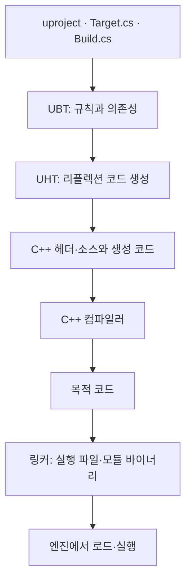

## C++ 파일에서 실행 가능한 모듈까지

[2주차](/writing/cpp-code-structure-containers/)에서는 선언이 보이는 것과 함수 정의가 링크되는 것이 다르다는 점을 다뤘습니다. 이번에는 그 경계를 언리얼의 모듈로 옮깁니다. C# 문법 자체보다 `Build.cs`와 `Target.cs`가 무엇을 결정하는지에 집중합니다. [12주 전체 계획](/writing/unreal-cpp-engine-12-week-plan/)과 [주차별 목록](/series/unreal-cpp-engine/)에서 앞뒤 순서를 확인할 수 있습니다.

예제는 Windows·Unreal Engine 5.8의 독립 프로젝트 `ModuleLab`입니다. 게임 쪽 진입 모듈, 재사용할 Runtime 모듈, Editor 전용 모듈을 만들고 콘솔 명령으로 서로의 연결을 확인합니다. 이 주차의 빌드 명령은 설치된 엔진과 C++ 개발 도구를 사용합니다. 엔진 버전이 다르면 그 버전의 새 C++ 프로젝트가 사용하는 기본 빌드 설정을 기준으로 맞춥니다.

## 1일차 — 누가 빌드를 진행합니까?

### UBT·UHT·컴파일러·링커

UBT는 대상 플랫폼·구성·타깃을 받아 빌드에 필요한 작업과 의존성을 계산하는 도구입니다. Visual Studio의 솔루션 파일 자체가 모듈 의존성의 원본은 아닙니다. C++ 파일을 솔루션에 추가했다는 사실만으로 다른 모듈을 사용할 수 있게 되지는 않습니다. [Epic: Unreal Build Tool](https://dev.epicgames.com/documentation/en-us/unreal-engine/unreal-build-tool-in-unreal-engine)

| 단계 | 입력과 역할 | 대표적인 실패 |
| --- | --- | --- |
| 규칙 평가 | UBT가 Target.cs·Build.cs와 프로젝트 설정을 읽습니다. | 규칙 클래스 이름, C# 문법, 설치 도구 문제 |
| 코드 생성 | UHT가 리플렉션 대상 헤더를 분석하고 등록 코드를 만듭니다. | 잘못된 UPROPERTY 형식, generated.h 배치 |
| 컴파일 | C++ 컴파일러가 각 번역 단위를 검사하고 목적 코드를 만듭니다. | 헤더 누락, 선언되지 않은 이름, 형식 불일치 |
| 링크 | 목적 코드와 필요한 라이브러리의 심벌을 연결합니다. | 정의 누락, 모듈 링크 의존성·내보내기 누락 |
| 로드·실행 | 실행 중인 엔진이 모듈을 로드하고 초기화합니다. | 바이너리 버전 불일치, 모듈 초기화 실패 |



UHT는 일반 C++ 컴파일러를 대체하지 않습니다. `USTRUCT` 등의 정보를 바탕으로 코드를 생성하고, 그 결과도 C++ 컴파일 단계를 거칩니다. 변경이 없는 증분 빌드에서는 모든 작업이 매번 다시 실행되지 않습니다. [Epic: Unreal Header Tool](https://dev.epicgames.com/documentation/en-us/unreal-engine/unreal-header-tool-for-unreal-engine)

### 모듈·타깃·구성을 나누기

언리얼 모듈은 기능과 의존성을 묶는 단위이며 C++20의 `import` 모듈과 다릅니다. 하나의 모듈 안에도 여러 `.cpp`와 번역 단위가 있습니다. Editor 빌드에서는 프로젝트 모듈을 DLL로 나누는 구성이 일반적이지만, 모든 타깃에서 ‘모듈 하나 = DLL 하나’가 성립하지는 않습니다. 단일 실행 파일로 링크하는 구성도 있습니다.

`ModuleLabEditor`는 타깃 이름이고 `Development`는 빌드 구성입니다. Editor 타깃은 에디터를 확장하는 코드를, Game 타깃은 독립 게임용 코드를 구성합니다. Game 타깃의 컴파일 성공과 쿠킹·패키징·배포 가능한 게임 완성은 별도 단계입니다. [Epic: 타깃](https://dev.epicgames.com/documentation/en-us/unreal-engine/unreal-engine-build-tool-target-reference), [빌드 구성](https://dev.epicgames.com/documentation/en-us/unreal-engine/compiling-game-projects-in-unreal-engine-using-cplusplus)

## 2일차 — Runtime 모듈의 경계를 만들기

### 파일 배치와 프로젝트 등록

빈 폴더에 아래 파일을 같은 이름으로 만듭니다. 기존 게임의 파일을 덮어쓰기보다 별도 `ModuleLab` 프로젝트로 시작합니다. `Content` 폴더나 레벨 에셋 없이도 아래 코드의 빌드는 가능합니다. 생성된 `Intermediate`·`Binaries` 파일을 직접 작성하지 않습니다.

```text
ModuleLab/
  ModuleLab.uproject
  Source/
    ModuleLab.Target.cs
    ModuleLabEditor.Target.cs
    ModuleLab/
      ModuleLab.Build.cs
      Private/ModuleLab.cpp
    StudyRuntime/
      StudyRuntime.Build.cs
      Public/StudyMath.h
      Public/StudyCounter.h
      Private/StudyMath.cpp
      Private/StudyRuntimeModule.cpp
    StudyEditor/
      StudyEditor.Build.cs
      Private/StudyEditorModule.cpp
```

`ModuleLab.uproject`

```json
{
  "FileVersion": 3,
  "EngineAssociation": "5.8",
  "Modules": [
    { "Name": "ModuleLab", "Type": "Runtime", "LoadingPhase": "Default" },
    { "Name": "StudyRuntime", "Type": "Runtime", "LoadingPhase": "Default" },
    { "Name": "StudyEditor", "Type": "Editor", "LoadingPhase": "PostEngineInit" }
  ]
}
```

프로젝트의 `Modules`는 모듈의 종류와 로드 단계를 선언합니다. 이것만으로 다른 모듈의 모든 헤더와 함수를 사용할 수 있게 되는 것은 아닙니다. 사용 관계는 `Build.cs`에 선언합니다. 같은 로드 단계에 놓았다고 초기화 순서까지 정해지지도 않습니다. 다른 모듈의 초기화 결과가 꼭 필요하면 명시적인 로드와 의존성을 설계해야 합니다. [Epic: 모듈 구성과 로드](https://dev.epicgames.com/documentation/en-us/unreal-engine/unreal-engine-modules)

`Source/ModuleLab.Target.cs`

```csharp
using UnrealBuildTool;

public class ModuleLabTarget : TargetRules
{
    public ModuleLabTarget(TargetInfo Target) : base(Target)
    {
        Type = TargetType.Game;
        DefaultBuildSettings = BuildSettingsVersion.V7;
        IncludeOrderVersion = EngineIncludeOrderVersion.Unreal5_8;
        ExtraModuleNames.Add("ModuleLab");
    }
}
```

`Source/ModuleLabEditor.Target.cs`

```csharp
using UnrealBuildTool;

public class ModuleLabEditorTarget : TargetRules
{
    public ModuleLabEditorTarget(TargetInfo Target) : base(Target)
    {
        Type = TargetType.Editor;
        DefaultBuildSettings = BuildSettingsVersion.V7;
        IncludeOrderVersion = EngineIncludeOrderVersion.Unreal5_8;
        ExtraModuleNames.AddRange(new[] { "ModuleLab", "StudyEditor" });
    }
}
```

`ExtraModuleNames`에는 타깃에 포함할 프로젝트 모듈을 지정합니다. 각 모듈이 필요한 다른 모듈은 의존성 그래프로 이어집니다. `Target.cs`와 `Build.cs`는 UBT가 빌드 설정을 구성할 때 실행하는 C# 규칙입니다. 파일명·규칙 클래스명·생성자 이름을 함께 맞춥니다. 여기의 `V7`과 `Unreal5_8`은 UE 5.8 템플릿 기준이며 다른 버전의 프로젝트에 그대로 복사하는 설정이 아닙니다.

### Public과 Private 의존성

`Public`·`Private` 폴더는 모듈 밖으로 노출할 헤더의 경계를 정합니다. C++ 클래스의 `public:`·`private:` 접근 지정자와 별개입니다. 외부에 제공하는 헤더에서 필요한 의존성은 공개 의존성에, 내부 구현에서만 필요한 것은 비공개 의존성에 둡니다. 모든 의존성을 공개로 두면 사용하는 쪽까지 불필요한 의존성이 전파됩니다.

아래 Runtime 모듈의 공개 헤더는 `Core`의 정수 형식과 `CoreUObject`의 리플렉션 구조체를 사용합니다. 따라서 둘을 공개 의존성으로 둡니다. [Epic: 모듈 속성](https://dev.epicgames.com/documentation/en-us/unreal-engine/module-properties-in-unreal-engine)

`Source/StudyRuntime/StudyRuntime.Build.cs`

```csharp
using UnrealBuildTool;

public class StudyRuntime : ModuleRules
{
    public StudyRuntime(ReadOnlyTargetRules Target) : base(Target)
    {
        PCHUsage = PCHUsageMode.UseExplicitOrSharedPCHs;
        PublicDependencyModuleNames.AddRange(new[] { "Core", "CoreUObject" });
    }
}
```

`Source/StudyRuntime/Private/StudyRuntimeModule.cpp`

```cpp
#include "Modules/ModuleManager.h"
#include "Logging/LogMacros.h"

class FStudyRuntimeModule final : public IModuleInterface
{
public:
    void StartupModule() override
    {
        UE_LOG(LogTemp, Display, TEXT("StudyRuntime startup"));
    }

    void ShutdownModule() override
    {
        UE_LOG(LogTemp, Display, TEXT("StudyRuntime shutdown"));
    }
};

IMPLEMENT_MODULE(FStudyRuntimeModule, StudyRuntime)
```

`StartupModule`은 모듈 초기화 시점의 콜백입니다. Actor가 레벨에 배치되거나 게임을 시작할 때 호출되는 `BeginPlay`와는 다릅니다. 여기에서는 월드나 플레이어 객체를 찾지 않고 초기화 로그만 남깁니다.

### 외부 호출에 필요한 API 매크로

`Source/StudyRuntime/Public/StudyMath.h`

```cpp
#pragma once
#include "CoreTypes.h"

class STUDYRUNTIME_API FStudyMath
{
public:
    static int32 AddClamped(int32 Current, int32 Delta, int32 Maximum);
};
```

`Source/StudyRuntime/Private/StudyMath.cpp`

```cpp
#include "StudyMath.h"
#include "Math/UnrealMathUtility.h"

int32 FStudyMath::AddClamped(int32 Current, int32 Delta, int32 Maximum)
{
    const int64 Sum = static_cast<int64>(Current) + Delta;
    const int64 Limit = FMath::Max<int64>(Maximum, 0);
    return static_cast<int32>(FMath::Clamp<int64>(Sum, 0, Limit));
}
```

계산 계약은 합계를 `0`부터 음수가 아닌 상한까지 제한하는 것입니다. 덧셈을 먼저 `int64`로 계산해 `int32` 덧셈의 범위 초과를 피합니다.

`STUDYRUNTIME_API`는 모듈 이름에서 만들어지는 내보내기·가져오기 매크로입니다. DLL을 만드는 쪽과 사용하는 쪽에서 의미가 달라지며, 단일 실행 파일 구성에서는 비어 있을 수 있습니다. 공개 폴더에 선언이 있어도 다른 DLL에서 호출할 함수의 심벌이 내보내지지 않았다면 링크가 실패할 수 있습니다. [Epic: Module API Specifiers](https://dev.epicgames.com/documentation/en-us/unreal-engine/module-api-specifiers-in-unreal-engine)

## 3일차 — UHT 생성 코드와 호출 모듈 연결하기

### 일반 C++ 클래스와 리플렉션 구조체

`FStudyMath`는 일반 C++ 클래스이며 `GENERATED_BODY`가 없습니다. 반면 아래 구조체는 `USTRUCT`와 `UPROPERTY` 정보를 UHT가 처리합니다. 세부 리플렉션은 4주차에서 이어가고, 여기서는 헤더 하나가 생성 코드로 연결되는 경로를 봅니다.

`Source/StudyRuntime/Public/StudyCounter.h`

```cpp
#pragma once
#include "CoreMinimal.h"
#include "StudyCounter.generated.h"

USTRUCT(BlueprintType)
struct STUDYRUNTIME_API FStudyCounter
{
    GENERATED_BODY()

    UPROPERTY(EditAnywhere, BlueprintReadWrite, Category = "Study")
    int32 Value = 0;
};
```

`StudyCounter.generated.h`는 이 헤더의 마지막 `#include`로 둡니다. 직접 만들거나 `Source`로 복사하지 않습니다. 빌드 뒤 `Intermediate`에서 파일 이름을 검색해 생성된 헤더와 `.gen.cpp`를 읽습니다. 생성 경로의 중간 폴더는 타깃·엔진 버전에 따라 달라질 수 있습니다.

### 게임 모듈에서 호출하기

`Source/ModuleLab/ModuleLab.Build.cs`

```csharp
using UnrealBuildTool;

public class ModuleLab : ModuleRules
{
    public ModuleLab(ReadOnlyTargetRules Target) : base(Target)
    {
        PCHUsage = PCHUsageMode.UseExplicitOrSharedPCHs;
        PrivateDependencyModuleNames.AddRange(new[]
        {
            "Core", "CoreUObject", "Engine", "StudyRuntime"
        });
    }
}
```

`Source/ModuleLab/Private/ModuleLab.cpp`

```cpp
#include "Modules/ModuleManager.h"
#include "HAL/IConsoleManager.h"
#include "UObject/Class.h"
#include "StudyMath.h"
#include "StudyCounter.h"

static void RunStudyBuildProbe()
{
    FStudyCounter Counter;
    Counter.Value = FStudyMath::AddClamped(95, 20, 100);
    const int32 Lower = FStudyMath::AddClamped(3, -8, 100);
    const int32 Wide = FStudyMath::AddClamped(MAX_int32, 1, 100);
    const int32 NegativeLimit = FStudyMath::AddClamped(5, 1, -10);

    check(Counter.Value == 100);
    check(Lower == 0 && Wide == 100 && NegativeLimit == 0);
    UScriptStruct* Type = FStudyCounter::StaticStruct();
    check(Type != nullptr);
    UE_LOG(LogTemp, Display,
        TEXT("Study.BuildProbe value=%d lower=%d wide=%d limit=%d type=%s"),
        Counter.Value, Lower, Wide, NegativeLimit, *Type->GetName());
}

static FAutoConsoleCommand StudyBuildProbe(
    TEXT("Study.BuildProbe"),
    TEXT("Run module linkage and reflection probes."),
    FConsoleCommandDelegate::CreateStatic(&RunStudyBuildProbe));

IMPLEMENT_PRIMARY_GAME_MODULE(FDefaultGameModuleImpl, ModuleLab, "ModuleLab")
```

이 모듈은 공개 헤더를 제공하지 않고 `.cpp`에서만 다른 모듈을 사용하므로 의존성을 비공개로 둡니다. `FStudyMath::AddClamped` 호출은 모듈 간 일반 함수 연결을, `StaticStruct()` 호출은 UHT가 만든 리플렉션 코드 연결을 확인합니다. 콘솔 명령 등록에 사용한 정적 객체는 모듈 로드 시 존재하게 되며 실제 계산은 명령을 실행할 때 합니다.

## 4일차 — Editor 전용 코드 분리하기

Editor 모듈은 Runtime 모듈을 사용할 수 있지만, 게임의 Runtime 모듈이 Editor 전용 기능을 무조건 요구하게 만들면 Game 타깃을 구성할 때 문제가 됩니다. 아래에서는 `StudyEditor → StudyRuntime` 방향만 둡니다. `ModuleLab`과 `StudyRuntime`에는 `UnrealEd` 의존성이 없습니다.

`Source/StudyEditor/StudyEditor.Build.cs`

```csharp
using UnrealBuildTool;

public class StudyEditor : ModuleRules
{
    public StudyEditor(ReadOnlyTargetRules Target) : base(Target)
    {
        PCHUsage = PCHUsageMode.UseExplicitOrSharedPCHs;
        PrivateDependencyModuleNames.AddRange(new[]
        {
            "Core", "CoreUObject", "StudyRuntime", "UnrealEd"
        });
    }
}
```

`Source/StudyEditor/Private/StudyEditorModule.cpp`

```cpp
#include "Modules/ModuleManager.h"
#include "Editor.h"
#include "StudyMath.h"

class FStudyEditorModule final : public IModuleInterface
{
public:
    void StartupModule() override
    {
        const int32 Preview = FStudyMath::AddClamped(10, 5, 20);
        UE_LOG(LogTemp, Display,
            TEXT("StudyEditor startup preview=%d editor=%s"),
            Preview, GEditor ? TEXT("ready") : TEXT("not-ready"));
    }
};

IMPLEMENT_MODULE(FStudyEditorModule, StudyEditor)
```

`.uproject`의 `Editor` 종류와 Editor 타깃의 포함 목록이 역할을 나눕니다. `PostEngineInit`은 엔진 초기화 뒤의 로드 단계입니다. `GEditor` 상태를 로그로 관찰하되 모든 실행 방식에서 동일한 포인터 상태를 전제로 기능을 호출하지 않습니다.

### 빌드하고 명령 실행하기

실습 프로젝트를 열어 둔 에디터는 닫고 일반 빌드를 실행합니다. Live Coding으로 코드 패치를 적용하는 흐름과, 모듈 구성·생성 코드까지 다시 만드는 흐름을 구분하기 위해서입니다. 다음 PowerShell의 프로젝트 경로는 실제 예제 폴더로 바꿉니다.

```powershell
$EngineRoot = 'C:\Program Files\Epic Games\UE_5.8'
$LabRoot = 'C:\Projects\ModuleLab'
$ProjectFile = Join-Path $LabRoot 'ModuleLab.uproject'

& "$EngineRoot\Engine\Build\BatchFiles\Build.bat" `
    ModuleLabEditor Win64 Development "-Project=$ProjectFile" -WaitMutex
```

성공하면 `.uproject`를 열고 에디터 콘솔에 `Study.BuildProbe`를 입력합니다. Output Log에서 확인할 본문은 다음과 같습니다. 앞의 시간·로그 분류는 실행 환경에 따라 붙습니다.

```text
Study.BuildProbe value=100 lower=0 wide=100 limit=0 type=StudyCounter
```

`StudyRuntime startup`과 `StudyEditor startup` 로그도 찾습니다. Play 버튼이나 Actor 배치 없이 모듈 로드와 콘솔 함수를 관찰할 수 있습니다. 모듈 초기화 로그가 보인다는 것만으로 게임 월드의 생명주기까지 확인한 것은 아닙니다.

같은 프로젝트를 Game 타깃으로도 빌드합니다. 이때 `StudyEditor`가 게임 코드의 필수 의존성으로 들어오지 않는지 빌드 출력에서 확인합니다. 이 명령은 쿠킹과 패키징을 수행하지 않습니다.

```powershell
& "$EngineRoot\Engine\Build\BatchFiles\Build.bat" `
    ModuleLab Win64 Development "-Project=$ProjectFile" -WaitMutex
```

## 5일차 — 오류를 한 단계씩 재현하기

### 첫 오류에서 분류하기

한 번에 한 가지 변경만 적용하고 매번 원래 상태로 복구합니다. 마지막 `Build failed` 문장보다 먼저 나온 도구 이름·파일·행·심벌을 읽습니다. 뒤따르는 오류는 첫 실패의 결과일 수 있습니다.

| 바꿀 내용 | 예상하는 실패 단계 | 복구할 내용 |
| --- | --- | --- |
| ModuleLab.cpp에서 StudyMath.h include 제거 | C++ 컴파일: FStudyMath 선언을 알 수 없음 | 해당 include 복원 |
| StudyMath.h에서 STUDYRUNTIME_API 제거 | DLL 방식 Editor 빌드의 링크: 외부 함수 심벌을 찾지 못함 | API 매크로 복원 |
| ModuleLab.Build.cs에서 StudyRuntime 의존성 제거 | 보통 헤더 탐색·컴파일부터 실패 | 직접 의존성 복원 |
| StudyCounter.generated.h 뒤에 다른 include 추가 | UHT: generated.h가 마지막 include가 아님 | generated.h를 마지막으로 이동 |

의존성을 빼면 언제나 링크 오류가 난다고 단정하지 않습니다. 헤더를 찾는 경로부터 사라지면 컴파일 단계에서 먼저 실패합니다. 헤더만 보이게 하고 링크 의존성을 빼는 실험은 아래처럼 구분할 수 있습니다. 성공 예제의 설정을 바꾸는 일시적인 실패 실험입니다.

```csharp
// ModuleLab.Build.cs: 기존 StudyRuntime 의존성을 제거한 뒤 임시로 추가합니다.
PrivateIncludePathModuleNames.Add("StudyRuntime");
```

`PrivateIncludePathModuleNames`는 해당 모듈의 공개 헤더 경로를 제공하는 설정이며 함수 구현에 대한 링크 의존성 선언을 대신하지 않습니다. 이 예제는 외부 정의 함수를 호출하므로 헤더만 보이는 것으로는 충분하지 않습니다. 실험 뒤에는 이 줄을 지우고 원래 `PrivateDependencyModuleNames`를 복구합니다. [Epic: include 경로와 의존성 속성](https://dev.epicgames.com/documentation/en-us/unreal-engine/module-properties-in-unreal-engine)

### Unity Build와 PCH가 숨긴 의존성

Unity Build는 여러 `.cpp`를 묶어 컴파일하는 최적화이며 Unity 게임 엔진과 관계없습니다. PCH는 공통 헤더의 처리 결과를 재사용합니다. 두 방식 때문에 우연히 다른 파일이 먼저 포함한 선언에 기대는 코드가 통과할 수 있습니다. 필요한 헤더를 직접 포함하는 것이 기준이고, 최적화 설정은 그 위에 놓입니다.

헤더 누락을 재현할 때는 다음처럼 Unity Build와 PCH를 끈 빌드도 비교합니다. 컴파일 시간이 늘 수 있으므로 의존성 점검에 사용합니다. `.cpp`에 대응하는 자신의 헤더가 있다면 먼저 포함해 그 헤더가 독립적으로 필요한 선언을 갖추는지도 확인합니다. [Epic: Include What You Use](https://dev.epicgames.com/documentation/en-us/unreal-engine/include-what-you-use-iwyu-for-unreal-engine-programming)

```powershell
& "$EngineRoot\Engine\Build\BatchFiles\Build.bat" `
    ModuleLabEditor Win64 Development "-Project=$ProjectFile" `
    -WaitMutex -DisableUnity -NoPCH
```

`Intermediate`를 지우는 것을 첫 해결책으로 삼기보다 규칙 평가·UHT·컴파일·링크 중 어디에서 실패했는지 먼저 분류합니다. IDE에서만 보이는 generated.h 밑줄과 실제 UBT 실패도 구분합니다. 새 파일이나 모듈 구성을 바꾼 뒤에는 프로젝트 파일을 다시 생성해 IDE의 탐색 정보를 맞춥니다.

## 3주차 마무리 과제

| 날짜 | 구현할 내용 | 설명할 질문 |
| --- | --- | --- |
| 1일차 | 빌드 로그에서 도구와 단계 표시 | UHT 성공 뒤에도 C++ 빌드가 실패할 수 있는 이유는 무엇입니까? |
| 2일차 | StudyRuntime과 공개 함수 작성 | Public 헤더와 API 매크로가 해결하는 문제는 어떻게 다릅니까? |
| 3일차 | USTRUCT 생성 코드와 콘솔 명령 연결 | 직접 쓴 코드와 생성된 코드는 어디에서 만납니까? |
| 4일차 | StudyEditor 분리와 두 타깃 빌드 | 게임 모듈이 UnrealEd를 요구하지 않게 하려면 의존 방향은 어떠해야 합니까? |
| 5일차 | 실패 실험·복구와 일반 빌드 비교 | 헤더가 보이는 것과 링크할 구현이 있는 것은 왜 별개입니까? |

자료를 닫고 `StudyMath`에 범위를 제한하는 함수를 하나 더 추가합니다. 공개 선언, 비공개 구현, API 매크로, 호출 모듈의 의존성 중 무엇이 필요한지 적고 콘솔 명령에서 경계값을 확인합니다. 이어서 `FStudyCounter`의 필드를 추가한 뒤 UHT가 생성한 코드에서 해당 이름을 찾아 4주차의 리플렉션으로 연결합니다.

변형 과제의 핵심은 다음과 같습니다. `Build.cs`는 모듈의 컴파일·링크 환경을, `Target.cs`는 빌드할 실행 대상의 구성을 정합니다. 헤더 누락은 선언을, 링크 오류는 정의·의존성·내보내기를 확인합니다. `generated.h`는 수동 수정 대상이 아니며, Editor 기능은 게임 코드가 무조건 요구하는 방향으로 연결하지 않습니다.

설명과 예제는 Codex의 도움으로 별도 작성했습니다. 개인 게임 프로젝트의 소스를 옮긴 것이 아니며, 공식 문서는 각 개념 옆에 연결했습니다.
