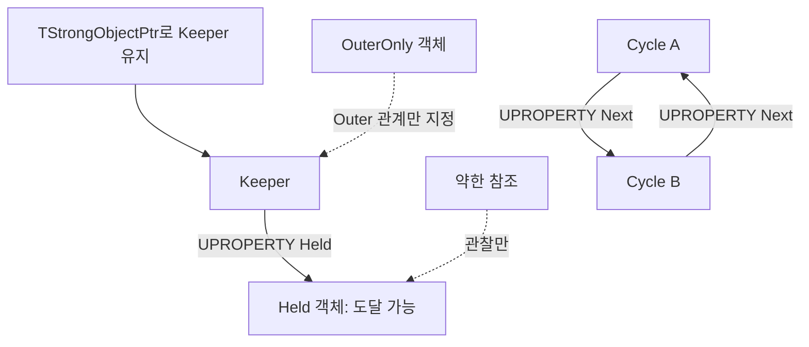

## 참조를 보관하는 것과 메모리를 소유하는 것

[4주차](/writing/unreal-uobject-reflection/)에서는 엔진에 등록한 속성과 일반 C++ 멤버를 구분했습니다. 이번에는 그 차이가 UObject의 수명에 어떻게 영향을 주는지 확인합니다. C#·C 공통 문법은 알고 있다는 전제로, [1주차의 RAII와 포인터](/writing/cpp-objects-memory-lifetime/)를 언리얼의 참조 추적과 비교합니다. [전체 계획](/writing/unreal-cpp-engine-12-week-plan/)과 [주차별 목록](/series/unreal-cpp-engine/)도 함께 연결합니다.

Windows·Unreal Engine 5.8의 `ModuleLab`을 이어 사용합니다. 4주차까지의 `StudyRuntime`은 Core·CoreUObject·Engine에 의존합니다. 아래 여섯 파일을 추가하며 기존 클래스와 모듈 시작 코드는 교체하지 않습니다. 예제의 강제 GC 명령은 독립 프로젝트에서 **Standalone Game**으로 실행합니다.

## 1일차 — 객체 종류에 맞는 생성과 종료

### 객체 종류별 생성 함수

| 대상과 시점 | 사용할 경로 | 함께 생각할 것 |
| --- | --- | --- |
| 일반 C++ 값·자료 구조 | 지역 변수, 표준 스마트 포인터 등 | RAII와 명시한 소유권 규칙 |
| 실행 중 일반 UObject | NewObject | 생성 후 어떤 경로가 참조를 유지할지 결정 |
| 월드에 참여하는 Actor | UWorld::SpawnActor | 월드·레벨·컴포넌트 초기화와 플레이 상태 |
| 생성자의 기본 컴포넌트 | CreateDefaultSubobject | 클래스의 기본 서브오브젝트 구성 |
| 실행 중 동적 컴포넌트 | NewObject 후 적절한 소유·등록 처리 | 생성만으로 월드에 등록되지 않음 |

`NewObject`는 언리얼 객체 생성 경로를 통과하게 합니다. C++ 생성자 인수에 게임 데이터를 넣는 대신 생성 이후 별도 초기화 함수를 호출할 수 있습니다. `NewObject<AActor>`로 Actor의 월드 등록을 대신하지 않습니다. UObject 계열은 직접 `new`·`delete`하거나 `std::unique_ptr`의 기본 삭제자로 지우지 않습니다. [Epic: UObject 생성](https://dev.epicgames.com/documentation/en-us/unreal-engine/creating-objects-in-unreal-engine)

`TSharedPtr`의 참조 횟수 관리와 UObject의 GC는 다른 체계입니다. 언리얼의 일반 스마트 포인터를 UObject 소유권에 섞지 않습니다. 반면 FString 같은 값이나 별도의 C++ 버퍼를 UObject의 멤버로 보관하는 것은 가능하며, 그 멤버의 자원 관리는 해당 C++ 형식의 규칙을 따릅니다.

동적 컴포넌트를 만들 때는 Actor와의 관계, 참조 유지, `RegisterComponent()`가 필요한지까지 확인합니다. `CreateDefaultSubobject`로 만든 기본 컴포넌트는 Actor 생성 과정에서 등록되는 경로를 사용합니다. 컴포넌트를 `UnregisterComponent()`한 것과 객체를 파괴한 것은 다릅니다. [Epic: Components](https://dev.epicgames.com/documentation/en-us/unreal-engine/components-in-unreal-engine)

### Outer는 자동 삭제 소유자가 아닙니다

`NewObject<UStudyGCObject>(Keeper)`의 `Keeper`는 새 객체의 Outer입니다. Outer는 객체의 포함 관계·이름 경로 등에 쓰입니다. 하지만 이 호출만으로 **Keeper가 새 객체를 강하게 참조하는 멤버를 얻는 것은 아닙니다**.

일반 UObject를 생성하고 Outer만 지정한 경우와, 살아 있는 객체의 `UPROPERTY`에 보관한 경우를 아래 실습에서 따로 비교합니다. Actor의 컴포넌트 관리처럼 엔진이 추가 참조를 보관하는 구조까지 모두 Outer 하나로 설명하지 않습니다. Outer·Actor Owner·장면 Attach Parent·GC 참조는 서로 다른 관계입니다.

## 2일차 — GC가 추적하는 참조

### 도달 가능한 객체에서 출발합니다

GC는 보존할 시작점과 엔진이 아는 참조들을 따라가며 도달 가능성을 조사합니다. C++ 포인터가 메모리 어딘가에 들어 있다는 이유만으로 모든 주소를 검색하지 않습니다. 살아 있는 객체가 등록된 속성으로 다른 UObject를 참조하면 그 대상도 추적 대상이 됩니다. 서로만 가리키는 두 객체에 외부 경로가 없다면 순환 참조 자체는 생존 근거가 되지 않습니다.



이 그림은 이번 예제의 참조 관계입니다. 실제 GC에는 엔진 내부 참조 수집과 클러스터 등도 참여합니다. 참조를 끊는 순간 즉시 C++ 소멸자가 실행되는 참조 횟수 방식으로 생각하지 않습니다. 수거 대상으로 판정하는 시점과 메모리를 정리하는 작업도 분리될 수 있습니다.

| 보관 방식 | 이 글에서의 용도 | 수명에 대한 의미 |
| --- | --- | --- |
| UPROPERTY + TObjectPtr | 살아 있는 UObject의 지속 멤버 | GC가 추적하는 참조 |
| TWeakObjectPtr | 사라질 수 있는 대상 관찰 | 그 참조만으로는 생존을 유지하지 않음 |
| TStrongObjectPtr | 일반 C++ 범위에서 잠시 UObject 보존 | GC가 아는 강한 참조를 제공 |
| 일반 로컬 포인터·미등록 TObjectPtr | 짧은 접근·비교 실험 | 존재 자체가 GC 보호를 보장하지 않음 |

`UPROPERTY(Transient)`도 참조 추적에 참여합니다. `Transient`는 저장 정책이며 약한 참조라는 뜻이 아닙니다. `TObjectPtr`를 사용했다는 사실만으로 미등록 지역 변수까지 강한 GC 참조가 되지도 않습니다. `USTRUCT` 안의 참조 역시 그 구조체가 엔진이 추적하는 경로에 들어 있어야 합니다. [Epic: Object Pointers](https://dev.epicgames.com/documentation/en-us/unreal-engine/object-pointers-in-unreal-engine)

UPROPERTY는 그 필드를 가진 객체 자체를 루트로 만들지 않습니다. Keeper까지 도달하는 경로가 없다면 Keeper와 Held가 함께 수거될 수 있습니다. 아래에서는 이 조건을 분리하려고 Keeper를 명시적으로 보존합니다.

`TStrongObjectPtr`를 사용한 범위가 끝나거나 `Reset()`하면 보존 근거 하나가 사라집니다. 이때 바로 `delete`하는 것은 아닙니다. 장기간 붙잡거나 람다에 캡처하면 의도보다 오래 살릴 수 있으므로 보존 범위를 짧게 둡니다. 같은 목적에 `AddToRoot()`를 무조건 붙이면 해제 책임을 놓치기 쉽습니다.

증분 도달 가능성 분석에서는 `TObjectPtr`의 쓰기 장벽도 관계가 있습니다. 그렇다고 객체 포인터 하나만 바꿨을 때 모든 스레드 접근이 안전해지는 것은 아닙니다. 이번 예제는 게임 스레드에서 실행하며 GC 설정을 변경하지 않습니다. [Epic: Incremental Garbage Collection](https://dev.epicgames.com/documentation/en-us/unreal-engine/incremental-garbage-collection-in-unreal-engine)

## 3일차 — 참조를 끊고 수거 결과 비교하기

### 객체와 참조 보관자

`Source/StudyRuntime/Public/StudyGCObject.h`

```cpp
#pragma once

#include "CoreMinimal.h"
#include "UObject/Object.h"
#include "StudyGCObject.generated.h"

UCLASS()
class STUDYRUNTIME_API UStudyGCObject : public UObject
{
    GENERATED_BODY()
public:
    UPROPERTY()
    FName Label;

    UPROPERTY()
    TObjectPtr<UStudyGCObject> Next;

    void BeginDestroy() override;
};

UCLASS()
class STUDYRUNTIME_API UStudyGCKeeper : public UObject
{
    GENERATED_BODY()
public:
    UPROPERTY(Transient)
    TObjectPtr<UStudyGCObject> Held;
};
```

`Source/StudyRuntime/Private/StudyGCObject.cpp`

```cpp
#include "StudyGCObject.h"

void UStudyGCObject::BeginDestroy()
{
    if (!HasAnyFlags(RF_ClassDefaultObject))
    {
        UE_LOG(LogTemp, Display, TEXT("Study.GC BeginDestroy label=%s"),
            *Label.ToString());
    }
    Super::BeginDestroy();
}
```

로그에는 객체 자신의 값만 사용합니다. 다른 객체의 파괴 순서에 기대어 접근하거나 게임플레이 정리를 이 함수까지 미루지 않습니다.

### 독립 명령에서 GC 실행하기

`Source/StudyRuntime/Private/StudyGCProbe.cpp`

```cpp
#include "StudyGCObject.h"
#include "Engine/World.h"
#include "HAL/IConsoleManager.h"
#include "UObject/GarbageCollection.h"
#include "UObject/Package.h"
#include "UObject/StrongObjectPtr.h"
#include "UObject/UObjectGlobals.h"

namespace StudyGC
{
    UStudyGCObject* Make(UObject* Outer, const TCHAR* Label)
    {
        auto* Object = NewObject<UStudyGCObject>(Outer);
        Object->Label = FName(Label);
        return Object;
    }

    void Run(UWorld* World)
    {
        if (!World || !World->IsGameWorld())
        {
            UE_LOG(LogTemp, Warning, TEXT("Run Study.GCProbe in a game world."));
            return;
        }
        check(IsInGameThread());

        TStrongObjectPtr<UStudyGCKeeper> Keeper(NewObject<UStudyGCKeeper>());
        TWeakObjectPtr<UStudyGCKeeper> KeeperWatch(Keeper.Get());
        Keeper->Held = Make(Keeper.Get(), TEXT("Held"));
        TWeakObjectPtr<UStudyGCObject> HeldWatch(Keeper->Held.Get());
        TWeakObjectPtr<UStudyGCObject> OuterWatch(
            Make(Keeper.Get(), TEXT("OuterOnly")));

        TObjectPtr<UStudyGCObject> LocalOnly =
            Make(GetTransientPackage(), TEXT("LocalOnly"));
        TWeakObjectPtr<UStudyGCObject> LocalWatch(LocalOnly.Get());

        TWeakObjectPtr<UStudyGCObject> CycleWatch;
        {
            auto* A = Make(GetTransientPackage(), TEXT("CycleA"));
            auto* B = Make(GetTransientPackage(), TEXT("CycleB"));
            A->Next = B;
            B->Next = A;
            CycleWatch = A;
        }

        CollectGarbage(GARBAGE_COLLECTION_KEEPFLAGS, true);
        UE_LOG(LogTemp, Display,
            TEXT("Study.GC first held=%d outer=%d local=%d cycle=%d"),
            HeldWatch.IsValid(), OuterWatch.IsValid(),
            LocalWatch.IsValid(), CycleWatch.IsValid());
        check(HeldWatch.IsValid() && !OuterWatch.IsValid());
        check(!LocalWatch.IsValid() && !CycleWatch.IsValid());
        LocalOnly = nullptr; // 수거된 대상을 역참조하지 않습니다.

        Keeper->Held = nullptr;
        CollectGarbage(GARBAGE_COLLECTION_KEEPFLAGS, true);
        UE_LOG(LogTemp, Display, TEXT("Study.GC release held=%d keeper=%d"),
            HeldWatch.IsValid(), KeeperWatch.IsValid());
        check(!HeldWatch.IsValid() && KeeperWatch.IsValid());

        Keeper.Reset();
        CollectGarbage(GARBAGE_COLLECTION_KEEPFLAGS, true);
        UE_LOG(LogTemp, Display, TEXT("Study.GC final keeper=%d"),
            KeeperWatch.IsValid());
        check(!KeeperWatch.IsValid());
    }

    FAutoConsoleCommandWithWorld Command(
        TEXT("Study.GCProbe"), TEXT("Compare UObject references and GC"),
        FConsoleCommandWithWorldDelegate::CreateStatic(&Run));
}
```

이 명령은 참조 하나씩의 효과를 비교하려고 수거를 강제로 진행합니다. 실제 게임에서 매 프레임 호출하는 패턴이 아닙니다. 수거할 수 있는 객체 자신의 멤버 함수나 그 객체를 사용 중인 콜백 안에서 강제 GC를 실행하는 방식도 피합니다. 여기서는 UObject가 아닌 콘솔 명령 함수에서 실험합니다.

기대하는 핵심 출력은 다음과 같습니다. 각 객체의 `BeginDestroy` 로그 순서는 비교 대상이 아닙니다.

```text
Study.GC first held=1 outer=0 local=0 cycle=0
Study.GC release held=0 keeper=1
Study.GC final keeper=0
```

첫 수거에서 Keeper는 `TStrongObjectPtr`가, Held는 Keeper의 등록된 속성이 유지합니다. OuterOnly는 Outer를 지정했지만 Keeper가 참조하지 않습니다. LocalOnly는 지역 변수에 주소를 보관하고 있어도 등록된 참조가 아닙니다. CycleA와 CycleB는 서로만 참조합니다.

두 번째 수거는 Held에 도달하는 경로를 끊은 결과이고, 세 번째는 Keeper의 보존 근거까지 해제한 결과입니다. `Held = nullptr` 자체를 소멸자 호출로 해석하지 않습니다.

### 약한 참조로 안전하게 관찰하기

수거 후에는 미등록 원시 포인터의 주소가 남아 있을 수 있습니다. 그런 포인터를 역참조하거나 `IsValid(Raw)`에 넣는 것으로 이미 해제된 메모리 접근을 복구할 수는 없습니다. 수거될 수 있는 대상을 이후에도 관찰하려면 `TWeakObjectPtr`를 사용합니다.

약한 참조의 `Get()`으로 유효한 대상이 나오는지 확인한 뒤 짧게 사용합니다. 그것은 미래의 콜백이나 다른 스레드까지 수명을 예약하는 행동은 아닙니다. 비동기 작업·델리게이트·타이머는 실행 시점에 다시 검사하고, 필요한 보존 범위는 별도로 정합니다.

## 4일차 — Actor와 컴포넌트의 플레이 수명

### 생성 경로가 달라도 종료를 관찰할 수 있습니다

레벨에서 로드한 Actor는 `PostLoad`, 실행 중 Spawn한 Actor는 `PostActorCreated` 경로를 비교할 수 있습니다. PIE는 에디터 월드 객체의 복제 경로도 관여합니다. 생성자 호출 횟수만 세어 플레이 시작 횟수를 판단하지 않습니다.

Actor의 컴포넌트 초기화 전후에는 `PreInitializeComponents`와 `PostInitializeComponents`가 있습니다. 컴포넌트의 `InitializeComponent`는 등록 상태와 `bWantsInitializeComponent` 조건을 확인해야 합니다. 아래 컴포넌트는 그 옵션을 명시합니다. [Epic: Actor Lifecycle](https://dev.epicgames.com/documentation/en-us/unreal-engine/unreal-engine-actor-lifecycle)

`Source/StudyRuntime/Public/StudyLifetimeActor.h`

```cpp
#pragma once

#include "CoreMinimal.h"
#include "Components/ActorComponent.h"
#include "GameFramework/Actor.h"
#include "StudyLifetimeActor.generated.h"

UCLASS()
class STUDYRUNTIME_API UStudyLifetimeComponent : public UActorComponent
{
    GENERATED_BODY()
public:
    UStudyLifetimeComponent();
    void OnRegister() override;
    void InitializeComponent() override;
    void BeginPlay() override;
    void EndPlay(const EEndPlayReason::Type Reason) override;
    void BeginDestroy() override;
};

UCLASS()
class STUDYRUNTIME_API AStudyLifetimeActor : public AActor
{
    GENERATED_BODY()
public:
    AStudyLifetimeActor();
    void PostLoad() override;
    void PostActorCreated() override;
    void PostInitializeComponents() override;
    void BeginPlay() override;
    void EndPlay(const EEndPlayReason::Type Reason) override;
    void BeginDestroy() override;

    UPROPERTY(VisibleAnywhere, Category="Study")
    TObjectPtr<UStudyLifetimeComponent> LifetimeComponent;
};

UCLASS()
class STUDYRUNTIME_API UStudyActorKeeper : public UObject
{
    GENERATED_BODY()
public:
    UPROPERTY(Transient)
    TObjectPtr<AStudyLifetimeActor> Target;
};
```

`Source/StudyRuntime/Private/StudyLifetimeActor.cpp`

```cpp
#include "StudyLifetimeActor.h"
#include "Components/SceneComponent.h"

UStudyLifetimeComponent::UStudyLifetimeComponent()
{
    PrimaryComponentTick.bCanEverTick = false;
    bWantsInitializeComponent = true;
}

void UStudyLifetimeComponent::OnRegister()
{
    Super::OnRegister();
    UE_LOG(LogTemp, Display, TEXT("Study.Life Component OnRegister"));
}

void UStudyLifetimeComponent::InitializeComponent()
{
    Super::InitializeComponent();
    UE_LOG(LogTemp, Display, TEXT("Study.Life Component Initialize"));
}

void UStudyLifetimeComponent::BeginPlay()
{
    Super::BeginPlay();
    UE_LOG(LogTemp, Display, TEXT("Study.Life Component BeginPlay"));
}

void UStudyLifetimeComponent::EndPlay(const EEndPlayReason::Type Reason)
{
    UE_LOG(LogTemp, Display, TEXT("Study.Life Component EndPlay reason=%d"),
        static_cast<int32>(Reason));
    Super::EndPlay(Reason);
}

void UStudyLifetimeComponent::BeginDestroy()
{
    if (!HasAnyFlags(RF_ClassDefaultObject))
        UE_LOG(LogTemp, Display, TEXT("Study.Life Component BeginDestroy"));
    Super::BeginDestroy();
}

AStudyLifetimeActor::AStudyLifetimeActor()
{
    PrimaryActorTick.bCanEverTick = false;
    SetRootComponent(CreateDefaultSubobject<USceneComponent>(TEXT("SceneRoot")));
    LifetimeComponent = CreateDefaultSubobject<UStudyLifetimeComponent>(
        TEXT("LifetimeComponent"));
}

void AStudyLifetimeActor::PostLoad()
{
    Super::PostLoad();
    UE_LOG(LogTemp, Display, TEXT("Study.Life Actor PostLoad name=%s"), *GetName());
}

void AStudyLifetimeActor::PostActorCreated()
{
    Super::PostActorCreated();
    UE_LOG(LogTemp, Display, TEXT("Study.Life Actor PostActorCreated name=%s"), *GetName());
}

void AStudyLifetimeActor::PostInitializeComponents()
{
    Super::PostInitializeComponents();
    UE_LOG(LogTemp, Display, TEXT("Study.Life Actor PostInitialize name=%s"), *GetName());
}

void AStudyLifetimeActor::BeginPlay()
{
    Super::BeginPlay();
    UE_LOG(LogTemp, Display, TEXT("Study.Life Actor BeginPlay name=%s"), *GetName());
}

void AStudyLifetimeActor::EndPlay(const EEndPlayReason::Type Reason)
{
    UE_LOG(LogTemp, Display, TEXT("Study.Life Actor EndPlay name=%s reason=%d"),
        *GetName(), static_cast<int32>(Reason));
    Super::EndPlay(Reason);
}

void AStudyLifetimeActor::BeginDestroy()
{
    if (!HasAnyFlags(RF_ClassDefaultObject))
        UE_LOG(LogTemp, Display, TEXT("Study.Life Actor BeginDestroy name=%s"), *GetName());
    Super::BeginDestroy();
}
```

`OnRegister`는 에디터에서도 여러 번 나타날 수 있습니다. `BeginPlay`와 같은 의미로 사용하지 않습니다. 또한 이 코드의 Actor BeginPlay 로그는 `Super` 뒤에 있고 EndPlay 로그는 `Super` 앞에 있습니다. 출력 순서를 해석할 때 자신의 로그 위치와 부모 함수 안에서 호출되는 컴포넌트 경로를 함께 봅니다.

## 5일차 — Destroy와 실제 수거 분리하기

### 강한 참조가 Actor의 Destroy를 막지는 않습니다

일반 UObject의 도달 가능성과 Actor를 게임에서 제거하는 요청은 구분합니다. Actor를 등록된 속성으로 보관해도 명시적인 `Destroy()`를 무효화하지 않습니다. 반환값을 확인하고, 성공한 Actor에는 이후 게임 로직을 계속 수행하지 않습니다. 메모리의 즉시 해제가 보장되는 것도 아닙니다. [Epic: AActor::Destroy](https://dev.epicgames.com/documentation/en-us/unreal-engine/API/Runtime/Engine/AActor/Destroy)

`Source/StudyRuntime/Private/StudyActorGCProbe.cpp`

```cpp
#include "StudyLifetimeActor.h"
#include "Engine/World.h"
#include "HAL/IConsoleManager.h"
#include "UObject/GarbageCollection.h"
#include "UObject/StrongObjectPtr.h"
#include "UObject/UObjectGlobals.h"

namespace StudyActorGC
{
    void Run(UWorld* World)
    {
        if (!World || !World->IsGameWorld())
        {
            UE_LOG(LogTemp, Warning, TEXT("Run Study.ActorGCProbe in a game world."));
            return;
        }
        check(IsInGameThread());
        TStrongObjectPtr<UStudyActorKeeper> Keeper(NewObject<UStudyActorKeeper>());
        Keeper->Target = World->SpawnActor<AStudyLifetimeActor>();
        if (!IsValid(Keeper->Target.Get()))
            return;

        TWeakObjectPtr<AStudyLifetimeActor> Watch(Keeper->Target.Get());
        UE_LOG(LogTemp, Display, TEXT("Study.ActorGC spawned begun=%d"),
            Keeper->Target->HasActorBegunPlay());

        const bool bAccepted = Keeper->Target->Destroy();
        UE_LOG(LogTemp, Display,
            TEXT("Study.ActorGC destroy accepted=%d pointer=%d valid=%d weak=%d"),
            bAccepted, Keeper->Target != nullptr,
            IsValid(Keeper->Target.Get()), Watch.IsValid());
        if (!bAccepted)
            return;

        CollectGarbage(GARBAGE_COLLECTION_KEEPFLAGS, true);
        UE_LOG(LogTemp, Display, TEXT("Study.ActorGC collected null=%d weak=%d"),
            Keeper->Target == nullptr, Watch.IsValid());
        check(Keeper->Target == nullptr && !Watch.IsValid());
    }

    FAutoConsoleCommandWithWorld Command(
        TEXT("Study.ActorGCProbe"), TEXT("Compare Actor Destroy and GC"),
        FConsoleCommandWithWorldDelegate::CreateStatic(&Run));
}
```

플레이가 시작된 일반 게임 월드에서 실행하면, 이 예제의 Actor는 Spawn이 반환할 때 BeginPlay까지 진행한 상태입니다.

```text
Study.ActorGC spawned begun=1
Study.ActorGC destroy accepted=1 pointer=1 valid=0 weak=0
Study.ActorGC collected null=1 weak=0
```

위 메시지 사이에 Actor와 Component의 EndPlay가, 이후 GC에서 BeginDestroy가 나타납니다. 단순히 `pointer != nullptr`인 것과 사용할 수 있는 대상인지는 다릅니다. 실행 조건을 고정한 예제이며, 어떤 Actor든 Spawn 직후에 반드시 BeginPlay가 끝난다는 규칙은 아닙니다. 지연 Spawn, 네트워크, 아직 플레이를 시작하지 않은 World에서는 조건이 다릅니다.

### EndPlay에서 정리할 것

`EndPlay`는 Destroy뿐 아니라 레벨 전환·PIE 종료·스트리밍에 의한 제거·앱 종료에서도 관찰합니다. 게임 객체가 그 World에 참여하지 않게 되었을 때 필요한 정리를 이곳에서 수행합니다. World 참조, 구독, 늦게 돌아오는 처리의 취소 방식을 점검합니다. 자신이 등록한 타이머나 델리게이트는 등록 방식에 맞춰 해제하거나 무효화합니다.

`BeginDestroy`는 GC의 파괴 처리 쪽에 있습니다. 이어서 `IsReadyForFinishDestroy`와 `FinishDestroy` 단계가 있으며 다른 스레드의 자원 등을 기다릴 수도 있습니다. 여기에서 World나 다른 Actor를 아직 사용할 수 있다고 가정하지 않습니다. 각 함수의 `Super` 호출도 유지합니다.

EndPlay가 있었다는 사실만으로 그 순간 메모리가 해제되었다고 판단하지 않습니다. 스트리밍 조건에 따라 GC 전에 같은 Actor가 다시 사용될 수도 있으므로, 재사용할 때 어떤 상태를 초기화할지도 설계합니다.

## 빌드와 5일 실습 순서

에디터를 닫고 여섯 파일을 저장한 뒤 Editor 타깃을 빌드합니다. PowerShell의 경로는 자신의 환경에 맞춥니다.

```powershell
$EngineRoot = 'C:\Program Files\Epic Games\UE_5.8'
$ProjectFile = (Resolve-Path '.\ModuleLab.uproject').Path
& "$EngineRoot\Engine\Build\BatchFiles\Build.bat" `
    ModuleLabEditor Win64 Development "-Project=$ProjectFile" -WaitMutex
```

1. 빈 레벨을 `/Game/GCLifetimeMap`으로 저장하고 `StudyLifetimeActor` 하나를 배치해 다시 저장합니다. 메시가 없으므로 Outliner에서 선택합니다.
2. 다른 빈 레벨을 `/Game/GCAfter`로 저장합니다.
3. `GCLifetimeMap`을 Standalone Game으로 실행합니다. 콘솔에서 `Study.GCProbe`, 이어서 `Study.ActorGCProbe`를 실행합니다.
4. 로그의 `Study.GC`와 `Study.ActorGC`에서 참조의 유지·해제와 파괴 전후 상태를 비교합니다. `Study.Life`에서는 배치한 Actor의 PostLoad와 Spawn한 Actor의 PostActorCreated를 구분합니다.
5. 같은 실행에서 `open /Game/GCAfter`를 입력합니다. 배치한 Actor의 EndPlay가 LevelTransition 이유로 호출되는지 확인합니다. 다른 실행에서는 레벨을 이동하지 않고 종료해 Quit 이유와 비교합니다.

이번 로그는 종료 이유를 숫자로 출력합니다. UE 5.8의 `EEndPlayReason`은 Destroyed=0, LevelTransition=1, EndPlayInEditor=2, RemovedFromWorld=3, Quit=4입니다. 게임 구현의 조건에는 숫자를 직접 넣기보다 열거값을 사용합니다.

| 날짜 | 주요 비교 | 설명할 질문 |
| --- | --- | --- |
| 1일차 | UObject·Actor·Component 생성 경로 | NewObject만으로 Actor 생성을 대신할 수 없는 이유는 무엇입니까? |
| 2일차 | 등록된 강한 참조와 약한 참조 | 보존되는 대상까지의 참조 경로가 어디에 있습니까? |
| 3일차 | Held·OuterOnly·LocalOnly·순환 참조 | Outer나 지역 변수의 존재만으로 생존을 보장합니까? |
| 4일차 | 배치·Spawn, Actor와 Component 로그 | OnRegister와 BeginPlay는 어떻게 다릅니까? |
| 5일차 | Destroy·레벨 이동·종료와 GC | EndPlay 이유와 메모리 해제 시점을 구분했습니까? |

변형 과제에서는 Keeper에 `UPROPERTY`를 하나 더 추가해 같은 Held를 참조합니다. 한쪽만 null로 바꾼 경우와 양쪽을 모두 null로 바꾼 경우를 비교합니다. 다음에는 Held의 `Transient`를 빼고 GC 유지 결과가 달라질지 예상한 뒤 확인합니다.

마지막으로 GC 강제 실행을 제거하고 일반 게임 처리로 돌아갑니다. 참조를 끊자마자 BeginDestroy가 필요하도록 설계했는지, 게임상 종료를 EndPlay나 명시적인 상태 전환으로 처리할 수 있는지 점검합니다. 설명과 독립 예제는 Codex의 도움으로 작성했으며 개인 게임 프로젝트의 소스를 사용하지 않았습니다.
