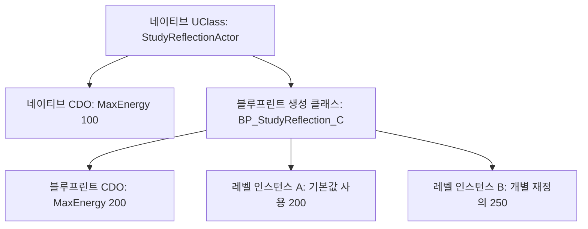

## 선언한 타입을 엔진이 읽는 방법

[3주차](/writing/unreal-build-modules/)에서 UHT가 생성한 코드도 C++ 컴파일·링크를 거친다는 점을 다뤘습니다. 이번에는 생성된 정보가 속성 편집, 함수 호출, 클래스 기본값에 어떻게 사용되는지 확인합니다. C#·C의 공통 문법은 알고 있다는 전제로 진행하며, [전체 계획](/writing/unreal-cpp-engine-12-week-plan/)과 [주차별 목록](/series/unreal-cpp-engine/)에서 다음 순서를 볼 수 있습니다.

예제는 Windows·Unreal Engine 5.8의 `ModuleLab`을 이어 사용합니다. 3주차의 프로젝트와 세 모듈을 먼저 만든 뒤, `StudyRuntime`에 Actor 클래스 하나를 추가합니다. 화면에 메시를 그리는 대신 Details와 Output Log에서 값을 비교합니다.

## 1일차 — UObject·UClass·CDO 구분하기

### 객체, 타입 정보, 기본값은 서로 다릅니다

일반 C++도 클래스와 멤버를 갖지만, 임의의 클래스가 가진 멤버 이름을 엔진이 자동으로 열거할 수 있는 것은 아닙니다. 언리얼의 리플렉션은 등록된 타입·속성·함수를 실행 중에 조회하고 다룰 수 있게 하는 체계입니다. C#의 리플렉션을 떠올릴 수 있지만, 여기서는 UHT가 처리하는 선언과 생성된 C++ 코드가 등록 과정에 참여합니다.

| 대상 | 의미 | 이번 예제에서의 역할 |
| --- | --- | --- |
| UObject | 엔진 객체 체계에 참여하는 객체의 기반 클래스 | Actor도 UObject의 파생 타입입니다. |
| UClass | 특정 클래스의 상속·속성·함수 등을 설명하는 객체 | 현재 인스턴스가 어떤 클래스인지 확인합니다. |
| CDO | 클래스마다 보관하는 기본값 객체, Class Default Object | 해당 클래스의 기본 설정을 읽습니다. |
| 인스턴스 | 특정 클래스에서 만들어진 개별 객체 | 레벨의 Actor마다 다른 값을 가집니다. |

`UClass`도 UObject 계열의 객체이며, CDO 역시 해당 클래스의 객체입니다. CDO는 타입 설명서 자체가 아닙니다. 예를 들어 `MaxEnergy`라는 속성의 형식·플래그는 클래스의 속성 정보에서 찾고, 기본 에너지 숫자는 CDO에서 읽습니다. [Epic: Objects](https://dev.epicgames.com/documentation/en-us/unreal-engine/objects-in-unreal-engine)



그림의 화살표는 클래스 상속과 기본값·인스턴스의 관계입니다. CDO가 인스턴스에 숫자를 매 프레임 공급한다는 뜻은 아닙니다. 생성·로드·에디터의 기본값 갱신 과정과 이미 실행 중인 인스턴스의 상태 변경을 구분해야 합니다.

### StaticClass와 GetClass

`AStudyReflectionActor::StaticClass()`는 코드에 명시한 네이티브 클래스의 정보를 반환합니다. 반면 `Instance->GetClass()`는 그 객체의 실제 클래스를 반환합니다. C++ 포인터 형식이 `AStudyReflectionActor*`여도 대상이 블루프린트 자식이면 `GetClass()`는 블루프린트 생성 클래스를 가리킵니다.

`GetDefault<AStudyReflectionActor>()`는 네이티브 클래스의 CDO입니다. 블루프린트 자식의 기본값이 필요하면 실제 클래스에서 `GetDefaultObject<AStudyReflectionActor>()`를 읽습니다. 두 경로를 혼동하면 블루프린트에서 200으로 바꿨는데 코드에서는 계속 100을 읽는 상황이 생깁니다.

`IsA()`는 파생 관계를 포함해 타입을 검사하며 `Cast<T>()`는 호환되는 UObject 타입이면 포인터를, 아니면 널 포인터를 반환합니다. 실제 값은 여전히 인스턴스가 보관합니다. 객체 이름·에디터의 Actor Label·클래스 이름은 서로 다른 정보입니다.

일반 `UObject`에는 Actor처럼 월드 배치·Transform·자동 Tick이 모두 붙어 있지 않습니다. 월드에 배치할 대상이라서 이번 예제는 `AActor`를 상속합니다. 일반 UObject의 `NewObject`, Actor의 `SpawnActor`, GC 참조와 종료 과정은 5주차에서 다룹니다. 이 객체들은 일반 C++의 스택 변수나 직접 `new`·`delete`하는 객체로 만들지 않습니다.

## 2일차 — 리플렉션으로 공개할 선언 작성하기

### UCLASS·GENERATED_BODY와 생성 헤더

`UCLASS`는 클래스의 등록과 동작에 필요한 지정자를 붙이는 선언입니다. `GENERATED_BODY()`는 UHT가 만든 클래스 지원 코드와 연결됩니다. `#include "StudyReflectionActor.generated.h"`는 이 헤더의 마지막 include로 둡니다. 직접 같은 이름의 파일을 만들거나 생성 결과를 수정하지 않습니다.

`Blueprintable`은 이 클래스를 부모로 블루프린트를 만들 수 있게 하는 설정입니다. `BlueprintType`은 블루프린트 변수·핀의 형식으로 사용할 수 있는지와 관계가 있습니다. 두 설정을 같은 뜻으로 보지 않습니다. 기반 클래스에서 상속되는 설정도 있으므로 사용할 때는 부모의 지정자까지 확인합니다. [Epic: Gameplay Classes](https://dev.epicgames.com/documentation/en-us/unreal-engine/gameplay-classes-in-unreal-engine)

`StudyRuntime`의 공개 헤더가 `AActor`를 상속하므로 `Engine`을 공개 의존성에 추가합니다. 다음 파일은 3주차 내용을 교체하며 나머지 모듈·타깃 설정은 그대로 둡니다.

`Source/StudyRuntime/StudyRuntime.Build.cs`

```csharp
using UnrealBuildTool;

public class StudyRuntime : ModuleRules
{
    public StudyRuntime(ReadOnlyTargetRules Target) : base(Target)
    {
        PCHUsage = PCHUsageMode.UseExplicitOrSharedPCHs;
        PublicDependencyModuleNames.AddRange(new[]
        {
            "Core", "CoreUObject", "Engine"
        });
    }
}
```

### UPROPERTY의 세 가지 질문

속성을 선언할 때는 **어느 편집 화면에서 바꿀 수 있는지**, **블루프린트 그래프에서 읽고 쓸 수 있는지**, **어떻게 저장되는지**를 따로 봅니다.

| 지정자 | 제어하는 범위 | 이 예제의 선택 |
| --- | --- | --- |
| EditAnywhere | 기본값과 인스턴스의 속성 창에서 편집 | MaxEnergy |
| EditDefaultsOnly | 클래스 기본값에서만 편집 | BaseCost |
| EditInstanceOnly | 배치한 인스턴스에서만 편집 | InstanceLabel |
| VisibleInstanceOnly | 인스턴스의 속성 창에서 읽기만 허용 | Energy |
| BlueprintReadWrite | 블루프린트 그래프의 Get·Set 허용 | MaxEnergy·InstanceLabel |
| BlueprintReadOnly | 블루프린트 그래프의 Get 허용 | BaseCost·Energy |
| Transient | 일반적인 에셋·레벨 저장에 유지하지 않을 값 | 실행 중 Energy |

`Visible` 계열과 `Edit` 계열을 같은 속성에 함께 붙이지 않습니다. `EditDefaultsOnly`여도 C++에서 값을 대입할 수 있고, `BlueprintReadOnly`는 C++의 `const`가 아닙니다. Details 편집과 블루프린트 Set 노드는 별도의 통로입니다. `UPROPERTY()`만으로 Details 편집이나 그래프 접근이 모두 열리지도 않습니다. [Epic: Properties](https://dev.epicgames.com/documentation/en-us/unreal-engine/unreal-engine-uproperties)

`meta=(ClampMin="0")`는 에디터 입력에 쓰이는 메타데이터입니다. C++ 대입이나 외부 입력을 막는 게임 규칙으로 의존하지 않습니다. 실제 함수에서도 음수 비용과 부족한 에너지를 검사합니다. [Epic: Metadata Specifiers](https://dev.epicgames.com/documentation/en-us/unreal-engine/metadata-specifiers-in-unreal-engine)

`Source/StudyRuntime/Public/StudyReflectionActor.h`

```cpp
#pragma once

#include "CoreMinimal.h"
#include "GameFramework/Actor.h"
#include "StudyReflectionActor.generated.h"

UCLASS(Blueprintable)
class STUDYRUNTIME_API AStudyReflectionActor : public AActor
{
    GENERATED_BODY()

public:
    AStudyReflectionActor();

    UPROPERTY(EditAnywhere, BlueprintReadWrite, Category="Study",
        meta=(ClampMin="0"))
    int32 MaxEnergy = 100;

    UPROPERTY(EditDefaultsOnly, BlueprintReadOnly, Category="Study",
        meta=(ClampMin="0"))
    int32 BaseCost = 10;

    UPROPERTY(EditInstanceOnly, BlueprintReadWrite, Category="Study")
    FString InstanceLabel;

    UPROPERTY(VisibleInstanceOnly, BlueprintReadOnly, Transient,
        Category="Study")
    int32 Energy = 0;

    // 일반 C++ 멤버입니다. 리플렉션에 등록하지 않습니다.
    int32 PlainCounter = 7;

    UFUNCTION(BlueprintCallable, Category="Study")
    bool SpendEnergy();

    UFUNCTION(BlueprintNativeEvent, BlueprintPure, Category="Study")
    int32 GetUseCost() const;
    virtual int32 GetUseCost_Implementation() const;

    UFUNCTION(BlueprintCallable, CallInEditor, Category="Study")
    void InspectReflection() const;

protected:
    virtual void BeginPlay() override;
};
```

`PlainCounter`는 C++에서 정상적으로 읽고 쓸 수 있지만 이 클래스의 리플렉션 속성에는 등록되지 않습니다. 해당 이름의 `FProperty`도 생성되지 않습니다. 기본 직렬화만 사용하는 이 예제에서는 그 값을 레벨에 보존하지 않습니다. 별도의 수동 직렬화를 구현하는 경우와 구분합니다.

## 3일차 — UFUNCTION 호출과 타입 조회 구현하기

### 호출 가능과 재정의 가능은 다릅니다

`BlueprintCallable`은 블루프린트에서 함수를 호출할 수 있게 합니다. 그것만으로 함수를 블루프린트에서 재정의할 수 있는 것은 아닙니다.

`BlueprintNativeEvent`는 블루프린트에서 재정의할 수 있고 C++ 기본 구현도 제공합니다. 선언 이름은 `GetUseCost`, C++ 구현 이름은 `GetUseCost_Implementation`입니다. 일반 호출 지점에서는 `GetUseCost()`를 호출해야 블루프린트 재정의가 반영됩니다. `_Implementation()`을 직접 호출하면 그 C++ 구현을 직접 선택합니다.

`BlueprintImplementableEvent`는 C++ 기본 구현 없이 블루프린트 구현 지점을 제공할 때 사용합니다. 재정의한 블루프린트에서 부모 로직도 필요하면 명시적으로 부모 호출을 연결합니다. [Epic: UFunctions](https://dev.epicgames.com/documentation/en-us/unreal-engine/ufunctions-in-unreal-engine), [블루프린트에 기능 노출하기](https://dev.epicgames.com/documentation/en-us/unreal-engine/exposing-gameplay-elements-to-blueprints-visual-scripting-in-unreal-engine)

`BlueprintPure`는 실행 핀 없이 값을 구하는 그래프 표현에 사용합니다. 결과 캐시나 호출 횟수 1회를 보장하지 않으므로 상태 변경·로그·랜덤 추출 같은 부수 효과를 넣지 않습니다. 예제의 비용 조회는 값을 읽기만 하고 실제 에너지 변경은 `SpendEnergy()`가 담당합니다.

### 기본 설정과 플레이 중 초기화 나누기

생성자는 CDO를 만들 때에도 사용됩니다. 생성자에서 플레이어를 찾거나, 월드가 준비되었다고 가정하거나, 블루프린트 재정의를 호출해 게임 상태를 초기화하지 않습니다. 이 예제는 생성자에서 기본 서브오브젝트와 Tick 설정을 정하고, `BeginPlay()`에서 최종 `MaxEnergy`를 읽어 `Energy`를 초기화합니다.

`Source/StudyRuntime/Private/StudyReflectionActor.cpp`

```cpp
#include "StudyReflectionActor.h"
#include "Components/SceneComponent.h"
#include "UObject/Class.h"
#include "UObject/UObjectGlobals.h"
#include "UObject/UnrealType.h"

AStudyReflectionActor::AStudyReflectionActor()
{
    PrimaryActorTick.bCanEverTick = false;
    SetRootComponent(CreateDefaultSubobject<USceneComponent>(TEXT("SceneRoot")));
}

void AStudyReflectionActor::BeginPlay()
{
    Super::BeginPlay();
    Energy = FMath::Max(0, MaxEnergy);
    InspectReflection();

    const int32 Before = Energy;
    const bool bSpent = SpendEnergy();
    UE_LOG(LogTemp, Display,
        TEXT("Study.Spend label=%s before=%d after=%d spent=%d"),
        *InstanceLabel, Before, Energy, bSpent ? 1 : 0);
}

bool AStudyReflectionActor::SpendEnergy()
{
    const int32 Cost = GetUseCost();
    if (Cost < 0 || Energy < Cost)
    {
        return false;
    }

    Energy -= Cost;
    ++PlainCounter;
    return true;
}

int32 AStudyReflectionActor::GetUseCost_Implementation() const
{
    return BaseCost;
}

void AStudyReflectionActor::InspectReflection() const
{
    UClass* ActualClass = GetClass();
    const AStudyReflectionActor* NativeDefaults =
        GetDefault<AStudyReflectionActor>();
    const AStudyReflectionActor* ActualDefaults =
        ActualClass->GetDefaultObject<AStudyReflectionActor>();

    const FIntProperty* MaxProperty = FindFProperty<FIntProperty>(
        ActualClass,
        GET_MEMBER_NAME_CHECKED(AStudyReflectionActor, MaxEnergy));
    const FProperty* PlainProperty = FindFProperty<FProperty>(
        ActualClass,
        GET_MEMBER_NAME_CHECKED(AStudyReflectionActor, PlainCounter));
    const UFunction* SpendFunction = FindFunction(
        GET_FUNCTION_NAME_CHECKED(AStudyReflectionActor, SpendEnergy));

    check(MaxProperty && ActualDefaults && SpendFunction);
    const int32 ReflectedMax = MaxProperty->GetPropertyValue_InContainer(this);
    check(ReflectedMax == MaxEnergy);
    check(PlainProperty == nullptr);

    UE_LOG(LogTemp, Display,
        TEXT("Study.Reflection label=%s class=%s native=%d defaults=%d instance=%d cdo=%d reflected=%d plain=%d callable=%d"),
        *InstanceLabel, *ActualClass->GetName(),
        NativeDefaults->MaxEnergy, ActualDefaults->MaxEnergy, MaxEnergy,
        HasAnyFlags(RF_ClassDefaultObject) ? 1 : 0,
        ReflectedMax, PlainProperty ? 1 : 0,
        SpendFunction->HasAnyFunctionFlags(FUNC_BlueprintCallable) ? 1 : 0);
}
```

`CreateDefaultSubobject`는 생성자에서 기본 컴포넌트를 구성하는 경로입니다. 이 Actor에는 위치를 가진 루트만 있으며 메시가 없으므로, 레벨의 Outliner에서 선택합니다. `Super::BeginPlay()` 호출도 유지합니다. 부모 클래스가 담당하는 초기화와 블루프린트 이벤트 흐름이 있기 때문입니다.

`FindFProperty`는 `MaxEnergy`의 이름과 형식으로 속성 정보를 찾습니다. 이 속성 정보에 `this`를 전달해 현재 인스턴스의 값을 읽으므로 클래스 기본값과 인스턴스 값을 혼동하지 않습니다. `check`는 예제의 전제를 점검하는 진단이며, 배포 빌드에서도 반드시 수행할 입력 검증을 대신하지 않습니다.

이 예제의 게임 로직은 직접 C++ 호출을 사용합니다. `ProcessEvent`로 임의의 함수를 호출하려면 매개변수 메모리 배치까지 맞춰야 하므로 문자열 함수 이름만으로 일반 호출을 대체하지 않습니다. 여기서는 생성된 호출 코드를 읽는 것으로 경로를 확인합니다.

## 4일차 — C++·블루프린트·레벨 값 비교하기

### 빌드와 블루프린트 자식 만들기

에디터를 닫고 두 새 소스 파일과 Build.cs 변경을 저장합니다. 리플렉션 선언을 추가하는 이번 실습에서는 Live Coding 결과만으로 판단하지 않고 Editor 타깃을 다시 빌드한 뒤 실행합니다. 3주차처럼 PowerShell에서 자신의 설치·프로젝트 경로를 지정합니다.

```powershell
$EngineRoot = 'C:\Program Files\Epic Games\UE_5.8'
$ProjectFile = (Resolve-Path '.\ModuleLab.uproject').Path

& "$EngineRoot\Engine\Build\BatchFiles\Build.bat" `
    ModuleLabEditor Win64 Development "-Project=$ProjectFile" -WaitMutex
```

1. 프로젝트를 열고 빈 레벨을 `/Game/ReflectionMap`으로 저장합니다.
2. C++ Classes의 StudyRuntime에서 `StudyReflectionActor`를 찾습니다. 블루프린트 클래스 생성 창에서 이 부모 클래스를 검색해도 됩니다.
3. 자식 블루프린트를 `/Game/BP_StudyReflection`으로 만듭니다.
4. 블루프린트의 Class Defaults에서 Study의 `Max Energy`를 200, `Base Cost`를 20으로 바꾸고 Compile·Save합니다.
5. 네이티브 Actor 하나와 블루프린트 Actor 두 개를 레벨에 배치합니다. 각 `Instance Label`을 `Native`, `Inherited`, `Override`로 정합니다.
6. `Override` 인스턴스의 `Max Energy`만 250으로 바꾸고 레벨을 저장합니다. 나머지 두 인스턴스는 기본값을 유지합니다.

`BP_StudyReflection` 에셋은 블루프린트 정의를 담습니다. 컴파일된 클래스는 보통 `BP_StudyReflection_C`라는 이름으로 나타나며, 플레이 중 인스턴스의 `GetClass()`는 그 생성 클래스를 반환합니다. 블루프린트 에셋 객체와 플레이할 Actor 인스턴스도 구분합니다.

레벨의 Actor를 선택하면 Study 항목에 `Inspect Reflection` 버튼이 나타납니다. 이 함수는 매개변수와 반환값이 없는 `CallInEditor` 함수이므로 플레이 전에도 값을 출력할 수 있습니다. Output Log에서 `Study.Reflection`을 검색합니다.

| 배치한 Actor | native | defaults | instance | plain |
| --- | --- | --- | --- | --- |
| Native | 100 | 100 | 100 | 0 |
| Inherited | 100 | 200 | 200 | 0 |
| Override | 100 | 200 | 250 | 0 |

`reflected`는 각 행의 `instance`와 같고, `callable`은 1입니다. 배치한 객체의 `cdo`는 0이며 실제 CDO에는 `RF_ClassDefaultObject` 플래그가 있습니다. 여기서 `plain=0`은 `PlainCounter`의 숫자가 0이라는 뜻이 아니라 **리플렉션 속성을 찾지 못했다는 뜻**입니다.

### 재정의 호출이 실제 비용을 바꾸는지 확인하기

먼저 함수 재정의 없이 Play를 실행합니다. `BeginPlay()`는 에너지를 초기화하고 한 번 소비합니다. `Study.Spend`의 결과는 Native 100→90, Inherited 200→180, Override 250→230입니다.

Play를 종료하고 블루프린트의 My Blueprint에서 Overrides 목록의 `Get Use Cost`를 선택합니다. 반환값이 있는 함수이므로 함수 그래프가 만들어집니다. 부모 함수 호출 노드가 자동으로 연결되어 있다면 Return Value의 연결을 끊고 사용하지 않는 부모 호출 노드를 제거합니다. Return Node의 정수 Return Value를 **25**로 정하고 Compile·Save합니다. 이 실험에서는 부모 비용을 사용하지 않습니다.

다시 Play하면 Native는 100→90을 유지하고, Inherited는 200→175, Override는 250→225가 됩니다. 블루프린트의 `BaseCost`는 여전히 20이지만 재정의한 `GetUseCost()`가 25를 반환하기 때문입니다. `SpendEnergy()`가 `_Implementation()`을 직접 호출했다면 블루프린트 자식도 20을 사용했을 것입니다.

## 5일차 — 저장·초기화·생성 코드를 연결하기

### 어느 값이 어디에 남습니까?

클래스 기본 설정은 블루프린트 에셋에, 레벨에서 바꾼 인스턴스 값은 맵에 저장합니다. `Transient`인 `Energy`는 플레이 시작 때 다시 초기화합니다. UPROPERTY가 붙었다고 플레이 중 바뀐 상태를 별도 세이브 파일에 자동 저장하거나 네트워크로 자동 복제하지는 않습니다. 저장 아카이브와 복제 설정은 별도로 설계합니다. [Epic: Unreal Object Handling](https://dev.epicgames.com/documentation/en-us/unreal-engine/unreal-object-handling-in-unreal-engine)

다음 실험에서는 Construction Script나 다른 코드로 `MaxEnergy`를 덮어쓰지 않습니다.

1. Play를 종료하고 레벨과 블루프린트를 저장한 뒤 에디터를 다시 엽니다. 기본값 200과 인스턴스 재정의 250이 구분되어 있는지 확인합니다.
2. 블루프린트 Class Defaults의 `MaxEnergy`를 300으로 바꿉니다. 기본값을 따르던 인스턴스와 명시적으로 250을 지정한 인스턴스를 비교합니다.
3. `Override` 인스턴스의 Max Energy 옆 기본값 복원 기능을 사용합니다. 이때 돌아갈 값은 네이티브 CDO의 100이 아니라 그 인스턴스 클래스의 기본값 300입니다.
4. Play 중 Energy가 줄어든 뒤 종료하고 다시 Play합니다. 매번 현재 `MaxEnergy`에서 시작하는지 확인합니다. Keep Simulation Changes 같은 별도 편집 기능은 사용하지 않습니다.

기본값 변경의 전파를 모든 필드에 대한 단순 복사로 생각하지 않습니다. 이미 저장한 재정의, 기존 기본값과의 비교, 블루프린트 컴파일·인스턴스 재구성과 생성 스크립트가 영향을 줍니다. 생성자 숫자를 바꿨는데 기존 에셋 값이 남는다면 해당 에셋의 재정의부터 확인합니다. 실행 중 CDO를 수정해 모든 인스턴스를 갱신하려고 하지 않습니다.

### 생성 파일에서 찾을 것

빌드 뒤 `Intermediate` 아래에서 `StudyReflectionActor.generated.h`와 `StudyReflectionActor.gen.cpp`를 찾습니다. 중간 디렉터리 이름은 엔진·타깃·플랫폼에 따라 달라질 수 있으므로 파일 이름으로 검색합니다.

```powershell
Get-ChildItem .\Intermediate -Recurse -File `
    -Include StudyReflectionActor.generated.h,StudyReflectionActor.gen.cpp |
    Select-Object FullName
```

생성 파일에서는 다음 이름을 검색해 자신이 작성한 선언과 대응시킵니다. 구체적인 생성 코드 형식은 엔진 버전에 따라 달라질 수 있습니다.

| 찾을 이름 | 연결해서 읽을 내용 |
| --- | --- |
| MaxEnergy | 정수 속성 등록, 편집·블루프린트 접근 플래그 |
| execSpendEnergy | 리플렉션 호출 인수를 C++ 함수 호출에 연결하는 코드 |
| GetUseCost | 이벤트 진입 함수와 ProcessEvent 경로 |
| GetUseCost_Implementation | 블루프린트 재정의가 없을 때 사용할 네이티브 구현 |
| StaticRegisterNativesAStudyReflectionActor | 네이티브 함수와 등록 정보의 연결 |

`PlainCounter`는 생성된 속성 목록에 없습니다. 또한 `BeginPlay()`를 C++에서 override했다는 사실 자체가 그 함수에 새 리플렉션 등록을 추가하지는 않습니다. C++ 가상 함수 재정의와 UFUNCTION 선언을 분리해서 읽습니다.

이름·형식·플래그와 C++ 호출을 따라가면, 매크로가 런타임에 원본 헤더를 다시 해석하는 것이 아니라 빌드 단계의 생성 코드와 등록 정보로 이어진다는 점을 확인할 수 있습니다.

## 4주차 마무리 과제

| 날짜 | 실습 | 설명할 질문 |
| --- | --- | --- |
| 1일차 | 네이티브 클래스·실제 클래스·CDO를 그림으로 표시 | 포인터의 C++ 형식이 같아도 GetClass 결과가 다른 이유는 무엇입니까? |
| 2일차 | 속성 지정자를 하나씩 바꾸고 화면 비교 | Details에서 편집 가능하다는 것과 Blueprint Set이 가능하다는 것은 어떻게 다릅니까? |
| 3일차 | InspectReflection과 비용 함수 구현 | 멤버 값과 FProperty는 각각 무엇을 보관합니까? |
| 4일차 | 기본값 100·200과 인스턴스 250, 비용 20·25 비교 | 네이티브 기본값과 블루프린트 재정의 중 어떤 경로를 읽었습니까? |
| 5일차 | 저장·재실행·기본값 복원과 생성 코드 검색 | 에셋 설정, 레벨 설정, 플레이 중 상태는 어디에서 갈라집니까? |

추가로 `SpendEnergy()`를 반복 호출해 에너지가 부족하면 `false`를 반환하고 음수가 되지 않는지 확인합니다. 블루프린트 비용을 -1로 바꾸면 에너지가 늘어나는 대신 소비가 거절되어야 합니다. 비용 0은 허용하는 현재 규칙도 직접 설명합니다.

마지막으로 `MaxEnergy`를 `BlueprintReadOnly`로 바꾸되 `EditAnywhere`는 유지합니다. Details 편집은 가능하고 블루프린트 Set 노드는 사용할 수 없다는 차이를 확인합니다. 이 변경이 C++ 대입 자체를 막지 않는 이유까지 설명하면 속성 접근 범위를 구분한 것입니다.

다음 주에는 UObject를 가리키는 포인터를 보관할 때 리플렉션에 등록한 참조와 일반 C++ 멤버가 수명 관리에서 어떻게 다른지 이어서 다룹니다. 설명과 독립 예제는 Codex의 도움으로 작성했으며 개인 게임 프로젝트의 소스를 옮기지 않았습니다.
