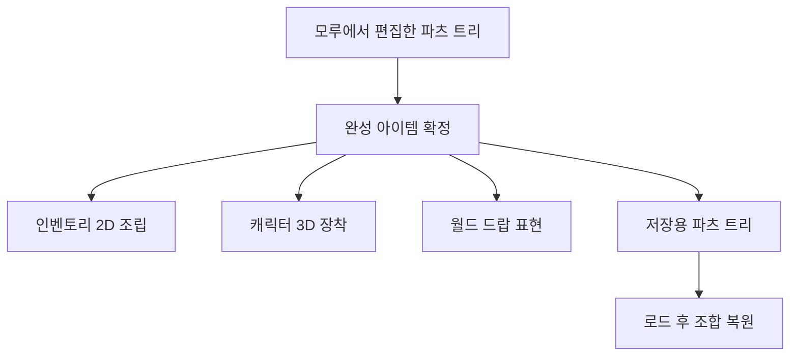

## 모루에서 파츠를 붙여 하나의 무기로 만든다

DCB의 조합 무기는 여러 파츠의 연결 관계를 가진 아이템이다. 모루 화면에서 조립할 대상을 고르고, 무기에 표시된 연결 지점을 선택해 맞는 파츠를 배치한다. 조합을 완성하면 무기 이름과 성능을 확인하고 인벤토리에 넣는다.

이 글은 **2026년 10월 18일의 모루 팝업·프리뷰·파츠 데이터·조립·저장 경로를 읽어 확인한 현재 기능 안내**다. 이번에 실제 조립 화면이나 저장 후 재실행을 재생한 것은 아니다.

## 조립 화면에서 하는 일

| 순서 | 현재 화면과 처리 |
| --- | --- |
| 대상 선택 | 목록에서 조립할 무기나 주 파츠를 고르고 조립 화면으로 들어감 |
| 연결 지점 선택 | 3D 무기 위의 마커를 고르면 해당 부분을 보기 좋게 확대하고 후보 목록을 표시 |
| 파츠 배치 | 연결 지점이 요구하는 분류·타입에 맞는 인벤토리 파츠를 선택 |
| 구성 확인 | 파츠의 배치와 무기 프리뷰를 다시 계산. 필요한 구성이 갖춰졌는지 확인 |
| 조합 | 파츠를 붙이는 연출 뒤 완성 무기와 성능 패널 표시 |
| 보관 | 결과를 확정해 완성 무기를 실제 플레이어 인벤토리에 반영 |

연결 지점마다 아무 아이템이나 넣을 수 있는 것은 아니다. 지점이 요구하는 파츠 분류와 타입으로 후보를 거른다. 같은 연결 지점을 중복 사용하지 않도록 조립 상태도 기록한다. 파츠가 아직 안착하는 연출 중이거나 조합 연출이 진행 중일 때는 다른 조합 입력이 겹치지 않도록 막는다.

화면에서 조립하는 동안은 편집용 구성을 보관한다. 원본 무기를 선택했다면 그 파츠 트리를 복사해 사용하며, 선택·교체·초기화 중의 데이터를 원본과 나눠 다룬다. 임시로 꺼내 쓴 인벤토리 항목도 별도로 추적해 되돌리는 경로가 있다.

## 3D 무기를 보면서 연결 위치를 고른다

조립 프리뷰는 실제 장착용 조립 리그를 별도 카메라로 그린다. 카메라의 RenderTexture를 UI에 보여 주고, 무기 연결 지점을 화면 좌표로 옮겨 마커를 놓는다. 파츠의 실제 위치와 방향은 모델의 피벗을 기준으로 맞춘다.

연결 지점을 선택하면 그 부분으로 화면을 당겨 후보를 고를 수 있게 한다. 파츠를 배치하면 낙하·안착 동작을 재생하고, 결합 시에는 벌어져 있던 파츠를 붙여 완성 형태를 보여 준다. 결과 확인 동안에는 완성 무기를 확대해서 유지한다.

불티와 연기는 이 조립 상태의 이벤트를 받아 발생한다. 파츠 안착에서는 주변 연기가 반응하고, 결합에서는 불티가 무기 쪽으로 날아가 축을 감싸는 경로를 사용한다. 이펙트의 실제 가독성과 동기 품질은 아직 최신 실행으로 확인하지 않았다. 표현의 상세 구성은 [장비 조합 UI 이펙트](/writing/modular-equipment-ui-vfx/)에서 설명한다.

## 조합 완료와 인벤토리 반영은 단계가 다르다

필요한 파츠가 갖춰져야 조합을 시작한다. 정상 화면 연결에서는 결합 연출을 마친 뒤 결과 패널을 띄우고, 사용자가 결과를 확정할 때 인벤토리 반영을 시도한다. 결과 패널이 연결되지 않은 경우에는 바로 확정하는 대체 경로도 있다.

완성 패널의 이름·등급·성능은 현재 조합 데이터에서 계산한다. 인벤토리 설명에서 무기 성능을 조회하는 경로와 연결돼 있으며, 선택한 파츠의 트리가 완성 아이템에 들어간다.

완성 무기를 넣을 칸은 아이템 데이터의 그리드 크기로 구한다. 인벤토리에 연속된 자리가 없어 넣지 못하면 공간 부족 안내를 표시하고 확정을 중단하는 경로가 있다. 이때 완성 무기가 없는 상태를 그대로 저장하고 임시 파츠 목록을 비우지 않도록 처리한다. 이 실패 경로가 있다는 사실과 모든 닫기·취소 조합에서 유실이 없다는 실행 결과는 구분한다.

## 인벤토리·장착·드랍이 같은 파츠 구성을 읽는다

구성의 원본은 `CombinedItemInfo`와 재귀적인 `PartsInfo` 트리다. 각 노드는 어떤 아이템 파츠인지와 그 아래 연결된 파츠 목록을 가진다. 인벤토리 이미지와 3D 장착·드랍은 같은 구성을 읽지만 각 표현에 맞는 조립기를 사용한다.

2D에서는 이미지 크기와 앞뒤 순서를 조정한다. 3D에서는 프리팹 모델의 스케일을 유지하면서 피벗의 위치·회전을 맞춘다. 따라서 같은 조합이 다른 화면으로 옮겨 갈 때에도 어떤 파츠를 썼는지는 공유하고 표현별 배치는 따로 계산한다.

저장에는 조합 식별 정보와 파츠 트리를 기록한다. 로드할 때 이를 읽어 조합 데이터를 복원하고 등급을 다시 계산한다. 프리뷰의 모델 오브젝트 자체를 저장하는 구조는 아니다.

## 현재 확인 범위

조립·결과 확정·공간 부족·복제·저장 경로를 소스에서 확인했다. 아직 최신 게임에서 파츠 선택부터 완성·장착·드랍·저장·재실행까지 한 조합을 끝까지 비교하지 않았다. 마우스·키보드·패드 조작, 접합부·크기·효과 복원과 실패 시 원본 보존은 실제 화면에서 확인할 항목이다.

조합 데이터와 조립·UI·저장 연결을 구성했고 코드와 도구 작성에는 AI 보조를 사용했다. 무기 모델 등 원본 자산은 재사용했다. 프리뷰가 사라진 원인, bounds·스케일과 풀 반환의 수정 과정은 [2D·3D 장비 파츠 조합 구현](/writing/modular-equipment/)에서 이어 설명한다.
