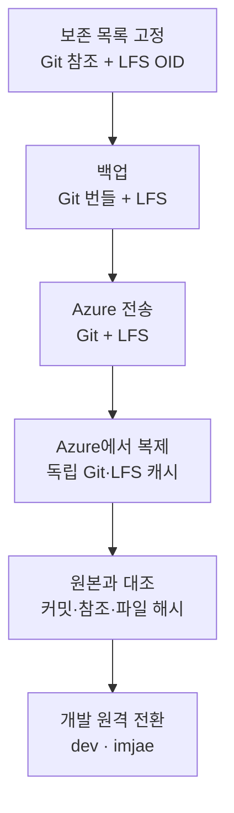

## LFS 한도에 걸린 저장소를 옮겼습니다

Unity 프로젝트 DCB를 개발하던 중 GitHub LFS 사용 한도로 변경 사항을 업로드할 수 없게 됐습니다. 저는 Azure Repos로 이전하되, **기존 커밋 이력과 에셋을 보존하고 `dev`와 `imjae` 브랜치에서 개발을 이어가는 것**을 조건으로 정했습니다. Git 저장소와 LFS 원본을 함께 비공개 Azure Repos로 옮겼습니다.

Azure 선택과 보존 조건은 제가 정했습니다. 저장소 조사, 백업·검증 스크립트 작성, 전송 실행과 작업 기록 정리에는 Codex를 사용했습니다. 이 글은 2026년 10월 24일 완료한 이전 과정을 바탕으로 작성했습니다.

이전 대상으로 선택한 근거 중 하나는 Git LFS 지원이었습니다. 2026년 10월 26일 확인한 Microsoft 문서는 Azure DevOps Services에서 Git LFS를 무료로 지원한다고 안내합니다. 일반 Git 푸시에는 한 번에 5GB 제한이 있지만, LFS로 전송하는 파일 본문은 그 계산에서 제외됩니다. 두 전송 경로의 제한을 구분해 이전 계획을 세웠습니다. [대용량 파일 관리](https://learn.microsoft.com/en-us/azure/devops/repos/git/manage-large-files?view=azure-devops), [Git 저장소 제한](https://learn.microsoft.com/en-us/azure/devops/repos/git/limits?view=azure-devops)

## 현재 파일과 과거 이력의 보존 범위를 나눴습니다

Git LFS를 쓰는 저장소에서 Git이 관리하는 것은 대용량 파일 자체가 아닌 **포인터 파일**입니다. 포인터에는 실제 파일을 식별하는 SHA-256 기반 OID와 파일 크기 등이 들어갑니다. 텍스처나 모델의 실제 바이트는 별도의 LFS 저장소에 있습니다.

따라서 Git 브랜치가 새 서버에 보인다고 에셋까지 옮겨진 것은 아닙니다. Azure의 저장소 가져오기 기능도 Git에 들어 있는 LFS 포인터는 가져오지만, LFS 파일 본문은 별도로 전송해야 합니다. [Azure 저장소 가져오기 안내](https://learn.microsoft.com/en-us/azure/devops/repos/git/import-git-repository?view=azure-devops)

이번 작업에서는 보존 대상을 세 부분으로 나눴습니다.

| 대상 | 보존할 내용 | 비교 기준 |
| --- | --- | --- |
| Git 이력과 참조 | 커밋·트리·일반 파일, 브랜치·태그가 가리키는 위치 | 커밋 SHA 집합과 참조별 객체 SHA |
| LFS 포인터 | 각 버전에서 필요한 파일의 OID와 크기 | 전체 보존 목록에 포함됐는지 |
| LFS 파일 본문 | 모델·텍스처 등 실제 파일의 바이트 | 다운로드한 파일의 SHA-256과 크기 |

현재 버전에서 사용하는 LFS 고유 객체는 약 **11.35GiB**였습니다. 그러나 이전 시점의 전체 로컬 참조를 조사하자 과거 버전을 포함해 **3,254개, 약 44.40GiB**가 필요했습니다. 최신 버전만 복사하면 과거 커밋으로 돌아갔을 때 필요한 에셋이 빠질 수 있었습니다.

이 용량은 로컬 참조와 포인터 목록에서 중복 OID를 제거해 집계한 값입니다. GitHub 청구 화면의 사용량과는 별개의 수치입니다. 보존 범위도 이전 시점에 확보한 참조와 그에 대응하는 객체 목록으로 고정했습니다.



## Git 번들과 LFS 원본을 함께 백업했습니다

전송 전에 브랜치·태그 등 참조 목록과 원격·추적 브랜치 설정을 기록했습니다. Git 객체는 전체 참조를 포함한 번들로 만들고, 별도 bare 저장소에 복원해 검사했습니다. bare 저장소에는 작업 파일을 체크아웃하지 않고 Git 객체와 참조만 둡니다.

아래는 백업 단계에서 사용한 명령 형태입니다. 파일명은 설명을 위해 바꿨습니다.

```powershell
git for-each-ref --format="%(refname) %(objectname)"
git bundle create ../repository-backup.bundle --all
git bundle verify ../repository-backup.bundle
```

`--all` 번들은 참조와 그 참조에서 도달할 수 있는 Git 이력을 담습니다. 작업 폴더의 미커밋 변경이나 저장소 설정까지 백업하는 명령은 아닙니다. LFS 본문 역시 Git 객체 밖에 있으므로 **번들 파일과 LFS 원본 디렉터리를 함께 보관**했습니다. [Git bundle 문서](https://git-scm.com/docs/git-bundle)

LFS 원본을 확보할 때는 현재 DCB 캐시에 없는 과거 객체 **1,461개, 약 32.56GiB**를 발견했습니다. 이 파일들은 이전 세대 프로젝트인 Deluge의 로컬 LFS 캐시에 남아 있었습니다. 해당 캐시는 읽기 전용 보조 원본으로 사용하고, 필요한 객체만 별도 백업에 복사했습니다.

복사 도구는 파일을 임시 경로에 쓰면서 SHA-256을 계산했습니다. 계산한 해시와 바이트 수가 포인터의 OID·크기에 모두 맞을 때만 완료 파일로 바꿨습니다. 파일 이름이나 존재 여부만 보고 원본을 확보했다고 판단하지 않도록 했습니다.

참조도 그대로 내보낼 수 있는 것과 별도 보관이 필요한 것을 나눴습니다. 기존 브랜치와 태그는 원래 SHA를 유지했습니다. 로컬 브랜치와 갈라진 원격 추적 브랜치의 끝 커밋은 보관용 브랜치로 남겼습니다. 도구가 만든 **커밋이 아닌 트리 객체 참조 11개**는 같은 객체 SHA를 가리키는 보관용 태그로 옮겼습니다.

그 결과 내보낼 참조는 브랜치 22개와 태그 15개가 됐습니다. 태그 15개 중 4개는 원래 태그이고, 나머지 11개는 트리 객체 보관용입니다. 원래 개발 브랜치에 합성 커밋을 끼워 넣거나 기존 커밋을 재작성하지 않았습니다.

## 전송 목록과 실제 업로드 대상을 대조했습니다

Azure에 비공개 저장소를 만든 뒤 Git과 LFS를 각각 전송했습니다. 브라우저의 Microsoft 계정 로그인과 Git HTTPS 인증은 별도였으므로 Git Credential Manager의 OAuth 로그인으로 전송 인증을 연결했습니다. 인증정보는 Credential Manager가 관리하고 저장소 URL이나 스크립트에는 넣지 않았습니다.

### `git lfs push --all`에서 빠진 객체를 보완했습니다

첫 `git lfs push --all` 실행이 선택한 객체는 **3,244개**였습니다. 백업 목록의 3,254개보다 10개 적었습니다. 이번 저장소에는 일반적인 커밋 이력 밖의 도구용 트리 스냅샷도 보존 대상으로 포함돼 있었기 때문입니다.

사용한 Git LFS 3.6.1의 문서에서 `--all`은 대상 참조로부터 도달할 수 있는 커밋이 참조하는 객체를 업로드하는 옵션입니다. 이번처럼 별도로 보존하는 스냅샷이 있으면, 사전에 만든 목록과 실제 전송 대상을 대조해야 했습니다. [Git LFS push 문서](https://github.com/git-lfs/git-lfs/blob/v3.6.1/docs/man/git-lfs-push.adoc)

검증한 전체 OID 목록을 명시적으로 전달하는 방식으로 바꿨습니다. 아래에서 `azure`는 이전 대상 원격의 이름이고, `lfs-oids.txt`는 OID를 한 줄에 하나씩 담은 목록입니다.

```powershell
Get-Content -LiteralPath ./lfs-oids.txt |
    git -C ./export.git lfs push --object-id azure --stdin
```

이후 완료 여부는 명령이 선택한 개수가 아니라 최초 보존 목록 전체를 기준으로 판단했습니다.

### 대용량 업로드에는 작업 저장소의 HTTP 설정을 바꿨습니다

기본 HTTP/2 전송에서 큰 파일의 진행이 멈추는 패턴이 나타났습니다. Git LFS 저장소의 [Azure 대용량 업로드 관련 논의](https://github.com/git-lfs/git-lfs/issues/4211)를 참고해 업로드용 저장소에만 HTTP/1.1을 적용했습니다.

```powershell
git -C ./export.git config --local http.version HTTP/1.1
```

먼저 가장 큰 약 3.49GB 객체 하나를 다시 보냈고, 해당 업로드가 끝난 뒤 같은 설정으로 나머지를 전송했습니다. 파일을 분할하거나 과거 이력의 LFS 포인터를 수정할 필요는 없었습니다. 이 설정은 당시 환경에서 전송을 완료하기 위해 적용한 것으로, HTTP/1.1이 항상 더 빠르다는 의미는 아닙니다.

업로드와 확인용 다운로드를 동시에 진행하는 동안에는 Git 설정 파일 잠금 충돌과 인증 갱신 문제도 발생했습니다. 업로드용 저장소와 다운로드용 저장소를 분리하고, 다운로드 도구의 자격 증명 도우미 호출을 직렬화해 같은 설정을 동시에 갱신하지 않도록 했습니다.

## 빈 캐시에서 다시 받아 파일 본문까지 확인했습니다

업로드 후 Azure가 전체 객체의 다운로드 주소와 예상 크기를 반환했습니다. 이 응답은 서버가 객체를 제공할 수 있다는 뜻이지만, 내려받은 파일 본문까지 원본과 같다는 증거는 아닙니다.

그래서 Azure HTTPS 주소에서 Git 저장소를 새로 복제하고, **로컬 원본과 공유하지 않는 빈 LFS 캐시**에 에셋을 내려받았습니다. 기존 DCB·Deluge 캐시나 백업 파일을 복사해 채우지 않았습니다. 모든 파일을 Azure에서 받아야 새 서버만으로 복구할 수 있는지 판단할 수 있었습니다.

대량 다운로드 도중 일부 큰 전송에 진행이 집중되는 구간이 있었습니다. 마지막에는 남은 OID를 LFS batch API로 조회하고, Python 보충 도구로 동시에 8개씩 받았습니다. 이미 받은 객체 중 해시 검증을 마친 파일은 유지하고 누락된 파일만 대상으로 삼았습니다.

다운로드 도구도 백업과 같은 완료 조건을 사용했습니다.

1. 응답 본문을 임시 파일에 기록하며 SHA-256을 계산합니다.
2. 파일 길이와 계산한 해시를 원본 목록의 크기·OID와 비교합니다.
3. 둘 다 일치할 때만 완료 파일로 원자적으로 바꿉니다.
4. 재실행에서는 완성·검증된 객체만 재사용합니다.

부분 파일의 이어받기도 시도했지만, 해당 서버 응답은 `206 Partial Content` 대신 `200 OK`였습니다. 이 요청을 이어받기 성공으로 계산하지 않았습니다. 중단된 임시 파일이 남아 있어도 전체 바이트를 받아 검증하기 전까지는 보존된 원본에 포함하지 않았습니다.

이렇게 확보한 **3,254개, 47,671,748,843바이트 전체의 SHA-256과 크기가 원본 목록과 일치**했습니다. 현재 `imjae` 버전을 체크아웃했을 때는 LFS 경로 1,757개가 실제 파일로 복원됐습니다. 고유 객체 수와 체크아웃 경로 수는 집계 대상이 다릅니다.

Git 이력은 커밋 개수만 세는 대신 **10,327개 커밋 SHA의 집합**을 비교했습니다. 개수가 같아도 서로 다른 커밋이 섞일 수 있기 때문입니다. 원본과 새 복제본의 집합이 같았고, 내보내기로 정한 브랜치·태그 37개의 객체 SHA도 일치했습니다.

## 검증 후 `dev`와 `imjae`의 원격을 연결했습니다

새 복제본에서 복구가 가능한 것을 확인한 뒤 실제 개발 폴더의 원격을 전환했습니다. 이전 GitHub 저장소는 그대로 남기고 이름을 `github`로 바꿨습니다. 새 `origin`은 Azure를 가리키며 기본 푸시 대상도 `origin`으로 지정했습니다.

| 설정 | 이전 후 연결 |
| --- | --- |
| `origin` | 비공개 Azure Repos 저장소 |
| `github` | 기존 GitHub 저장소 |
| 로컬 `imjae` | `origin/imjae` 추적 |
| 로컬 `dev` | `origin/dev` 추적 |
| Azure 기본 브랜치 | `imjae` |
| 기본 푸시 대상 | `origin` |

원본 이력의 일치 여부를 확인한 뒤 이전 문서와 도구를 새 커밋으로 추가하고, `dev`와 `imjae`를 그 커밋까지 fast-forward했습니다. 따라서 완료 시점의 커밋 수는 원본보다 하나 많아졌지만, 기존 커밋 SHA와 게임 에셋 트리는 유지됐습니다. 기존 GitHub 원격의 브랜치와 태그도 변경하지 않았습니다.

이번에 옮긴 범위는 Git으로 추적하던 코드·에셋·`.meta`와 과거 버전의 LFS 원본입니다. GitHub Issues·Pull Requests·Actions 실행 기록 같은 서비스 데이터는 포함하지 않았습니다. Git에서 제외한 Unity `Library`·`Temp`와 녹화 원본도 기존 로컬 위치에 남겼습니다.

작업이 끝난 뒤에는 Git 번들, 전체 LFS 백업과 Azure에서 받은 검증용 복제본을 보관했습니다. 약 44.4GiB는 LFS 원본 한 벌의 크기이므로, 백업과 독립 다운로드를 함께 유지하는 이전 작업에는 그보다 많은 디스크 공간이 필요했습니다. 개발 원격은 Azure로 전환했고, 기존 이력을 재작성하지 않은 상태로 두 개발 브랜치를 이어서 사용할 수 있게 됐습니다.
