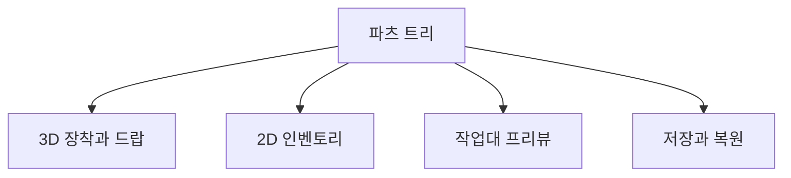

## 파츠 데이터

조합 무기의 상태를 `CombinedItemInfo`와 재귀적인 `PartsInfo` 트리로 관리한다. 각 파츠의 식별 정보와 자식 파츠 구성이 들어간다.

3D 드랍용 `ItemCombiner`, 장착용 `EquipItemCombiner`, 2D용 `ItemUICombiner`가 같은 조합 데이터를 읽는다. 작업대 프리뷰와 저장 데이터에도 이 구조를 사용한다.

## 조립 처리

세 조립기는 `CombinerBase`의 연결 탐색, 피벗 중복 사용 방지와 결합 후 중심 정렬을 공유한다. 피벗 조회, 좌표 정렬과 bounds 계산은 표현별로 구현했다.

| 표현 | 처리 내용 |
| --- | --- |
| 3D 장착 | 모델 스케일 유지, 연결 피벗 위치·회전 정렬 |
| 3D 드랍 | 파츠 렌더러 범위와 중심 계산 |
| 2D 인벤토리 | 이미지 순서, 링크 스케일과 슬롯 크기 조정 |
| 작업대 프리뷰 | 조립 리그, 카메라와 분해·결합 표현 |

현재 3D 장착 경로는 프리팹에 저작된 모델 스케일을 유지한다. 2D 이미지용 스케일 보정을 3D 모델에 그대로 적용하지 않는다.

## 프리뷰 bounds와 정리 처리

무기 중심 계산에 파티클·트레일의 오래된 월드 bounds가 들어가면 실제 파츠 위치가 밀릴 수 있다. 중심 정렬에서는 파티클·트레일·라인 렌더러를 제외했다.

프리뷰 리그를 얻은 직후 소유 참조를 기록한다. 이후 설정 중 예외가 발생해도 정리 경로에서 반환할 수 있게 했다.

## 복제와 저장

조합 데이터에는 복제 생성자와 재귀 저장·복원 경로가 있다. 편집 중 복사본이 원본 데이터를 바꾸지 않는지, 풀 재사용 후 이전 파츠가 남지 않는지 확인해야 한다.

최신 일반 시작 경로에서 조립·장착·드랍·저장 전체 과정을 재확인하는 작업은 남아 있다. 확인 순서는 2D 파츠 교체, 3D 프리뷰·장착, 드랍·회수, 저장 후 재실행이다.

이 글은 조합 무기 시스템 구현을 다룬다. 3D 모델 원본 제작은 포함하지 않는다.
