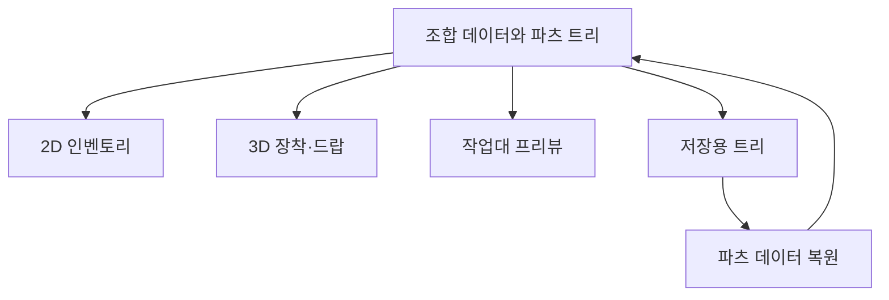

## 한 조합을 여러 화면과 오브젝트에서 사용하기

현재 모루에서 파츠를 선택하고 완성 무기를 보관하는 흐름은 [DCB의 장비 조합](/writing/dcb-equipment-overview/)에서 먼저 설명한다. 여기서는 조립 데이터와 프리뷰·저장 연결의 문제 해결 과정을 다룬다.

DCB의 조합 무기는 인벤토리의 2D 이미지, 캐릭터가 든 3D 모델, 월드에 떨어진 무기와 모루의 조립 프리뷰에서 같은 구성을 보여줘야 한다. 구성의 원본은 `CombinedItemInfo`와 재귀적인 `PartsInfo` 트리로 뒀다. 노드는 아이템 정보와 자식 파츠 목록을 가진다.

화면마다 조립 결과를 따로 저장하면 파츠를 교체할 때 서로 다른 결과가 남을 수 있다. 여기서는 파츠 구성을 데이터로 전달하고, 각 표현을 담당하는 조립기가 이를 읽는다. 같은 데이터를 사용하면서도 실제 오브젝트와 보정값은 표현별로 관리한다.

데이터와 표현의 관계를 간추린 구조도다. 이 글은 소스와 작업 이력을 대조한 설명이며, 조립부터 저장·재실행까지의 최신 플레이를 검증한 결과는 아니다. 확인한 중심 경로는 조합 무기다.

## 조립 순서를 공유하고 좌표 보정은 나누기

공통 부모인 `CombinerBase`는 파츠의 피벗을 순회하며 연결 가능한 상대를 찾는다. 피벗은 파츠끼리 맞붙일 위치와 방향을 나타내는 연결 지점이다. 사용한 피벗은 집합에 기록해 같은 연결 지점을 중복 사용하지 않는다. 결합 후에는 전체 렌더링 범위인 bounds를 구해 파츠 그룹의 중심을 정렬한다.

표현에 따라 달라지는 피벗 조회, 위치·회전 정렬과 bounds 계산은 하위 조립기가 담당한다.

| 표현 | 조립기와 처리 |
| --- | --- |
| 2D 인벤토리 | `ItemUICombiner`: 이미지 피벗, 연결 스케일, 앞뒤 순서와 슬롯 크기에 맞춘 배치 |
| 3D 장착 | `EquipItemCombiner`: 모델 피벗의 위치·회전 정렬, 프리팹 모델 스케일 유지 |
| 3D 드랍 | `ItemCombiner`: 월드 파츠 조립, 표시 범위와 중심 계산 |
| 작업대 프리뷰 | `ForgeWeaponPreview`: 장착용 조립 리그를 별도 카메라와 RenderTexture로 표시 |

모루에서 `ShowWeapon`을 호출하면 조합용 장착 리그를 풀에서 얻는다. `EquipWeapon.SetupPartsInfo`로 데이터를 넘기고, 장착 경로에서 파츠 생성과 결합을 진행한다. 일반 드랍도 `ItemManager`에서 조합 드랍용 무기를 얻어 파츠 데이터를 전달하는 경로가 있다.

### 2D와 3D의 스케일 규칙 분리

수정 이력에는 3D 장착 조립의 연결 스케일 보정을 제거한 변경이 있다. 현재 3D 경로는 프리팹에 저작한 모델 스케일을 기준으로 피벗을 맞춘다. 2D 경로에는 `PartsLinkScaleDatabase`를 이용한 이미지 크기 보정이 남아 있다.

이미지를 슬롯 안에 읽기 좋게 배치하는 목적과, 캐릭터가 드는 모델의 치수를 유지하는 목적을 각각 처리한다. 파츠 트리를 공유해도 두 표현의 배율까지 같게 만들 필요는 없다. 같은 파츠의 2D 비율과 3D 접합부가 현재 자산에서 맞는지는 화면 비교로 확인해야 한다.

## 모루 프리뷰에서 무기가 사라진 문제

수정 기록에는 칼날 파츠를 붙이면 프리뷰에서 무기가 사라지는 문제가 있다. 원인을 추적한 기록은 이펙트의 렌더링 상태와 bounds 계산으로 나뉜다.

### 프리뷰에서 끈 이펙트를 풀 반환 전에 복원하기

작업 기록에서는 날에 붙은 스윙 트레일의 굴절 표현이 프리뷰 카메라·검은 배경·어두운 색을 투명하게 만드는 루마 키 처리와 충돌한 경로를 다뤘다. 당시 사용자가 트레일을 수동으로 껐을 때 무기가 보이는 것을 확인했고, 이를 프리뷰 코드로 옮겼다.

현재 `SuppressWeaponEffects`는 리그 안의 해당 VFX와 무기 트레일 오브젝트를 모아 프리뷰 동안 비활성화한다. 원래 활성 상태였던 오브젝트만 목록에 넣는다. `HideWeapon`은 목록에 있는 것만 다시 켠 뒤 레이어를 복원하고 리그를 반납한다. 원래 꺼져 있던 효과를 복원하면서 새로 켜는 일을 피하기 위한 구분이다.

이 순서가 필요한 이유는 프리뷰와 실제 장착이 풀의 리그를 공유하기 때문이다. 끈 상태로 반납하면 이후 게임에서 꺼낸 무기의 트레일까지 꺼져 있을 수 있다. 팝업의 조립 정리 경로도 `HideWeapon`을 호출한다.

### 이펙트를 꺼도 남는 bounds 제외하기

이펙트를 끄는 것만으로 bounds 계산 문제가 끝나지는 않았다. 비활성 자식까지 포함한 렌더러 조회에는 해당 렌더러가 계속 잡힐 수 있다. 월드 공간에서 움직이던 파티클·리본의 bounds가 이전 위치에 남으면, 프리뷰로 옮긴 무기의 실제 범위와 크게 벌어진다.

그 둘을 함께 감싸는 bounds를 사용하면 두 경로가 영향을 받는다.

| 계산 | 작업 기록에서 추적한 영향 |
| --- | --- |
| 프리뷰 카메라의 프레이밍 | 지나치게 큰 물체로 판단해 카메라가 멀어지고, 무기가 화면에서 매우 작아짐 |
| 조립 그룹의 중심 정렬 | 실제 파츠와 오래된 VFX 위치 사이의 중점을 기준으로 무기 그룹이 밀려남 |

이어서 프리뷰의 `IsFramingGeometry`와 공통 조립기의 `IsCenteringGeometry` 필터를 추가했다. 현재 두 필터는 꺼졌거나 비활성인 렌더러와 `ParticleSystemRenderer`, `TrailRenderer`, `LineRenderer`를 제외한다.

프리뷰의 카메라 범위, 파츠 중심과 축 방향 폭도 공통 bounds 조회를 거치게 했다. 한 계산에서는 이펙트를 빼고 다른 계산에는 넣으면 카메라와 조립 위치가 다시 어긋날 수 있기 때문이다. 이 처리는 렌더러의 종류와 활성 상태를 기준으로 하며, 모든 커스텀 VFX 메시를 자동으로 식별하는 규칙은 아니다.

## 표시 중 예외가 나도 리그를 추적하기

리그를 풀에서 얻은 뒤 파츠 설정과 장착이 진행된다. 그 과정에서 예외가 났는데 참조를 마지막에 저장하도록 두면, 프리뷰 아래에 붙인 리그를 다음 정리에서 찾지 못할 수 있다.

현재 `ShowWeapon`은 리그를 얻자마자 `currentRig`에 저장한다. 뒤의 파츠 설정이나 장착이 실패해도 다음 `HideWeapon`에서 추적할 수 있도록 한 것이다. `HideWeapon`은 표시 상태와 효과·레이어를 정리하고 `Unequip`을 호출한다. 추적되지 않은 잔여 리그를 제거하는 별도 경로도 있다.

여기서 확인한 것은 소유 참조를 먼저 잡는 순서와 정리 코드다. 예외가 나는 즉시 모든 자원이 자동 반환된다거나, 반복해서 열고 닫아도 누수가 없다는 실행 결과로 설명하지는 않는다.

## 편집용 복사본과 저장용 트리

모루 팝업은 기존 조합을 `Clone()`한 뒤 편집용으로 보관한다. `PartsInfo`의 복제 생성자는 각 노드의 아이템 정보와 자식 목록을 새로 만든다. 프리뷰에서 파츠를 결합·제거하는 중 원본 조합과 수정 객체를 분리하려는 경로다. 장착 리그에 데이터를 넘기는 `SetupPartsInfo`도 복사본을 만든다.

저장에는 `PartsItemSaveInfo`를 사용한다. 조합의 식별 정보와 루트 파츠를 저장하고, 각 파츠의 아이템 정보와 자식 목록을 재귀적으로 기록한다. 인벤토리 저장 항목에 이 데이터가 들어가고, UI 데이터 복원 시 다시 `CombinedItemInfo`를 만든다. 복원 생성자는 파츠 트리를 읽은 뒤 조합 등급을 다시 계산한다.

각 조립기의 해제 경로도 따로 확인했다. 장착 무기는 파츠를 해제한 뒤 조합 리그를 반환한다. 드랍용 조립기는 하위 파츠를 순회하며 집합에 반환 대상을 기록해 중복 반환을 피하도록 구성했다. 저장용 데이터와 풀에서 재사용할 시각 오브젝트의 수명을 나눠 다뤄야 한다.

복제·직렬화·반환 경로가 있다는 사실만으로 전체 왕복이 검증되지는 않는다. 편집 전 원본, 조립 후 2D·3D, 저장 후 복원한 파츠 트리와 등급·스탯을 같은 조합으로 대조해야 한다.

## 확인한 기록과 실행 검증이 남은 부분

| 근거 | 이번에 확인한 범위 |
| --- | --- |
| 현재 소스 | 모루의 복사본 생성과 프리뷰 호출, 공통·표현별 조립, bounds 필터, 효과 복원과 풀 반납, 저장·복원 경로 |
| 트레일 복원 수정 기록 | 트레일 수동 비활성화 시 표시 확인과 자동화 수정의 헤드리스 임포트 기록. 자동화한 동작의 실제 플레이 재확인은 남겨 둠 |
| bounds 필터 수정 이력 | 프리뷰와 조립 중심의 bounds 필터 추가를 현재 코드와 대조 |
| 스케일 보정 수정 이력 | 3D 연결 스케일 보정 제거와 현재 2D·3D 처리 차이를 대조 |
| 기존 검사 코드 | `MonsterEquipCombinedWeaponTests`의 파츠 리소스 등록·피벗·두 파츠 결합 확인 항목을 읽음 |

**이번에는 Unity 컴파일, EditMode 검사, 프리뷰 렌더와 실제 게임 플레이를 실행하지 않았다.** 앞선 선택 검사에도 위 장비 검사는 포함되지 않았다. 검사 코드가 있다는 사실이나 다른 기능의 통과 수를 장비 조립 전체의 검증 결과로 사용하지 않는다.

다음 실행은 한 조합을 끝까지 따라가는 방식으로 확인한다.

1. 기존 조합을 모루에 열고 파츠를 바꾼다. 편집 중 원본 데이터가 유지되는지 확인한다.
2. 2D 이미지와 3D 프리뷰에서 같은 파츠가 사용되고 접합부·스케일이 맞는지 비교한다. 날을 마지막에 붙이는 경우도 포함한다.
3. 프리뷰를 닫고 실제 장착·공격을 재생해 레이어와 트레일이 복원됐는지 확인한다. 반복 열기·닫기와 실패 경로에서는 잔여 리그를 확인한다.
4. 무기를 드랍·회수하고 저장 후 다시 실행한다. 파츠 트리와 등급·스탯, 이전 파츠 잔존 여부를 대조한다.

실제 조립 화면과 비교 영상은 아직 첨부하지 않았다.

## 담당 범위

조합 데이터, 공통·표현별 조립과 프리뷰·저장 연결의 프로그래밍을 담당했다. DCB 개발에서 코드 후보와 검증 도구 작성에 AI를 사용했다. 3D 모델 원본은 기존 자산을 사용했다.

전투의 상태와 자원 관리 사례는 [몬스터 행동 DSL·그룹 제어 분석](/writing/monster-combat-analysis/)에서, 확인한 결과를 나누는 기준은 [AI를 사용한 구현과 검증 과정](/writing/working-with-ai/)에서 다뤘다.
