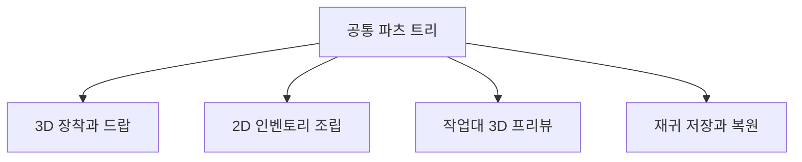

## 조합 결과는 하나여야 한다

파츠를 바꾸면 2D 인벤토리 이미지와 3D 장착 모습이 함께 바뀌어야 합니다. 드랍하거나 저장했다 다시 불러와도 같은 조합이어야 합니다. 그래서 조합 무기의 상태를 표현 오브젝트에서 분리하고, 재귀적인 파츠 트리를 공통 데이터로 사용했습니다.

## 데이터와 조립기의 관계

`CombinedItemInfo`와 `PartsInfo`는 파츠 식별 정보와 자식 조합을 담습니다. 이를 드랍용 `ItemCombiner`, 장착용 `EquipItemCombiner`, 2D용 `ItemUICombiner`가 읽습니다.

세 조립기는 `CombinerBase`의 연결 탐색, 피벗 중복 사용 방지, 결합 후 중심 정렬 흐름을 공유합니다. 실제 피벗을 얻고 좌표를 맞추는 방법과 bounds 계산은 표현별로 나눕니다.

## 공통 알고리즘과 서로 다른 보정

| 표현 | 맞추는 기준 |
| --- | --- |
| 3D 장착 | 모델의 원래 스케일, 연결 피벗 위치와 회전 |
| 3D 드랍 | 조립된 파츠의 실제 렌더러 범위와 중심 |
| 2D 인벤토리 | 파츠 이미지 순서, 링크 스케일, 보이는 범위와 슬롯 크기 |
| 작업대 프리뷰 | 조립 리그, 카메라 프레이밍, 분해·결합 표현 |

같은 데이터를 사용한다는 이유로 2D의 스케일 보정까지 3D에 적용할 필요는 없습니다. 현재 3D 장착 경로는 프리팹에 저작된 모델 스케일을 유지합니다.

## 프리뷰에서 드러난 경계

무기 중심 정렬에 파티클·트레일의 오래된 월드 bounds를 포함하면 실제 파츠가 멀리 밀릴 수 있습니다. 현재 공통 조립기는 파티클·트레일·라인 렌더러를 중심 계산에서 제외합니다. 무기의 실루엣과 장식 효과의 공간 범위를 분리한 판단입니다.

프리뷰 리그를 얻은 직후 소유 참조를 기록하는 것도 같은 맥락입니다. 이후 설정 중 예외가 발생해도 정리 경로에서 리그를 반환할 수 있어야 반복 조립에서 중복과 잔존을 막을 수 있습니다.

## 저장과 재사용에서 확인할 것

조합 데이터에는 복제 생성자와 재귀 저장·재구성 경로가 있습니다. 편집 중 복사본이 원본을 바꾸지 않는지, 풀 재사용 후 이전 파츠가 남지 않는지, 저장 전후 파츠·등급·능력치가 같은지를 확인합니다.

다음 재생 확인은 **2D 파츠 교체 → 3D 프리뷰·장착 → 드랍·회수 → 저장·복원**의 왕복을 기준으로 진행합니다. 이 기록은 조합 무기의 구현 범위를 다루며 3D 모델 원본 제작은 포함하지 않습니다.
