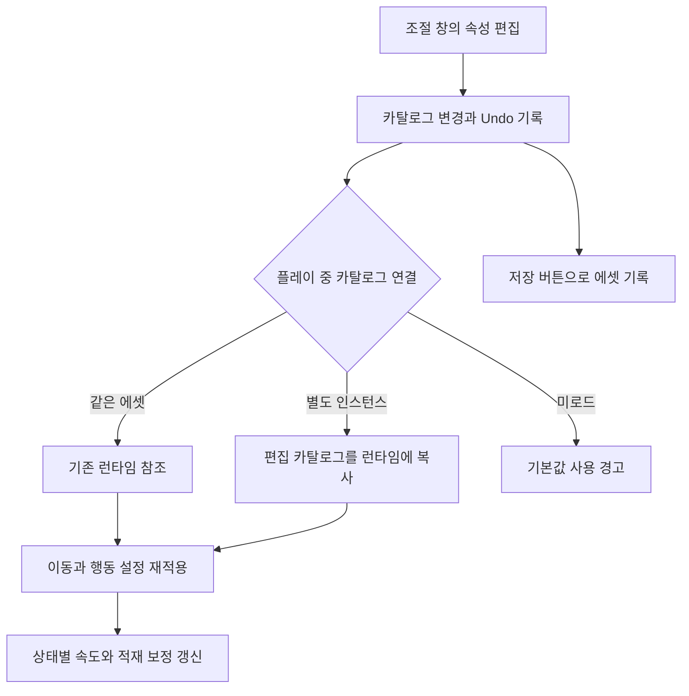

## 값을 고친 자리에서 결과까지 확인하는 조절 창

DCB에는 맨몸·지게 상태별 이동과 스태미너, 짐 적재율에 따른 배율, 배고픔·갈증의 단계별 효과가 있습니다. 이 값을 조정하려면 서로 연결된 결과를 함께 봐야 합니다. 달리기 소모를 낮추면 달릴 수 있는 시간이 늘고, 회복 배율을 바꾸면 다음 이동을 준비하는 시간도 달라집니다.

이를 위해 Unity에 **플레이어 밸런스 조절 창**을 만들었습니다. 맨몸과 지게 값을 나란히 편집하고, 적재 곡선과 계산 표를 확인한 뒤 플레이 중 수치와 비교하는 흐름입니다. 고갈이나 갈증 2단계를 시험하려고 자원이 자연히 줄어들 때까지 기다리는 대신, 버튼으로 해당 조건에 바로 들어갈 수 있게 했습니다.

에디터 메뉴의 `Deluge/Balance/플레이어 밸런스 조절`에서 여는 `JigeCarryBurdenTunerWindow`입니다. 클래스 이름에는 지게가 남아 있지만 현재 화면은 이동·스태미너·체력·배고픔·갈증을 함께 다룹니다.

## 원본 값과 임시 시험값의 책임을 나눕니다

조절 값은 원본과 사용 목적에 따라 세 종류로 나눴습니다.

| 조절 대상 | 도구에서 하는 일 | 확정하는 위치 |
| --- | --- | --- |
| 이동·행동 비용·적재 곡선·배고픔/갈증 규칙 | `GameBalanceCatalog`의 속성 편집 | 카탈로그 에셋 저장 |
| 지금 체력·스태미너·배고픔·갈증·적재량 | 재현할 현재 상태를 바로 설정 | 런타임 상태. 기본 밸런스 원본으로 자동 저장하지 않음 |
| 시트가 소유한 기본 체력·스태미너·회복 시간·최대 자원 | 현재 플레이에서 시험하고 비교 | 복사한 값을 원본 시트에 직접 반영한 뒤 다시 로드 |

배고픔·갈증의 감소량과 문턱은 원래 플레이어 프리팹 컴포넌트에 있었습니다. 작업 기록에서 Play 중 고친 값이 종료 뒤 사라지는 문제를 확인했고, 해당 규칙을 카탈로그로 옮겼습니다. 반면 최대 자원 등의 시트 원본은 그대로 두고 시험 경로를 제공했습니다.

이 구분 덕분에 저장할 규칙을 편집하는 중인지, 현재 자원을 바꿔 특정 상황을 재현하는 중인지 알 수 있습니다. 원본 시트로 값을 보내는 일까지 자동화한 도구는 아닙니다.

## 비교하는 단위로 여섯 영역을 구성합니다

| 영역 | 편집·확인하는 내용 | 조정할 때 도움 되는 점 |
| --- | --- | --- |
| 이동 속도 | 걷기·달리기·질주, 달리기→걷기와 걷기→정지의 감속 시간 | 맨몸·지게를 나란히 보고 속도 비율 확인 |
| 스태미너 | 걸음별 초당 소모, 행동 비용·회복 배율, 공통 행동 비용 | 지속 이동의 소모와 한 번의 행동 비용 구분 |
| 적재 무게 | 속도·소모·회복 곡선, 예시 적재율과 프리셋 | 무게별 효과를 그래프와 배율로 함께 확인 |
| 배고픔·갈증 | 감소량, 단계 문턱, 패널티와 자원 0일 때 피해 | 조건과 결과를 배고픔·갈증 두 열로 비교 |
| 시뮬레이션 | 예상 이동 지속 시간·거리·회복 시간, 단계 도달 시간 | 실행 전에 현재 설정의 관계를 계산으로 확인 |
| 플레이 중 실측 | 현재 상태·자원·속도·소모·변화량과 즉시 조절 | 예상과 실제 상태를 같은 창에서 대조 |

단위와 조건도 표시합니다. 이동 속도는 m/s, 지속 소모는 초당, 배고픔·갈증 감소는 10초당입니다. 단계 문턱은 최대치 대비 비율이 아니라 현재 자원 수치 기준입니다. 예를 들어 최대 갈증을 바꾸더라도 문턱 25가 자동으로 최대치의 25%가 되는 것은 아닙니다.

현재 지게 질주는 꺼져 있지만 속도 칸은 별도 공격 문턱에도 사용됩니다. 따라서 칸이 존재한다는 이유로 그 이동 상태를 플레이어가 선택할 수 있다고 설명하지 않고, 해당 조건을 툴팁으로 함께 적었습니다.

## 곡선 하나의 효과를 배율과 결과 표로 확인합니다

적재 곡선은 속도·소모·회복을 각각 편집합니다. 같은 그래프에 색을 나누어 그리고 예시 적재율의 세 배율을 함께 표시합니다. 표는 적재율 0·25·50·75·100·150·200%를 비교합니다.

프리셋은 무효과·완만·기본값·혹독으로 구성했습니다. 예를 들어 완만 프리셋의 100% 적재 지점은 속도 0.92배, 소모 1.25배, 회복 0.9배입니다. 버튼을 누르면 세 곡선의 속성값을 함께 바꿉니다.

**프리셋과 현재 카탈로그의 값은 다릅니다.** 현재 적재 속도·소모·회복 곡선은 모두 1배이며, 프리셋을 적용하면 해당 곡선을 바꿀 수 있습니다.

`지게 부담 끄기` 버튼도 범위가 정해져 있습니다. 지게 스태미너 모드를 맨몸 값으로 맞추고 적재 곡선을 무효과로 바꿉니다. 이동 속도 영역의 맨몸·지게 기준 속도까지 모두 같은 값으로 만드는 버튼은 아닙니다.

## 계산 표는 플레이 결과의 대체물이 아닙니다

지속 소모량이 일정하다고 가정하면 예상 시간과 거리는 다음처럼 계산합니다.

$$
t_\text{drain}=\frac{S_\text{max}}{c},\qquad
d_\text{estimate}=v\,t_\text{drain}
$$

가상의 최대 스태미너 120, 초당 소모 10, 속도 4m/s라면 예상 시간은 12초, 거리는 48m입니다. 이 숫자는 식을 설명하는 독립 예시이며 DCB의 현재 설정이나 실제 이동 측정값이 아닙니다. 소모가 0에 가까우면 이 표는 무한대로 표시합니다.

회복 시간은 회복 지연에 `기본 회복 시간 ÷ 회복 배율`을 더합니다. 소모가 있는 걸음은 회복하지 않는다고 표시합니다. 배고픔·갈증 표는 지정 최대치에서 1단계·2단계·0까지 걸리는 시간과 자원 0 이후 체력 감소 시간을 계산합니다.

이 표는 인벤토리 무게·갈증·물속 감속, 배고픔·갈증의 회복 패널티 등을 제외합니다. 환경과 상태 이상으로 더해지는 감소도 별도입니다. 따라서 표의 거리는 충돌·경사·공격 중단을 포함해 실제로 달린 거리가 아닙니다. 기본 설정의 관계를 먼저 보고 실제 상태에서 차이를 확인하는 용도입니다.

현재 배고픔·갈증이 적용하는 문턱과 회복 시간·운반 한도·이동·체력의 실제 보정 경로는 [행동 비용과 회복 분석](/writing/action-stamina-cost-and-recovery/)에 추가했습니다. 도구의 단순 예상 표와 두 자원의 회복 패널티까지 반영한 계산을 구분해 볼 수 있습니다.

## 편집한 값이 플레이어에 도달하는 경로

창은 `SerializedObject.Update()`로 값을 읽고, `SerializedProperty`를 편집한 뒤 `ApplyModifiedProperties()`로 반영합니다. 변경이 적용되면 런타임 전달 경로를 호출합니다. 속성 반영과 Undo 기록은 [Unity의 ApplyModifiedProperties 문서](https://docs.unity3d.com/6000.3/Documentation/ScriptReference/SerializedObject.ApplyModifiedProperties.html)에서 설명합니다.

런타임이 같은 에셋을 참조하면 그 값을 사용합니다. 다른 카탈로그 인스턴스를 사용하면 에디터 JSON 직렬화로 편집값을 덮어씁니다. 이후 `ReapplyBalanceCatalog()`가 이동 컨트롤러·행동 설정·현재 이동 상태의 속도와 적재 보정을 다시 적용합니다. 배고픔·갈증 시스템은 각 고정 스텝에서 카탈로그를 읽으며, 이미 같은 단계에 있더라도 적용했던 패널티 값과 비교해 달라진 배율을 다시 겁니다.

카탈로그를 로드하지 않은 씬은 코드 기본값으로 움직이므로 창의 편집이 플레이에 반영되지 않는다고 경고합니다. 에디터에서 값을 바꾼 사실과 실제 실행이 읽는 원본을 구분하기 위한 표시다.

## 플레이 중에는 재현 조건과 관찰값을 함께 둡니다

실측 영역은 현재 이동 상태와 지게 착용·적재량, 상태 속도와 `MeasuredGroundSpeed`, 이동 소모·회복·행동 비용 배율을 표시합니다. 체력·스태미너·배고픔·갈증은 현재값과 최대값을 막대로 보여 줍니다. 체력의 마지막 감소 원인·양·지난 시간도 확인하는 경로가 있습니다.

속도 계측은 이동한 양에서 다리 같은 표면에 실려 간 몫을 빼고 지면 방향에 투영해 평활합니다. 자원 변화량 역시 표본 사이의 차분에 평활을 적용한 표시다. 프레임별 원시 계측 로그나 정밀한 성능 측정기로 소개하지 않습니다.

재현 버튼은 적재율 0·50·100·150%, 스태미너 가득·절반·바닥, 배고픔·갈증 가득·1단계·2단계·0 등을 제공합니다. 현재값을 바로 맞춘 뒤 입력과 행동을 반복할 수 있는 구성입니다. 시뮬레이션 입력을 현재 플레이어의 최대 자원·회복 시간·용량·적재율에서 가져오는 버튼도 둡니다.

## 시트 값을 시험하되 원본 저장은 분리합니다

최대 체력·스태미너는 시트 바닥값에 능력치 보너스가 더해집니다. 조절 창은 현재 최대치를 그대로 덮는 대신 바닥값 `B0`를 바꾸고 능력치 계산을 다시 실행합니다. 최대 자원을 낮추면 현재 자원도 그 범위로 제한하고, 올렸다고 현재 자원을 자동으로 가득 채우지는 않습니다.

시트 시험 영역에는 현재값·비교 시작값·계산 결과를 나란히 둡니다. `Play 시작값으로` 버튼은 저장해 둔 비교값을 다시 적용합니다. 다만 이 비교값은 창이 해당 플레이어의 시트 값을 처음 읽을 때 잡습니다. Play 첫 프레임을 항상 보관하는 별도 기록 기능으로 설명하지 않습니다.

마음에 드는 값은 `시트에 붙일 값 복사`로 `hp`, `stamina`, `staminaRegen`, `thirst`, `hunger` 다섯 값을 탭으로 이어 클립보드에 넣습니다. 원본 시트 반영과 재다운로드는 별도로 진행합니다. 이 버튼이 외부 시트에 직접 쓰거나 배포 데이터를 자동 확정하지는 않습니다.

## 저장·되돌리기와 입력 검증의 경계

카탈로그를 편집하면 Play 중에도 에셋 값이 함께 바뀔 수 있습니다. 창은 이를 안내하고, 변경된 에셋에 `저장 *`을 표시해 `SaveAssetIfDirty()`로 기록합니다. Undo/Redo 후에는 런타임에도 다시 반영합니다. 저장 API의 동작은 [Unity 문서](https://docs.unity3d.com/6000.3/Documentation/ScriptReference/AssetDatabase.SaveAssetIfDirty.html)를 참고했습니다.

값 편집에는 하한을 두고, 속도 순서·단계 문턱·패널티 범위 등은 카탈로그의 검증 오류로 보여 줍니다. 로딩 시 `PresetManager`는 잘못된 카탈로그를 거절합니다. 기존 카탈로그를 만들기/검증 메뉴로 열 때 이미 조정한 값을 기본값으로 덮지 않는 경로도 확인했습니다.

다만 **창의 검증 메시지가 모든 잘못된 편집을 적용 전에 차단하는 것은 아닙니다.** `ApplyModifiedProperties()` 뒤의 런타임 전달 앞에는 오류 목록으로 중단하는 조건이 없습니다. 잘못된 관계를 편집한 상태의 적용·복구는 별도 재현이 필요합니다. 실험용 카탈로그 자동 복제, 변경 전후 실험 이력 저장과 모든 런타임 시험값의 Undo까지 구현됐다고 확대하지 않습니다.

## 작업 기록과 기여

| 순서 | 도구에서 확인한 변경 |
| --- | --- |
| 1 | 맨몸·지게 비교, 적재 곡선·프리셋, 결과 계산 표와 플레이 중 패널 추가 |
| 2 | 비교 표의 머리글을 열 중심에 맞추는 화면 정리 |
| 3 | 배고픔·갈증 규칙 중앙화, 자원·시트 값의 플레이 중 시험과 복사 확장 |

담당한 부분은 조정 대상을 비교 단위로 모으고, 편집값을 런타임에 전달하며, 계산 예상과 현재 상태를 함께 확인할 수 있게 연결한 도구입니다. 코드와 검사 작성에는 AI 보조를 사용했으며 관련 작업에 공동 작성 기록이 있습니다.

도구가 제공하는 편의는 값을 찾는 위치를 모으고, 같은 조건의 비교와 자원 단계 재현을 바로 할 수 있는 데 있습니다.

## 관련 글

실제 속도·비용 계산은 [지게 운반 규칙 분석](/writing/jige-carry-burden/), 후속 제어 요소는 [게임플레이 밸런싱과 제어](/projects/dcb/features/gameplay-balancing/)에서 볼 수 있습니다.
